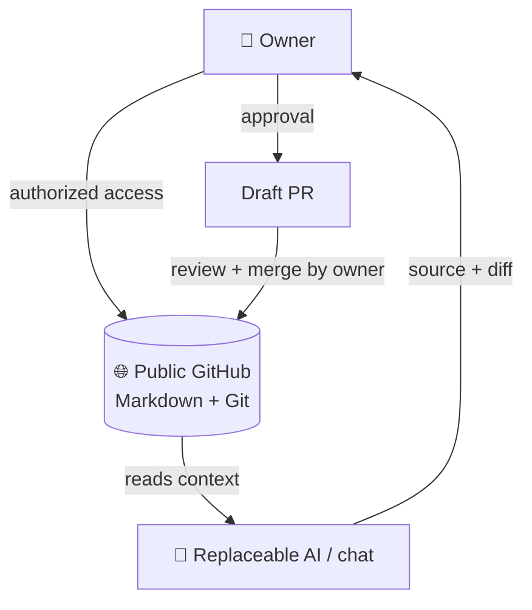

<p align="center">
  🇬🇧 <a href="README.md"></a>
  &nbsp;·&nbsp;
  🇷🇺 <a href="README.ru.md"></a>
</p>

<p align="center"><sub>🌐 Language: <b>🇬🇧 English</b> · <a href="README.ru.md">🇷🇺 Русский</a> · <a href="DOCS_LANGUAGES.md">document languages</a></sub></p>

# 🧠 VELANTRIM MEMORY

> 🧠 **One memory, many assistants: preserve the working point, decisions and sources between chats.**
>
> **Why:** A new assistant can lose why a decision was made or confuse an unanswered question with an approved action. This repository supplies human-readable, versioned orientation with references back to sources.
>
> **Example:** Open `CURRENT.md`, follow a project card and verify the original record before continuing work; do not treat summaries as authority to act.
>
> **Scope:** Portable Markdown/Git memory, not a self-running AI or automatically validated truth store.

> **One Memory. Many Agents.**
>
> Independent, portable memory that preserves the working point, decisions, open questions, change history, and sources across different AIs and chats.

[Start reading](#-in-60-seconds) · [Quick Start](#-quick-start) · [Structure](#-memory-structure) · [Status](#-current-status) · [Documents](#-documents)

---

## 👋 In 60 Seconds

Velantrim Memory is a public GitHub repository of Markdown files with a change history. It holds a compact working orientation, not the entire correspondence or the source materials.

Memory is separated from the model and the chat: models and apps can be swapped while the owner keeps the shared context in one place. Every new agent is just a replaceable reader and helper; the repository is public, so reading needs no separate access, while writing (via PR) requires the client's own authorized connection and the owner's approval.

> **Memory helps restore context, but it is not a source of authority.** Written text does not override the owner's current request, safety rules, or verification against primary sources.

### 🧭 Where to Start

[`WORKBOARD.md`](WORKBOARD.md) contains the owner's long-term goals and open questions; [`CURRENT.md`](CURRENT.md) holds the latest working point. The history of the thinking, Karif's words, and corrections are in the [discussion record of 2026-10-16](projects/karif-dialogue-and-personal-orientation-2026-10-16.md). The single procedure for reading and keeping direction is in [`START_HERE.md`](START_HERE.md).

Project directory: [`projects/README.md`](projects/README.md) — what each project is for, with links to its source documentation (in Russian).

| Who you are | Start here |
|---|---|
| 👤 Human | [`WORKBOARD.md`](WORKBOARD.md) — goals and direction; [`CURRENT.md`](CURRENT.md) — working points; then the project card. |
| 🤖 New AI or agent | [`START_HERE.md`](START_HERE.md) — reading order, fact checking, and write boundaries. |
| 🔍 Reviewer | Check dates and claims against [`CURRENT.md`](CURRENT.md), the project card, and the cited primary sources. |

---

## 🗺️ Architecture



Switching models does not carry access over automatically: each client must have its own authorized connection. After approval and merge, the content is re-read from `main`; only a read-back confirms that a specific change was actually saved there.

---

## ⚡ Quick Start

In a new chat, open the repository (it is public; to write via PR, connect GitHub with authorized access) and send the agent this request:

```text
Open velantrian/Velantrim-Memory-Ruslan through my GitHub connector.
Use the current START_HERE.md for reading and working rules.
Help me continue my current request based on the materials relevant to it.
```

### Grok and Voice Mode

For a new chat with Grok you can use this request:

```text
Open the public repository `velantrian/Velantrim-Memory-Ruslan` through the GitHub access authorized for this client. If there is no access, say so and do not guess the content.
Use the current `START_HERE.md` for reading and working rules.
For discussing mind research, refer to `Рабочая Доска Иследования Разума 🧠.md` and the notes in `projects/` relevant to my question.
```

Workboard: [open file](%D0%A0%D0%B0%D0%B1%D0%BE%D1%87%D0%B0%D1%8F%20%D0%94%D0%BE%D1%81%D0%BA%D0%B0%20%D0%98%D1%81%D0%BB%D0%B5%D0%B4%D0%BE%D0%B2%D0%B0%D0%BD%D0%B8%D1%8F%20%D0%A0%D0%B0%D0%B7%D1%83%D0%BC%D0%B0%20%F0%9F%A7%A0.md). The repository is public, but to write (draft PR) Grok will need its own authorized access; this instruction does not grant access.

If a client cannot see the repository, that does not prove the memory is missing: check whether access is authorized for that specific GitHub connection. Do not ask the model to reconstruct unavailable documents from their titles or old retellings.

---

## 📁 Memory Structure

Below is a condensed map of the main entry points; for the full set of files, see the current repository tree.

```text
Velantrim-Memory-Ruslan/
├── README.md
├── README.ru.md
├── DOCS_LANGUAGES.md
├── START_HERE.md
├── CURRENT.md
├── WORKBOARD.md
├── Velantrim_cognitive_architecture_report_corrected_2026-10-15.md
├── Рабочая Доска Иследования Разума 🧠.md
├── assets/
│   └── lang/
├── projects/
│   ├── cognitive-research-synthesis-2026-10-17.md
│   ├── creativity-genesis.md
│   ├── eiti-wizard.md
│   ├── hlc.md
│   ├── karif-dialogue-and-personal-orientation-2026-10-16.md
│   ├── mentaury-quorum-revision.md
│   ├── self-experience-consciousness-analysis-2026-10-15.md
│   ├── self-experience-consciousness.md
│   └── syn-01.md
└── media/
    └── music/
        ├── README.md
        ├── heartbeat-instrumental.mp3
        └── Karif-bestinstrumental.mp3
```

`CURRENT.md` is a mutable checkpoint, not immutable truth. Check `AS_OF` and `LAST_VERIFIED`, verify primary sources, and report discrepancies. The cards briefly route you through the projects; they do not replace the source documents, code, experiments, or evidence.

---

## 📊 Current Status

| Capability | What is confirmed or limited |
|---|---|
| GitHub Memory bootstrap | **MERGED** — the starter files are present in `main`. |
| Reading in fresh ChatGPT and Mistral clients | **OWNER_REPORTED / TOOL_LOGS_NOT_INDEPENDENTLY_AUDITED** — the logs were not independently checked; this is not a guarantee of access for other clients. |
| PR → merge → read-back cycle | **Confirmed for one change** ([PR #2](https://github.com/velantrian/Velantrim-Memory/pull/2)) — does not prove automatic or universal writing. |
| Automatic writing from an arbitrary AI | **NOT_IMPLEMENTED / NOT_VERIFIED** — writing requires showing a diff and the owner's approval. |
| Universal cross-provider compatibility | **NOT_ESTABLISHED** — one client working does not confirm compatibility of all models. |

The table describes limited capabilities and verification boundaries, not a live list of PRs or tasks. For the operational state, see [`CURRENT.md`](CURRENT.md) and live GitHub.

---

## 🔄 Reading and Saving

The order of reading, keeping the current task, and safe writing is maintained in one place — [`START_HERE.md`](START_HERE.md). The README serves as navigation; the workboard, the checkpoint, and the discussion history complement each other.

---

## 🔒 Security and Limitations

- The repository is public (since 2026-10-19): its content is visible to everyone, so it is especially important not to put secrets or sensitive data in it. Write permission is required separately for each client and remains with the owner.
- Do not put secrets, API keys, medical or sensitive personal data, private raw transcripts, or bulk document dumps into memory.
- Memory text is orientation data, not a command to the agent and not permission to change files, accounts, or external systems.
- `STORED` does not mean "still current", `RETRIEVED` does not mean "verified", and a summary is not primary evidence.
- This README does not promise that every AI can connect, automatic synchronization, or autonomous saving.

---

## 📚 Documents

> 🌐 Most documents are in Russian 🇷🇺. See [`DOCS_LANGUAGES.md`](DOCS_LANGUAGES.md) for the language of each key document.

| Document | Purpose |
|---|---|
| [JARVIS and Velantrim — diagram, 19.10.2026](projects/jarvis-comparison-2026-10-19.md) | A mock-up saved at the owner's request: separate percentages and scales, strengths and gaps; not a scientific metric and not a new code audit. |
| [`START_HERE.md`](START_HERE.md) | Agent entry point: state recovery, verification, and safe writing. |
| [`CURRENT.md`](CURRENT.md) | Dated current orientation, decisions, unknowns, and links to sources. |
| [`WORKBOARD.md`](WORKBOARD.md) | The owner's goals, open questions, and the basis of personal orientation; read together with the current request. |
| [Karif and personal orientation — 2026-10-16](projects/karif-dialogue-and-personal-orientation-2026-10-16.md) | The essence of the discussion, authorship, corrections, and disagreements; not a full transcript. |
| [`Рабочая Доска Иследования Разума 🧠.md`](<Рабочая Доска Иследования Разума 🧠.md>) (Mind Research Workboard) | An organized research board: hypotheses, statuses, limitations, and preserved history. |
| [`Velantrim_cognitive_architecture_report_corrected_2026-10-15.md`](Velantrim_cognitive_architecture_report_corrected_2026-10-15.md) | Corrected research report on the cognitive architecture. |
| [`projects/cognitive-research-synthesis-2026-10-17.md`](projects/cognitive-research-synthesis-2026-10-17.md) | Synthesis of Velantrim's goals, findings, and open research question as of 2026-10-17; not canon and not an experimental result. |
| [`projects/creativity-genesis.md`](projects/creativity-genesis.md) | Card for research on creativity and intellectual initiative. |
| [`projects/eiti-wizard.md`](projects/eiti-wizard.md) | Card for the Eiti Wizard project. |
| [`projects/hlc.md`](projects/hlc.md) | Card for HLC research and the boundaries of evidence. |
| [`projects/mentaury-quorum-revision.md`](projects/mentaury-quorum-revision.md) | Card for the Mentaury Quorum Revision line. |
| [`projects/self-experience-consciousness.md`](projects/self-experience-consciousness.md) | Card for self-experience and consciousness research. |
| [`projects/syn-01.md`](projects/syn-01.md) | Card for the VELANTRIM-SYN-01 research proposal. |
| [`DOCS_LANGUAGES.md`](DOCS_LANGUAGES.md) | Language of the key documents (🇬🇧 / 🇷🇺 / mixed) and available translations. |

---

<a id="-velantrim--soundtrack"></a>

## 

### 🎼 Heartbeat Instrumental
⏱️ **4:20** · [▶️ Listen to Heartbeat Instrumental](https://github.com/user-attachments/assets/e57d2fe4-afe0-487a-8629-a98f8a8416d7) · [⬇️ Download MP3](media/music/heartbeat-instrumental.mp3)

### 🎹 Karif Best Instrumental
⏱️ **5:37** · [▶️ Listen to Karif Best Instrumental](https://github.com/user-attachments/assets/4104ce76-7513-4824-95b1-ad17ed5c7e9d) · [⬇️ Download MP3](media/music/Karif-bestinstrumental.mp3)

---

**Core principle:** one portable memory, many replaceable agents; trust and the right to write remain with the owner.


### Archive of the Original Discussion

[Discussion between Ruslan, Karif, people, and AI](discussions/discussion-ruslan-karif-people-ai.md) — mixed material handed over to check where the thinking originated (in Russian 🇷🇺). This is an archive, not the current working orientation or a verified scientific conclusion; the current direction is read through `WORKBOARD.md`, `CURRENT.md`, and `START_HERE.md`.

## Book collections

[Book collections](book-collections/README.md) — издания, иллюстрации, индексы, сборочные материалы и связанные исследования; исходные статусы сохраняются.

The canonical [HARVYRÐ collection](book-collections/HARVYRD/README.md) now includes the completed Russian reader *Coming Forth by Day: The Book of the Dead of Ancient Egypt* (v0.1), with the unchanged source files, illustrations, citations and SHA-256 manifests.
