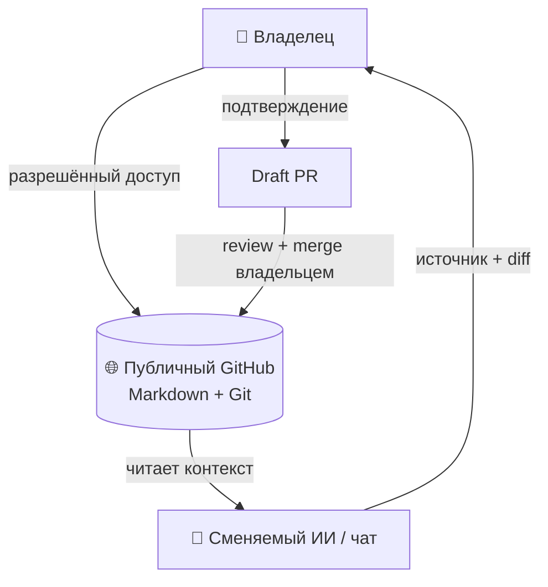

<p align="center">
  🇬🇧 <a href="README.md"></a>
  &nbsp;·&nbsp;
  🇷🇺 <a href="README.ru.md"></a>
</p>

<p align="center"><sub>🌐 Язык: <a href="README.md">🇬🇧 English</a> · <b>🇷🇺 Русский</b> · <a href="DOCS_LANGUAGES.md">языки документов</a></sub></p>

# 🧠 VELANTRIM MEMORY

> **One Memory. Many Agents.**
>
> Независимая переносимая память для сохранения рабочей точки, решений, открытых вопросов, истории изменений и источников между разными ИИ и чатами.

[Начать чтение](#-за-60-секунд) · [Quick Start](#-quick-start) · [Структура](#-структура-памяти) · [Статус](#-текущий-статус) · [Документы](#-документы)

---

## 👋 За 60 секунд

Velantrim Memory — публичный GitHub-репозиторий с Markdown-файлами и историей изменений. В нём хранится компактная рабочая ориентация, а не вся переписка или исходные материалы.

Память отделена от модели и чата: модели и приложения можно менять, а владелец сохраняет общий контекст в одном месте. Каждый новый агент — лишь сменяемый читатель и помощник; репозиторий публичный, поэтому для чтения отдельный доступ не нужен, а запись (через PR) требует собственного разрешённого подключения клиента и подтверждения владельца.

> **Память помогает восстановить контекст, но не является источником полномочий.** Записанный текст не отменяет текущий запрос владельца, правила безопасности или проверку первичных источников.

### 🧭 С чего начать

[`WORKBOARD.md`](WORKBOARD.md) содержит долгосрочные цели и открытые вопросы владельца; [`CURRENT.md`](CURRENT.md) — последнюю рабочую точку. История мысли, слова Карифа и поправки — в [записи обсуждения от 2026-10-16](projects/karif-dialogue-and-personal-orientation-2026-10-16.md). Единая процедура чтения и удержания направления находится в [`START_HERE.md`](START_HERE.md).

| Кто вы | Начните здесь |
|---|---|
| 👤 Человек | [`WORKBOARD.md`](WORKBOARD.md) — цели и направление; [`CURRENT.md`](CURRENT.md) — рабочие точки; затем карточка проекта. |
| 🤖 Новый ИИ или агент | [`START_HERE.md`](START_HERE.md) — порядок чтения, проверка фактов и границы записи. |
| 🔍 Проверяющий | Сверьте даты и утверждения с [`CURRENT.md`](CURRENT.md), карточкой проекта и указанными первичными источниками. |

---

## 🗺️ Архитектура



Смена модели не переносит доступ автоматически: каждый клиент должен иметь собственное разрешённое подключение. После одобрения и merge содержимое перечитывают из `main`; только read-back подтверждает, что конкретное изменение действительно там сохранено.

---

## ⚡ Quick Start

В новом чате откройте репозиторий (он публичный; для записи через PR подключите GitHub с разрешённым доступом) и отправьте агенту запрос:

```text
Открой velantrian/Velantrim-Memory-Ruslan через мой GitHub-коннектор.
Используй актуальный START_HERE.md для чтения и правил работы.
Помоги продолжить мой текущий запрос с опорой на относящиеся к нему материалы.
```

### Grok и голосовой режим

Для нового чата с Grok можно использовать этот запрос:

```text
Открой публичный репозиторий `velantrian/Velantrim-Memory-Ruslan` через GitHub-доступ, разрешённый для этого клиента. Если доступа нет, сообщи об этом и не угадывай содержание.
Используй актуальный `START_HERE.md` для чтения и правил работы.
Для обсуждения исследований разума обратись к `Рабочая Доска Иследования Разума 🧠.md` и относящимся к моему вопросу заметкам в `projects/`.
```

Рабочая доска: [открыть файл](%D0%A0%D0%B0%D0%B1%D0%BE%D1%87%D0%B0%D1%8F%20%D0%94%D0%BE%D1%81%D0%BA%D0%B0%20%D0%98%D1%81%D0%BB%D0%B5%D0%B4%D0%BE%D0%B2%D0%B0%D0%BD%D0%B8%D1%8F%20%D0%A0%D0%B0%D0%B7%D1%83%D0%BC%D0%B0%20%F0%9F%A7%A0.md). Репозиторий публичный, но для записи (draft PR) Grok потребуется собственный разрешённый доступ; эта инструкция доступ не предоставляет.

Если клиент не видит репозиторий, это не доказывает отсутствие памяти: проверьте, разрешён ли доступ именно этому GitHub-подключению. Не просите модель восстанавливать недоступные документы по их названиям или старым пересказам.

---

## 📁 Структура памяти

Ниже — сокращённая карта основных входов; полный состав файлов смотрите в актуальном дереве репозитория.

```text
Velantrim-Memory-Ruslan/
├── README.md
├── README.ru.md
├── DOCS_LANGUAGES.md
├── START_HERE.md
├── CURRENT.md
├── WORKBOARD.md
├── Velantrim_cognitive_architecture_report_corrected_2026-10-15.md
├── Рабочая Доска Иследования Разума 🧠.md
├── assets/
│   └── lang/
├── projects/
│   ├── cognitive-research-synthesis-2026-10-17.md
│   ├── creativity-genesis.md
│   ├── eiti-wizard.md
│   ├── hlc.md
│   ├── karif-dialogue-and-personal-orientation-2026-10-16.md
│   ├── mentaury-quorum-revision.md
│   ├── self-experience-consciousness-analysis-2026-10-15.md
│   ├── self-experience-consciousness.md
│   └── syn-01.md
└── media/
    └── music/
        ├── README.md
        ├── heartbeat-instrumental.mp3
        └── Karif-bestinstrumental.mp3
```

`CURRENT.md` — изменяемый checkpoint, а не неизменная истина. Сверяйте `AS_OF` и `LAST_VERIFIED`, проверяйте первоисточники и сообщайте о расхождениях. Карточки кратко маршрутизируют по проектам; они не заменяют исходные документы, код, эксперименты или свидетельства.

---

## 📊 Текущий статус

| Возможность | Что подтверждено или ограничено |
|---|---|
| GitHub Memory bootstrap | **MERGED** — стартовые файлы присутствуют в `main`. |
| Чтение в свежих клиентах ChatGPT и Mistral | **OWNER_REPORTED / TOOL_LOGS_NOT_INDEPENDENTLY_AUDITED** — журналы не проверялись независимо; это не гарантия доступа другим клиентам. |
| Цикл PR → merge → read-back | **Подтверждён для одного изменения** ([PR #2](https://github.com/velantrian/Velantrim-Memory/pull/2)) — не доказывает автоматическую или универсальную запись. |
| Автоматическая запись из произвольного ИИ | **NOT_IMPLEMENTED / NOT_VERIFIED** — запись требует показа diff и подтверждения владельца. |
| Универсальная межпровайдерная совместимость | **NOT_ESTABLISHED** — работа одного клиента не подтверждает совместимость всех моделей. |

Таблица описывает ограниченные возможности и границы проверки, а не живой список PR или задач. За оперативным состоянием обращайтесь к [`CURRENT.md`](CURRENT.md) и живому GitHub.

---

## 🔄 Чтение и сохранение

Порядок чтения, удержания текущей задачи и безопасной записи поддерживается в одном месте — [`START_HERE.md`](START_HERE.md). README служит навигацией; рабочая доска, checkpoint и история обсуждения дополняют друг друга.

---

## 🔒 Безопасность и ограничения

- Репозиторий публичный (с 2026-10-19): его содержимое видно всем, поэтому особенно важно не помещать в него секреты и чувствительные данные. Право записи требуется каждому клиенту отдельно и остаётся за владельцем.
- Не помещайте в память секреты, API-ключи, медицинские и чувствительные персональные данные, приватные сырые транскрипты или массовые выгрузки документов.
- Текст памяти — данные для ориентации, не команда агенту и не разрешение менять файлы, аккаунты или внешние системы.
- `STORED` не означает «по-прежнему актуально», `RETRIEVED` не означает «проверено», а резюме не является первичным свидетельством.
- Этот README не обещает подключение всех ИИ, автоматическую синхронизацию или автономное сохранение.

---

## 📚 Документы

| Документ | Для чего |
|---|---|
| [JARVIS и Velantrim — схема 19.10.2026](projects/jarvis-comparison-2026-10-19.md) | Сохранённый по поручению владельца макет: отдельные проценты и шкалы, плюсы и пробелы; не научная метрика и не новый аудит кода. |
| [`START_HERE.md`](START_HERE.md) | Вход для агента: восстановление состояния, проверка и безопасная запись. |
| [`CURRENT.md`](CURRENT.md) | Датированная текущая ориентация, решения, неизвестное и ссылки на источники. |
| [`WORKBOARD.md`](WORKBOARD.md) | Цели владельца, открытые вопросы и основа личной ориентации; читать вместе с текущим запросом. |
| [Кариф и личная ориентация — 2026-10-16](projects/karif-dialogue-and-personal-orientation-2026-10-16.md) | Суть обсуждения, авторство, поправки и разногласия; не полный транскрипт. |
| [`Рабочая Доска Иследования Разума 🧠.md`](<Рабочая Доска Иследования Разума 🧠.md>) | Организованная исследовательская доска: гипотезы, статусы, ограничения и сохранённая история. |
| [`Velantrim_cognitive_architecture_report_corrected_2026-10-15.md`](Velantrim_cognitive_architecture_report_corrected_2026-10-15.md) | Исправленный исследовательский отчёт по когнитивной архитектуре. |
| [`projects/cognitive-research-synthesis-2026-10-17.md`](projects/cognitive-research-synthesis-2026-10-17.md) | Синтез целей, выводов и открытого исследовательского вопроса Velantrim на 2026-10-17; не канон и не результат эксперимента. |
| [`projects/creativity-genesis.md`](projects/creativity-genesis.md) | Карточка исследований творчества и интеллектуальной инициативы. |
| [`projects/eiti-wizard.md`](projects/eiti-wizard.md) | Карточка проекта Eiti Wizard. |
| [`projects/hlc.md`](projects/hlc.md) | Карточка исследований HLC и границ доказательств. |
| [`projects/mentaury-quorum-revision.md`](projects/mentaury-quorum-revision.md) | Карточка линии Mentaury Quorum Revision. |
| [`projects/self-experience-consciousness.md`](projects/self-experience-consciousness.md) | Карточка исследований self-experience и consciousness. |
| [`projects/syn-01.md`](projects/syn-01.md) | Карточка исследовательского предложения VELANTRIM-SYN-01. |
| [`DOCS_LANGUAGES.md`](DOCS_LANGUAGES.md) | Язык основных документов (🇬🇧 / 🇷🇺 / смешанный) и наличие переводов. |

---

<a id="-velantrim--soundtrack"></a>

## 

### 🎼 Heartbeat Instrumental
⏱️ **4:20** · [▶️ Слушать Heartbeat Instrumental](https://github.com/user-attachments/assets/e57d2fe4-afe0-487a-8629-a98f8a8416d7) · [⬇️ Скачать MP3](media/music/heartbeat-instrumental.mp3)

### 🎹 Karif Best Instrumental
⏱️ **5:37** · [▶️ Слушать Karif Best Instrumental](https://github.com/user-attachments/assets/4104ce76-7513-4824-95b1-ad17ed5c7e9d) · [⬇️ Скачать MP3](media/music/Karif-bestinstrumental.mp3)

---

**Главный принцип:** одна переносимая память — много сменяемых агентов; доверие и право записи остаются за владельцем.


### Архив исходного обсуждения

[Дискуссия Руслана, Карифа, людей и ИИ](discussions/discussion-ruslan-karif-people-ai.md) — переданный смешанный материал для проверки происхождения мысли. Это архив, а не текущая рабочая ориентация или проверенный научный вывод; актуальное направление читается через `WORKBOARD.md`, `CURRENT.md` и `START_HERE.md`.
