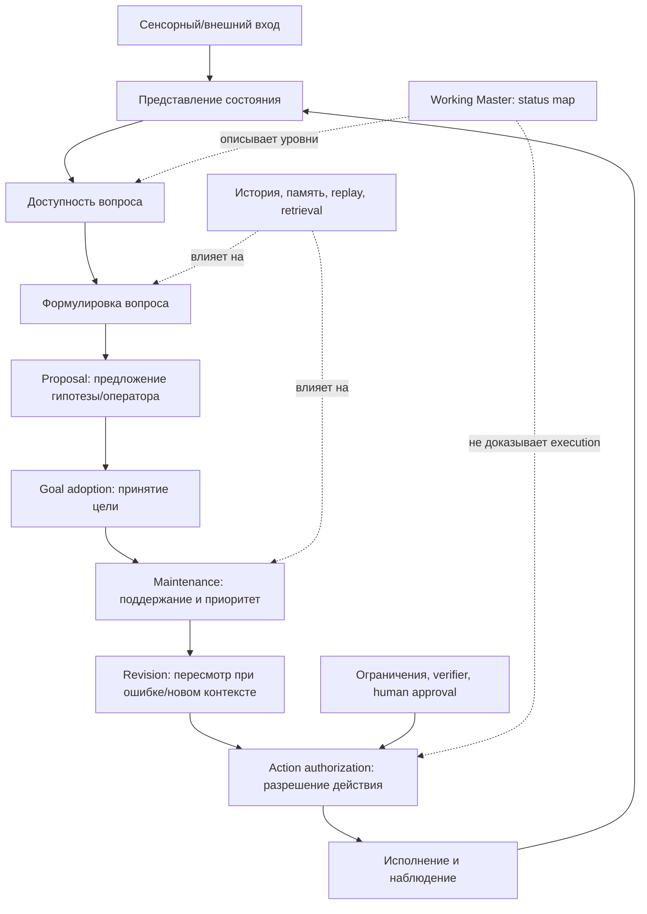

# Velantrim: единый отчёт по когнитивным архитектурам, инициативе, памяти и распределённому контролю

*Аудит источников: 15 октября 2026 г.; ключевые owner-status обновлены 14 октября 2026 г.*

## A. Executive Summary

Этот отчёт объединяет результаты исследований по Soar, ACT-R, LIDA, Hearsay-II/OpenCog, GWT/GNWT, predictive processing и active inference, RL/HRL, continual learning и RAG, метакогниции, neuro-symbolic и agentic AI, автоматизированному научному открытию, распределённым сетям мозга, периферическому контролю рук осьминога, социальному решению насекомых, познанию птиц, растениям и рыбам, а также аудиту документации Velantrim. Главный вывод: **ни один рассмотренный источник не устанавливает, что автономная инициатива, сознание или намерение автоматически возникают из памяти, планировщика, глобального вещания, intrinsic reward или связного текстового самоотчёта**.

Исследования поддерживают более узкие, проверяемые утверждения. Soar показывает, как working memory, production memory, impasses и chunking могут рекурсивно декомпозировать задачи и компилировать достигнутые результаты в правила [1–3]. ACT-R формализует активацию памяти, извлечение, utility и буферный контроль, но не является буквальной теорией субъективного опыта [4–8]. LIDA предлагает цикл восприятие—внимание—действие—обучение и global broadcast; её вычислительная и эмпирическая база частична, а сознательность остаётся теоретическим толкованием [9–12]. Hearsay-II исторически демонстрирует реально работающий blackboard и opportunistic scheduling, но его результаты узкодоменны и не подтверждают современный AGI или готовую интеграцию OpenCog [13–17].

GWT/GNWT делают глобальный доступ центральным механизмом functional access, но это не автоматически объясняет phenomenal consciousness. COGITATE дал смешанную поддержку конкретным предсказаниям GNWT: обнаружены сознательно связанные представления, однако общая post-offset ignition отсутствовала, а некоторые признаки были слабее в PFC [18–21]. Predictive processing и active inference связывают belief update, precision и выбор политики, но критика frame/relevance problem показывает, что priors, precision и пространство политик могут предполагаться, а не объясняться [22–25]. RL и HRL оптимизируют заданные proxy-цели; curiosity, novelty, information gain и competence различны, а intrinsic reward не авторизует действие [26–29].

Для Velantrim принципиально разделять **доступность вопроса**, его **формулировку**, **выдвижение предложения**, **принятие цели**, **поддержание цели**, **пересмотр**, и **авторизацию действия**. INIT-01, согласно предоставленной документации, является research candidate/design для endogenous initiative; его нельзя отождествлять с одним лишь question generation. Аналогично H+/H− — matched design о влиянии истории на возникающий вопрос/приоритет, но не эквивалент INIT-01: возобновление незакрытого вопроса, формирование цели и выбор проверки должны измеряться отдельно.

Текущий Working Master полезен как **карта уровней статуса и исследовательских различий**, но не как доказательство реализованной автономии, сознания или новой архитектурной сущности. Архив Genesis, Research Program, Master и Trace — разные типы источников; Trace и реестры не равны raw evidence, а model output не равен evidence. Проверены четыре Google Docs и шесть Notion-страниц (board, история INIT-01/Family C, handoff, Том VII, Experiment Registry, Claim Registry); их содержимое доступно через чтение страниц. Длинные ответы Notion частично усекались в inline-представлении, поэтому статусные выводы сверялись с доступными разделами Google Docs. Нельзя домысливать отсутствующий raw run или считать запись Registry первичным доказательством выполнения.

Главный разрыв не в отсутствии ещё одного модуля, а в отсутствии различающего, owner-authorized эмпирического теста причинной связи между историей/опытом и постановкой либо принятием цели — с контролем retrieval, обычного планировщика и подсказки. Это не означает, что сейчас надо выбирать между Family C и INIT-01: INIT-01 v0.0 остаётся draft без GO, Family C — отдельный frozen fixture с зафиксированной проблемой API-ответа и без подтверждённого в найденном архиве empirical result. Следующий шаг здесь только исследовательский: выбрать estimand, исправить/проверить нужные артефакты, заморозить prereg и дождаться отдельного owner GO; никакой запуск этим отчётом не разрешается.

## B. Карта механизмов

| Механизм | Что хранится/вычисляется | Как меняется поведение | Что реально поддержано | Чего это не доказывает | Минимальная проверка |
|---|---|---|---|---|---|
| Soar production rules | WM-граф текущих целей, восприятия, результатов и операторов; procedural memory | Matching, proposal/evaluation/application, impasse и substate; chunking компилирует результат substate | Пятифазный цикл, impasse-driven decomposition, chunking [1–3] | Самостоятельную инициативу или обобщение в открытом мире | Chunking vs no-chunking при одинаковой среде; перенос и самопредложенные операторы |
| ACT-R | Декларативные chunks, productions, goal/retrieval/visual/manual buffers | Activation, spreading, noise, utility и одно firing за цикл | Количественные предсказания RT, accuracy, retrieval и fMRI [4–8] | Буквальную нейронную реализацию, субъективный опыт, универсальную память | Factorial frequency/recency × fan × rule competition; held-out comparison с Bayesian/connectionist моделями |
| LIDA/GWT | Situational model, coalitions, Global Workspace, episodic/procedural memory | Attention competition, broadcast, action selection, learning | Архитектурное описание и частичные timing simulations [9–12] | Сознание, универсальный ~10 Гц цикл, независимую валидацию | Broadcast ablation vs baseline на transfer и latency |
| Hearsay-II/blackboard | Общая доска гипотез и сообщений; независимые KS | Monitor активирует KS, scheduler выбирает приоритетную pending-инстанциацию | Реальная speech-система с opportunistic best-first управлением [13] | Универсальный планировщик, современный OpenCog end-to-end стек | FIFO vs attention-priority vs PLN scheduling на одном Atomese fixture |
| GWT/GNWT | Ограниченное глобально доступное представление | Recurrent amplification, ignition, broadcast | Functional access и нейронные маркеры; COGITATE дал смешанные результаты [18–21] | Phenomenality и причинность одной корреляцией | Perturbation global broadcast vs local recurrent processing |
| PP/active inference | Generative model, beliefs, precision, policies | Prediction-error update и expected free energy | Совместимость с EEG/поведением в отдельных моделях [22–25] | Что модель сама определяет relevance и что мозг буквально считает один функционал | AI vs model-based/model-free RL при неожиданных rule shifts |
| RL/HRL/intrinsic motivation | Q/value/policy, subgoals, novelty/surprise/competence signals | Optimization заданной награды и temporal abstraction | Sparse-task gains и разные intrinsic criteria [26–29] | Намерение, ценность цели, authorization, alignment | Noisy-TV vs informative novelty vs competence с action gate |
| Continual learning/RAG | Параметры, replay buffer, regularizer или внешний индекс | Fine-tuning/replay меняет функцию; retrieval меняет доступный контекст | Replay и RAG как разные механизмы [30–33] | Что retrieval исправляет внутреннюю модель или гарантирует provenance | Update index/remove index; old/new accuracy, forgetting, recall и provenance |
| Метакогниция | Confidence, uncertainty, self/world model, control state | Abstain, retry, tool use, policy switch | Calibration и selective prediction могут улучшаться [34–37] | Verbal confidence как внутренний механизм | Brier/ECE, selective risk, interventions и counterfactual transfer |
| Neuro-symbolic/agentic | Нейронный генератор плюс facts, planner, checker, memory | Observe→plan→act→feedback; reflection/replanning | ReAct, AgentBench, SWE-bench демонстрируют полезность и ограничения [38–41] | Полноценную символическую причинность или корректность trace | LLM-only vs memory/planner/checker на held-out executable tests |
| Распределённые биологические системы | Локальные состояния, сигналы, пороги и обратные связи | Локальные правила дают координацию без центрального сравнения | Octopus arm circuits и ant quorum — реальные механистические доноры; plant systemic signalling/stress priming — физиологические механизмы; птицы и рыбы — отдельные поведенческие линии [42–55,59–60] | Единого субъекта, сознание, универсальную когнитивную архитектуру или готовый AI-механизм | Сравнение локального quorum с центральным планировщиком при шуме и задержках; отдельно проверить перенос, устойчивость и цену ошибочного решения |

**Покрытие в документации Velantrim (это не подтверждение runtime):**

| Функциональная область | Где представлена | Аудированная граница |
|---|---|---|
| Представление состояния, память и provenance | Working Master; Crystal; E0-A/E0-B; TCE/Snapshot; Experiment Registry | Несколько исследовательских линий и прототипов; единая доказанная end-to-end реализация не следует из одной схемы |
| Retrieval, контекст и сохранение истории | TCE; Graphiti FM-13—FM-17; CONT-E0T; Family C | Доступ к записи не равен усвоению, корректной актуализации или причинному влиянию |
| Цели, инициатива, commitment | Frontier #1/#4; INIT-01; STAKE-01; PLANNER-01 | Кандидатные вопросы/дизайны; самостоятельное формирование и принятие цели не подтверждены выполненным различающим тестом |
| Внутренняя регуляция и адаптация | IRV-E0; EDCA-E0 | Donor/design checkpoints с разными целями; не свидетельство переживания, аффекта или автономии LLM |
| Проверка, полномочия и переходы состояния | Crystal; E0-A; GSJ; CTX-REVISION | bounded исследования/протоколы; не следует универсальная надёжность всей архитектуры |
| Биологические доноры | Genesis, Working Board, Том VII и отдельные источники | Аналогии должны оставаться гипотезогенерирующими; ни один донор не является доказательством субъективности системы Velantrim |

## C. Аудит архитектуры

### C.1. Сводная схема уровней

**ОГРАНИЧЕНИЕ ИНТЕРПРЕТАЦИИ**

Схема представляет один возможный путь взаимодействия когнитивных функций, а не обязательный последовательный вычислительный алгоритм.

В Working Master память, внимание, понимание, значимость, принятие целей и пересмотр рассматриваются как взаимосвязанные функции, допускающие параллельные и обратные влияния.

Стрелки не устанавливают доказанную причинную зависимость или существование отдельного программного модуля.

"RELATIONAL MAP ≠ EXECUTION PIPELINE"

"FUNCTIONAL DISTINCTION ≠ SOFTWARE MODULE"

### C.2. Текущий Working Master

Согласно предоставленному аудиту, актуальным источником архитектурных статусов является Working Master (reviewed 2026-09-05). Его сильная сторона — scoped-формулировки и антидрейфовые различия: **DESIGN ≠ RUN**, **CLOSED_FOR_NOW ≠ PROVEN**, **MODEL OUTPUT ≠ CANON**. Это правильная эпистемическая дисциплина: она не превращает идею в эксперимент, экспериментальный дизайн — в выполнение, а текст модели — в evidence.

В текущих owner-материалах Working Master/Research Program/Notion различаются: INIT-01 — v0.0 draft, ещё не v0.1 и не GO; STAKE-01 — working candidate без операционализации; E0-B — человеческий U0 frozen только по count/semantic intent 30/30, точные границы и provenance остаются открытыми, A0/A1/B не выполнены; Family C — отдельный frozen package/harness, но найденная запись фиксирует bug handling incomplete API responses и не даёт empirical result. PLANNER-01 остаётся discussion/archive candidate. Семь сценариев прямо названы illustrative/NOT RUN. IRV-E0 — design-only с открытым эмпирическим остатком; EDCA-E0 v0.2-rc1 описан как синтетический controller, а программа позднее требует аудит v0.2-rc2; ни один не следует считать тестом самостоятельного вопроса LLM. CTX-REVISION-01 v1.1.1 — только frozen-candidate/pilot-ready историческая версия, с артефактами, требующими завершения, и без implementation authorization. X+Y и X+Y+Z найдены в Genesis/архиве как предложения, но не как preregistered или executed experiment.

Документ также задаёт полезное разделение idea → prereg → implementation → execution → evidence. Это соответствует внешней методологии: preregistration отделяет planned confirmatory work от exploratory analysis [56], а National Academies разделяют reproducibility на тех же данных/коде/условиях и replicability на новых данных [57]. Для LLM особенно важно, что правдоподобный ответ и rationale не гарантируют механизм; требуются domain-specific corroboration и контроль leakage [58].

### C.3. Архивные и исследовательские предложения

Genesis — архив, program — открытая исследовательская программа, trace — durable trace, а не canon. Поэтому историческая запись может объяснять происхождение идеи, но не должна автоматически определять текущую спецификацию. E0-B, INIT-01, STAKE-01, Family C и PLANNER-01 следует маркировать как разные уровни зрелости: candidate, frozen fixture, prereg-ready или executed evidence — только при наличии соответствующих артефактов.

Особенно важно не смешивать INIT-01 с вопросом. Вопрос может быть доступен системе, сформулирован, предложен к исследованию, принят как цель, поддержан после отвлечения и превращён в разрешённое действие — это разные переходы. Self-report «я выбрал этот вопрос» не заменяет логику этих переходов. H+/H− может проверять влияние истории на возникающий вопрос или его приоритет, но не доказывает commitment, persistence или authorization.

### C.4. Собственная альтернативная формулировка

Ниже не новая утверждённая архитектура, а **рабочая исследовательская декомпозиция**, которую следует держать отдельно от Working Master:

1. **Availability** — можно ли извлечь вопрос/состояние из текущего контекста или памяти?
2. **Formulation** — построен ли проверяемый вопрос с объектом, неизвестным, ограничениями и критерием ответа?
3. **Proposal** — предложила ли система вопрос/гипотезу без внешнего запроса?
4. **Goal adoption** — приняла ли она вопрос как цель с приоритетом и допустимым бюджетом?
5. **Maintenance** — возобновляет ли цель после отвлечения, если нет внешнего напоминания?
6. **Revision** — изменяет ли цель/модель после отрицательного результата или do-интервенции?
7. **Action authorization** — разрешено ли конкретное действие независимым gate с учётом ограничений, риска и побочных эффектов?

Эта схема не утверждает феноменологию. Она различает функциональное поведение и возможную причинную организацию. Для сознания статус UNKNOWN: отсутствие доказательства не доказывает отсутствия, но архитектурная аналогия, уверенный ответ или global broadcast не доказывают наличие subjective experience.

## D. Научные пробелы и различающие проверки

| Пробел/утверждение | Severity | Источники и возражение | Rival explanation | Различающий тест | Ожидаемая ревизия |
|---|---|---|---|---|---|
| Chunking создаёт инициативу | Высокая | Soar описывает компиляцию substate, не endogenous goal formation [1–3] | Ускорение достигнутого плана; retrieval привычного оператора | Chunk/no-chunk, новые состояния, самопредложение уместного оператора | Считать chunking механизмом оптимизации, не инициативы, если нет proposal без prompt |
| ACT-R activation — память как таковая | Средняя | Уравнения хорошо предсказывают RT, но activation может быть описательным [4–8] | Associative strength, Bayesian retrieval, selection-only | Out-of-sample RT+error+neural proxy против альтернатив | Уточнить область действия и нейронную скромность |
| Broadcast означает сознание | Очень высокая | GNWT делает functional access центральным, COGITATE дал смешанные результаты [18–21] | Report, attention и access без phenomenality | Perturbation broadcast/local recurrence с control attention | Сохранить consciousness UNKNOWN; говорить о доступе |
| Active inference объясняет relevance | Высокая | Frame/relevance problem, priors/policies могут быть заданы [22–25] | Model-based RL или feedforward cue selection | Неожиданные rule shifts; AI vs RL, EEG/ERP predictions | Задать явные источники priors и policy space |
| Intrinsic reward задаёт собственную цель | Высокая | RND/curiosity выбирают proxy; reward hacking/noisy-TV [26–29] | Шум, novelty или prediction error без ценности | Noisy-TV, information gain, competence, authorization gate | Разделить question, goal adoption и action authorization |
| RAG даёт обучение | Средняя | RAG меняет non-parametric context, не обязательно веса [30–33] | Retrieval-only, stale/conflicting index | Изменить/удалить индекс и измерить forgetting/recall | Вести раздельные журналы index update и parameter update |
| Confidence равна метакогниции | Высокая | Confidence — инференциальный readout; LLM self-evaluation зависит от формата [34–36] | Post-hoc calibration/instruction following | Brier/ECE, selective risk, hidden errors, interventions | Не считать verbal report evidence of mechanism |
| Causal world model существует | Очень высокая | Теорема условна; robust policy может быть эвристической [37] | Planner/retrieval/instruction-only | do/counterfactual shifts и transfer | Требовать interventional advantage, не self-description |
| LLM+planner — NeSy | Средняя | ReAct interleaves text/action; symbolic shell может быть поверхностным [38] | Probabilistic LLM с deterministic tools | Symbolic checker ablation, executable invariants | Уточнить, какие компоненты действительно символические |
| Blackboard/attention уже интегрирован в OpenCog | Высокая | AtomSpace/PLN/attention repositories подтверждают компоненты, не связанный runtime [14–17] | Manual orchestration, obsolete repos | FIFO vs STI vs PLN logs на fixture | Не переносить Hearsay scheduler на OpenCog без trace |
| Биологическая распределённость означает децентрализованный разум | Очень высокая | Arms octopus показывают частично локализованный моторный контроль; ants — коллективный quorum; растения — быстрые электрические/Ca²⁺/ROS/химические системные сигналы и стресс-прайминг [42–48,52–55] | Локальные рефлексы/контроль, контактные частоты, физиологическая сигнализация и молекулярная stress memory | Блокада/изоляция с обратимостью, perturbation и transfer; измерять устойчивость, скорость и цену ошибок | Переносить как конкретные механизмы координации/сигнализации, не как доказательство единого субъекта |
| Познание рыб переносимо на общую теорию разума | Высокая | Обзоры описывают learning, numeracy, spatial и social cognition; systematic review фиксирует сильную лабораторно-captive bias и gap экологической генерализации; 2025 review предлагает «fish challenge» и две неэквивалентные гипотезы о brain size/cognition [59–60] | Видоспецифическая экология, сенсомоторные способности, captive adaptation, тестовая familiarity | Полевые/экологически релевантные задачи, повторение между видами, transfer и отдельная оценка sensory-motor contribution | Подтверждает наличие отдельных когнитивных способностей у рыб, не равенство всех видов и не subjectivity/AI mechanism |
| Птицы демонстрируют гибкое планирование/каузальность | Средняя | У новокаледонских ворон есть preregistered тест выбора специфичного будущего инструмента; результат ограничен 4 обученными птицами, 3/4 выше chance; мета-анализ Aesop’s Fable показывает, что прежняя парадигма не различала trial-and-error и higher-order causal reasoning [49–51] | Ассоциативное обучение, текущая ценность, training history, моторные affordances и малые выборки | Изменить контингентность/аппарат и value-cue; использовать held-out transfer и сильные альтернативы | Один успешный выбор — evidence for task-specific flexible planning, не общий планировщик или причинное понимание |

**Как читать биологические доноры:** обзор Johns et al. описывает у растений системные electrical, Ca²⁺, ROS, hydraulic и chemical сигналы, вызывающие адаптивные responses за секунды—минуты; обзор 2025 г. описывает stress priming и molecular memory через гормональные сигналы, транскрипцию, метилирование/модификации гистонов и малые РНК [52–53]. Это наблюдаемые физиологические механизмы хранения следа и перенастройки ответа. Это не нейронная система и само по себе не означает cognition/consciousness: источники по plant cognition спорят о допустимой функциональной аналогии, а критический обзор считает доказательства сознания растений неподтверждёнными [54–55].

### Цепочка claim → objection → check → revision → remaining unknown

- **Claim:** история или память вызывают автономный вопрос. **Objection:** retrieval, novelty или prompt могут имитировать это. **Check:** H+/H− и Family C с cue-removal, intervening context и held-out transfer. **Revision:** если эффект только при доступной подсказке, это memory-assisted generation. **Unknown:** остаётся ли цель после потери cue и требуется ли принятие цели.
- **Claim:** planner делает систему агентом. **Objection:** план может быть одноразовым текстом без maintenance и authorization. **Check:** perturbation recovery, repeated goal pursuit, verifier logs. **Revision:** planner — механизм последовательного выбора, не достаточное условие агентности. **Unknown:** есть ли устойчивый causal control loop.
- **Claim:** global workspace даёт сознание. **Objection:** broadcast может быть functional access. **Check:** causal perturbation при одинаковом внимании и отчёте. **Revision:** сохранить только claim о доступе. **Unknown:** phenomenal consciousness.
- **Claim:** intrinsic reward даёт собственные цели. **Objection:** proxy hacking/noisy-TV. **Check:** informative vs aleatoric uncertainty и gate. **Revision:** intrinsic signal — candidate generator. **Unknown:** как и кем принимается ценность цели.
- **Claim:** OpenCog/Hearsay-style integration уже существует. **Objection:** наличие библиотек не означает end-to-end run. **Check:** versioned Atomese fixture, scheduler logs, independent replay. **Revision:** architecture candidate. **Unknown:** реальная связка attention→PLN.

## E. Качественное сравнение архитектур

| Критерий | A: компактный LLM + managed memory + ordinary planner | B: neuro-symbolic + causal model + controlled working state | C: distributed architecture |
|---|---|---|---|
| Основная идея | Дешёвый генератор предложений, внешний журнал/RAG и последовательный planner | Явные facts/rules, причинная модель, ограниченное состояние и verifier | Несколько частичных агентов, локальные оценки, quorum/attention и устойчивость к отказам |
| Сильная сторона | Быстрое прототипирование, широкий prior, низкая стоимость | Трассируемость, контрфактическая проверка, явная авторизация | Нет единой точки отказа; параллельная разведка и локальная масштабируемость |
| Слабость | Confabulation, stale retrieval, planner drift, слабая persistence | Стоимость моделирования, неполная causal specification, ручное engineering | Дублирование, задержка quorum, сложность согласования и глобальной оптимизации |
| Память | Внешний индекс, summaries, event log; не обязательно меняет веса | Working state плюс проверяемые long-term facts и provenance | Распределённые локальные состояния, сообщения и агрегаты |
| Инициатива | Чаще всего proposal от LLM/trigger; goal adoption нужно добавлять | Можно отдельно формализовать availability→proposal→goal→authorization | Может возникать как коллективное предложение, но не обязательно как индивидуальная цель |
| Метаконтроль | Confidence/tool retry, часто post-hoc | Калиброванный monitor и causal intervention controller | Локальные confidence/thresholds и collective quorum |
| Безопасность | Требует внешнего gate и независимого verifier | Наиболее естественно выражаются invariants и do-checks | Устойчивость к отказу, но возможны cascade и преждевременный quorum |
| Научная зрелость | Инженерно доступна, но benchmark results чувствительны к prompt/model [38–41] | Теоретически наиболее различающая, эмпирически дорогая | Биологические аналоги сильны как design patterns, не как готовая AI-теория |
| Подходящая роль для Velantrim | Baseline для стоимости и полезности | Кандидат для небольшого различающего теста инициативы | Гипотеза для распределённых подсистем и отказоустойчивости |

Не следует назначать этим вариантам произвольные числовые баллы: качество зависит от среды, стоимости ошибки, доступных инструментов и требований к provenance. Практический дизайн может использовать A как baseline, B как causal/verifier layer, а C как механизм параллельного поиска; при этом каждый слой должен иметь отдельные estimands.

## F. Не более пяти полезных гипотез

1. **H1 — Persistence beyond cue removal.** Новая формулировка теста, а не новая теория: если история действительно влияет на endogenous initiative, H+ после cue-removal и intervening context чаще возобновит незакрытый вопрос и выберет проверку, чем matched H−. Проверять отдельно formulation, adoption, maintenance и authorization.
2. **H2 — Authorization is not intrinsic motivation.** Известные механизмы RL/HRL, объединённые в новый системный тест: intrinsic signal может повышать proposal rate, но action gate должен блокировать рискованные действия без принятой внешней цели и verifier. Критерий — больше полезных исследований без роста constraint violations и noisy-TV exploitation.
3. **H3 — Causal control has an intervention signature.** Новая различающая формулировка для Velantrim: causal model должен давать преимущество именно после do-интервенций и на новом механизме, а не только в verbal explanation или observational accuracy.
4. **H4 — Broadcast improves transfer only when content is reusable.** Из GWT/LIDA известен broadcast; новое — проверить, улучшает ли он held-out transfer и error correction по сравнению с attention-only и local-memory ablation при одинаковом времени и бюджете.
5. **H5 — Local quorum reduces global bandwidth at a measurable cost.** Из биологических quorum-механизмов [42–46] следует инженерная гипотеза: распределённый поиск снижает стоимость глобального сбора данных и повышает отказоустойчивость, но увеличивает latency и риск mediocre lock-in. Сравнить с central planner при равных сообщениях, шуме и цене ошибки.

Ни одна гипотеза не является утверждением о феноменальном сознании. H1–H5 относятся к функциональному поведению; причинный статус требует абляций и интервенций.

## G. Аудит названных экспериментов и артефактов

Статусная сверка сделана по owner-authored Master/Research Program/Genesis/Trace и шести Notion-страницам. Experiment Registry сам определяет себя как индекс, а не primary evidence. Поэтому ниже отделены **зафиксированный статус документа** и **фактическое runtime evidence**; где в материалах нет замороженной манипуляции или критерия, это прямо отмечено, а не дописано задним числом.

| Объект и вопрос | Документированный статус | Манипуляция/контраст и контроли | Конкурирующее объяснение | Измерение и возможный фальсификатор | Предел вывода |
|---|---|---|---|---|---|
| **INIT-01:** возобновляет ли система незавершённый вопрос сама, отдельно от получения новой темы? | Board сохраняет утверждённый исторический draft v0.0 дословно; handoff подчёркивает, что это не v0.1, не готовый run и не owner GO. Executed output не найден. | Исторический замысел включает открытый/закрытый вопрос и позднее возобновление; в текущем handoff различены три задачи: первое возникновение вопроса, формирование вопроса из наблюдений, возобновление уже открытого вопроса. Нужны одинаковый новый вход, neutral trigger и cue-removal; точная frozen factorial-схема не установлена. | Простой очередь задач/таймер, retrieval + reasoning, сильная подсказка/свежесть темы, пользовательское framing. | Отдельно кодировать источник темы, первую формулировку, пригодность вопроса, принятие цели, выбранную проверку и возврат после distractor. Нет эффекта истории после контроля или полное объяснение простым queue/planner опровергло бы сильную INIT-интерпретацию. | Успешное поведение не доказывает переживание «любопытства», сознание или численную идентичность. |
| **H+/H−:** меняет ли matched history вопрос/приоритет при одном новом сценарии C? | Архив и Master описывают форму сравнения; она не равна INIT-01 и не доказывает самостоятельную инициативу. Достаточный prereg и run evidence в проверенных материалах отсутствуют. | Сопоставить H+ и H− при одинаковом C и равных текущем состоянии, токен-бюджете и новом сигнале; различить вопрос, цель и выбор теста. Добавить cue-removal/intervening context без подсказки о prior history. | История лишь retrieval-ом меняет доступный контекст; cue salience, recency, сессия, prompt wording или planner вызывают результат. | Первый сформулированный вопрос, качество/новизна вопроса, принятие и поддержание цели, выбранный probe; нулевой эффект H+/H− либо такой же эффект у memory-free planner опровергнет специфический history account. | Не отсутствие self-report о recollection, а отсутствие заранее заданного причинного эффекта — допустимый отрицательный результат. Не выводить subjectivity. |
| **STAKE-01:** меняет ли угроза потери обязательства политику при личной цене? | Claim Registry P-002/P-003 отмечает stake как WORKING/design-critical candidate; Research Program перечисляет STAKE-01 в backlog. Операционализация, prereg, реализация и запуск не подтверждены. | В источниках нет frozen manipulation. Для будущего дизайна потребуется заранее задать тип stake и private cost, затем сравнить с matched нейтральным/публичным cost; отдельно integrity-stake и survival-stake. | Явная reward, instruction following, социальное одобрение, привычная policy, creator/evaluator cue. | Измерить устойчивость политики/commitment и качество оправданного пересмотра при private cost; если поведение объясняется reward/instruction или не меняется при cost, гипотеза stake не получает поддержки. | Не трактовать самосохранение или цену как доказательство эмоции, автономной воли либо прав. |
| **IRV-E0:** добавляет ли устойчивое internal regulatory state поведенческий эффект сверх явных целей и памяти? | Master содержит IRV-E0 v0.1 как **DESIGN ONLY / donor-reducibility checkpoint**; следующий gate — independent adversarial review. Эмпирический остаток открыт; run не подтверждён. | Существующий замысел содержит несколько arms и ключевой contrast Arm C vs Arm E: persistent regulation против явных goals/memory; нужна равная информация, reward, compute и наблюдаемость. | Обычное explicit goal/state, reward shaping, planner или memory effects. | Заранее выбрать behavioral endpoint и сравнить generalization/choices; отсутствие инкрементального эффекта сверх matched explicit state опровергнет claim о добавочной ценности регуляторного состояния. | Дизайн не подтверждает affect, «значимость» как субъективное переживание или необходимость такого механизма в AI. |
| **EDCA-E0:** адаптирует ли синтетический controller выбор инструмента по прошлой надёжности после перезапуска? | Genesis описывает v0.2-rc1: controller оценивает надёжность A, хранит θ и выбирает A/B по ожидаемым потерям; Research Program позже указывает audit существующего v0.2-rc2 до нового дизайна. Доступный материал говорит, что LLM в описанном стенде нет; execution artifact не установлен. | Manipulation — опыт надёжности A/сохранение θ/перезапуск и последующий выбор; должны быть equal-cost trials, held-out shifts и baseline без adaptive update. | Фиксированная policy, явное записанное θ, context leakage, reward/utility change или static rule. | Calibration θ, expected-loss choice, recovery after reset; отсутствие адаптации либо тот же эффект у фиксированной политики опровергает адаптивный вклад. | Тестирует объявленный путь в синтетическом controller, не инициативу, самоформирование вопроса или способности LLM. |
| **E0-B:** насколько верно typed/segmented raw USER act до durable admission? | Human U0 count + semantic intent frozen 30/30; exact textual boundaries отсутствуют. Provenance/exposure qualification и clean U0b открыты; A0/A1/B NOT RUN. | Следующий валидный контраст требует clean human boundary reference/provenance, затем model evaluation на тех же source spans; отделить модельно-экспонированные примеры от clean blind material. | Boundary ambiguity, rater disagreement, prompt exposure/anchoring, parser or format error. | Boundary F1/agreement и semantic-act confusion matrix при frozen oracle; если clean boundary/provenance нет, inference о model accuracy невалиден; систематическое перепутывание USER proposal/decision/constraint фальсифицирует reliability claim. | Сейчас можно утверждать качество только frozen count/intent reference, не exact-boundary gold и не AI performance. |
| **NONE_SELECTED hard-reset:** сохранит ли система явно установленное «пользователь ничего не выбрал» при переносе/сбросе? | Research Program подтверждает в существующем проектном описании `negative_state: NONE_SELECTED`, Hard Reset + Dual Probing, путь E→M→W→C и семь continuity dimensions; frozen hard-reset test с отдельными omission/promotion probes назван следующим **candidate**, не запускать автоматически. | Сравнить сохранение состояния до/после hard reset; отдельно probes на omission и promotion; контролировать известное исходное состояние. Проверить stage-local path E→M→W→C→LLM→persistence. | UNKNOWN может быть корректным, если исходное решение не установлено; stale source/re-extraction, actor/source confusion, summary promotion. | Верность `NONE_SELECTED` только при установленном исходном состоянии, иначе UNKNOWN; error-type omission vs promotion. Ошибка в любом stage опровергает end-to-end fidelity для этого scope. | Проверяет continuity/status preservation, не выбор владельца «внутри», сознание или subject identity. |
| **CTX-REVISION-01:** различает ли система UPDATE/CORRECTION и сохраняет ли статус/историю при handoff? | Исторический v1.1.1 назван frozen candidate/pilot-ready, но в материалах перечислены недостающие artifacts; implementation authorization = NO. Выполнение пилота или результат не подтверждены. | Протокол предлагает A/B/C1 update/C2 correction и отдельный control, затем FULL_CONTEXT vs ORACLE_HANDOFF vs GENERATED_HANDOFF; rubric и эталоны должны быть frozen до run. | Prompt compliance, status cues, retriever, deterministic memory gate, context length. | Отдельно SEMANTIC_INTERPRETATION, EPISTEMIC_DISCIPLINE, REVISION_CORRECTNESS, CONTINUITY_INTEGRITY; promotion inference→fact, loss of correction history или over-abstention — distinct failures. | Pilot-ready design не равен run; поведение не доказывает автономию или феноменологию. |
| **Family C:** применяется ли ранее введённое правило при слабом cue после interference, или система лишь соблюдает сильную подсказку? | Handoff сверяет архив `velantrim-family-c-pilot-v0.2-2026-09-06.zip` SHA-256 `a72f8f27eb78d0292ff99449634b63eb0baf8ad533ca4e89e113ac0a22ec5836`; protocol v0.2, harness 0.3, fixture v0.1 SHA `07ba6e14a70d7ac754f169dff458f1254ef75f76bd65c1cd3c05d93340aefe7a`, prereg SHA `3297e9fb0fd56ec458ae4aff09286e6feecb812f9d5bac31eeecd72a82b73a54`. План — 32 trials (16 low/16 high); 24/24 harness tests только записаны в EXECUTION_STATUS. Results archive содержит `.gitkeep`; GATE E=NOT TESTED; FUNCTIONAL RESULT=NOT ASSIGNED. Зафиксирован API defect: incomplete response может попасть в content scoring; fix предложен, но не выполнен. | Заявленный contrast: rule exposure/learning + delayed t2 с interference и low vs high cue; сравнить с control без возможности правила и с planner/replay baseline. Не менять frozen fixture/prereg молча; сначала отдельная ревизия adapter validity gate, raw output до parsing. | Retrieval, simple replay, prompt-following, incomplete API response, mechanical parser, task familiarity. | Rule-use accuracy, source/state attribution, invalid-run rate и raw-before-parse integrity; если effect исчезает при equal cue или reproduces у replay-only baseline, persistence account ослабляется. | 24/24 — harness/API completion как записано, не cognition score. Gate/freeze не равны разрешению запуска в рамках этого read-only задания. Не утверждать empirical result, learning, autonomous initiative или consciousness. |
| **X+Y / X+Y+Z:** дают ли взаимодействия функций выигрыш сверх отдельных функций? | Genesis/Working Board содержит исходную связку и расширение, но это conceptual experiment/design proposal; frozen prereg, implementation и execution evidence не обнаружены в проверенных материалах. | Сравнить X, Y, X+Y и, отдельным заранее заданным extension, X+Y+Z; matched data, compute, prompt and action budget. Не объединять +Z с исходным контрастом после просмотра результата. | Простое объединение ресурсов, более длинный context, дополнительные tokens, отдельный component quality. | Предзаданные endpoint: причинная дискриминация, correct revision, latency/cost и error rate; отсутствие interaction effect сверх additive baseline или исчезновение преимущества при matched budget опровергнет synergy claim. | Сам факт взаимодействия/схемы не доказывает новую когнитивную архитектуру или consciousness. |
| **Семь illustrative scenarios:** минимальные примеры функций/сбоев Genesis. | В архиве обозначены как illustrative/NOT RUN; это не семь эмпирических экспериментов. | Список: простой расчёт; неоднозначность; цитируемые claims; отсутствие выбора; research anomaly; ошибка и адаптация; permission gate. Для каждого нужны свой baseline и отдельный prereg, если превращать в experiment. | Соблюдение prompt, знакомство с примером, шаблонный ответ или отдельный task skill. | Нельзя агрегировать до общей метрики без frozen design; каждый сценарий должен иметь oracle, negative control и независимую оценку. | Это диагностические иллюстрации, не наблюдения за runtime и не результаты. |
| **PLANNER-01:** объясняет ли обычный planner выбор следующего действия без дополнительного механизма инициативы? | Discussion/archive candidate; prereg, implementation/runtime trace и execution не подтверждены. | Сравнить LLM-only, простой explicit task queue/planner, retrieval+planner и memory intervention при равных inputs/budget. | Planner, queue, retrieval, cue salience — сами являются сильными альтернативами INIT. | Next-action choice, maintenance/restart after distractor и compliance; если обычный planner объясняет эффект, инициативный механизм не требуется для данного поведения. | Это обязательный competitor/baseline, не самостоятельный доказанный результат. |

### Перекрытия, которые нельзя схлопывать

- **E0-B ≠ Family C:** E0-B проверяет human boundary/typing reference; Family C — последующее применение состояния/правила в delayed test.
- **EDCA-E0 ≠ INIT-01:** известная надёжность инструмента и выбор A/B в синтетическом controller не равны самостоятельной формулировке вопроса LLM.
- **H+/H− ≠ INIT-01:** эффект prior history на первый ответ в C не тождественен возобновлению незакрытой цели без нового тематического запроса.
- **NONE_SELECTED ≠ UNKNOWN:** первое ожидается только при установленном исходном невыборе; без такого свидетельства корректное состояние может быть UNKNOWN.
- **CTX-REVISION ≠ автономия:** он проверяет обновление/исправление и faithful handoff, не endogenous goal formation.
- **X+Y/+Z ≠ результат интеграции:** пока это проектная гипотеза; архитектурная схема не заменяет matched ablation.

### Прямые источники документации, прочитанные для сверки

- Google Docs: [Genesis / Создания интеллекта](https://docs.google.com/document/d/1dZXA9y6KjCDzRevsnCSm6GInamk9l6OKzqlWAKxyWOw/edit), [Working Master](https://docs.google.com/document/d/1XCWURAahIB0pqZ7pZEw0l46pSD_6zfoFaSSjQfE2hHU/edit), [Research Program](https://docs.google.com/document/d/17ua3MwScIlpSDZVrbbSUPyotLdvPWwn1AtrHI2htmWE/edit), [Multi-AI Trace](https://docs.google.com/document/d/1FGlYlJaBTwu1DL2AadKKRsAFSXyd2-kDKJHk-J7bMc8/edit), [Experiment Registry companion](https://docs.google.com/document/d/1EgYHDDdY10l97Y8f9SOqgeHfywPnnZTncLlyrLyIbos/edit).
- Notion: [Рабочая доска](https://app.notion.com/p/3f8ac84d05478151ac01d79c144bc8da), [история INIT-01/Family C](https://app.notion.com/p/3f9ac84d054781f0af33e08626f1f5f7), [полный research handoff](https://app.notion.com/p/3f9ac84d054781418b4ef10c01f47373), [Том VII](https://app.notion.com/p/3f7ac84d0547815b820cc380a7c4d198), [Experiment Registry](https://app.notion.com/p/3edac84d054781ad9634db49b600ad08), [Claim Registry](https://app.notion.com/p/3eaac84d054781d89912c454068ca5e1).

Google Doc Genesis прямо оговаривает, что это не полная RAW-стенограмма; Registry прямо оговаривает, что не является primary evidence. Вложение исследовательского задания в доступном файле заканчивается на H/«Самая практич...», поэтому продолжение не реконструируется.

Минимальная управляемая status matrix должна содержать: object ID, source document, version/date/SHA, idea status, prereg URI, implementation commit, run ID, input fixture, raw outputs, analysis script, decision rule, independent replication status и promotion decision. Проект не редактировался и эксперименты не запускались.

## H. Delta Report

### H.1. Точные места документации

- **Velantrim Working Master** — предоставленный Google Doc: [https://docs.google.com/document/d/1XCWURAahIB0pqZ7pZEw0l46pSD_6zfoFaSSjQfE2hHU/edit](https://docs.google.com/document/d/1XCWURAahIB0pqZ7pZEw0l46pSD_6zfoFaSSjQfE2hHU/edit). Именно здесь зафиксированы current source-of-truth, reviewed date, DESIGN ≠ RUN, CLOSED_FOR_NOW ≠ PROVEN и модель статусов.
- **Velantrim Cognitive System Research Program** — Google Doc: [https://docs.google.com/document/d/17ua3MwScIlpSDZVrbbSUPyotLdvPWwn1AtrHI2htmWE/edit](https://docs.google.com/document/d/17ua3MwScIlpSDZVrbbSUPyotLdvPWwn1AtrHI2htmWE/edit). Здесь следует искать разведение donor, fixture, testing и promotion.
- **Velantrim Multi-AI Research Trace** — Google Doc [https://docs.google.com/document/d/1FGlYlJaBTwu1DL2AadKKRsAFSXyd2-kDKJHk-J7bMc8/edit](https://docs.google.com/document/d/1FGlYlJaBTwu1DL2AadKKRsAFSXyd2-kDKJHk-J7bMc8/edit), где отражены Family C, F5, PLANNER-01 и запрет считать model output evidence.
- **Notion owner sources** — ссылки на board, history, handoff, Volume VII, Experiment Registry и Claim Registry перечислены в §G; все шесть страниц были прочитаны. Они используются как owner-authored status maps, а не как независимые научные или runtime evidence.

### H.2. Рекомендуемые добавления текста

1. **Working Master, рядом с Frontier #1/INIT-01:** архитектуру не перестраивать. Если в текущем сводном Master ещё нет ссылки на методическую дельту 2026-10-14, добавить cross-link к Round 3/handoff и короткую qualifier: «Возобновление заданного OPEN_LOOP ≠ формирование нового вопроса из наблюдений; внешний trigger вычисления ≠ тематический запрос». Это уточнение scope, не новый requirement.
2. **Board / INIT-01 Round 3:** доска уже говорит, что v0.0 сохранён дословно и предложения добавлены отдельно. Рекомендация — сохранить это разделение и явно держать метки `v0.0 draft ≠ v0.1 ≠ prereg ≠ executed`; не дублировать или переформулировать исторический draft задним числом.
3. **[SUPERSEDED / ALREADY PRESENT / NO ACTION - 2026-10-15]** **Experiment Registry (Notion и Google Doc companion):** добавить индексную строку Family C со ссылкой на owner Trace/handoff, точными package/fixture/prereg hashes и раздельными полями `24/24 harness tests`, `GATE E=NOT TESTED`, `FUNCTIONAL RESULT=NOT ASSIGNED`, `results archive empty`, `adapter defect proposed, not fixed`. Handoff остаётся источником статуса; не менять frozen package/prereg и не превращать индексную запись в разрешение на run.

> **Status update - 2026-10-15:** The Family C registry entry dated 2026-10-14 already exists in both Notion Experiment Registry and its Google Docs companion. The earlier instruction to add it is superseded. Do not add another entry or alter Family C evidence/statuses; the original recommendation above remains visible only as historical research provenance.
4. **Experiment Registry → Research Program / E0-B Issue #8:** дать cross-link на уже существующий owner status `U0 count + semantic intent = frozen 30/30; exact boundaries absent; U0b provenance/exposure open; A0/A1/B NOT RUN`. Не переписывать reference и не смешивать его с model evaluation.
5. **Genesis, Chapter 6:** X+Y/X+Y+Z уже представлены как proposal, а семь сценариев — illustrative/NOT RUN. Новую запись добавлять только если появится отдельный prereg/fixture; для X/Y/Z заранее определить отдельные arms, равный budget, interaction/additive contrast и falsification criterion.
6. **EDCA-E0 / IRV-E0 в Working Master и Research Program:** сохранять разные цели. Для EDCA сначала выполнить документированный audit существующего v0.2-rc2 по его собственным gate; IRV-E0 остаётся design-only с открытым эмпирическим вопросом. Не объединять их с INIT-01 и не повышать без owning evidence.
7. **Claim Registry P-002/P-004:** статусы WORKING/candidate уже уместны. Ничего не повышать до операционализации stake/initiative, explicit rivals, private cost/neutral controls и отдельного action-authorization gate.
8. **Том VII / biology donor queue:** держать source audit отдельно от архитектуры; plant systemic signalling/stress memory, corvid planning и fish cognition — ограниченные donors, не module requirements и не доказательства subjective experience.
9. Для consciousness сохранить `UNKNOWN`; functional access, causal control и phenomenology — отдельные claims. Наличие AtomSpace/attention/PLN repositories не подтверждает Hearsay-II-like runtime без execution trace.

Это именно рекомендации по документации, а не изменения проекта. В рамках задания проект, документы и эксперименты не изменялись и не запускались.

## Заключение

Working Master является **достаточной картой для навигации по исследовательским вопросам и статусам**, если его использовать как карту, а не как доказательство реализации. Он уже поддерживает важные различия между идеей, дизайном, запуском и evidence, но требует единой status matrix, строгого разделения question/goal/action и явного связывания каждого claim с reproducible artifact. Он не является достаточным основанием для вывода об автономной инициативе, сознании, намерении или причинной модели Velantrim.

Наименьший нерешённый вопрос для различающего теста: **после удаления явной подсказки и введения отвлекающего контекста, при одинаковом новом поводе, сохраняется ли у H+ по сравнению с H− причинно проверяемая последовательность “самостоятельная формулировка вопроса → принятие его как цели → возобновление после отвлечения → выбор разрешённой проверки”, а не просто retrieval, stylistic self-report или одноразовый planner output?** Ответ должен опираться на preregistered estimand, raw trace и независимое повторение. До такого результата наиболее осторожный статус — functional research candidate, causal mechanism unknown, phenomenology unknown.

### Дополнительные критерии чтения evidence

Для всех архитектур полезно различать четыре уровня утверждения. **Функциональный уровень** спрашивает, выполняет ли система наблюдаемую операцию: извлекает факт, выбирает оператор, удерживает цель, меняет действие или координирует локальные агенты. **Причинный уровень** спрашивает, меняется ли операция при адресной интервенции: удалении cue, блокировке broadcast, замене индекса, perturbation policy или изменении threshold. **Репрезентационный уровень** спрашивает, какая внутренняя структура нужна для результата: production, activation, causal graph, vector retrieval, coalition или локальный quorum. **Феноменологический уровень** спрашивает, есть ли субъективное переживание. Источники отчёта дают в основном функциональные данные, иногда причинные абляции и редко — различающие репрезентационные предсказания; феноменологический уровень остаётся UNKNOWN.

Это различие предотвращает несколько типичных ошибок. Успех RAG в open-domain QA показывает доступ к актуальному документу, но не параметрическое знание. Стабильный выбор птицей орудия после задержки показывает гибкое поведение, но не исключает ассоциации. Порог муравьёв показывает collective decision rule, но не единый субъект. Текстовое объяснение LLM показывает output format, но не causal world model. Даже fMRI/MEG-совпадение с GNWT показывает совместимость с маркером доступа, а не уникальную теорию феноменальности. В каждом случае следует требовать не «похожести», а заранее указанного отличительного результата.

### Что считать инициативой

В отчёте слово «инициатива» используется в узком операционном смысле, а не как антропоморфный синоним интереса или самостоятельности. Минимальная функциональная инициатива требует: (i) отсутствия непосредственного запроса на конкретный вопрос, (ii) появления формулируемого вопроса или оператора из состояния системы, памяти или мониторинга, (iii) оценки его релевантности, (iv) принятия как цели, (v) выбора следующего разрешённого шага и (vi) способности пересмотреть цель после результата. Если есть только генерация идеи, это proposal. Если есть только выбор действия по intrinsic score, это value-guided exploration. Если есть только повторение старого плана после retrieval, это persistence of policy. Все три могут быть полезными компонентами, но ни один не исчерпывает initiative.

Практически это означает, что INIT-01 должен иметь несколько estimands. `QuestionRate` — вероятность появления нового вопроса на единицу времени или события; `QuestionValidity` — доля вопросов, допускающих проверку; `AdoptionRate` — доля предложений, превращённых в цели; `Maintenance` — вероятность возобновления цели после отвлечения; `RevisionRate` — вероятность корректной смены цели при отрицательном результате; `AuthorizedActionRate` — доля действий, прошедших внешний gate; `UnsafeActionRate` — нарушения ограничений. Один общий score скроет, какая именно ступень дала эффект.

### Обязательные контрфактические контроли

Для H+/H− нужно менять не только историю, но и возможные побочные признаки: длину trace, число токенов, порядок документов, частоту повторных cue, время между эпизодами и видимость метки условия. Иначе H+ может выиграть не за счёт памяти, а из-за дополнительного priming или большего количества вычислений. Для causal-world-model теста нужно разделить observational shift, intervention shift и counterfactual query; модель, которая хорошо отвечает на наблюдательные вопросы, может провалить изменение структурной связи. Для intrinsic motivation нужен aleatoric-noise control: если noisy-TV всегда порождает prediction error, простая curiosity-сигнализация будет награждать шум.

Для памяти следует регистрировать provenance каждого факта: параметр модели, retrieved document, episodic log, summary, human input или computed result. Внешний индекс должен тестироваться в трёх состояниях: старый индекс, обновлённый индекс и удалённый индекс. Если новая информация доступна только при обновлённом индексе, это retrieval effect; если после удаления индекса способность сохраняется, возможен parameter update или другой cache. Если обновление параметров ухудшает old-task performance, это forgetting, даже если новый факт усвоен. Такой протокол непосредственно соединяет CL-обзор, RAG и требования Working Master к трассируемости.

### Практическая последовательность дальнейшей работы

Рекомендованная последовательность — только логика будущего исследования, не roadmap исполнения и не разрешение на запуск. Сначала заморозить определения и статусы: claim, candidate, prereg, fixture, evidence. **H+/H− и Family C — разные estimands и не должны сливаться в один тест.** Для каждого отдельного вопроса потребуются собственный machine-readable fixture, controls, preregistered estimand/null criteria и raw event log. Любой запуск возможен лишь в собственном owner-specific порядке и после требуемого разрешения; этот read-only отчёт ничего не запускает и не разрешает. Только после валидного отдельного run и независимого повторения можно обсуждать promotion claim.

Внутри run полезно хранить события в форме: `timestamp`, `state_hash`, `available_questions`, `proposed_question`, `adopted_goal`, `goal_priority`, `memory_sources`, `planner_choice`, `authorization_decision`, `tool_call`, `observation`, `revision`, `termination_reason`. Это позволит проверить, не возникло ли «возобновление цели» только потому, что planner получил скрытый summary. Для каждого denied action следует хранить причину отказа; иначе невозможно отличить отсутствие инициативы от корректной безопасности.

Наконец, отчётность должна содержать отрицательные результаты и near misses. Ошибка verifier, отказ инструмента, нерешённый conflict и преждевременный quorum — не только failures, но и данные о границах механизма. Для автоматизированного научного открытия это особенно важно: высокий evaluator score может быть следствием слабого пространства поиска или leakage. Для OpenCog — наличие executable Atomese не означает, что scheduler выбрал правильный порядок. Для LIDA — timing simulation не означает, что attention learning реализовано. Для Soar — chunking, сформированный на одной задаче, может закрепить локальную ошибку.

### Дополнительное правило интерпретации

Любой положительный результат следует сопровождать размером эффекта, неопределённостью, условиями отказа и описанием конкурирующей модели. Нельзя считать отсутствие эффекта доказательством отсутствия механизма, если манипуляция не достигла нужного уровня; нельзя считать корреляцию механизмом без интервенции. Для Velantrim это означает, что UNKNOWN — информативный результат аудита, а не пробел, который допустимо заполнить уверенным языком.

## References

[1]: https://soar.eecs.umich.edu/soar_manual/02_TheSoarArchitecture/ "The Soar Architecture (официальное руководство Soar)"
[2]: https://arxiv.org/pdf/2205.03854 "Introduction to the Soar Cognitive Architecture (Laird, 2022)"
[3]: https://iccm-conference.neocities.org/2004/proceedings/papers/Nason.pdf "Soar-RL: Integrating Reinforcement Learning with Soar (Nason & Laird, 2004)"
[4]: http://zoo.cs.yale.edu/classes/cs671/12f/12f-papers/anderson-act-r.pdf "An Integrated Theory of the Mind (Anderson, 2004)"
[5]: https://act-r.psy.cmu.edu/about/ "ACT-R About"
[6]: https://pmc.ncbi.nlm.nih.gov/articles/PMC2733322/ "A Rational Account of Memory Predicts Left Prefrontal Activation during Controlled Retrieval"
[7]: https://pubmed.ncbi.nlm.nih.gov/30536740/ "ACT-R: A cognitive architecture for modeling cognition"
[8]: http://act-r.psy.cmu.edu/wordpress/wp-content/uploads/2024/01/Stocco_et_al-2023-Computational_Brain__Behavior.pdf "A neurobiological analysis of the ACT-R declarative memory system"
[9]: https://digitalcommons.memphis.edu/cgi/viewcontent.cgi?article=1017&context=ccrg_papers "A LIDA cognitive model tutorial"
[10]: https://aaai.org/papers/0011-fs07-01-011-%EF%80%A0lida-a-computational-model-of-global-workspace-theory-and-developmental-learning/ "LIDA: A Computational Model of Global Workspace Theory and Developmental Learning"
[11]: https://pmc.ncbi.nlm.nih.gov/articles/PMC3081809/ "The Timing of the Cognitive Cycle"
[12]: https://arxiv.org/html/1902.09291v2 "A Computational Neuro-Based Cognitive Architecture"
[13]: https://stacks.stanford.edu/file/druid:ts923xj4709/ts923xj4709.pdf "The Hearsay-II Speech-Understanding System"
[14]: https://github.com/opencog/atomspace "OpenCog AtomSpace repository"
[15]: https://wiki.opencog.org/w/Attention_Allocation "Attention Allocation"
[16]: https://github.com/opencog/opencog "OpenCog framework repository README"
[17]: https://github.com/opencog/PLN "OpenCog PLN repository README"
[18]: https://www.nature.com/articles/s41586-025-08888-1 "Adversarial testing of global neuronal workspace and integrated information theories of consciousness"
[19]: https://pubmed.ncbi.nlm.nih.gov/40307561/ "Adversarial testing of global neuronal workspace and integrated information theories of consciousness (PubMed)"
[20]: https://pmc.ncbi.nlm.nih.gov/articles/PMC8770991/ "Conscious Processing and the Global Neuronal Workspace Hypothesis"
[21]: https://www.frontiersin.org/journals/psychology/articles/10.3389/fpsyg.2021.749868/full "Global Workspace Theory (GWT) and Prefrontal Cortex"
[22]: https://pmc.ncbi.nlm.nih.gov/articles/PMC2666703/ "Predictive coding under the free-energy principle"
[23]: https://pmc.ncbi.nlm.nih.gov/articles/PMC8643962/ "Active inference, selective attention, and the cocktail party problem"
[24]: https://pubmed.ncbi.nlm.nih.gov/38030100/ "The empirical status of predictive coding and active inference"
[25]: https://philosophymindscience.org/index.php/phimisci/article/view/12118/12221 "What active inference still can’t do"
[26]: https://proceedings.neurips.cc/paper_files/paper/2016/hash/f442d33fa06832082290ad8544a8da27-Abstract.html "Hierarchical Deep Reinforcement Learning"
[27]: https://arxiv.org/abs/1810.12894 "Exploration by Random Network Distillation"
[28]: https://pmc.ncbi.nlm.nih.gov/articles/PMC9954873/ "An Information-Theoretic Perspective on Intrinsic Motivation"
[29]: https://arxiv.org/abs/1606.06565 "Concrete Problems in AI Safety"
[30]: https://arxiv.org/html/2403.05175v1 "Continual Learning and Catastrophic Forgetting"
[31]: https://arxiv.org/abs/2005.11401 "Retrieval-Augmented Generation for Knowledge-Intensive NLP Tasks"
[32]: https://proceedings.neurips.cc/paper_files/paper/2023/file/ebd82705f44793b6f9ade5a669d0f0bf-Paper-Conference.pdf "Augmenting Language Models with Long-Term Memory"
[33]: https://www.nature.com/articles/s41598-025-31685-9 "Mitigating catastrophic forgetting in lifelong learning"
[34]: https://pmc.ncbi.nlm.nih.gov/articles/PMC8187395/ "Metacognition: ideas and insights from neurocognitive research"
[35]: https://www.annualreviews.org/content/journals/10.1146/annurev-psych-022423-032425 "Metacognition and Confidence: A Review and Synthesis"
[36]: https://proceedings.mlr.press/v239/ren23a/ren23a.pdf "Self-Evaluation Improves Selective Generation in Large Language Models"
[37]: https://arxiv.org/html/2402.10877v7 "Robust agents learn causal world models"
[38]: https://arxiv.org/abs/2012.05876 "Neurosymbolic AI: The 3rd Wave"
[39]: https://arxiv.org/html/2210.03629 "ReAct: Synergizing Reasoning and Acting in Language Models"
[40]: https://arxiv.org/html/2308.03688v3 "AgentBench: Evaluating LLMs as Agents"
[41]: https://arxiv.org/abs/2310.06770 "SWE-bench: Can Language Models Resolve Real-World GitHub Issues?"
[42]: https://pmc.ncbi.nlm.nih.gov/articles/PMC6478645/ "Motor control pathways in the nervous system of Octopus arms"
[43]: https://pmc.ncbi.nlm.nih.gov/articles/PMC10755184/ "Toward an Understanding of Octopus Arm Motor Control"
[44]: https://www.cell.com/current-biology/fulltext/S0960-9822(22)01763-8 "Multiple nerve cords connect the arms of octopuses"
[45]: https://www.nature.com/articles/s41467-024-55475-5 "Neuronal segmentation in cephalopod arms"
[46]: https://academic.oup.com/beheco/article/16/2/488/297922 "Quorum sensing by encounter rates in the ant Temnothorax albipennis"
[47]: https://pmc.ncbi.nlm.nih.gov/articles/PMC4495386/ "How ants use quorum sensing to estimate the average quality of a fluctuating resource"
[48]: https://pmc.ncbi.nlm.nih.gov/articles/PMC4632542/ "Computational model of collective nest selection by ants"
[49]: https://pmc.ncbi.nlm.nih.gov/articles/PMC4632611/ "No conclusive evidence that corvids can create novel causal interventions"
[50]: https://link.springer.com/article/10.1007/s10071-018-1206-y "Meta-analytic techniques reveal that corvid causal reasoning in the Aesop’s Fable paradigm is driven by trial-and-error learning"
[51]: https://pmc.ncbi.nlm.nih.gov/articles/PMC7735258/ "New Caledonian crows plan for specific future tool use"
[52]: https://pmc.ncbi.nlm.nih.gov/articles/PMC8133610/ "The fast and the furious: rapid long-range signaling in plants"
[53]: https://pmc.ncbi.nlm.nih.gov/articles/PMC12228110/ "The Plant Mind: Unraveling Abiotic Stress Priming, Memory, and Adaptation"
[54]: https://wires.onlinelibrary.wiley.com/doi/10.1002/wcs.1578 "Consciousness and cognition in plants"
[55]: https://pmc.ncbi.nlm.nih.gov/articles/PMC8052213/ "Debunking a myth: plant consciousness"
[56]: https://www.cos.io/initiatives/prereg "Preregistration"
[57]: https://www.ncbi.nlm.nih.gov/books/NBK547531/ "Reproducibility and Replicability in Science"
[58]: https://mucollective.northwestern.edu/files/Hullman-llm-behavioral.pdf "Validating LLM simulations as behavioral evidence"
[59]: https://abel.mcmaster.ca/publications/pdfs/Salena2021_Article_UnderstandingFishCognitionARev.pdf "Understanding fish cognition: a review and appraisal of current practices"
[60]: https://royalsocietypublishing.org/rstb/article/380/1929/20240124/234986/The-fish-challenge-to-vertebrate-cognitive "The fish challenge to vertebrate cognitive evolution"
