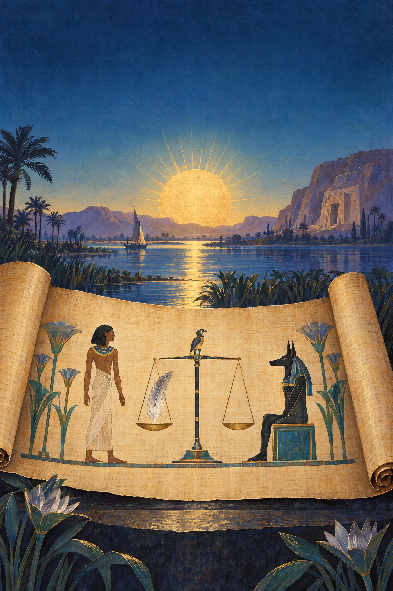
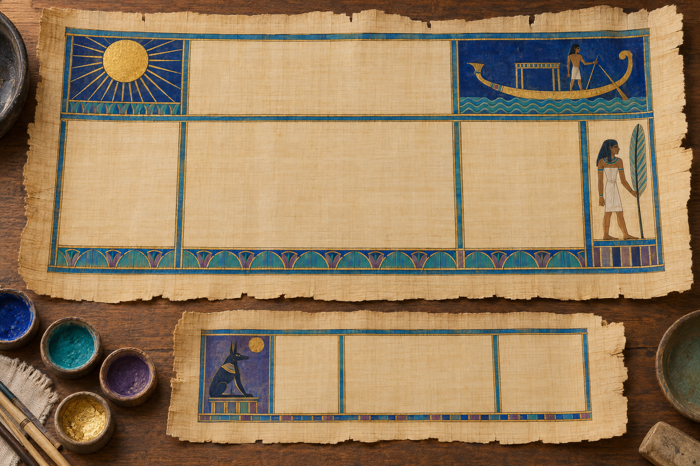
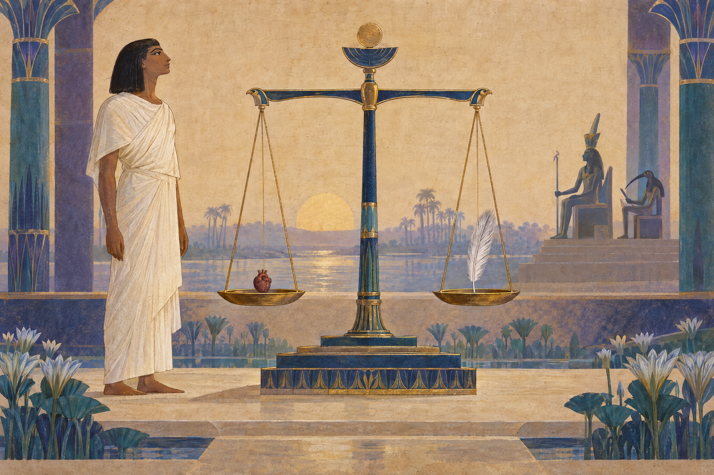
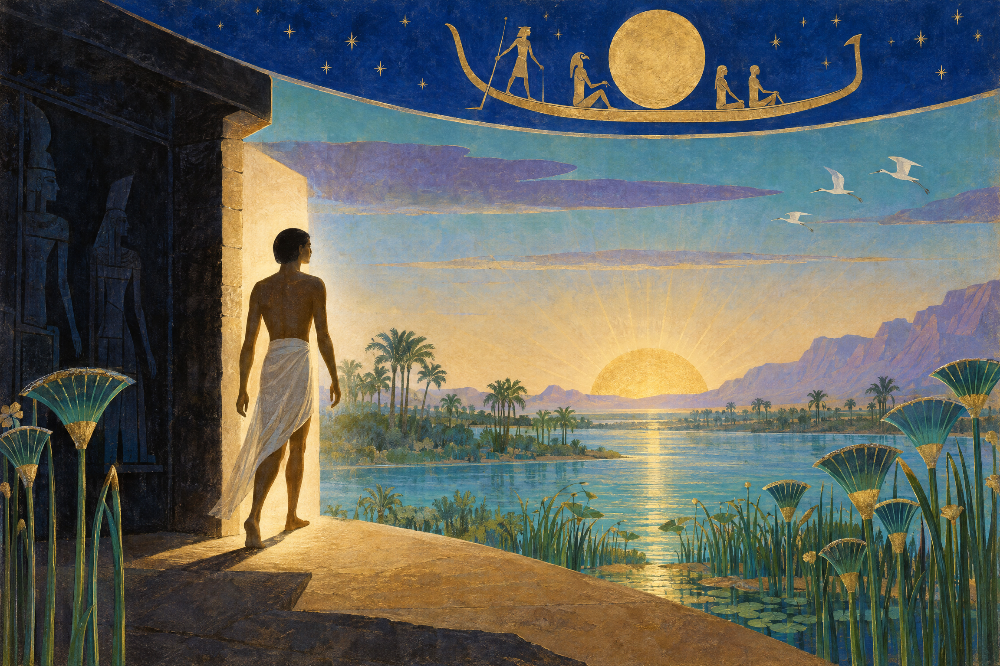
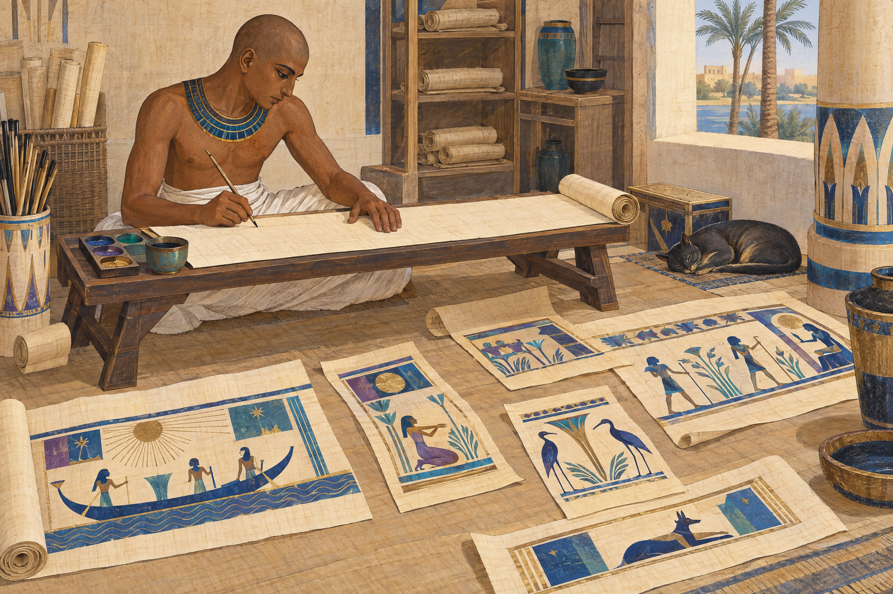

# Выходя к дневному свету

## Книга мёртвых Древнего Египта

**Читательский том HARVYRÐ**  
Авторские пояснения и пересказы; музейные предметы, тексты и исследования — в ссылках по главам.

*Это не перевод одного древнего свитка. Это проводник по меняющейся традиции — с папирусом Ани в качестве главного, но не единственного свидетеля.*

---

## Содержание

1. Книга, которой не было в единственном числе  
2. От пирамиды к погребальному свитку  
3. Папирус Ани: один человек, одна рукопись  
4. Как устроена страница: письмо и изображение  
5. Четыре формулы: выход, знание, сердце и суд  
6. Маат, Осирис и разные пути посмертия  
7. Свиток в гробнице: текст как погребальный предмет  
8. Не только Ани: Ну, Хунефер, Науни и Гринфилд  
9. Что популярный пересказ обычно упрощает  

**Авторские пересказы.** Все пересказы заклинаний в этой книге написаны заново по открытым текстовым и музейным источникам. Это не дословные переводы и не попытка восстановить единственную «правильную» редакцию. Нумерация заклинаний дана как современный научный ориентир. Пять иллюстраций — оригинальная редакционная графика; они не копируют конкретную древнюю виньетку и не являются реконструкциями исторических обрядов.

## 1. Книга, которой не было в единственном числе

Название **«Книга мёртвых»** звучит так, словно речь идёт об одной книге с установленными главами и неизменным сюжетом. Но древние египтяне не оставили такого единого тома. Под современным названием исследователи объединяют множество погребальных текстов — заклинаний, гимнов, речений и изображений, которые переписывали, выбирали и соединяли по-разному. Музейные и университетские обзоры подчёркивают: отдельные папирусы не обязаны совпадать ни составом, ни порядком, ни оформлением. [5] [8]

Древнее название, передаваемое в англоязычной египтологии как *Book of Coming Forth by Day* или *Going Forth by Day*, можно осторожно пояснить как **«выход днём»** или **«появление при дневном свете»**. Это желание умершего снова являться в мире дня, а не название повествования о смерти. Переводчики расходятся в выборе глагола; одна русская калька не снимает всей неоднозначности. [5] [8]

Разделы принято называть «главами», «заклинаниями» или «формулами». Для чтения удобен номер, например «заклинание 125», однако номера придумали исследователи нового времени. Они помогают сопоставлять тексты, но не были проставлены древним писцом и не превращают все папирусы в издания одной книги. [6] [11]

Поэтому полезно держать в уме три уровня. Есть большой и неоднородный корпус традиции. Есть конкретная рукопись, созданная для конкретного умершего. И есть современный каталог, который присваивает листам номера, описывает изображения и связывает их с научными обозначениями. Эти уровни связаны, но не тождественны.

## 2. От пирамиды к погребальному свитку

Погребальные формулы существовали задолго до папирусов, которые сегодня называют «Книгами мёртвых». Самые ранние тексты, известные как **Тексты пирамид**, высекали в царских пирамидах. Позже сходные и новые материалы записывали на гробах и иных предметах; этот разнородный корпус исследователи называют **Текстами саркофагов**. В нём встречаются как переработки более ранних формул, так и новые композиции. Переход не был простой заменой одной книги другой. [7]

В Новом царстве на папирусах стали особенно заметны подборки текстов «Выхода днём». Однако папирус не содержал автоматически всего известного корпуса. Для разных погребений выбирали разные формулы; менялись их число, порядок и изображение. Даже слова «Тексты пирамид», «Тексты саркофагов» и «Книга мёртвых» — современные исследовательские рубрики, полезные для разговора о времени и носителе, но не названия трёх древних томов с чёткими границами. [5] [7]

Источники также не дают нам единого древнего руководства о том, кто именно выбирал тексты для каждого свитка и по каким правилам. Часть рукописей могла опираться на доступный мастерской репертуар, часть — на пожелания заказчика или особенности погребения; точную долю каждого фактора установить нельзя. Поэтому лучше говорить о **меняющемся наборе текстов**, чем придумывать универсальный сценарий заказа. [5]

В поздних рукописях также различаются состав, порядок формул и связь текста с изображениями; такие подборки не обязательно образуют единый рассказ. [5] [17] [18]

## 3. Папирус Ани: один человек, одна рукопись

В центре этого тома — **папирус Ани**, потому что его можно обсуждать по конкретным музейным листам и хорошо известным сценам. Британский музей каталогизирует его под номером EA10470 и описывает отдельные части и рамки. Современная музейная запись датирует рукопись **XIX династией, приблизительно 1250 годом до н. э.**, и указывает место находки как **гробницу Ани в Фивах**. Это надёжная отправная точка для данного предмета, но не точная дата изготовления и не подробный археологический отчёт о раскопках. [1]

Каталог называет материал папирусом и отмечает расписную поверхность. В надписях Ани выступает как царский писец, писец, ведавший божественными приношениями, и надзиратель двойной житницы. В тех же записях названа его жена Туту, «госпожа дома» и певчая Амона. Эти титулы говорят о конкретном социальном положении владельца; они не позволяют превращать Ани в условного «обычного египтянина». [1]

Музейные карточки фиксируют и историю поступления: Британский музей указывает, что части были подарены сэром Эрнестом Уоллисом Баджем и зарегистрированы в 1888 году. Это важные сведения о передаче предмета музею. Но сами по себе они не рассказывают, как именно папирус был первоначально найден, кем и на каких условиях вывезен, куплен или передан. Такие детали нельзя достраивать по одному каталожному полю. [1] [2]

Удобно рассматривать Ани не как «полную Книгу мёртвых», а как **один персональный свидетель**. На одной части показаны сцены, связанные с погребальной процессией; на другой — суд, сердце и перо Маат; на третьей — формулы и образы загробного поля. Музей описывает отдельные листы и рамки, поэтому размеры отдельных частей не следует выдавать за точные размеры исходного свитка целиком. [1] [2] [3] [4]

Оцифрованные музейные страницы позволяют рассмотреть детали, а старое факсимильное издание Э. А. Уоллиса Баджа 1913 года остаётся историческим путём к изображению и тексту рукописи. Но старое издание — не современная критическая транскрипция и не повод перепечатывать чужой перевод. Здесь мы используем его только как часть истории публикации, а факты о датировке и музейной идентификации сверяем по нынешнему каталогу. [1] [25]

Старые публикации иногда предлагали иную датировку: например, университетская страница с редакцией Баджа обозначает папирус как относящийся примерно к 1240 году до н. э. Это следует читать как историю научной оценки, а не как точную дату изготовления; здесь принят нынешний ориентир Британского музея — около 1250 года до н. э. [1] [26]

## 4. Как устроена страница: письмо и изображение

Папирус — не страница современной книги. На нём могли соседствовать столбцы письма, цветные рамки, отдельные сцены и крупные изображения. В некоторых рукописях текст записан иератикой — скорописной формой египетского письма; в других важную роль играют иероглифические надписи и виньетки. Направление письма определяется конкретной записью и ориентацией знаков, а не одним правилом, которое можно механически наложить на любой фрагмент. [16] [17]

В папирусе Ани музей описывает иероглифические надписи и сцены, где изображение и текст действуют рядом. Например, лист EA10470,3 показывает взвешивание сердца, а каталог связывает его текст с формулой 30B. Но музей отдельно предупреждает: неизвестно, как именно проектировалось общее расположение текста и фигур. Мы можем описать сохранившуюся страницу, но не можем уверенно восстановить все этапы работы писца и художника. [1]

Виньетка — не обязательно просто «картинка к соседнему абзацу». В папирусе жреца Имхотепа, который хранится в Метрополитен-музее, музей отмечает, что изображения могли пояснять или даже заменять отдельные формулы. Там 182 колонки письма, но это особенность именно этого позднего свитка, не стандарт для всех рукописей. [17] [18]

*Схема рукописи здесь художественная: она объясняет соседство текста и образа, но не копирует конкретную страницу Ани.*

Современная нумерация помогает найти нужную композицию, но не подсказывает, где она стояла в каждом свитке. Номер мог быть присвоен группе слов, варианту текста или даже изображению. Так что читатель, который видит «заклинание 17», получает навигационный ориентир для научной литературы, а не древнюю страницу с напечатанным номером. [6]

## 5. Четыре формулы: выход, знание, сердце и суд

Все пересказы ниже — авторские. Они передают функцию и общий ход выбранных формул, а не заменяют египетский текст или научный перевод. Кроме того, одно и то же современное обозначение может объединять варианты из разных рукописей. [6] [9]

### Заклинание 1: открыть путь

Формула 1 связана с выходом после погребения и доступом к путям Осириса. В папирусе Ну, например, она не стоит первой: музейный корпус и университетское описание показывают, что положение формулы могло меняться. В нашем пересказе умерший присоединяется к свите Осириса и просит, чтобы путь был открыт, а движение туда и обратно не было остановлено. Уже этот небольшой пример показывает: смысл формулы и её позиция в рукописи — не одно и то же. [14] [19]

### Заклинание 17: объяснить, кто ты

В заклинании 17 умерший говорит о себе через язык богов и космогонии. Текст обращается к образам происхождения мира, задаёт вопросы о значении отдельных образов и затем даёт им толкования. Это не просто список имён: формула связывает умершего с божественным устройством мира и знанием, необходимым для посмертного существования. UCL указывает на связь композиции с более ранним материалом Текстов саркофагов; опубликованный текст собран из нескольких источников, поэтому его не следует приписывать одному папирусу целиком. [9]

### Заклинание 30B: сердце как свидетель

В формуле 30B умерший обращается к собственному сердцу и просит не выступать против него на суде и не давать обвинительного свидетельства. Это обращение связано с тем, что сердце — не просто орган, а важная часть личности и памяти умершего. Папирус Ани показывает эту идею через сцену, где сердце помещено на чашу весов, а напротив находится перо Маат. В музейном каталоге это конкретное место связано с 30B. [1] [6] [10]

У этой формулы есть близкие варианты, а практика сердечных скарабеев имеет свою историю. Поэтому неправильно пересказывать 30B как магическое «стирание грехов» или обещание автоматического оправдания. Смысл безопаснее передать как просьбу о защите сердца и о том, чтобы оно не стало враждебным свидетелем против умершего. [6] [10]

### Заклинание 125: оказаться перед Осирисом

Заклинание 125 соединяет несколько действий: умерший входит в зал, обращается к Осирису, называет богов и произносит отрицательные декларации — заявляет, что не совершал перечисленных вредных поступков. Современные редакторы различают вводную часть 125A и список 125B. Среди пунктов есть не только насилие над людьми, но и нарушения, связанные с храмовыми подношениями, землёй, мерой и весом, водой и хозяйственным порядком. Поэтому этот текст не стоит сводить к современному «кодексу преступлений». [12]

*Сцена — современная интерпретация мотивов суда; она не является копией папируса Ани и не означает, что один и тот же сценарий применялся во всех погребениях.*

Список и его оформление менялись. В папирусе Рамосе, опубликованном Фицуильям-музеем, сцена и колонки деклараций сохранились не полностью; музей также отмечает несоответствия между некоторыми отрицаниями и богами, а также поздние вставки. Это наблюдение по конкретной рукописи, но оно напоминает, что перед нами живая рукописная традиция, а не набор неизменных печатных страниц. [13]

## 6. Маат, Осирис и разные пути посмертия

Весы и перо Маат часто становятся главным образом, через который пересказывают египетские представления о смерти. Но **Маат** — не только «мера личной добродетели». Британский музей описывает её как богиню и принцип истины, справедливости, равновесия, порядка и гармонии. В контексте 125 речь идёт о том, как умерший соотносится с упорядоченным миром, где важны поступки, общественные отношения и поддержание ритуального порядка. [12] [22]

В папирусе Ани сердце сравнивается с пером. В папирусе Хунефера и в папирусе Науни есть свои сцены суда с Осирисом и другими божествами. Это важные изображения, но они принадлежат конкретным рукописям. Они не доказывают, что каждый египтянин видел один и тот же суд в одинаковом виде или произносил один и тот же список. [1] [15] [16]

Загробное существование также не сводилось только к одной проверке. Погребальные тексты могли защищать тело, обеспечивать подношения, давать знание имён и проходов, помогать умершему принимать разные формы, связывать его с Осирисом и включать в солнечный цикл. В разных традициях эти темы переплетались. Они не образуют две полностью раздельные «религии» и не укладываются в простую схему, где есть только один суд, один рай и один ад. [7] [23]

*Образ выхода к солнцу передаёт одну из тем традиции, а не универсальную карту загробного мира.*

Популярные пересказы иногда делают Аммит аналогом универсального ада, а список отрицаний — единым моральным экзаменом для всех. Источники дают более сложную картину. Мотив угрозы и уничтожения встречается, но его нельзя превращать в универсальную доктрину. Рукописи различаются, а само посмертие описывается через несколько функций и образов: возрождение, продолжение движения, защиту, превращение и поддержание умершего. [7] [12] [23]

## 7. Свиток в гробнице: текст как погребальный предмет

Папирус был не просто носителем слов. Это был предмет, созданный для конкретного человека и помещённый в погребальный контекст. Виньетка Ани с процессией к гробнице показывает гроб, жреца, совершающего возлияние и окуривание, и предметы, которые несут для помещения в могилу. Это музейное описание одной сцены, а не инструкция, что происходило во всех египетских похоронах. [3]

Сравнительные находки показывают разные способы размещения. В погребении Науни один свиток положили прямо на мумию, другой — внутрь полой деревянной фигуры Осириса. Метрополитен-музей описывает также папирус Тие, найденный завёрнутым вместе с её мумией. Эти примеры подтверждают, что способы могли различаться; они не устанавливают единственного порядка для всех эпох и регионов. [16] [24]

Сам текст мог помогать умершему преодолеть опасности и поддерживать его новое существование. Но музейные каталоги не доказывают, что свиток непременно разворачивали и читали вслух в ходе каждой церемонии. Следует различать наличие текста в гробнице, его магическую функцию и конкретное действие живых — последнее можно утверждать только там, где есть отдельное свидетельство. [1] [3] [16]

*Современный образ мастерской подчёркивает вариативность рукописей; он не реконструирует конкретную мастерскую или историческую процедуру заказа.*

Сохранившиеся роскошные рукописи особенно часто связаны с владельцами, чьи титулы видны в надписях: Ани был писцом и чиновником, Науни — певчей Амона и царской дочерью, Имхотеп — жрецом Хора. Эти памятники дают подробный материал, но выборка смещена в сторону людей, чьи погребальные предметы были качественными и пережили время. Нельзя по ним определить, какой свиток был у каждого египтянина или был ли такой папирус у большинства населения. [1] [16] [17]

## 8. Не только Ани: Ну, Хунефер, Науни и Гринфилд

Сравнение нескольких рукописей помогает увидеть, что Ани — не шаблон. Британский музей датирует папирус Ну XVIII династией. В каталоге отдельных листов перечислены разные формулы — среди них 83, 84, 81, 87, 88, 132 и 148; на другом листе есть заклинание 125. Это сведения о просмотренных листах, а не полное оглавление всего свитка. [19] [20]

Хунефер относится к XIX династии, то есть близок по времени к Ани. На музейном листе EA9901,3 описана сцена суда и формула 30B. Университетский обзор Смартхистори отмечает крупные полихромные сцены суда и «открытия уст». Общее обозначение формулы не делает два папируса одинаковыми: их изображения, наборы текстов и компоновка остаются особенностями каждой рукописи. [15] [18]

Папирус Науни показывает другую эпоху и погребальный контекст: XXI династия, титул певчей Амона, свитки в разных местах погребения. У жреца Имхотепа — позднептолемеевский свиток с большим числом колонок и подборкой формул, чья последовательность не образует прямого повествования. Гринфилдский папирус, созданный для жрицы Нестанебетишеру, содержит на описанном музейном листе виньетку к заклинанию 17 и формулы 23–26; это ещё один индивидуальный выбор материала. [16] [17] [21]

Сравнивать следует то, что действительно документировано: дату, владельца, отдельный лист, текст или сцену. Там, где музей показывает один фрагмент, мы не должны выдумывать состав всего свитка. Так нагляднее видны и общие темы, и расхождения: формула могла переходить из одной рукописи в другую, но каждая копия сохраняла собственные решения. [5] [6] [19] [20] [21]

## 9. Что популярный пересказ обычно упрощает

**«Это одна книга с одинаковыми главами».** Нет: название объединяет меняющиеся подборки, а номера глав — современная система навигации. [5] [6] [8]

**«Папирус Ани показывает верования всех египтян».** Нет: это один фиванский папирус XIX династии, созданный для конкретных владельцев; общие выводы проверяют по другим рукописям. [1] [15] [16] [19]

**«Суд — единый нравственный экзамен».** Формула 125 содержит отрицательные декларации, но её варианты различаются; Маат — также порядок и равновесие мира, а не только личная мораль. [12] [13] [22]

**«Загробный мир — это просто рай или ад».** Источники соединяют осирианские и солнечные образы с защитой тела, превращениями, подношениями и продолжением действия умершего. [7] [16] [23]

**«Картинка точно переводит соседний текст».** Виньетка может сопровождать или замещать формулу; для Ани музей не знает, как был спроектирован общий макет. [1] [17] [18]

Называйте конкретный папирус, сцену и дату, затем сравнивайте их с другими свидетельствами. Перед нами не один условный свиток, а многовековая традиция, которую собирали заново.

---

## Источники и дальнейшее чтение

Музейные карточки ниже относятся к конкретным предметам и листам. Университетские и кураторские материалы помогают сопоставлять их, но не заменяют самих рукописей. Все ссылки проверены по открытым страницам; прямые цитаты из современных переводов в текст книги не включены.

[1]: https://www.britishmuseum.org/collection/object/Y_EA10470-3 "British Museum, Papyrus of Ani, frame 3 (EA10470,3)"
[2]: https://www.britishmuseum.org/collection/object/Y_EA10470-35 "British Museum, Papyrus of Ani, frame 35 (EA10470,35)"
[3]: https://www.britishmuseum.org/collection/object/Y_EA10470-5 "British Museum, Papyrus of Ani, frame 5 (EA10470,5)"
[4]: https://www.britishmuseum.org/collection/object/Y_EA10470-2 "British Museum, Papyrus of Ani, frame 2 (EA10470,2)"
[5]: https://www.ucl.ac.uk/museums-static/digitalegypt/literature/religious/bdquestions.html "UCL Digital Egypt, What is the Book of the Dead?"
[6]: https://www.ucl.ac.uk/museums-static/digitalegypt/literature/religious/bdbynumber.html "UCL Digital Egypt, Book of the Dead chapters in modern numerical order"
[7]: https://smarthistory.org/ancient-egyptian-mortuary-texts/ "Smarthistory, Ancient Egyptian mortuary texts: an introduction"
[8]: https://www.britishmuseum.org/blog/what-book-dead "British Museum, What is a Book of the Dead?"
[9]: https://www.ucl.ac.uk/museums-static/digitalegypt/literature/religious/bd17.html "UCL Digital Egypt, Book of the Dead chapter 17"
[10]: https://www.ucl.ac.uk/museums-static/digitalegypt/literature/religious/bd30a.html "UCL Digital Egypt, Book of the Dead chapter 30A"
[11]: https://book-of-the-dead.fitzmuseum.cam.ac.uk/explore/book-of-the-dead/spells "Fitzwilliam Museum, What are these spells like?"
[12]: https://www.ucl.ac.uk/museums-static/digitalegypt/literature/religious/bd125a.html "UCL Digital Egypt, Book of the Dead chapter 125A"
[13]: https://book-of-the-dead.fitzmuseum.cam.ac.uk/explore/the-book-of-the-dead/spell-125 "Fitzwilliam Museum, Book of the Dead of Ramose: Spell 125"
[14]: https://www.ucl.ac.uk/museums-static/digitalegypt/literature/religious/bd1.html "UCL Digital Egypt, Book of the Dead chapter 1"
[15]: https://www.britishmuseum.org/collection/object/Y_EA9901-3 "British Museum, Book of the Dead of Hunefer, frame 3 (EA9901,3)"
[16]: https://www.metmuseum.org/art/collection/search/548344 "The Metropolitan Museum of Art, Book of the Dead for the Chantress of Amun, Nauny"
[17]: https://www.metmuseum.org/art/collection/search/551786 "The Metropolitan Museum of Art, Book of the Dead of the Priest of Horus, Imhotep (Imuthes)"
[18]: https://www.metmuseum.org/perspectives/book-of-the-dead "The Metropolitan Museum of Art, Scrolling through Imhotep’s Book of the Dead"
[19]: https://www.britishmuseum.org/collection/object/Y_EA10477-11 "British Museum, Book of the Dead of Nu, sheet 11 (EA10477,11)"
[20]: https://www.britishmuseum.org/collection/object/Y_EA10477-23 "British Museum, Book of the Dead of Nu, sheet 23 (EA10477,23)"
[21]: https://www.britishmuseum.org/collection/object/Y_EA10554-12 "British Museum, The Greenfield Papyrus, EA10554,12"
[22]: https://www.britishmuseum.org/learn/schools/ages-7-11/ancient-egypt/ancient-egyptian-gods-and-goddesses "British Museum, Ancient Egyptian gods and goddesses"
[23]: https://arce.org/resource/book-dead-guidebook-afterlife/ "American Research Center in Egypt, Book of the Dead: A Guidebook to the Afterlife"
[24]: https://www.metmuseum.org/art/collection/search/551142 "The Metropolitan Museum of Art, Book of the Dead Papyrus of Tiye"
[25]: https://catalog.hathitrust.org/Record/005895967 "HathiTrust, The papyrus of Ani: a reproduction in facsimile"
[26]: https://www.africa.upenn.edu/Books/Papyrus_Ani.html "University of Pennsylvania, The Papyrus of Ani: The Egyptian Book of the Dead"
