# ЧЖОУ И
## «Книга перемен» — читательское издание 64 гексаграмм

**Авторские краткие резюме · исторический путеводитель · русское издание**

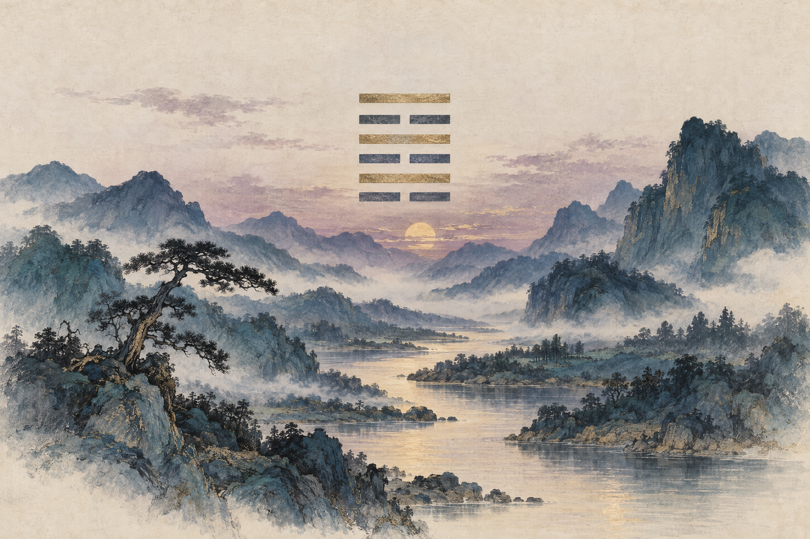

*Не новый перевод древнего текста, а самостоятельное чтение с ясными границами между ранним гадательным корпусом и поздними толкованиями.*

---

## О чём эта книга

«И цзин» — название, под которым один из древних китайских текстов стал классикой и получил долгую жизнь. В раннем контексте его обычно называют **Чжоу и** — «Перемены Чжоу». Это не единый текст, написанный одним автором в один момент. Знакомые сегодня 64 гексаграммы — результат длительной передачи, редактирования и толкования.

Эта книга даёт краткий маршрут по **полученному (традиционному) порядку 64 гексаграмм**. Каждая запись — оригинальное русское резюме с конкретными образами раннего текста. Это не буквальный перевод, не замена научному изданию и не инструкция, как принимать решения по гаданию. Заголовки — удобные редакционные названия; значения китайских слов и отдельных образов спорны.

### Три слоя, которые важно не смешивать

**1. Графические знаки и ранний гадательный корпус.** Чжоу и состоит из восьми триграмм, составленных в 64 шестилинейные фигуры, и текстов к ним: общего суждения для каждой фигуры и шести высказываний по линиям. Эти формулы содержат прорицания, образы, социальные и ритуальные сцены. Их нельзя без остатка свести к готовой философии или кодексу морали. Современные исследования рассматривают раннее формирование текста как исторический процесс; традиционные приписывания отдельных частей царю Вэню и князю Чжоу не следует принимать за доказанное авторство. Для сверки ранней текстовой истории и гадательного контекста см. [Эдварда Шонесси, *The Origin and Early Development of the Zhou Changes* (2022)](https://library.oapen.org/handle/20.500.12657/76660).

**2. «Десять крыльев».** Это более поздний набор толкований и трактатов, традиционно приписываемый Конфуцию. Он сделал знаки материалом для рассуждений о космосе, власти, человеке и переменах. Современная наука рассматривает эти тексты как составные и разновременные: датировки обсуждаются, но они не принадлежат к тому же раннему слою, что краткие суждения и строки. В полученных изданиях комментарии часто стоят рядом с основным текстом, из-за чего различие легко потерять. См. [обзор Stanford Encyclopedia of Philosophy, «Chinese Philosophy of Change (Yijing)»](https://plato.stanford.edu/archives/sum2019/entries/chinese-change/).

**3. Позднейшие способы чтения и гадания.** Практика обращения к книге менялась вместе с политической и интеллектуальной историей Восточной Азии. Знаменитая процедура с пучком стеблей тысячелистника описана в одном из «Крыльев», а не должна автоматически считаться неизменным способом, сопровождавшим ранний корпус с самого начала. Позднее Чжоу и служил инструментом гадания, классической философией, предметом ритуального знания и источником новых прочтений. Удобная история этой долгой жизни — [Ричард Дж. Смит, *The I Ching: A Biography* (2012)](https://press.princeton.edu/books/hardcover/9780691145099/the-i-ching).

Находка рукописи из гробницы Мавандуй, закрытой во II веке до н. э., показала, что в раннеханьскую эпоху существовала почти полная, но заметно иначе организованная версия Чжоу и, а также другие тексты-комментарии. Это наглядное свидетельство того, что книга передавалась в разных формах, а не раз и навсегда застыла в единственной редакции. Шонесси подробно разбирает этот корпус и оговаривает, что будущие находки могут изменить наши реконструкции.

### Как читать записи

Номера следуют традиционному порядку от 1 до 64. В миниатюре целая черта обозначена сплошной линией, разорванная — двумя отрезками; **нижняя черта — первая**, верхняя — шестая. Схемы показывают форму гексаграммы и ничего не говорят о том, какие линии «меняются» в конкретном гадании. У гексаграмм 1 и 2 в тексте есть дополнительная итоговая формула за пределами обычных шести линий; она включена в краткие резюме.

Переводные названия не всегда прозрачны: некоторые слова допускают несколько прочтений. Так, для 亢龍 в первой гексаграмме привычное толкование «слишком высоко поднявшийся дракон» конкурирует с филологической гипотезой Шонесси, предлагающей иной, астрономически мотивированный смысл. Поэтому резюме формулируют вероятный сюжет осторожно и не превращают спорную деталь в догму.

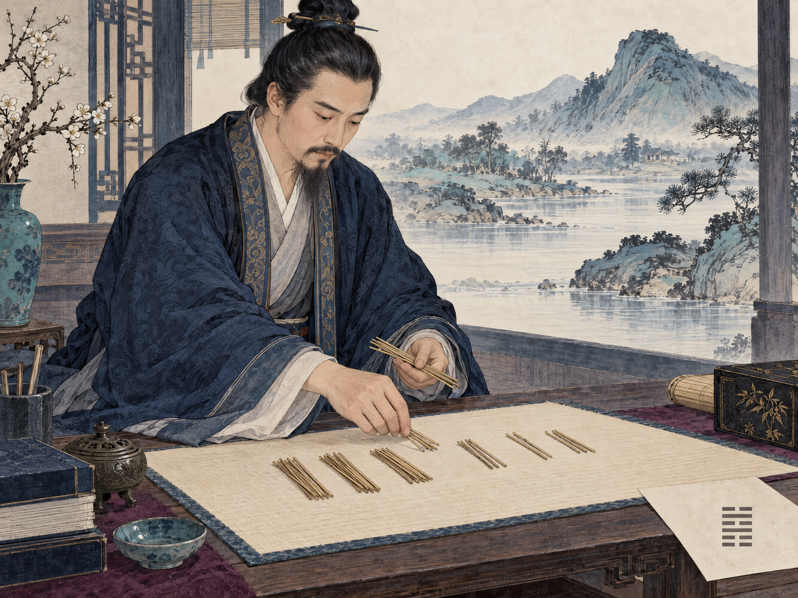

---

## 64 гексаграммы

### 01. 乾 · Qián — Творящее · Небо

 Суждение называет великое начало и благоприятное продвижение при твёрдости. Шесть образов дракона ведут от скрытости к полёту, но высшая линия предупреждает о сожалении того, кто превысил предел. Дополнительная заключительная формула о множестве драконов вводит иной исход; это последовательность оракульных формул, не универсальная моральная система.

*Первичный текст: [Легг, гексаграмма 1 (1882)](https://en.wikisource.org/wiki/Sacred_Books_of_the_East/Volume_16/Hexagram_1); историческое чтение — [Шонесси, 2022](https://library.oapen.org/handle/20.500.12657/76660).*

### 02. 坤 · Kūn — Воспринимающее · Земля

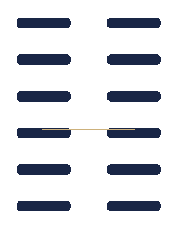 Земля и кобыла соединяют восприимчивость с выносливым следованием. Иней предвещает лёд; позднее появляются скромная служба, опасное столкновение драконов и напоминание сохранять правильность. Мягкость здесь не бездействие, а способность не присваивать себе почин и выдерживать долгий путь; дополнительная формула для шести меняющихся линий также оговаривает условие постоянной правильности.

*Первичный текст: [Легг, гексаграмма 2 (1882)](https://en.wikisource.org/wiki/Sacred_Books_of_the_East/Volume_16/Hexagram_2); историческое чтение — [Шонесси, 2022](https://library.oapen.org/handle/20.500.12657/76660).*

### 03. 屯 · Zhūn — Трудное начало

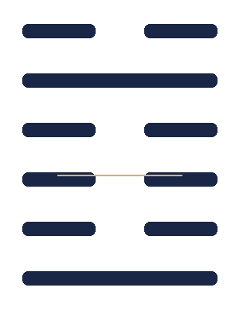 Начало дела затруднено, поэтому текст советует не спешить и поручить устройство порядка достойным людям. Образы растения, пробивающегося из земли, неумелой охоты и отступления со слезами показывают, насколько хрупким бывает первый шаг.

*Первичный текст: [Легг, гексаграмма 3 (1882)](https://en.wikisource.org/wiki/Sacred_Books_of_the_East/Volume_16/Hexagram_3); историческое чтение — [Шонесси, 2022](https://library.oapen.org/handle/20.500.12657/76660).*

### 04. 蒙 · Méng — Неведение и обучение

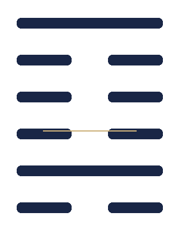 Ученик сам обращается за ответом, но повторное выспрашивание порицается. Наставление должно быть своевременным и соразмерным: наказание может снять заблуждение, но причинять вред ученику нельзя. Это конкретная сцена обучения и гадания, а не отвлечённый трактат о мудрости.

*Первичный текст: [Легг, гексаграмма 4 (1882)](https://en.wikisource.org/wiki/Sacred_Books_of_the_East/Volume_16/Hexagram_4); историческое чтение — [Шонесси, 2022](https://library.oapen.org/handle/20.500.12657/76660).*

### 05. 需 · Xū — Ожидание

 Облака собрались, но дождь ещё не выпал: перед опасным переходом требуется выждать. Линии приближают ожидающего к воде — от окраины и песка к грязи и крови; в финале помощь может прийти от неожиданных гостей.

*Первичный текст: [Легг, гексаграмма 5 (1882)](https://en.wikisource.org/wiki/Sacred_Books_of_the_East/Volume_16/Hexagram_5); историческое чтение — [Шонесси, 2022](https://library.oapen.org/handle/20.500.12657/76660).*

### 06. 訟 · Sòng — Тяжба

 Спор обещает трудности, если довести его до конца. Текст предпочитает осторожность, посредничество и возвращение к мере; строки показывают, что исход зависит от положения участников и конкретного хода дела, а не от одной лишь уверенности в своей правоте.

*Первичный текст: [Легг, гексаграмма 6 (1882)](https://en.wikisource.org/wiki/Sacred_Books_of_the_East/Volume_16/Hexagram_6); историческое чтение — [Шонесси, 2022](https://library.oapen.org/handle/20.500.12657/76660).*

### 07. 師 · Shī — Войско

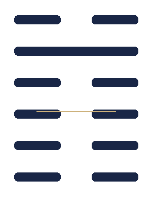 Военное множество нуждается в дисциплине и опытном командире. Строки допускают отступление и обсуждают награды после победы, но предостерегают от передачи власти над общинами неподходящим людям. Успех здесь — вопрос организации и ответственности.

*Первичный текст: [Легг, гексаграмма 7 (1882)](https://en.wikisource.org/wiki/Sacred_Books_of_the_East/Volume_16/Hexagram_7); историческое чтение — [Шонесси, 2022](https://library.oapen.org/handle/20.500.12657/76660).*

### 08. 比 · Bǐ — Объединение

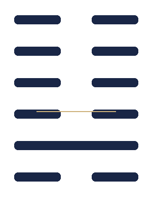 Союз вокруг центра требует проверки: продлится ли он и есть ли у него надёжное основание? Вода на земле становится образом связи и распределённой власти. Тот, кто присоединяется слишком поздно, рискует остаться вне общего порядка.

*Первичный текст: [Легг, гексаграмма 8 (1882)](https://en.wikisource.org/wiki/Sacred_Books_of_the_East/Volume_16/Hexagram_8); историческое чтение — [Шонесси, 2022](https://library.oapen.org/handle/20.500.12657/76660).*

### 09. 小畜 · Xiǎo Chù — Малое укрощение

 Сдерживание пока невелико: западные облака сгущаются, но дождя нет. Строки говорят о возвращении на путь, натянутой упряжи и восстановившемся союзе; даже когда дождь наконец выпал, продолжать движение может быть опасно.

*Первичный текст: [Легг, гексаграмма 9 (1882)](https://en.wikisource.org/wiki/Sacred_Books_of_the_East/Volume_16/Hexagram_9); историческое чтение — [Шонесси, 2022](https://library.oapen.org/handle/20.500.12657/76660).*

### 10. 履 · Lǚ — Осторожный шаг

 Идущий наступает тигру на хвост, но не бывает укушен: путь возможен при осмотрительности. Образ связывает шаг с различением ролей и порядка. Самоуверенный напор не даёт той же гарантии, что привычный или осторожный ход.

*Первичный текст: [Легг, гексаграмма 10 (1882)](https://en.wikisource.org/wiki/Sacred_Books_of_the_East/Volume_16/Hexagram_10); историческое чтение — [Шонесси, 2022](https://library.oapen.org/handle/20.500.12657/76660).*

### 11. 泰 · Tài — Мир

 Небо и земля сообщаются, малое отходит, великое приходит. Общее дело и взаимопомощь поддерживают благоприятный порядок, но текст помнит о его изменчивости: в конце городская стена рушится обратно в ров, и войско неуместно.

*Первичный текст: [Легг, гексаграмма 11 (1882)](https://en.wikisource.org/wiki/Sacred_Books_of_the_East/Volume_16/Hexagram_11); историческое чтение — [Шонесси, 2022](https://library.oapen.org/handle/20.500.12657/76660).*

### 12. 否 · Pǐ — Застой

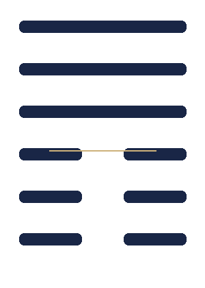 Небо и земля не встречаются: связь нарушена, и прежний порядок не действует. Вместо поиска почестей суждение советует сохранять достоинство и отступить. В строках застой понемногу ослабевает, пока не открывается возможность благоприятного завершения.

*Первичный текст: [Легг, гексаграмма 12 (1882)](https://en.wikisource.org/wiki/Sacred_Books_of_the_East/Volume_16/Hexagram_12); историческое чтение — [Шонесси, 2022](https://library.oapen.org/handle/20.500.12657/76660).*

### 13. 同人 · Tóng Rén — Содружество с людьми

 Объединение за пределами родственного круга сулит успех, но строки показывают его трудность: от выхода за ворота до скрытого оружия, осады и встречи за городом. Это не готовая проповедь о единстве, а путь через конфликт к союзу.

*Первичный текст: [Легг, гексаграмма 13 (1882)](https://en.wikisource.org/wiki/Sacred_Books_of_the_East/Volume_16/Hexagram_13); историческое чтение — [Шонесси, 2022](https://library.oapen.org/handle/20.500.12657/76660).*

### 14. 大有 · Dà Yǒu — Великое обладание

 Большое обладание означает не только богатство, но и обязанность им распорядиться. Нагруженная повозка, подношение правителю и поддержка способных людей соседствуют с требованием удерживать меру; изобилие требует управления.

*Первичный текст: [Легг, гексаграмма 14 (1882)](https://en.wikisource.org/wiki/Sacred_Books_of_the_East/Volume_16/Hexagram_14); историческое чтение — [Шонесси, 2022](https://library.oapen.org/handle/20.500.12657/76660).*

### 15. 謙 · Qiān — Скромность

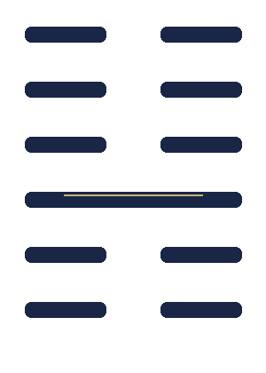 Сила, скрытая как гора под землёй, получает благоприятную оценку и позволяет продвигаться. Строки связывают скромность с заслугой, притяжением соседей и даже военным действием, ограниченным собственной областью. Это не отказ от действия, а его соразмерность.

*Первичный текст: [Легг, гексаграмма 15 (1882)](https://en.wikisource.org/wiki/Sacred_Books_of_the_East/Volume_16/Hexagram_15); историческое чтение — [Шонесси, 2022](https://library.oapen.org/handle/20.500.12657/76660).*

### 16. 豫 · Yù — Воодушевление

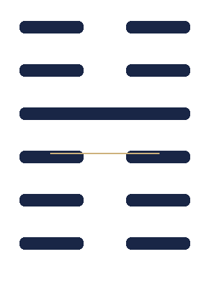 Общественный подъём способен собрать людей и поддержать действие, включая движение войска. Но самодовольное выставление радости и пассивное ожидание милостей ненадёжны; к концу требуется перемена курса. Здесь настроение связано с политической мобилизацией.

*Первичный текст: [Легг, гексаграмма 16 (1882)](https://en.wikisource.org/wiki/Sacred_Books_of_the_East/Volume_16/Hexagram_16); историческое чтение — [Шонесси, 2022](https://library.oapen.org/handle/20.500.12657/76660).*

### 17. 隨 · Suí — Следование

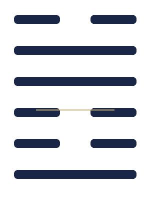 Следовать — не значит бездумно подчиняться: важны подходящая связь и правильный момент для остановки. Строки различают младшего и старшего, возвращение после захвата и царский жертвенный обряд; образ предлагает также отойти к покою.

*Первичный текст: [Легг, гексаграмма 17 (1882)](https://en.wikisource.org/wiki/Sacred_Books_of_the_East/Volume_16/Hexagram_17); историческое чтение — [Шонесси, 2022](https://library.oapen.org/handle/20.500.12657/76660).*

### 18. 蠱 · Gǔ — Исправление порчи

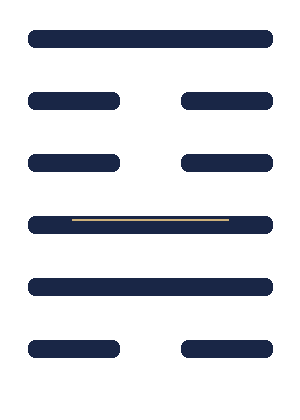 С испорченным порядком нужно разбираться, а не обходить его. Формула о трёх днях до и после перемены задаёт срок; строки рассматривают ответственность сына за дела родителей и возможность отказаться от службы ради собственного дела.

*Первичный текст: [Легг, гексаграмма 18 (1882)](https://en.wikisource.org/wiki/Sacred_Books_of_the_East/Volume_16/Hexagram_18); историческое чтение — [Шонесси, 2022](https://library.oapen.org/handle/20.500.12657/76660).*

### 19. 臨 · Lín — Приближение

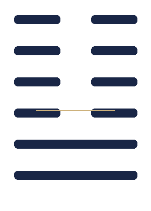 Власть приближается к тем, кем управляет; продвижение обещает успех, но суждение заранее напоминает о спаде к восьмому месяцу. Образы наставления и поддержки народа соседствуют с предупреждением не превращать благополучие в беспечную радость.

*Первичный текст: [Легг, гексаграмма 19 (1882)](https://en.wikisource.org/wiki/Sacred_Books_of_the_East/Volume_16/Hexagram_19); историческое чтение — [Шонесси, 2022](https://library.oapen.org/handle/20.500.12657/76660).*

### 20. 觀 · Guān — Созерцание

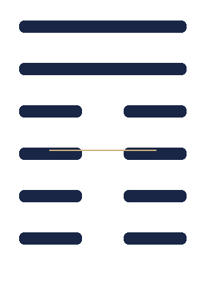 Перед подношением дар ещё не вручён: важны сосредоточенность и убедительная осанка. Правитель обозревает области и людей, воздействуя примером. Линии различают поверхностный взгляд, ограниченное наблюдение и внимательное рассмотрение собственного поведения.

*Первичный текст: [Легг, гексаграмма 20 (1882)](https://en.wikisource.org/wiki/Sacred_Books_of_the_East/Volume_16/Hexagram_20); историческое чтение — [Шонесси, 2022](https://library.oapen.org/handle/20.500.12657/76660).*

### 21. 噬嗑 · Shì Kè — Прокусывание препятствия

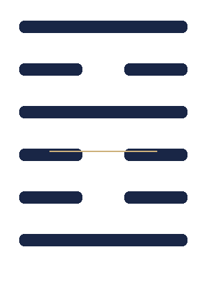 Чтобы соединить разорванное, препятствие устраняют законом и наказанием. Образ грома и молнии ведёт к формулированию и оглашению правил; строки показывают разные меры кары и суровый исход для упорного нарушителя. Это не метафора внутреннего саморазвития.

*Первичный текст: [Легг, гексаграмма 21 (1882)](https://en.wikisource.org/wiki/Sacred_Books_of_the_East/Volume_16/Hexagram_21); историческое чтение — [Шонесси, 2022](https://library.oapen.org/handle/20.500.12657/76660).*

### 22. 賁 · Bì — Украшение

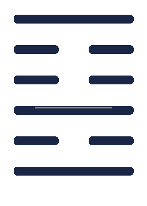 Украшение может прояснить и упорядочить, но остаётся второстепенным по отношению к сути. Образ огня у горы и строки об одежде, дороге и ткани дают локальные, условные исходы; внешняя отделка не обещает общего успеха.

*Первичный текст: [Легг, гексаграмма 22 (1882)](https://en.wikisource.org/wiki/Sacred_Books_of_the_East/Volume_16/Hexagram_22); историческое чтение — [Шонесси, 2022](https://library.oapen.org/handle/20.500.12657/76660).*

### 23. 剝 · Bō — Распад

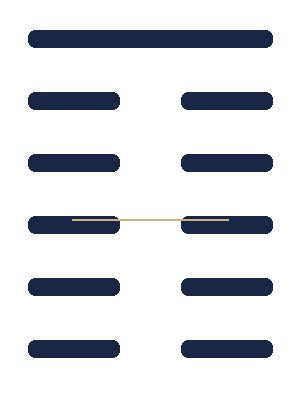 Опора разрушается снизу: повреждение ложа постепенно достигает того, кто на нём лежит. Однако связка рыб и сохранившийся плод оставляют шанс на восстановление. Последняя линия противопоставляет правителя, вновь обретающего народ, заговорщикам, губящим собственный дом.

*Первичный текст: [Легг, гексаграмма 23 (1882)](https://en.wikisource.org/wiki/Sacred_Books_of_the_East/Volume_16/Hexagram_23); историческое чтение — [Шонесси, 2022](https://library.oapen.org/handle/20.500.12657/76660).*

### 24. 復 · Fù — Возвращение

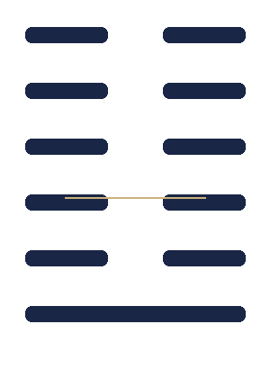 Возврат к надлежащему пути назван благоприятным; рядом возникают семь дней, выход и вход без беды. Строки отличают раннее и спокойное возвращение от опасного повторения ошибки и от окончательного сбивания с пути, которое разрушает дело.

*Первичный текст: [Легг, гексаграмма 24 (1882)](https://en.wikisource.org/wiki/Sacred_Books_of_the_East/Volume_16/Hexagram_24); историческое чтение — [Шонесси, 2022](https://library.oapen.org/handle/20.500.12657/76660).*

### 25. 無妄 · Wú Wàng — Невымышленное действие

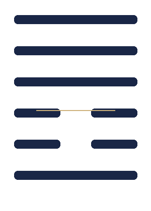 Путь без притворства может быть благоприятен, но невиновность не защищает от случайного ущерба или болезни. Гром под небом связывается с сезонным порядком и взращиванием существ; ошибочное действие, напротив, не оправдано благими намерениями.

*Первичный текст: [Легг, гексаграмма 25 (1882)](https://en.wikisource.org/wiki/Sacred_Books_of_the_East/Volume_16/Hexagram_25); историческое чтение — [Шонесси, 2022](https://library.oapen.org/handle/20.500.12657/76660).*

### 26. 大畜 · Dà Xù — Великое укрощение

 Сила не уничтожается, а удерживается и накапливается до подходящего момента. Строки переходят от снятой упряжи и обучения управлению колесницей к сдерживанию быка; подготовленное усилие открывает путь к большому переходу.

*Первичный текст: [Легг, гексаграмма 26 (1882)](https://en.wikisource.org/wiki/Sacred_Books_of_the_East/Volume_16/Hexagram_26); историческое чтение — [Шонесси, 2022](https://library.oapen.org/handle/20.500.12657/76660).*

### 27. 頤 · Yí — Питание

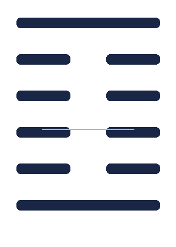 Образ челюстей ставит вопрос: чем человек поддерживает себя и кого кормит? Строки предупреждают о неверном поиске помощи и бездействии, но одобряют внимательный выбор пищи, самостоятельное усилие и заботу о других.

*Первичный текст: [Легг, гексаграмма 27 (1882)](https://en.wikisource.org/wiki/Sacred_Books_of_the_East/Volume_16/Hexagram_27); историческое чтение — [Шонесси, 2022](https://library.oapen.org/handle/20.500.12657/76660).*

### 28. 大過 · Dà Guò — Великое преобладание

 Балка прогибается под чрезмерной нагрузкой: ситуация необычна и опасна, хотя движение вперёд иногда возможно. Строки различают надёжную опору, новую поросль и гибельный перегиб; один переход через воду заканчивается дурно, но без вины.

*Первичный текст: [Легг, гексаграмма 28 (1882)](https://en.wikisource.org/wiki/Sacred_Books_of_the_East/Volume_16/Hexagram_28); историческое чтение — [Шонесси, 2022](https://library.oapen.org/handle/20.500.12657/76660).*

### 29. 坎 · Kǎn — Опасная впадина · Вода

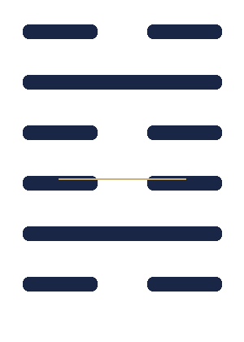 Двойная впадина означает повторяющуюся опасность, а не испытание, которое исчезает после одного усилия. Суждение опирается на искренность и умение проходить через риск; строки распределяют исходы от временного спасения до запрета двигаться.

*Первичный текст: [Легг, гексаграмма 29 (1882)](https://en.wikisource.org/wiki/Sacred_Books_of_the_East/Volume_16/Hexagram_29); историческое чтение — [Шонесси, 2022](https://library.oapen.org/handle/20.500.12657/76660).*

### 30. 離 · Lí — Огонь · Привязанность

 Двойной огонь даёт свет, но нуждается в опоре и поддержании; рядом появляется образ кроткой коровы. Строки ведут от осторожного шага через закат и пожар к военному действию, исход которого нельзя обобщить до лозунга о «просветлении».

*Первичный текст: [Легг, гексаграмма 30 (1882)](https://en.wikisource.org/wiki/Sacred_Books_of_the_East/Volume_16/Hexagram_30); историческое чтение — [Шонесси, 2022](https://library.oapen.org/handle/20.500.12657/76660).*

### 31. 咸 · Xián — Влияние

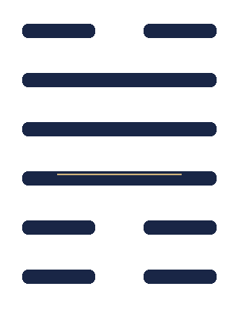 Взаимное воздействие описано через брак и отклик тела: от пальца ноги и икры до спины, щёк и языка. Влияние может привести к успеху, но поспешность и пустая речь нарушают отклик; образ говорит о восприимчивости к людям.

*Первичный текст: [Легг, гексаграмма 31 (1882)](https://en.wikisource.org/wiki/Sacred_Books_of_the_East/Volume_16/Hexagram_31); историческое чтение — [Шонесси, 2022](https://library.oapen.org/handle/20.500.12657/76660).*

### 32. 恆 · Héng — Постоянство

 Длительность обещает успех, если действие сохраняет правильную меру, а движение возможно в обе стороны. Но повторение само по себе не добродетель: отдельные строки связывают нетерпение, непостоянство и неуместную роль с бедой.

*Первичный текст: [Легг, гексаграмма 32 (1882)](https://en.wikisource.org/wiki/Sacred_Books_of_the_East/Volume_16/Hexagram_32); историческое чтение — [Шонесси, 2022](https://library.oapen.org/handle/20.500.12657/76660).*

### 33. 遯 · Dùn — Отступление

 Отступление может быть верным ходом, когда противник усиливается. Строки показывают, как промедление и связанность ухудшают положение, тогда как своевременный уход сохраняет возможность действовать. Образ неба над горой передаёт расхождение и дистанцию.

*Первичный текст: [Легг, гексаграмма 33 (1882)](https://en.wikisource.org/wiki/Sacred_Books_of_the_East/Volume_16/Hexagram_33); историческое чтение — [Шонесси, 2022](https://library.oapen.org/handle/20.500.12657/76660).*

### 34. 大壯 · Dà Zhuàng — Великая сила

 Сила полезна лишь при твёрдости и осторожности. Баран застревает рогами в ограде, когда напирает не вовремя; верхняя линия получает благоприятный исход, признав затруднение и отказавшись от бесплодного усилия.

*Первичный текст: [Легг, гексаграмма 34 (1882)](https://en.wikisource.org/wiki/Sacred_Books_of_the_East/Volume_16/Hexagram_34); историческое чтение — [Шонесси, 2022](https://library.oapen.org/handle/20.500.12657/76660).*

### 35. 晉 · Jìn — Продвижение

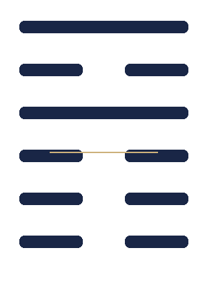 Служилый правитель продвигается и получает знаки признания, включая коней и повторные аудиенции. Но строки сохраняют задержки, недоверие и опасное скрытное движение; чрезмерное применение силы в конце вызывает сожаление.

*Первичный текст: [Легг, гексаграмма 35 (1882)](https://en.wikisource.org/wiki/Sacred_Books_of_the_East/Volume_16/Hexagram_35); историческое чтение — [Шонесси, 2022](https://library.oapen.org/handle/20.500.12657/76660).*

### 36. 明夷 · Míng Yí — Затемнение света

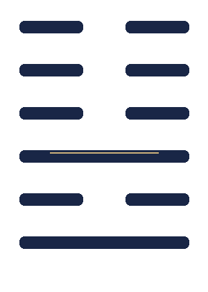 Когда свет скрыт землёй, открытая демонстрация себя опасна. Строки описывают ранения, бегство и придворную угрозу; князь Цзи становится примером человека, который терпит внешнее унижение, не отказываясь от внутреннего намерения.

*Первичный текст: [Легг, гексаграмма 36 (1882)](https://en.wikisource.org/wiki/Sacred_Books_of_the_East/Volume_16/Hexagram_36); историческое чтение — [Шонесси, 2022](https://library.oapen.org/handle/20.500.12657/76660).*

### 37. 家人 · Jiā Rén — Домочадцы

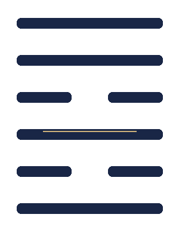 Домашний порядок создаётся распределением ролей, правилами, приготовлением пищи и ответственностью главы дома. Образ и строки отражают древнюю иерархическую семью, а не универсальную модель семейной жизни; искренность и достоинство определяют финальный исход.

*Первичный текст: [Легг, гексаграмма 37 (1882)](https://en.wikisource.org/wiki/Sacred_Books_of_the_East/Volume_16/Hexagram_37); историческое чтение — [Шонесси, 2022](https://library.oapen.org/handle/20.500.12657/76660).*

### 38. 睽 · Kuí — Противостояние

 При расхождении и недоверии большое совместное дело затруднено, но малые дела ещё возможны. Строки показывают потерянных лошадей и ошибочную встречу с родственником, принятым за врага; различение не обязательно означает окончательный разрыв.

*Первичный текст: [Легг, гексаграмма 38 (1882)](https://en.wikisource.org/wiki/Sacred_Books_of_the_East/Volume_16/Hexagram_38); историческое чтение — [Шонесси, 2022](https://library.oapen.org/handle/20.500.12657/76660).*

### 39. 蹇 · Jiǎn — Препятствие

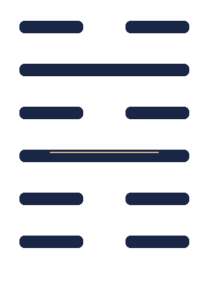 Продвижение может лишь усилить препятствие; встреча с великим человеком и возвращение к своим названы полезными. Образы воды над горой переводят трудность в вопрос о направлении: когда следует остановиться, искать союзников и менять путь.

*Первичный текст: [Легг, гексаграмма 39 (1882)](https://en.wikisource.org/wiki/Sacred_Books_of_the_East/Volume_16/Hexagram_39); историческое чтение — [Шонесси, 2022](https://library.oapen.org/handle/20.500.12657/76660).*

### 40. 解 · Xiè (совр. Jiě) — Освобождение

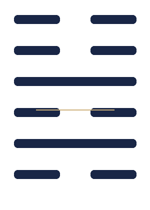 После устранения препятствия нужно понять, завершена ли работа: если да — вернуться к обычному порядку; если нет — действовать без промедления. Строки связывают освобождение с восстановлением порядка и выбором соразмерных средств.

*Первичный текст: [Легг, гексаграмма 40 (1882)](https://en.wikisource.org/wiki/Sacred_Books_of_the_East/Volume_16/Hexagram_40); историческое чтение — [Шонесси, 2022](https://library.oapen.org/handle/20.500.12657/76660).*

### 41. 損 · Sǔn — Уменьшение

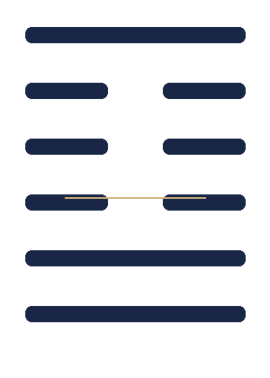 Даже малое приношение может быть принято, если оно искренне и соразмерно. Образ связывает отдачу нижнего с поддержкой верхнего; строки различают помощь, не истощающую дающего, и вклад, который наносит ущерб самому помощнику.

*Первичный текст: [Легг, гексаграмма 41 (1882)](https://en.wikisource.org/wiki/Sacred_Books_of_the_East/Volume_16/Hexagram_41); историческое чтение — [Шонесси, 2022](https://library.oapen.org/handle/20.500.12657/76660).*

### 42. 益 · Yì — Увеличение

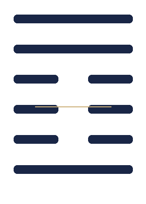 Прибавление приходит сверху вниз: власть передаёт благо тем, кто ниже, поэтому новое дело и переход через большую реку благоприятны. Строки говорят о дарах, службе и переносе столицы, а также о наказании правителя, не приносящего пользы народу.

*Первичный текст: [Легг, гексаграмма 42 (1882)](https://en.wikisource.org/wiki/Sacred_Books_of_the_East/Volume_16/Hexagram_42); историческое чтение — [Шонесси, 2022](https://library.oapen.org/handle/20.500.12657/76660).*

### 43. 夬 · Guài — Прорыв

 Опасного противника следует назвать открыто и известить общину, но не бросаться к оружию. Образ высокого озера призывает распределять богатство вниз; строки удерживают напряжение между решимостью, одиночеством и риском дурного исхода.

*Первичный текст: [Легг, гексаграмма 43 (1882)](https://en.wikisource.org/wiki/Sacred_Books_of_the_East/Volume_16/Hexagram_43); историческое чтение — [Шонесси, 2022](https://library.oapen.org/handle/20.500.12657/76660).*

### 44. 姤 · Gòu — Встреча

 Внезапная встреча представлена образом сильной женщины, которую не следует брать в жёны. Затем идут отдельные гадательные сцены — рыба, кошелёк, дерево, тыква и столкновение рогами; сводить их к единой притче рискованно.

*Первичный текст: [Легг, гексаграмма 44 (1882)](https://en.wikisource.org/wiki/Sacred_Books_of_the_East/Volume_16/Hexagram_44); историческое чтение — [Шонесси, 2022](https://library.oapen.org/handle/20.500.12657/76660).*

### 45. 萃 · Cuì — Собрание

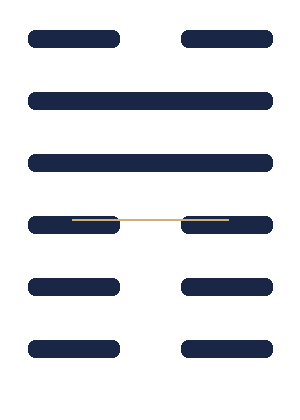 Собрание людей требует места, подношения и организующего центра; образ связан с храмом предков и царским присутствием. Строки спрашивают, есть ли запасы, доверие и надлежащий порядок, прежде чем множество соберётся вместе.

*Первичный текст: [Легг, гексаграмма 45 (1882)](https://en.wikisource.org/wiki/Sacred_Books_of_the_East/Volume_16/Hexagram_45); историческое чтение — [Шонесси, 2022](https://library.oapen.org/handle/20.500.12657/76660).*

### 46. 升 · Shēng — Подъём

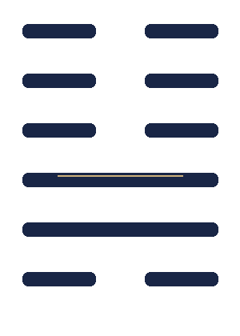 Продвижение вверх происходит постепенно и требует настойчивости, подходящего помощника и правильного направления. Образ дерева, растущего из земли, сопровождают действия служилого человека и выход на встречу с правителем; путь не сводится к внезапной удаче.

*Первичный текст: [Легг, гексаграмма 46 (1882)](https://en.wikisource.org/wiki/Sacred_Books_of_the_East/Volume_16/Hexagram_46); историческое чтение — [Шонесси, 2022](https://library.oapen.org/handle/20.500.12657/76660).*

### 47. 困 · Kùn — Стеснённость

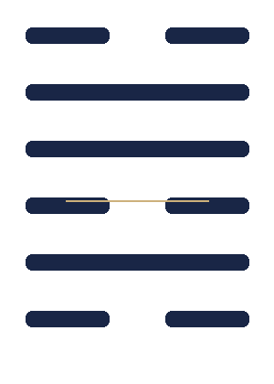 Истощение и стеснённость ограничивают речь и движение, но не отменяют достоинства. Суждение связывает успех с твёрдостью; строки показывают колодец, тернии, дворец и угрозу наказания — разные формы ограничения, не одинаковые по исходу.

*Первичный текст: [Легг, гексаграмма 47 (1882)](https://en.wikisource.org/wiki/Sacred_Books_of_the_East/Volume_16/Hexagram_47); историческое чтение — [Шонесси, 2022](https://library.oapen.org/handle/20.500.12657/76660).*

### 48. 井 · Jǐng — Колодец

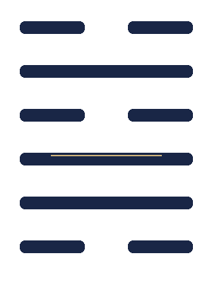 Колодец сохраняет воду для общины, но его польза зависит от ухода и доступа: верёвка может оборваться, а ведро — разбиться. Образ напоминает о постоянном источнике, которому нужны надёжные инструменты и совместная забота.

*Первичный текст: [Легг, гексаграмма 48 (1882)](https://en.wikisource.org/wiki/Sacred_Books_of_the_East/Volume_16/Hexagram_48); историческое чтение — [Шонесси, 2022](https://library.oapen.org/handle/20.500.12657/76660).*

### 49. 革 · Gé — Перемены

 Перемена требует времени, доверия и правильного момента; само слово «реформа» ещё не делает её благой. Образ снятой шкуры и строки о жертвенных действиях, царе и смене календарного порядка связывают её с политической легитимностью.

*Первичный текст: [Легг, гексаграмма 49 (1882)](https://en.wikisource.org/wiki/Sacred_Books_of_the_East/Volume_16/Hexagram_49); историческое чтение — [Шонесси, 2022](https://library.oapen.org/handle/20.500.12657/76660).*

### 50. 鼎 · Dǐng — Котёл

 Котёл готовит пищу для жертвенного ритуала и пиров, поддерживая порядок общины и её служителей. Строки проходят от перевёрнутого сосуда к устойчивой рукояти и нефритовой ручке: благоприятное устройство требует и подходящего содержания, и надлежащей формы.

*Первичный текст: [Легг, гексаграмма 50 (1882)](https://en.wikisource.org/wiki/Sacred_Books_of_the_East/Volume_16/Hexagram_50); историческое чтение — [Шонесси, 2022](https://library.oapen.org/handle/20.500.12657/76660).*

### 51. 震 · Zhèn — Гром

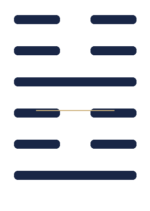 Гром потрясает на сто ли, но страх может смениться смехом. Главное — не выронить ковш и чашу ритуального вина: образ и строки связывают испуг с проверкой поведения и сохранением того, что важно.

*Первичный текст: [Легг, гексаграмма 51 (1882)](https://en.wikisource.org/wiki/Sacred_Books_of_the_East/Volume_16/Hexagram_51); историческое чтение — [Шонесси, 2022](https://library.oapen.org/handle/20.500.12657/76660).*

### 52. 艮 · Gèn — Неподвижность

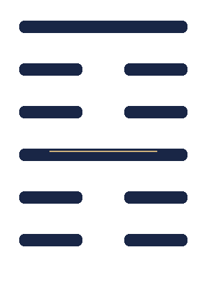 Остановка показана через части тела — от стоп и голеней к пояснице и челюстям. Не всякая неподвижность благоприятна: иногда она делает помощь невозможной; в иных строках сдержанность в словах и верное завершение полезны.

*Первичный текст: [Легг, гексаграмма 52 (1882)](https://en.wikisource.org/wiki/Sacred_Books_of_the_East/Volume_16/Hexagram_52); историческое чтение — [Шонесси, 2022](https://library.oapen.org/handle/20.500.12657/76660).*

### 53. 漸 · Jiàn — Постепенное развитие

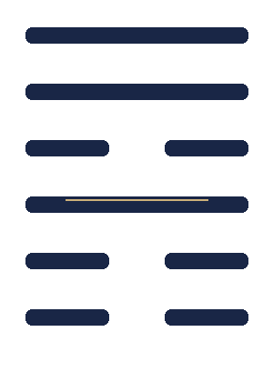 Движение развивается шаг за шагом, как дерево на горе и дикий гусь, перелетающий от берега к высоте. Брачный образ подчёркивает порядок и длительность; строки допускают задержки и опасности, но не требуют скачка.

*Первичный текст: [Легг, гексаграмма 53 (1882)](https://en.wikisource.org/wiki/Sacred_Books_of_the_East/Volume_16/Hexagram_53); историческое чтение — [Шонесси, 2022](https://library.oapen.org/handle/20.500.12657/76660).*

### 54. 歸妹 · Guī Mèi — Брак младшей сестры

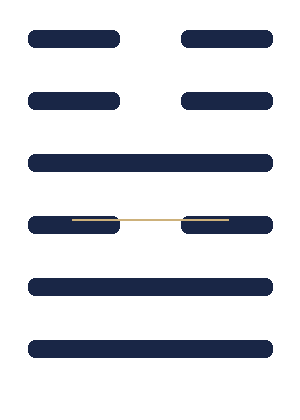 Брачное соединение описано как неравное положение младшей женщины и прямо получает неблагоприятную оценку. Строки показывают вторичную жену, отсрочку и неисполненный обряд; это социальный мир древнего текста, а не идеал супружества.

*Первичный текст: [Легг, гексаграмма 54 (1882)](https://en.wikisource.org/wiki/Sacred_Books_of_the_East/Volume_16/Hexagram_54); историческое чтение — [Шонесси, 2022](https://library.oapen.org/handle/20.500.12657/76660).*

### 55. 豐 · Fēng — Изобилие

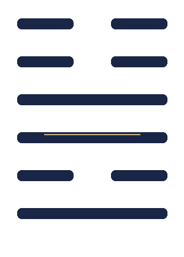 Полнота достигнута, но не гарантирует безопасности: полуденный свет затемняется, а облака заслоняют обзор. Важны встреча с правителем и связи с людьми; дом, замкнутый только на себе, может надолго остаться без обитателей.

*Первичный текст: [Легг, гексаграмма 55 (1882)](https://en.wikisource.org/wiki/Sacred_Books_of_the_East/Volume_16/Hexagram_55); историческое чтение — [Шонесси, 2022](https://library.oapen.org/handle/20.500.12657/76660).*

### 56. 旅 · Lǚ — Странник

 Путник находится вне своей обычной опоры, поэтому обещано лишь небольшое продвижение. Жильё, слуги, припасы и оружие оказываются уязвимы; добыча фазана приносит признание, тогда как вспышка насилия приводит к пожару и потере.

*Первичный текст: [Легг, гексаграмма 56 (1882)](https://en.wikisource.org/wiki/Sacred_Books_of_the_East/Volume_16/Hexagram_56); историческое чтение — [Шонесси, 2022](https://library.oapen.org/handle/20.500.12657/76660).*

### 57. 巽 · Xùn — Мягкое проникновение · Ветер

 Небольшое продвижение возможно через последовательное, проникающее действие и обращение к достойному человеку. Колебание ведёт к затруднению, чрезмерная сила — к сожалениям; строки советуют принять решение, объявить перемены и проверить результат.

*Первичный текст: [Легг, гексаграмма 57 (1882)](https://en.wikisource.org/wiki/Sacred_Books_of_the_East/Volume_16/Hexagram_57); историческое чтение — [Шонесси, 2022](https://library.oapen.org/handle/20.500.12657/76660).*

### 58. 兌 · Duì — Радость · Озеро

 Радость поддерживается беседой и совместным упражнением, но требует правильной меры. Строки различают искренний отклик и разрушительное увлечение удовольствием; сам факт приятного состояния не делает каждое продолжение безопасным.

*Первичный текст: [Легг, гексаграмма 58 (1882)](https://en.wikisource.org/wiki/Sacred_Books_of_the_East/Volume_16/Hexagram_58); историческое чтение — [Шонесси, 2022](https://library.oapen.org/handle/20.500.12657/76660).*

### 59. 渙 · Huàn — Рассеяние

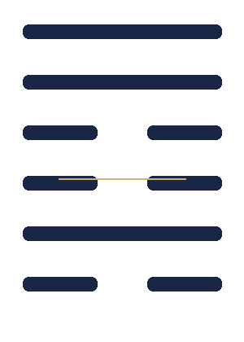 Рассеявшееся сообщество собирают через храм предков, переход и публичное распоряжение. Строки говорят о сильной лошади, запасах и отказе от личной выгоды; образ связывает восстановление с общим, а не частным порядком.

*Первичный текст: [Легг, гексаграмма 59 (1882)](https://en.wikisource.org/wiki/Sacred_Books_of_the_East/Volume_16/Hexagram_59); историческое чтение — [Шонесси, 2022](https://library.oapen.org/handle/20.500.12657/76660).*

### 60. 節 · Jié — Ограничение

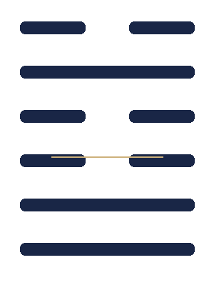 Установленные пределы могут поддерживать порядок, но чрезмерная суровость не удерживается. Строки показывают закрытый двор, предписания и различие между мягкой и жёсткой мерой; самоограничение здесь не безусловная добродетель.

*Первичный текст: [Легг, гексаграмма 60 (1882)](https://en.wikisource.org/wiki/Sacred_Books_of_the_East/Volume_16/Hexagram_60); историческое чтение — [Шонесси, 2022](https://library.oapen.org/handle/20.500.12657/76660).*

### 61. 中孚 · Zhōng Fú — Внутренняя искренность

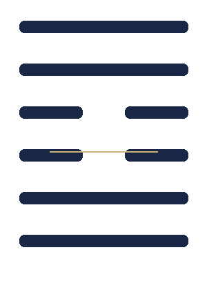 Искренность представлена как действенный отклик, достигающий даже свиней и рыб; она позволяет решиться на переход. Но петух, пытающийся взлететь к небу, становится предупреждением против чрезмерного возвышения.

*Первичный текст: [Легг, гексаграмма 61 (1882)](https://en.wikisource.org/wiki/Sacred_Books_of_the_East/Volume_16/Hexagram_61); историческое чтение — [Шонесси, 2022](https://library.oapen.org/handle/20.500.12657/76660).*

### 62. 小過 · Xiǎo Guò — Малое превышение

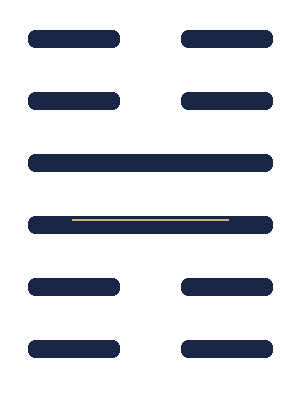 Небольшое дело может завершиться благоприятно, но крупный замысел неуместен. Образ летящей птицы задаёт направление вниз, а строки предупреждают о чрезмерном взлёте и опасном продвижении; осторожность не равна бездействию.

*Первичный текст: [Легг, гексаграмма 62 (1882)](https://en.wikisource.org/wiki/Sacred_Books_of_the_East/Volume_16/Hexagram_62); историческое чтение — [Шонесси, 2022](https://library.oapen.org/handle/20.500.12657/76660).*

### 63. 既濟 · Jì Jì — После переправы

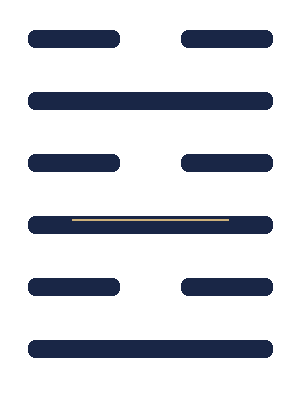 Переправа уже совершена и малый успех достигнут, но начальное благополучие может обратиться расстройством. Колесница, лодка и ритуальные сцены напоминают о продолжающейся бдительности: дело нельзя считать безопасным лишь потому, что главный рубеж пройден.

*Первичный текст: [Легг, гексаграмма 63 (1882)](https://en.wikisource.org/wiki/Sacred_Books_of_the_East/Volume_16/Hexagram_63); историческое чтение — [Шонесси, 2022](https://library.oapen.org/handle/20.500.12657/76660).*

### 64. 未濟 · Wèi Jì — Перед переправой

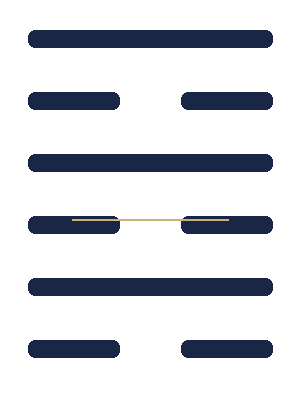 Переход ещё не завершён; поспешный молодой лис промачивает хвост и получает неблагоприятный исход. Строки чередуют удерживание и движение, поход и награды, пир и риск. Незавершённость требует выдержки, а не преждевременного празднования.

*Первичный текст: [Легг, гексаграмма 64 (1882)](https://en.wikisource.org/wiki/Sacred_Books_of_the_East/Volume_16/Hexagram_64); историческое чтение — [Шонесси, 2022](https://library.oapen.org/handle/20.500.12657/76660).*

---

## Источники и редакционные примечания

1. **James Legge**, “The Yi King,” in *The Sacred Books of the East*, vol. 16, *The Sacred Books of China: The Texts of Confucianism, Part II* (Oxford: Clarendon Press, 1882). [Полный открытый текст тома](https://en.wikisource.org/wiki/Sacred_Books_of_the_East/Volume_16); [каталог и скан издания](https://archive.org/details/wg916). Легг служит открытым текстовым ориентиром для суждений и строк; его перевод XIX века и конфуцианские комментарии — исторический слой интерпретации, а не нейтральный или окончательный перевод. Проверка библиографии: Project Gutenberg №2528 относится к *The Women of the French Salons* Амелии Гир Мейсон, а не к *И цзин*; поэтому здесь используется Wikisource и скан издания.
2. **Edward L. Shaughnessy**, *The Origin and Early Development of the Zhou Changes* (Leiden: Brill, 2022). [Описание и открытый доступ через OAPEN](https://library.oapen.org/handle/20.500.12657/76660). Современное исследование истории текста, ранних рукописей, формульных прорицаний и практик гадания.
3. **Tze-ki Hon**, “Chinese Philosophy of Change (Yijing),” *Stanford Encyclopedia of Philosophy*, archived edition. [Статья](https://plato.stanford.edu/archives/sum2019/entries/chinese-change/). Обзор составного характера текста, различия основного корпуса и «Десяти крыльев», а также позднейших философских прочтений.
4. **Richard J. Smith**, *The I Ching: A Biography* (Princeton University Press, 2012). [Издательское описание](https://press.princeton.edu/books/hardcover/9780691145099/the-i-ching). История разнообразных употреблений и интерпретаций книги в Китае и за его пределами.

### Как составлены резюме

Текст этой книги написан заново. Он не воспроизводит перевод Легга или современной защищённой авторским правом версии. Для каждой гексаграммы дан прямой линк на соответствующий раздел открытого издания Легга; академический контекст и осторожные оговорки опираются прежде всего на Шонесси, Hon и Smith. Переводы имён и отдельных строк остаются дискуссионными, а краткие резюме неизбежно отбирают лишь часть возможных смыслов.

Гексаграммы не предлагаются как безошибочные прогнозы или психологические диагнозы. Их ранние формулы возникли в конкретном историческом и ритуальном мире; последующие читатели вновь и вновь помещали их в новые системы. Данное читательское издание старается показать текст, не стирая этих различий.

---

*Русское читательское издание. Полный корпус: 64 гексаграммы. Схемы линий и все три иллюстрации подготовлены специально для этой книги.*
