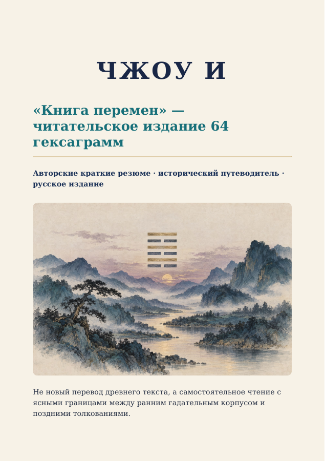

# HARVYRÐ — Чжоу и: «Книга перемен» · читательское издание v0.1

26-страничное русское читательское издание с авторскими краткими резюме всех 64 гексаграмм в традиционном порядке. Оно помогает читать образы и формулы рядом с историческим контекстом, но не является новым переводом древнего текста, научным комментарием или руководством по гаданию.

## Файлы издания

- [Иллюстрированный PDF](I_Ching_reader_ru.pdf)
- [Редактируемый DOCX](I_Ching_reader_ru.docx)
- [Полный Markdown](I_Ching_reader_ru.md)
- [Полный ZIP-пакет иллюстраций](illustrations_bundle.zip)
- [Папка исходных иллюстраций — 70 изображений и инвентарь](illustrations/)
- [Просмотр обложки](cover-preview.png)
- [Реестр источников](sources/SOURCE_INDEX.md)
- [SHA-256 всех файлов комплекта](SHA256SUMS)
- [Манифест редакции](edition_manifest.json)
- [Страница книги в Notion](https://app.notion.com/p/408ac84d054781ed8630ebbd3db7e611)

## Как устроен текст

Резюме написаны заново на русском языке и следуют полученному порядку 64 гексаграмм. Каждая запись выбирает часть образов и строк раннего корпуса; краткость неизбежно означает отбор и не разрешает все филологические споры. В Markdown даны отдельные ссылки на соответствующие главы открытого перевода Джеймса Легга 1882 года, а также на исследовательские работы о ранней истории и позднейших прочтениях.

В книге особо различаются три слоя: знаки и ранние гадательные формулы Чжоу и; более поздние тексты-комментарии, объединяемые названием «Десять крыльев»; и многочисленные позднейшие способы использовать и объяснять классический текст. Традиционные атрибуции частей царю Вэню, князю Чжоу и Конфуцию отмечены как традиция, а не как доказанное авторство. Рукопись из Мавандуй показывает, что в раннеханьскую эпоху существовала иная организация текста; современное получение книги нельзя считать единственной неизменной формой с самого начала.

## Границы и оговорки

- Это обзор для читателя, а не перевод с китайского и не замена критическому изданию.
- Резюме не предлагают гексаграммы как надёжные предсказания, диагнозы или готовые советы.
- Легг — важный открытый текстовый ориентир XIX века, но его перевод и комментарии не нейтральны и не окончательны.
- Названия разделов — редакционные; значения отдельных китайских слов и образов остаются спорными.
- Иллюстрации — графические материалы этой читательской редакции, а не исторические изображения.

Ссылки и краткие пояснения к первичным и исследовательским источникам собраны в [SOURCE_INDEX.md](sources/SOURCE_INDEX.md). Контрольные суммы позволяют сверить перенос с исходными файлами; исходный архив и все исходные изображения сохранены.

## Статус переноса

Книга добавлена в отдельную ветку `docs/harvyrd-i-ching-v0.1-20261029` для draft PR в `main`. Ветка предназначена для проверки; слияния в `main` не выполнялось.
