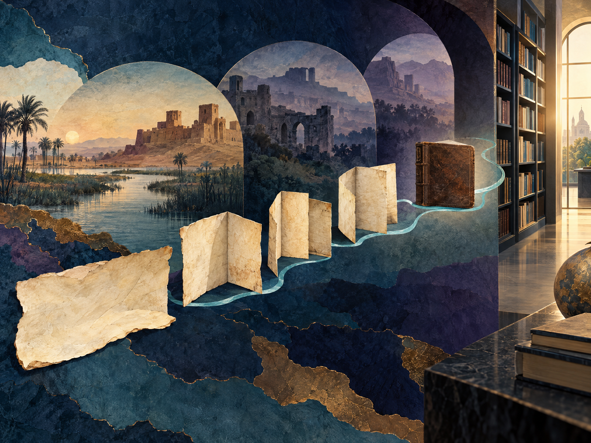
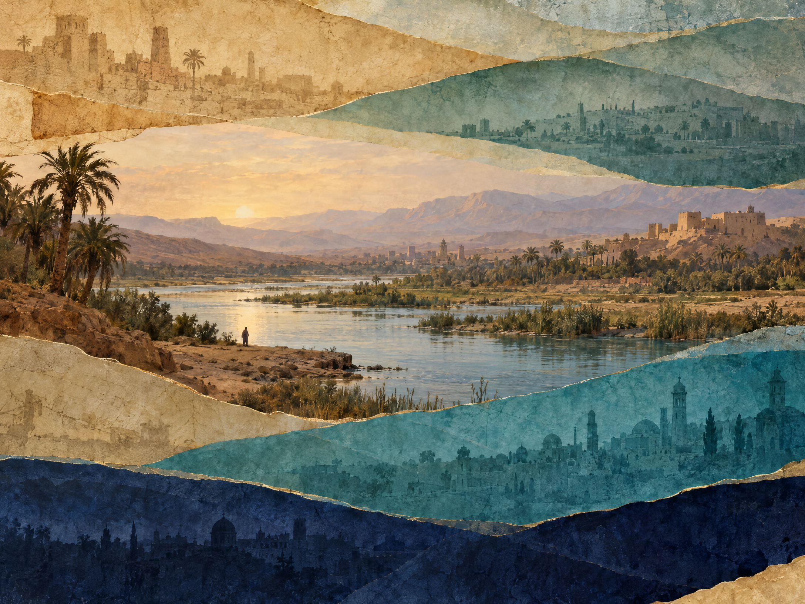
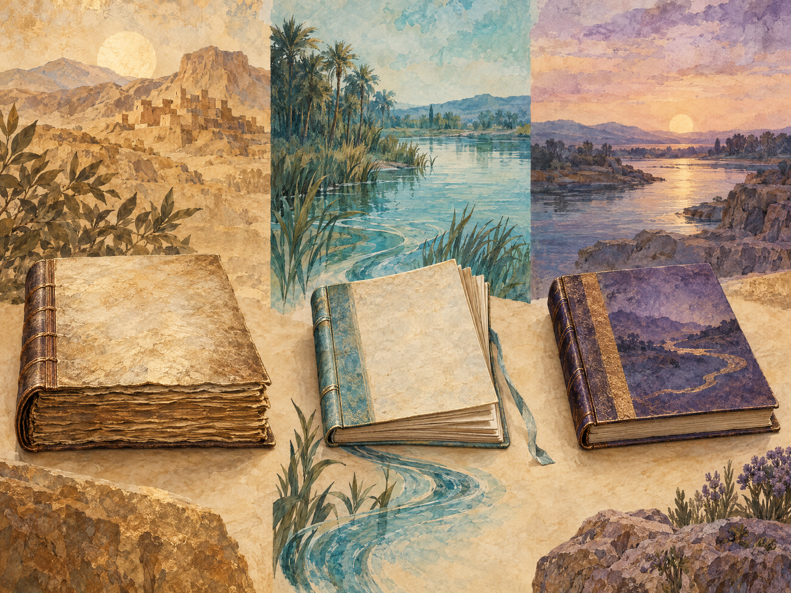

# Книга Иоанна у мандаев

## Sidra d-Yahya: «Учения царей», голоса и история текста

**HARVYRÐ · читательский путеводитель · v0.1**

> Это авторский обзор мандаейского текста, известного как Книга Иоанна. Он не является полным переводом, критическим изданием, биографией исторического Иоанна Крестителя или инструкцией к религиозной практике. Пересказ написан своими словами по академическим источникам; защищённые переводы не воспроизводятся, непубличное жреческое знание не реконструируется.

## Как читать эту книгу

Название «Книга Иоанна» может сбить с толку. Это не одноимённое Евангелие Нового Завета, не последовательная биография Иоанна Крестителя и не книга, которую, по доказанным данным, написал сам Иоанн. Перед нами мандаейский сборник разнородных текстов: в нём есть наставления, мифологические рассказы, диалогические и гимнические формы, космологические мотивы и полемические эпизоды. В критическом издании Häberl и McGrath материал представлен как посвящение и 76 пронумерованных единиц. Это редакторская карта именно этого издания, а не универсальная нумерация всех рукописей. [1] [2] [3]

В книге мы будем различать пять вещей. **Рукопись** — конкретный физический список с его листами, почерком и колофоном. **Критическая редакция** — научная работа, которая выбирает чтения и выстраивает текст по свидетельствам. **Перевод** — передача смысла на другом языке; он не заменяет оригинал. **Полемический источник** — текст, который говорит о другой группе с определённой позиции, а не нейтральный протокол. **Современная практика** — жизнь нынешних мандаейских общин, которую нельзя вывести только из древнего текста или старой книги исследователя.

Форма *Sidra d-Yahya* используется здесь как знакомое читателю название. В академической литературе встречаются также *Draša d-Yahya* и *Draša d-Yuhana*; критическое издание говорит о «Книге Иоанна», а также связывает традицию с названием «Учения царей». Это варианты наименования и редакторского описания, а не доказательство того, что перед нами разные книги. [1] [3]

## Содержание

1. [Что скрывается за названием](#глава-1-что-скрывается-за-названием)
2. [Карта составного корпуса](#глава-2-карта-составного-корпуса)
3. [Жанры: не один голос и не один сюжет](#глава-3-жанры-не-один-голос-и-не-один-сюжет)
4. [Яхья, Мириаи и другие фигуры](#глава-4-яхья-мириаи-и-другие-фигуры)
5. [Свет, жизнь и истина](#глава-5-свет-жизнь-и-истина)
6. [Рукопись и дата](#глава-6-рукопись-и-дата)
7. [Как текст стал доступен в печати](#глава-7-как-текст-стал-доступен-в-печати)
8. [Три разные книги: Иоанн, Ginza и Qolasta](#глава-8-три-разные-книги-иоанн-ginza-и-qolasta)
9. [Исторический Иоанн и поздняя память](#глава-9-исторический-иоанн-и-поздняя-память)
10. [Живая традиция и границы чтения](#глава-10-живая-традиция-и-границы-чтения)

## Глава 1. Что скрывается за названием

Книга Иоанна — важный текст мандаейской письменности, но её привычное название описывает только часть содержания. Академический обзор называет её *draša d-yahya* или *draša d-yuhana* и связывает с обозначением «Книги царей» — *draši d-malki*. В пояснении критического издания используется английское название *The Teachings of the Kings* — «Учения царей». Такие названия напоминают, что книга говорит не только о Яхье: её мир населяют небесные и световые существа, а наставление встроено в более широкие повествования о мироздании и духовном знании. [1] [2]

Слово *draša* передают как «учение», «наставление» или «речь» в зависимости от контекста. Русское «Книга Иоанна» удобно для ориентации, но не должно создавать иллюзию одного автора, одного сюжета и одной окончательной рукописной формы. Текст прошёл через передачу, переписывание, редакторскую группировку и перевод. [1] [2]

Особенно важно не смешивать эту книгу с христианским Евангелием от Иоанна. Совпадение имени не означает совпадения произведения, литературной формы или богословской функции. Мандаейская книга принадлежит собственной традиции и должна читаться через её рукописи, язык и исследовательскую историю. [1] [3]

Критическая публикация Häberl и McGrath включает мандаейский текст, английский перевод и комментарий. Это одна из наиболее полных научных точек входа в корпус, но не синоним «единственного оригинала»: даже хорошее критическое издание остаётся результатом редакторских решений. [1] [2]

## Глава 2. Карта составного корпуса

Оглавление издания Häberl–McGrath делит текст на посвящение и 76 единиц, объединённых редакторами в тематические группы. В начале следуют циклы вопросов об Истине, тексты о Юшамине, Добром Пастыре, создании и Шеме. Затем идут крупный цикл John–Johannes, блоки о Мириаи и «ловце душ», наставления, разделы об Истине и планетах, материалы о Сокровище Жизни и Создании, а ближе к концу — повествования о последующих событиях, посещениях Манда д-Хаййе, плачах и Еноше в Иерусалиме. Заголовки в этих формулировках — удобная навигация по конкретной редакции, не перечень древних жанровых названий, присутствующих в каждой рукописи. [1] [2]

Эта карта сразу разрушает представление о книге как о сплошном жизнеописании Иоанна. Яхья занимает заметное место, особенно в цикле, который редакторы обозначают как John–Johannes, но рядом с ним находятся другие персонажи, голоса и темы. В книге переплетены поучения, космические рассказы, мифологические мотивы, плачи и полемические сцены. [1] [2] [3]

Составной характер не означает, что текст лишён связности. Повторяющиеся образы и темы создают родство между разными частями. Но связь не обязательно равна единому первоначальному плану. История передачи могла соединять разновременные материалы, а современная рубрикация помогает увидеть их как тематические циклы. Порядок страниц издания поэтому нельзя без дополнительного доказательства выдавать за первоначальную композицию всей традиции. [3] [4]

Для читателя полезен простой вопрос: когда мы говорим «Книга Иоанна утверждает», о какой именно единице, рукописи или редакторской группе идёт речь? Иногда точнее сказать: «в цикле, обозначенном редакторами как John–Johannes» или «в одном из рассказов, представленном в критическом издании». Такая формулировка звучит осторожнее, зато не заставляет один фрагмент говорить за весь корпус.

## Глава 3. Жанры: не один голос и не один сюжет

В книге сменяются повествование, разговор, прямое обращение к читателю и наставительная речь. В одном эпизоде рассказ может внезапно уступить место обращению к слушателям; диалог может служить не бытовой сценой, а способом показать спор интерпретаций; речь может становиться увещеванием. Это не роман с единым рассказчиком, а собрание литературных режимов. [2] [4]

Исследователи говорят о наставлениях, гимнической речи, мифологических и космогонических сюжетах, эсхатологических мотивах и полемике. Эти термины полезны, но часть из них зависит от того, как редактор разбил текст и перевёл его. Название вроде «Наставления» может быть удобным переводным ориентиром, а не бесспорным самоназванием жанра в рукописи. [1] [2] [3]

Повтор в таких текстах выполняет несколько задач. Он связывает отдельные части, удерживает внимание на ключевых образах и помогает формировать узнаваемый ритм речи. Но если два фрагмента похожи, это ещё не объясняет, почему: перед нами может быть общая традиция, редакторское соседство, повторная переработка или переводческая гармонизация. Чтобы выбрать одно объяснение, нужно сопоставлять свидетели и аргументы редакторов. [2] [4]

Поэтому не стоит читать книгу как стенограмму реальных бесед Иоанна, Иисуса или небесных персонажей. Диалог в религиозном тексте — литературная форма, которая может объяснять, спорить, разоблачать или наставлять. Историческая реконструкция начинается только после того, как эти функции отделены от вопроса о реальных событиях. McGrath на примере рассказов о посетителях из мира Света в Иерусалиме показывает, как литературная полемика и редакционные слои меняют смысл исторических деталей. [4]

*Иллюстрация — современная метафора литературного диалога, а не реконструкция звучания, музыки или исполнения текста.*

## Глава 4. Яхья, Мириаи и другие фигуры

Яхья — титульная и центральная пророческая фигура, но книга не ограничена его рассказом. В ней появляются Мириаи, Иисус, Шем, Анош/Енох, Манда д-Хаййе, Абатор и другие фигуры. Критическое оглавление выделяет отдельные группы о Мириаи, «ловце душ», Манда д-Хаййе и Еноше в Иерусалиме. Так что правильнее говорить о многоголосом мандаейском корпусе, где Иоанн занимает важное, но не исключительное положение. [1] [2] [3]

В мандаейском религиозном самоописании Иоанн высоко почитаем. Однако академическая статья Iranica прямо предостерегает от превращения его в основателя мандаизма: он описывается как один из выдающихся представителей и священнослужителей традиции. Это различие важно. Почитание Иоанна внутри религии и доказательство того, что исторический Иоанн основал позднейшую мандаейскую общину, — два разных утверждения. [3]

В мандаейском корпусе Иоанн выступает в собственном повествовательном и богословском пространстве. Его нельзя автоматически подменять образом из христианской биографии, где его роль часто определяется отношением к Иисусу. Сходные имена и сюжеты могут входить в разные традиции и выполнять в них разные задачи. [1] [3] [4]

Появление Иисуса в мандаейских текстах также требует аккуратности. Полемическое изображение Иисуса говорит прежде всего о том, как текст проводит религиозные границы и формирует собственную память. Оно не является нейтральной биографической справкой и не должно использоваться как простое доказательство того, что происходило в Иудее I века. То же относится к рассказам о других религиозных группах. [3] [4]

## Глава 5. Свет, жизнь и истина

Один из ключевых образных миров мандаейской религиозности строится вокруг Света и Тьмы, жизни и смерти, души и тела. Эти слова не просто декоративные метафоры. Они участвуют в космологическом языке, через который тексты описывают мир, положение человека и возможность возвращения души к её источнику. Но короткий читательский обзор не может заменить подробное изложение мандаейской теологии, а одна схема не объясняет каждую главу книги. [1] [3]

Истина в оглавлении критического издания появляется сразу в нескольких редакторских рубриках: вопросы Истины, Истина Шема, отдельные тексты «Истина». Для читателя это подсказка о повторяющемся поле вопросов и свидетельства. Однако английское название рубрики — часть редакторской и переводческой работы. Лучше говорить, что тема истины возвращается в разных речевых и повествовательных ситуациях, чем приписывать всему корпусу единый трактат об Истине. [1] [2]

Космические мотивы соседствуют с этическим наставлением. Предисловие к критическому изданию характеризует книгу как писание, где моральные поучения встроены в широкий рассказ о небесных существах и устройстве миров. Это полезная рамка, но не повод сводить всё содержание к одной простой схеме добра и зла. [2]

Вода занимает особое место в мандаейской религиозной жизни и в памяти об Иоанне. Академический обзор отмечает важность проточной воды и связь водного ритуала с памятью о нём. В этом путеводителе мы упоминаем эту связь только как общий культурный и религиозный контекст. Мы не превращаем опубликованный текст в практическое руководство и не извлекаем из него порядок закрытых ритуалов. [3] [13]

## Глава 6. Рукопись и дата

Самый ранний известный рукописный свидетель, названный в издательском предварительном материале, — Codex Sabéen 10. Его скопировал Зехрун бар Адам в Басре 13 октября 1616 года. Эта дата относится к конкретной сохранившейся копии. Она не говорит сама по себе, когда возникла книга, когда были написаны отдельные тексты или сколько времени существовали лежащие под ними устные и письменные традиции. [5]

Это различие — основа добросовестной истории текста. Поздняя рукопись может передавать более ранний материал; но сам факт позднего списка не доказывает древность каждого его фрагмента. Чтобы датировать слой, нужны дополнительные признаки: язык, формы письма, параллели, колофоны и сравнительный анализ. Ни имя Иоанна, ни религиозное предание не заменяют такого доказательства. [4] [5]

Рукопись — не только слова. Это листы, почерк, порядок, переплёт, возможные пропуски и записи переписчика. Критическое издание работает с такими свидетельствами, но читатель видит уже подготовленный результат: выбранные чтения, последовательность и перевод. Доступная издательская страница и опубликованный текст не предоставляют полного цифрового каталога всех известных списков. Поэтому в этой книге мы называем только проверяемый рукописный якорь и не выдаём его за полную историю всех свидетелей. [1] [2] [5]

*Иллюстрация символизирует передачу текста; это не изображение реального кодекса, каталожной комнаты или конкретной рукописи.*

## Глава 7. Как текст стал доступен в печати

Мандейский язык — разновидность арамейского, обычно классифицируемая как юго-восточный арамейский. Работы Теодора Нёльдеке, включая *Mandäische Grammatik* 1875 года, стали частью ранней научной инфраструктуры для чтения этого языка. Грамматика помогает изучать язык, но не является критическим изданием Книги Иоанна. [10]

В начале XX века Марк Лидцбарский опубликовал немецкое издание *Das Johannesbuch der Mandäer* в двух томах, выходивших в 1915 и 1922 годах. Предшествующие современному критическому изданию полные немецкий и арабский переводы, по сообщению Häberl и McGrath, передавали стихотворный текст прозой. Поэтому различия между версиями могут быть связаны не только с чтением рукописи, но и с тем, как переводчик переносит поэтическую форму и смысл на другой язык. [2] [8] [10]

Э. С. Дроуэр — важная фигура в изучении мандаейских рукописей и современной ей общинной жизни, однако её *The Canonical Prayerbook of the Mandæans* (1959) — издание и перевод молитвенника Qolasta, а не Книги Иоанна. Это полезный пример того, почему библиографические роли исследователей и названия книг нужно проверять отдельно. [8] [10]

В 2012–2015 годах проект Rutgers готовил печатное и сетевое критическое издание, включавшее мандейский текст, английский перевод и комментарий. Итоговая работа Häberl и McGrath вышла у De Gruyter и стала основным современным научным изданием, которое здесь используется для карты текста и сопоставления редакторских решений. Авторы называют английский перевод первым полным и несокращённым; это их характеристика конкретной публикации, а не утверждение, будто прежде не существовало частичных переводов или исследований. [1] [2] [11]

Необходимо разделять три ступени. **Транслитерация** передаёт мандейское письмо средствами другого алфавита. **Критический текст** отражает чтение рукописных свидетелей и решения редакторов. **Перевод** предлагает смысл на новом языке. Например, шрифт Ardwan Lidzbarski, использованный для публикации мандейского текста, — современное типографское решение, основанное на изучении почерка; оно помогает читателю, но не является рукописью и не датирует её. [2]

*Это художественная метафора разных исторических слоёв. Она не изображает конкретный город и не является археологическим свидетельством.*

## Глава 8. Три разные книги: Иоанн, Ginza и Qolasta

Соседние тома этой серии уже познакомили читателя с Ginza Rabba и Qolasta. Книга Иоанна — отдельный корпус, не сокращение Ginza и не другой вариант молитвенника. У трёх книг есть общие темы и религиозный язык, но их роль различается. [3]

**Ginza Rabba** — большой и неоднородный сборник мандаейских сочинений. В академическом описании выделяются Правая и Левая Ginza: первая чаще обращается к космологии, богословию и наставлению; вторая сосредоточена на судьбе и восхождении души. Это полезная карта, но Ginza сама не является одним трактатом с единственным сюжетом. [3]

**Qolasta** — канонический молитвенник, включающий литургические гимны, молитвы и ритуальные тексты. Академический обзор связывает его крупные функциональные области с *maṣbuta* и *masiqta*. Здесь важна связь книги с литургическим действием, но печатное оглавление не превращается в инструкцию и не исчерпывает живую практику. [3]

**Книга Иоанна** — смешанный поучительно-мифологический корпус. В нём есть наставления и диалоги, космогонические сюжеты, рассказы о Яхье, Мириаи и Иисусе, а также другие тематические циклы. В отличие от Qolasta, её основная задача не сводится к молитвенному употреблению; в отличие от Ginza, её известное издание организовано вокруг собственной последовательности текстов и циклов. [1] [2] [3]

Упрощённая формула «Ginza — учение, Книга Иоанна — история, Qolasta — молитва» полезна только на старте. В Ginza есть разные жанры, Книга Иоанна не является чистым повествованием, а Qolasta не ограничивается гимнами. Мотивы могут пересекаться, но пересечение не делает книги взаимозаменяемыми. При ссылке на тему следует указывать, к какому корпусу, части и изданию она относится. [1] [3]

*Три книги показаны как самостоятельные формы внутри одной литературной традиции; композиция не устанавливает иерархию их авторитета.*

## Глава 9. Исторический Иоанн и поздняя память

О раннем Иоанне Крестителе лучше всего говорить, опираясь на источники его эпохи и на те ограничения, которые они задают. Иосиф Флавий в *Иудейских древностях* описывает Иоанна как проповедника, призывавшего к добродетели и омовению, и сообщает о казни по приказу Ирода Антипы. Этот текст не связывает Иоанна с мандаями, Месопотамией или переселением его учеников. [7]

Раннехристианские тексты также рассказывают об Иоанне, его крещении и учениках, но делают это в богословской рамке христианства. Они важны как свидетельства ранней памяти об Иоанне; они не прослеживают непрерывную институциональную или этническую линию от Иудеи I века к позднейшим мандаейским общинам. [6] [7]

Книга Иоанна — ценное свидетельство мандаейской памяти, самоописания и литературной полемики. Но её нельзя использовать как биографический отчёт современника. В ней есть редакционные слои, сюжеты, связанные с разными религиозными средами, и повествования, которые исследователи анализируют как части истории традиции. McGrath подчёркивает, что порядок материала и рассказы об Иерусалиме не дают сами по себе независимой хроники событий I века. [2] [4]

Самые ранние материально датируемые мандаейские свидетельства, на которые указывает Iranica, относятся к III–IV векам; это магические тексты, а не рукописи Книги Иоанна. Между деятельностью Иоанна в начале I века и такими датируемыми следами лежит значительный временной промежуток. Возможность более ранних устных или литургических традиций нельзя исключить, но она не равна доказанной непрерывности. [6]

Исследователи предлагали разные модели происхождения мандаизма. Одни допускают палестинскую предысторию и опосредованную связь с баптистскими группами; другие считают, что мандаизм сформировался прежде всего в южной Месопотамии поздней античности, перерабатывая разные религиозные влияния. Современные мандаейские авторы также могут отстаивать более сильную гипотезу преемственности. Такую позицию следует обозначать как позицию автора, а не как научный консенсус. [4] [6] [9]

Наиболее осторожный итог таков: мандаейская традиция глубоко сохранила и переосмыслила память об Иоанне. Возможная культурная или ритуальная связь заслуживает исследования. Но имеющиеся источники не доказывают, что Иоанн был мандаем, что мандаи — те же самые его ученики или что Книга Иоанна была написана в его кругу. [4] [6] [7]

## Глава 10. Живая традиция и границы чтения

Мандаи — не только персонажи древних книг. Это живая религиозная община, исторически связанная с южным Ираком и Хузестаном и сегодня широко представленная в диаспоре. Университетский проект Exeter описывает вынужденное расселение после 2003 года и подчёркивает, что точные современные оценки численности неизвестны. Австралийская Nasoraean Mandaean Association описывает свою работу как поддержку общины, сохранение культуры и помощь новым беженцам. Это внешнее академическое описание и отдельное общинное самоописание; одно не следует подменять другим. [12] [14]

Роль священнослужителей и передача знания особенно важны для понимания того, почему опубликованный текст — не вся религиозная жизнь. Exeter отмечает, что исследователи сталкивались с ограничениями доступа к уникальному жреческому знанию, а письмо рукописей исторически было тесно связано со священнической средой. Эти наблюдения относятся к истории исследования и не описывают одинаково каждую современную общину. Но они напоминают: доступный файл не даёт автоматического разрешения на всякое знание или его воспроизведение. [13]

В этом томе мы поэтому не пересказываем закрытые формулы, не реконструируем порядок посвящений или ритуальных действий, не перечисляем непубличные сакральные имена и не выдаём книжную рубрику за пошаговую инструкцию. Речь идёт о литературной истории, библиотечных описаниях, научных изданиях и общеизвестном контексте. Это позволяет познакомиться с книгой, не выдавая читателя за участника или носителя традиции. [13]

*Иллюстрация служит литературным образом, а не описанием современного обряда.*

## Как читать без смешения уровней

Перед тем как принять сильное историческое утверждение, полезно задать три вопроса.

**Что именно перед нами?** Конкретный список, печатная редакция, перевод, комментарий, полемический текст или описание практики? Дата одного кодекса не становится датой всей книги; перевод не становится рукописью; рубрика не обязательно существовала во всех свидетелях. [2] [5]

**Кто говорит?** Иосиф Флавий, христианский автор, мандаейский текст, современный исследователь и представитель общинной организации обладают разными позициями и разными видами знания. Полемический рассказ ценен для истории самопонимания и споров, но не всегда для реконструкции событий, которые он описывает. [4] [6] [7] [14]

**Какой вывод действительно следует?** Сходство крещальных практик не доказывает тождества общин. Почитание Иоанна не доказывает, что он основал мандаизм. Появление Иисуса в позднем тексте не делает его рассказ свидетельством очевидца. Хорошее чтение сохраняет интерес и одновременно ограничивает выводы тем, что позволяют источники. [3] [4] [6]

## Краткий словарь

**Мандаи.** Название религиозной общины и её традиции.

**Мандейский / мандаикский язык.** Арамейская языковая традиция, обычно классифицируемая как юго-восточный арамейский диалект.

**Draša d-Yahya / Draša d-Yuhana.** Академические варианты названия мандаейского корпуса, передаваемого по-русски как Книга Иоанна.

**Sidra d-Yahya.** Знакомая форма названия, используемая в этом путеводителе; она не отменяет вариантов, встречающихся в академической литературе.

**Teachings of the Kings.** «Учения царей» — название, связанное с мандаейским текстом и принятое в современном критическом описании.

**Критическое издание.** Научная публикация, в которой редакторы сопоставляют текстовые свидетельства и обосновывают выбранные чтения.

**Колофон.** Рукописная запись, которая может сообщать о переписчике, времени или истории конкретного экземпляра.

**Ginza Rabba.** Крупный мандаейский сборник с Правой и Левой частями; это не синоним Книги Иоанна.

**Qolasta.** Мандаейский молитвенник и литургический корпус; его функция отличается от повествовательно-наставительного профиля Книги Иоанна.

## Источники

1. [Charles G. Häberl and James F. McGrath, *The Mandaean Book of John: Critical Edition, Translation, and Commentary*](https://doi.org/10.1515/9783110487862). Научное критическое издание с переводом и комментарием.
2. [Häberl and McGrath, *The Mandaean Book of John: Text and Translation*](https://butler.elsevierpure.com/ws/portalfiles/portal/40125718/The%20Mandaean%20Book%20of%20John_%20Text%20and%20Translation.pdf). Открытая университетская копия текста и английского перевода.
3. [Kurt Rudolph, “Mandaeans II. The Mandaean Religion,” *Encyclopaedia Iranica*](https://www.iranicaonline.org/articles/mandaeans/mandaeans-ii-the-mandaean-religion/). Справочная статья о книгах, литературе, богословии и ритуальном контексте.
4. [James F. McGrath, “Polemic, Redaction, and History in the Mandaean Book of John,” *ARAM*](https://digitalcommons.butler.edu/cgi/viewcontent.cgi?article=1941&context=facsch_papers). Рецензируемое исследование редакционных слоёв и ограничений исторического чтения.
5. [De Gruyter preview к критическому изданию](https://api.pageplace.de/preview/DT0400.9783110487862_A33482931/preview-9783110487862_A33482931.pdf). Издательский материал о Codex Sabéen 10 и рукописной истории.
6. [“Mandaeans I. History,” *Encyclopaedia Iranica*](https://www.iranicaonline.org/articles/mandaeans/mandaeans-i-history/). Академический обзор истории, датируемых свидетельств и конкурирующих гипотез происхождения.
7. [Josephus, *Antiquities* XVIII.116–119](http://penelope.uchicago.edu/josephus/ant-18.html). Первичный исторический источник об Иоанне; он не связывает его с мандаями.
8. [Charles G. Häberl, “Of Calendars—and Kings—and Why the Winter is Boiling Hot,” *Journal of the Royal Asiatic Society*](https://www.cambridge.org/core/journals/journal-of-the-royal-asian-society/article/of-calendarsand-kingsand-why-the-winter-is-boiling-hot/074CF5A8A65C73265413E0A4F143D9D1). Академическая библиографическая опора для работ Лидцбарского и Дроуэр.
9. [B. H. S. Nasoraia, “Probing the Relationships Between Mandaeans and the Followers of John the Baptist,” *Religions*](https://www.mdpi.com/2077-1444/16/1/14). Современная работа, отстаивающая более сильную гипотезу преемственности; в книге она обозначена как позиционная, а не консенсусная.
10. [Comprehensive Aramaic Lexicon, Bibliography for Mandaic](https://cal.huc.edu/getbibsigla.php?myauthor=Mandaic) и [“Mandaeans V. Mandaic Language,” *Encyclopaedia Iranica*](https://www.iranicaonline.org/articles/mandaeans/mandaeans-v-mandaic-language/). Академическая библиография по мандейским исследованиям и справка о языке.
11. [Rutgers University, проект критического издания Книги Иоанна](https://www.researchwithrutgers.org/en/projects/the-mandaean-book-of-john-critical-edition-translation-and-commen/). Университетская запись проекта 2012–2015 годов.
12. [University of Exeter Mandaean Priests Project, “Who are the Mandaeans?”](https://mandaeanpriests.exeter.ac.uk/the-mandaeans). Университетское описание диаспоры и современной общины; демографические оценки там помечены как неопределённые.
13. [University of Exeter Mandaean Priests Project, “Academic Studies of the Mandaeans”](https://mandaeanpriests.exeter.ac.uk/academic-studies-of-the-mandaeans). История изучения, рукописная культура и ограничения доступа к жреческому знанию.
14. [Nasoraean Mandaean Association Inc., общинное самоописание](https://scoa.org.au/members/the-nasoraean-mandaean-association-inc/). Источник о заявленных целях конкретной современной организации, не перепись и не универсальное описание всех общин.

[1]: https://doi.org/10.1515/9783110487862 "Charles G. Häberl and James F. McGrath, The Mandaean Book of John: Critical Edition, Translation, and Commentary, De Gruyter"
[2]: https://butler.elsevierpure.com/ws/portalfiles/portal/40125718/The%20Mandaean%20Book%20of%20John_%20Text%20and%20Translation.pdf "Häberl and McGrath, The Mandaean Book of John: Text and Translation, открытая университетская копия"
[3]: https://www.iranicaonline.org/articles/mandaeans/mandaeans-ii-the-mandaean-religion/ "Kurt Rudolph, Mandaeans II. The Mandaean Religion, Encyclopaedia Iranica"
[4]: https://digitalcommons.butler.edu/cgi/viewcontent.cgi?article=1941&context=facsch_papers "James F. McGrath, Polemic, Redaction, and History in the Mandaean Book of John, ARAM"
[5]: https://api.pageplace.de/preview/DT0400.9783110487862_A33482931/preview-9783110487862_A33482931.pdf "De Gruyter preview: Codex Sabéen 10 и редакционная история издания"
[6]: https://www.iranicaonline.org/articles/mandaeans/mandaeans-i-history/ "Encyclopaedia Iranica, Mandaeans I. History"
[7]: http://penelope.uchicago.edu/josephus/ant-18.html "Josephus, Antiquities XVIII.116–119, University of Chicago"
[8]: https://www.cambridge.org/core/journals/journal-of-the-royal-asian-society/article/of-calendarsand-kingsand-why-the-winter-is-boiling-hot/074CF5A8A65C73265413E0A4F143D9D1 "Charles G. Häberl, Of Calendars—and Kings—and Why the Winter is Boiling Hot, Journal of the Royal Asiatic Society"
[9]: https://www.mdpi.com/2077-1444/16/1/14 "B. H. S. Nasoraia, Probing the Relationships Between Mandaeans and the Followers of John the Baptist, Religions (позиционная современная гипотеза)"
[10]: https://cal.huc.edu/getbibsigla.php?myauthor=Mandaic "Comprehensive Aramaic Lexicon, Bibliography for Mandaic"
[11]: https://www.researchwithrutgers.org/en/projects/the-mandaean-book-of-john-critical-edition-translation-and-commen/ "Rutgers University, The Mandaean Book of John: Critical Edition, Translation, and Commentary project"
[12]: https://mandaeanpriests.exeter.ac.uk/the-mandaeans "University of Exeter Mandaean Priests Project, Who are the Mandaeans?"
[13]: https://mandaeanpriests.exeter.ac.uk/academic-studies-of-the-mandaeans "University of Exeter Mandaean Priests Project, Academic Studies of the Mandaeans"
[14]: https://scoa.org.au/members/the-nasoraean-mandaean-association-inc/ "Nasoraean Mandaean Association Inc., community organisation profile"

---

## Редакторские границы этой версии

Этот путеводитель — оригинальный русский обзор. Он не копирует английские переводы Lidzbarski, Drower или Häberl–McGrath, не является критическим переводом с мандейского и не пытается восстановить закрытые аспекты религиозной практики. Когда в тексте говорится о 76 единицах, имеется в виду карта критического издания Häberl–McGrath. Когда приводится 1616 год, речь идёт о датировке конкретного известного списка. Исторические сведения об Иоанне, поздняя мандаейская память, академические гипотезы и современные общинные заявления разведены и подписаны источниками.

Иллюстрации созданы специально для этого тома как авторские метафоры. Они не являются факсимиле рукописей, реконструкцией древнего города, изображением реального обряда или свидетельством о том, как выглядели исторические персонажи.
