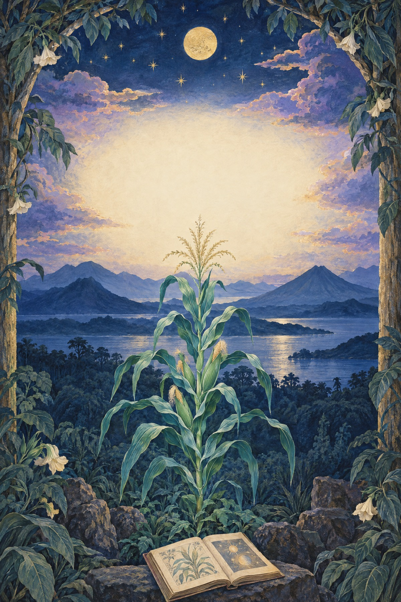
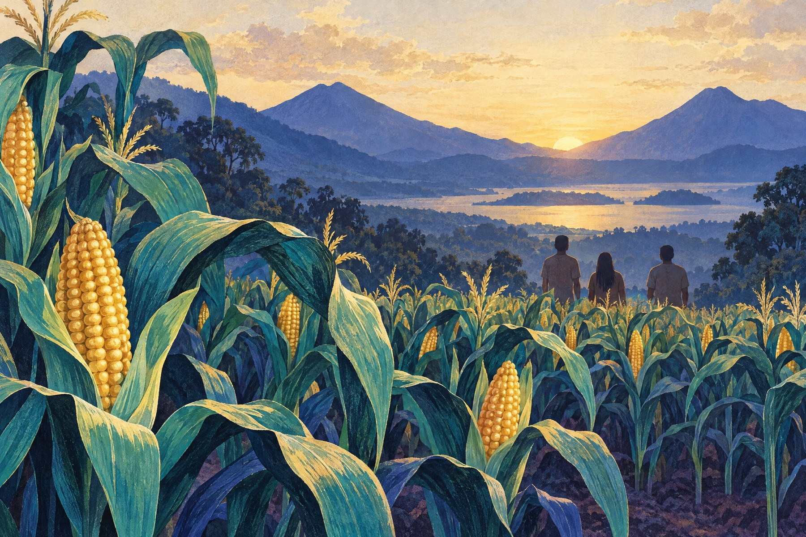
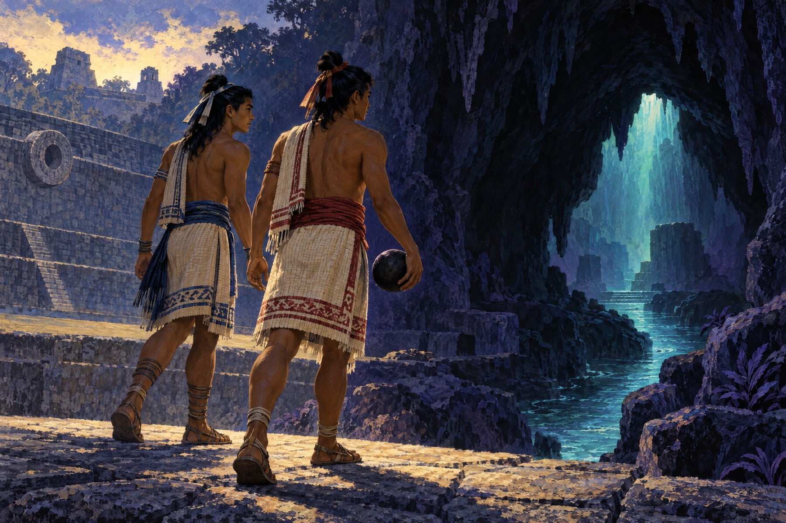
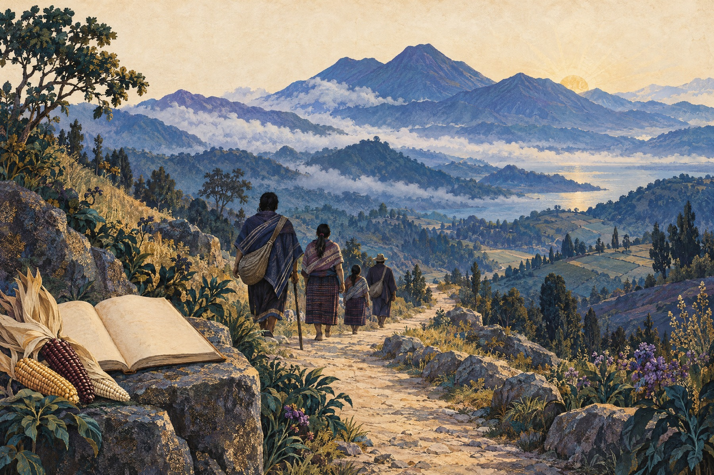

# POPOL VUH / POPOL WUJ
## Голоса, испытания и память К’иче’

*Иллюстрированный авторский русский пересказ повествования K’iche’ — с примечаниями о рукописи и переводе*

*Книжный выпуск HARVYRÐ · черновик для чтения владельцем*

---

# Примечание к этому изданию

Эта книга — самостоятельный русский пересказ, а не полный перевод рукописи Франсиско Хименеса и не попытка восстановить единственный утраченный «первоначальный текст». В центре рассказа — Popol Wuj, повествование K’iche’, которое известно нам через длительную устную и письменную передачу, колониальную фиксацию и множество редакций.

Сохранившийся рукописный свидетель Ayer MS 1515 хранится в Newberry Library. С ним связана работа доминиканца Франсиско Хименеса: в рукописном комплексе есть текст на K’iche’, записанный латинским письмом, и испанская версия. Каталог Library of Congress датирует этот экземпляр 1700–1703 годами; Newberry описывает транскрипцию шире — 1700–1715. Это разные рамки описания, а не повод приписывать бумаге дату рождения самого повествования. Более ранние письменные формы и устные исполнения реконструируются косвенно. [Newberry] [LoC] [Harvard ReVista]

В этой книге мы говорим о том, что происходит **в повествовании**, отдельно от того, что исследователи **предполагают** о его создании и политическом контексте. Историю предков нельзя автоматически читать как перечень независимо датированных правителей, а сакральные сюжеты — как универсальное описание всех народов Maya. Там, где речь идёт о научной гипотезе или современном K’iche’ прочтении, это обозначено рядом с утверждением.

Текст написан заново и не копирует современные переводы. События и имена изложены прозой; авторская разбивка на главы нужна только для удобства этого издания. Мы не имитируем устное исполнение и не выдаём собственный ритм за голос K’iche’ рассказчика. Написания Popol Wuj, K’iche’, Hunahpu, Xbalanque, Xquic и Xibalba выбраны для последовательности чтения; в других изданиях встречаются варианты.

К Popol Wuj относятся с глубоким уважением многие K’iche’ и другие Maya люди. Поэтому здесь нет инструкций, реконструкций закрытых обрядов или претензии объяснить одну «религию Maya». Современные голоса и права живых сообществ не заменяются древним текстом. [Newberry] [Multepal] Перед возможной публикацией следует дополнительно сверить написания K’iche’ имён и терминов с квалифицированным специалистом или носителем языка.

# Оглавление

1. [До того как появилась земля](#1-до-того-как-появилась-земля)
2. [Животные и первые попытки](#2-животные-и-первые-попытки)
3. [Люди из жёлтой и белой кукурузы](#3-люди-из-жёлтой-и-белой-кукурузы)
4. [Старшие братья и зов Шибальбы](#4-старшие-братья-и-зов-шибальбы)
5. [Xquic у дерева калабасов](#5-xquic-у-дерева-калабасов)
6. [Детство близнецов и спрятанный мяч](#6-детство-близнецов-и-спрятанный-мяч)
7. [Дорога в Шибальбу](#7-дорога-в-шибальбу)
8. [Дома испытаний](#8-дома-испытаний)
9. [Огонь, возвращение и финал](#9-огонь-возвращение-и-финал)
10. [Предки и дорога к земле K’iche’](#10-предки-и-дорога-к-земле-kiche)
11. [Дома, память и право на землю](#11-дома-память-и-право-на-землю)
12. [Живой язык и открытое окончание](#12-живой-язык-и-открытое-окончание)
13. [Краткое исследовательское приложение](#13-краткое-исследовательское-приложение)

# 1. До того как появилась земля

В начале повествования ещё нет человеческого мира в привычном смысле. Нет населённых дорог, домов и полей. Земля не оформлена так, чтобы по ней можно было пройти. Вода и тишина предшествуют обжитому пространству.

Создатели советуются о том, каким должен стать мир и кто сможет в нём жить осмысленно. Это важный жест начала: мир возникает не после одиночного приказа, а после разговора и решения. Земля обретает очертания, поднимаются горы, появляются долины и русла. Речь в этом эпизоде действует как сила, способная придать миру форму. [AHA] [Smarthistory]

Мы не перечисляем здесь всех имён и титулов создателей. Переводы по-разному передают их написание, число и отношения. Для одного читательского пересказа было бы слишком уверенно представить этот ряд как единую неизменную схему божеств. Важно само действие: создатели думают о мире как о месте, где должны появиться существа, способные говорить и поддерживать отношения с тем, что их окружает. [NMAI] [Newberry]

*Иллюстрация передаёт настроение начальной сцены, а не исторический пейзаж или рукописный оригинал.*

**Источники к главе:** [American Historical Association] [Smarthistory / Denver Art Museum] [Smithsonian National Museum of the American Indian] [Newberry Library].

# 2. Животные и первые попытки

Когда мир обретает места и границы, в нём появляются животные. У каждого — своя среда, свой способ двигаться и звучать. Но создатели ищут не просто жизнь. Они ждут существ, которые смогут отвечать им, помнить о них и участвовать в устройстве мира.

Животные не становятся такими собеседниками. Рассказ не унижает их и не превращает в неудачные копии человека. Они остаются частью созданного мира, но не исполняют роль, о которой думают создатели. Исследовательское чтение может видеть здесь язык обязательств между разными существами; это интерпретация учёных, а не отдельная реплика персонажа. [AHA] [Christenson]

Следующие попытки тоже не дают устойчивого результата. Существа из мягкой земли распадаются и не удерживают форму. Деревянные люди движутся и размножаются, но в повествовании не достигают нужной глубины речи и понимания. Эти эпизоды не следует читать как научную историю видов. Они показывают поиск способа существования, в котором телесная форма, память и способность к отношениям неразделимы. [AHA] [NMAI]

Каждая попытка оставляет вопрос: что значит быть человеком в мире, где жизнь предполагает не только дыхание, но и ответ? Повествование пока не отвечает одним определением. Оно продолжает испытание.

**Источники к главе:** [American Historical Association] [Smithsonian National Museum of the American Indian] [Christenson, “Theology and Economy…”].

# 3. Люди из жёлтой и белой кукурузы

Затем рассказ ведёт к кукурузе. Животные указывают путь к зёрнам, из которых должны появиться новые люди. В конкретной доступной текстовой версии названы жёлтая и белая кукуруза; после её обработки вместе с водой она становится образным материалом человеческого тела. Это сюжетное описание одного K’iche’ текста, а не формула, которую можно переносить на все Maya традиции. [Purdue] [NMAI]

Появляются первые четыре человека. Их зрение и знание оказываются поначалу необычайно широкими. Они видят далеко и понимают больше, чем создатели готовы им оставить. Сердце Неба ограничивает их взгляд, так что ясным становится прежде всего близкое. В рассказе это не простое наказание за любопытство: это обозначение человеческой меры, границы между людьми и создателями. [Purdue]

Для современного K’iche’ комментатора, которого цитирует Национальный музей американских индейцев, кукуруза священна и связывает людей с предками, питая тело и дух. Это конкретный современный голос, а не универсальное объяснение всех представлений Maya. Мы сохраняем его именно как голос, а не превращаем в безличное правило. [NMAI]

Так кукуруза в повествовании не просто продукт поля. Она стоит у начала человеческой жизни и напоминает, что люди не возникают отдельно от земли и её даров. Что именно означает эта связь в разных K’iche’ сообществах и поколениях, нельзя исчерпать одной книгой.

*Кукуруза и люди показаны как образная связь, а не документальная сцена создания.*

**Источники к главе:** [Smithsonian National Museum of the American Indian] [Purdue, текстовая версия Book 4] [Harvard ReVista].

# 4. Старшие братья и зов Шибальбы

Дальше повествование переносит нас к игре в мяч. Старшие братья — One Hunahpu и Seven Hunahpu — играют так, что шум достигает Шибальбы, подземного мира её владык. Оттуда приходит зов: братья должны спуститься и сыграть.

На дороге их ждут подмены и ловушки. Они обращаются к ложным фигурам, принимая их за настоящих хозяев. Скамья обжигает их. Затем им дают факел и сигары, которые нужно сохранить до утра; братья не справляются с условием. Владыки убивают гостей, а голову One Hunahpu помещают в крону дерева калабасов. [Mesoweb] [AHA]

Это поражение не завершает историю. Голова становится частью дерева, и дерево меняется: среди его плодов уже невозможно сразу различить её. Предмет игры, путешествие и растущее дерево связывают подземный эпизод с тем, что ещё произойдёт на земле.

Имена One Hunahpu и Seven Hunahpu сохраняются здесь в форме, привычной по англоязычным пересказам. Это не попытка объявить её единственно верной транслитерацией K’iche’. В этой книге мы избегаем обширных этимологических пояснений, если источники не дают для них надёжной опоры.

**Источники к главе:** [Mesoweb, “The Hero Twins”] [American Historical Association].

# 5. Xquic у дерева калабасов

Xquic слышит о необычном дереве и приходит посмотреть на его плоды. Там она встречается с головой One Hunahpu. Из этой встречи возникает беременность — событие, которое открывает путь младшим близнецам.

Владыки Шибальбы считают, что Xquic нарушила их власть, и требуют её казнить. Но посланные с ней совы помогают обойти приказ: вместо сердца, которое требуют предъявить, появляется древесный сок. Xquic остаётся жива и отправляется к матери погибшего One Hunahpu. Она входит в дом, который прежде не знал о её существовании, и называет себя частью его семейной истории. [Mesoweb]

Здесь важны переходы: дерево хранит след погибшего, Xquic спасает будущую жизнь, а дом становится местом встречи поколений. Мы не превращаем этот эпизод в универсальную теорию материнства или в рассказ о реальном историческом случае. Это сцена внутри конкретного повествования.

В некоторых пересказах Xquic называют Blood Woman. В этой книге мы оставляем имя Xquic и не смешиваем его с переводным эпитетом. Разные переводы могут по-разному расставлять акценты и пояснять имя; ни одно англоязычное решение само по себе не отменяет K’iche’ формы. [AHA] [Mesoweb]

**Источники к главе:** [Mesoweb, “The Hero Twins”] [American Historical Association].

# 6. Детство близнецов и спрятанный мяч

Xquic рождает Hunahpu и Xbalanque. Они растут рядом с бабушкой и старшими родственниками. Дом не встречает их безусловно: близнецов отталкивают, а их старшие кузены соперничают с ними. В ответ младшие братья прибегают к хитрости, и кузены оказываются превращены в обезьян. [Mesoweb] [AHA]

Затем близнецы пытаются расчистить поле, но работа будто не держится: на следующий день участок снова зарос. Их помощниками становятся животные. Пойманная крыса рассказывает о спрятанном мяче и снаряжении их отцов. Предметы лежат высоко, под крышей, где их не достали раньше.

Чтобы вынуть их, братья отвлекают взрослых и действуют вместе. Когда мяч снова ударяет о землю, игра звучит так, что её слышат в Шибальбе. Владыки понимают: история старших братьев повторяется — но на этот раз к ним идут другие игроки.

Мяч здесь не просто спортивный предмет. В структуре рассказа он переносит наследие между поколениями. Близнецы не получают готового рассказа о своих отцах; они находят их след через вещи, совет животных и собственное действие. Это литературный вывод о последовательности эпизодов, а не универсальная мораль текста.

**Источники к главе:** [Mesoweb, “The Hero Twins”] [American Historical Association].

# 7. Дорога в Шибальбу

*Близнецы и мяч показаны как персонажи повествования; архитектурный образ не утверждает конкретное место действия.*

Hunahpu и Xbalanque отправляются туда, где погибли их отцы. Они не идут вслепую. Дорога разветвляется, реки и перекрёстки проверяют путника; братья выбирают путь, который позволяет им не повторить прежние ошибки.

Первый обман — приветствовать деревянные изображения, будто это владыки. Близнецы не попадаются на него. Затем они сталкиваются с сидящими в зале фигурами, часть которых снова лишь подобие. Москит кусает тех, кто должен быть назван по имени. По их реакции братья узнают, кто действительно присутствует. [Mesoweb]

Обнаружив настоящих владык, близнецы приветствуют их правильно и не садятся на обжигающую скамью. Испытание пройдено не силой, а вниманием: они проверяют, что видят, слушают и называют. Повествование ставит рядом наблюдательность и уважительное обращение — но не превращает сцену в практическое руководство или предписание для читателя.

Шибальба встречает их как место, где порядок нарочно подменён. Каждая вещь может оказаться ловушкой. Каждый ответ требует не только смелости, но и проверки.

**Источники к главе:** [Mesoweb, “The Hero Twins”] [American Historical Association].

# 8. Дома испытаний

Владыки требуют, чтобы братья выдержали ряд испытаний в специальных домах. В повествовательных пересказах названы Дом Бритв, Холодный дом, Дом Ягуаров, Огненный дом и Дом Летучих мышей. Это не каталог реальных церемоний; это последовательность испытаний внутри истории. [Mesoweb]

Каждый дом проверяет иной предел. В одном грозит острая сталь. В другом — холод. Затем появляются ягуары и огонь. Братья находят способы пережить опасность, используя помощь друг друга и животных, которые включаются в их путь. Испытания отличаются, но общий узор повторяется: Шибальба хочет, чтобы гости приняли навязанные условия за неизбежные; близнецы ищут в них слабое место.

Самое опасное испытание ждёт их среди летучих мышей. Hunahpu скрывается в духовой трубке, но, высунувшись, теряет голову. Xbalanque не бросает брата. Он временно заменяет голову плодом и использует ситуацию так, чтобы вернуть настоящую на место. История опять связывает поражение с восстановлением — хотя оно не гарантировано и требует точного действия. [Mesoweb]

Мы не добавляем к этому эпизоду готовую формулу вроде «добро всегда побеждает». В повествовании успех близнецов зависит от конкретного знания, верных помощников и умения не действовать по правилам, навязанным врагом. Любая более широкая мораль была бы уже интерпретацией.

**Источники к главе:** [Mesoweb, “The Hero Twins”] [American Historical Association].

# 9. Огонь, возвращение и финал

Пройдя дома, близнецы принимают вызов, который нельзя пережить обычным способом. Они входят в огонь и погибают. Владыки измельчают их кости и бросают их в реку. Но на этом рассказ не останавливается: братья возвращаются сначала в рыбьем облике, затем — как странствующие исполнители, показывающие необычные представления. [Mesoweb]

Владыки приглашают незнакомцев показать свои способности. Те изображают разрушение и восстановление, смерть и возвращение. Увидев это, хозяева просят испытать трюк на них. Близнецы убивают двух главных владык, но не возвращают их. Обманчивая власть Шибальбы теряет опору. [Mesoweb] [NMAI]

Финальные детали в пересказах могут различаться. В музейном изложении Smithsonian NMAI и в пересказе Mesoweb близнецы восходят как солнце и луна; Mesoweb также связывает One Hunahpu с кукурузой. Мы передаём это как содержание конкретных современных изложений, а не как бесспорную астрономическую или религиоведческую формулу. [NMAI] [Mesoweb]

Так завершается путь через подземный мир, но не вся книга. Поздние части обращают внимание на предков K’iche’, их странствия, линии власти и память о земле. Герои возвращают будущее не только себе: их история соединяется с историей сообщества.

**Источники к главе:** [Mesoweb, “The Hero Twins”] [Smithsonian National Museum of the American Indian] [American Historical Association].

# 10. Предки и дорога к земле K’iche’

После историй о создании и близнецах повествование переходит к предкам K’iche’ и движению к землям, которые называются K’iche’. Оно рассказывает о происхождении, странствиях и возникновении порядка. Это не современная хронологическая летопись: порядок текста не обязательно совпадает с последовательностью событий в линейном времени. [Harvard ReVista] [Multepal]

Среди фигур этой памяти — четыре первопредка, часто передаваемые как B’alam Ki’tze’, B’alam Aq’ab, Majukutaj и Iq’i B’alam. В этой книге мы называем их первопредками повествования, а не независимо датированными царями. Их функция — связать происхождение, путь и принадлежность к домам и линиям K’iche’. [Harvard ReVista] [Princeton Multepal]

В рассказе появляется Tulán — место сакрально-исторического происхождения, связанное с властью и переходом предков к новым землям. Исследователи предлагали отождествлять его с конкретными местами, в том числе с Чичен-Ицей; такое отождествление остаётся гипотезой, а не установленной точкой на карте. Внутри повествования важнее то, что география хранит память об истоке и даёт язык, на котором можно говорить о праве и принадлежности. [LoC, обзор Florescano]

*Путь показан как современная художественная метафора, а не реконструкция конкретного исторического маршрута.*

**Источники к главе:** [Harvard ReVista] [Princeton Multepal Project] [Library of Congress, обзор Tulán].

# 11. Дома, память и право на землю

Родословные поздней части — это не только перечень родственников. Повествование связывает происхождение с коллективными домами, должностями, авторитетом и правом говорить от имени общности. Оно даёт K’iche’ способ рассказывать о том, откуда пришли предки и почему определённые линии занимают своё место.

Рядом с Popol Wuj существует Título de Totonicapán — колониальный земельный документ K’iche’, завершённый в 1554 году. Он тоже связывает предков, историю и права на землю, но не совпадает с Popol Wuj во всех деталях. Такие сходства и расхождения помогают увидеть, что разные тексты могли сохранять разные перспективы и одновременно действовать в мире колониальных правовых споров. [University Press of Colorado] [Quiroa]

Это сопоставление требует осторожности. Título — не нейтральная летопись, свободная от политических интересов; исследователи описывают подобные документы как местные исторические рассказы и юридические аргументы, создававшиеся в условиях испанского суда. А гипотеза о том, что Popol Wuj отражал позицию одной из фракций K’iche’, принадлежит конкретному исследователю и не должна подаваться как установленное намерение всех создателей текста. [Quiroa] [van Akkeren]

Здесь история предков не отделяется от земли. Сохранять память — значит не только рассказывать о прошлом, но и утверждать, кто имеет право жить на своей земле, говорить о ней и принимать решения. Это вывод о функции таких текстов и их колониальном контексте, а не доказательство каждой отдельной миграции или битвы.

**Источники к главе:** [University Press of Colorado, *The Title of Totonicapán*] [Quiroa] [van Akkeren, “Authors of the Popol Wuj”].

# 12. Живой язык и открытое окончание

Popol Wuj дошёл до нас не как немой предмет. K’iche’ — живой язык. Университет Нью-Мексико хранит архив из 149 аудиозаписанных и расшифрованных K’iche’ историй, собранных в западной Гватемале в 1960–1970-х годах; записи и транскрипции проверяли носители языка. Это самостоятельный документальный проект, а не доказательство того, что любая современная история буквально повторяет рукопись начала XVIII века. [UNM]

Академия языков Maya Гватемалы приводит для K’iche’ 1 680 551 говорящего по переписи 2018 года. Такое число следует указывать только вместе с источником и годом. Оно напоминает о масштабе живого языка, но за ним стоят люди и разные сообщества, а не единый голос. [ALMG]

Совместный проект Multepal подчёркивает уважение к Indigenous data sovereignty и сотрудничество с K’iche’ участниками при создании цифровых материалов. Это позиция конкретного проекта, не универсальное заявление обо всех сообществах. Но она предлагает важную редакторскую дисциплину: спрашивать, кто говорит, кто хранит знание и на чьих условиях его показывают. [Multepal]

Эта книга заканчивается не разгадкой «мира Maya», а признанием границ собственного пересказа. Мы читали текст, прошедший через устную передачу, колониальную запись, перевод и архив. Перед нами — не единственный неизменный оригинал и не замена современным K’iche’ голосам. Рассказ остаётся открытым, потому что его память живёт не только на странице.

**Источники к главе:** [UNM K’iche’ Maya Oral History Project] [ALMG] [Multepal].

# 13. Краткое исследовательское приложение

## Что именно здесь называется рукописью

Ayer MS 1515 — сохранившийся колониальный рукописный комплекс Newberry Library, связанный с Франсиско Хименесом. В нём находится K’iche’ текст латинским письмом и испанская версия. Library of Congress описывает Popol Vuh-часть как 1700–1703 годы; Newberry даёт более широкий диапазон 1700–1715 для транскрипции и связанного корпуса. Упоминание предполагаемой записи 1554–1558 годов относится к научной реконструкции более ранней формы. Самостоятельный рукописный экземпляр этой ранней записи не сохранился. [Newberry] [LoC] [Multepal]

Поэтому в этой книге различаются три уровня: материальный свидетель, который можно исследовать в архиве; предполагаемые ранние письменные и устные формы; гипотетическая более ранняя композиция. Слово «оригинал» без объяснения смешало бы эти уровни и создало бы неверное впечатление.

## Короткая заметка о переводе и именах

Русский текст — авторский пересказ по институциональным описаниям, исследовательским публикациям и сюжетным обзорам. Он не следует близко ни одному современному переводу. Повествование сжато и разделено на главы заново. Имена и термины приведены к одной удобной для чтения системе, но иные написания могут отражать другие издания, диалекты или редакторские решения. Для научного или коммерческого издания потребуется дополнительная сверка K’iche’ написаний с квалифицированным специалистом и консультация с современными K’iche’ участниками.

## Источники по главам

- **Примечание, рукопись и передача:** [Newberry Library] [Library of Congress] [Harvard ReVista] [Multepal].
- **Главы 1–3, создание мира и кукурузные люди:** [American Historical Association] [Smithsonian National Museum of the American Indian] [Smarthistory / Denver Art Museum] [Purdue, текстовая версия Book 4].
- **Главы 4–9, близнецы и Шибальба:** [Mesoweb, “The Hero Twins”] [American Historical Association] [Smithsonian National Museum of the American Indian].
- **Главы 10–11, предки, земля и поздняя историческая часть:** [Harvard ReVista] [Princeton Multepal Project] [Library of Congress, обзор Florescano] [University Press of Colorado] [Quiroa] [van Akkeren].
- **Глава 12, живой язык и совместная работа:** [UNM K’iche’ Maya Oral History Project] [ALMG] [Multepal].

## Краткий список источников

**Рукопись и история передачи**

- [Newberry Library, “Popol Vuh”](https://www.newberry.org/collection/research-guide/popol-vuh) — Ayer MS 1515, Хименес, признаки текста и история хранения.
- [Library of Congress, “Popol Vuh: Transcription in Quiché Mayan and Translation into Spanish”](https://www.loc.gov/item/2021668226/) — описание экземпляра и каталожная дата.
- [Harvard ReVista, “Translating the Maya Popol Wuj”](https://revista.drclas.harvard.edu/translating-the-maya-popol-wuj/) — история публикаций и атрибутированные реконструкции.
- [Multepal Project, University of Virginia](https://multepal.spanitalport.virginia.edu/) — совместная цифровая работа и история передачи.

**Сюжетные ориентиры**

- [American Historical Association, “Popol Vuh”](https://www.historians.org/resource/popol-vuh/) — образовательный обзор текста и его истории.
- [Smithsonian NMAI, “Creation Story of the Maya”](https://maya.nmai.si.edu/the-maya/creation-story-maya) — музейное изложение и отдельный современный K’iche’ голос.
- [Smarthistory / Denver Art Museum, “An excerpt from an origin story”](https://smarthistory.org/mesoamerican-art-in-context-origin-story-popol-vuh/) — образовательный материал о начальной части.
- [Mesoweb, “The Hero Twins”](https://www.mesoweb.com/features/twins/twins_text.html) — подробный сюжетный каркас цикла близнецов; использован только для проверки последовательности, не как источник формулировок.
- [Purdue, Popol Vuh Book 4](https://web.ics.purdue.edu/~kdickson/pvbk4.html) — переводная текстовая версия для проверки мотива кукурузы; это не оригинал K’iche’.

**Поздняя историческая часть и живой язык**

- [University Press of Colorado, The Title of Totonicapán](https://upcolorado.com/university-press-of-colorado/the-title-of-totonicapan) — контекст земельного документа 1554 года.
- [Néstor I. Quiroa, “Revisiting the Highland Guatemala Títulos”](https://read.dukeupress.edu/ethnohistory/article/58/2/293/26207/Revisiting-the-Highland-Guatemala-Titulos-How-the) — колониальная юридическая функция títulos.
- [R. W. van Akkeren, “Authors of the Popol Wuj”](https://www.cambridge.org/core/journals/ancient-mesoamerica/article/authors-of-the-popol-wuj/FD3D13058C533FCE32C2B8EC7C5BAC40) — атрибутированная гипотеза об авторах и политическом контексте.
- [University of New Mexico, K’iche’ Maya Oral History Project](https://laii.unm.edu/kiche.html) — аудиозаписи и транскрипции современных устных историй.
- [Academia de Lenguas Mayas de Guatemala, “Idioma Maya K’iche’”](https://almg.org.gt/idioma_kiche/) — языковые сведения и данные переписи 2018 года.

