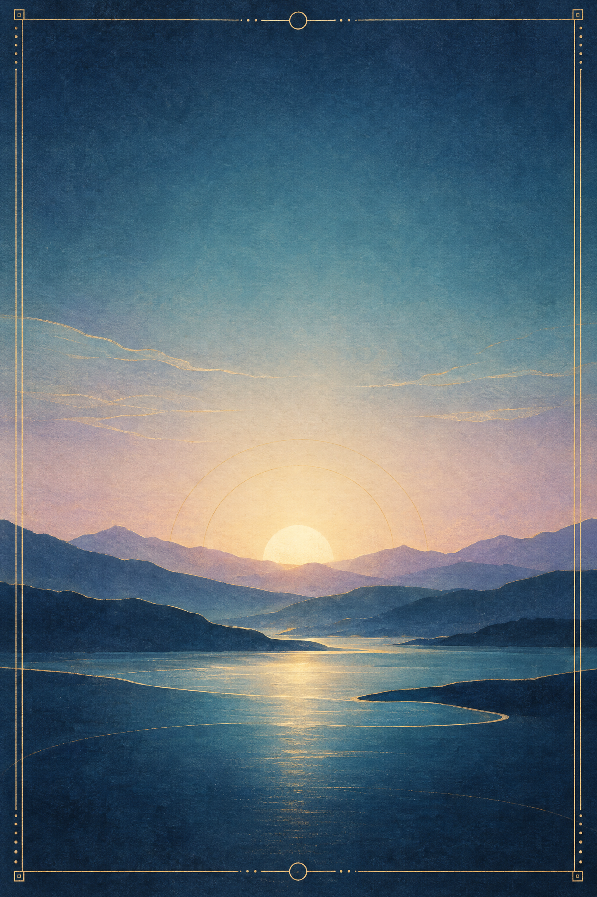
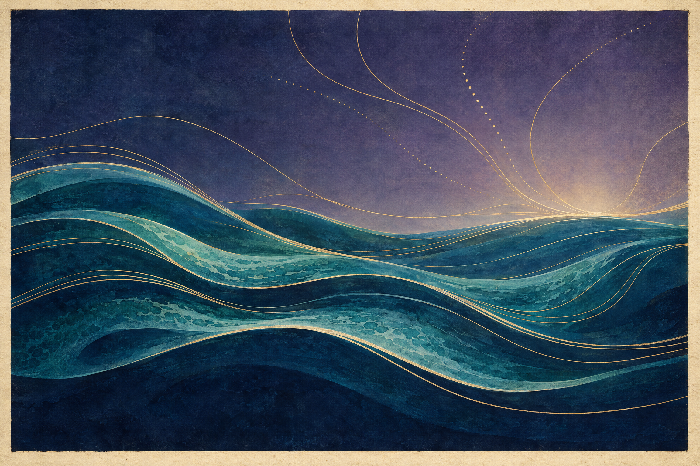

# HARVYRÐ

# Ригведа: семь голосов у истока

### Агни · Ушас · Варуна · Пуруша · Хираньягарбха · Вак · Насадия

*Небольшая книга для внимательного чтения*

---

## Не весь лес, а семь троп

Ригведа — собрание более тысячи гимнов на ведийском санскрите. Эта книга берёт из него семь текстов: 1.1, 1.113, 7.86, 10.90, 10.121, 10.125 и 10.129. Это не перевод всей Ригведы, не пересказ четырёх Вед и не попытка свести их к единой доктрине. Семь гимнов выбраны потому, что в них слышны разные способы обращаться к миру: просьба, восхваление, исповедь, космогоническое размышление и вопрос, который не торопится закрыться ответом. [Описание корпуса и современного полного перевода](https://global.oup.com/academic/product/the-rigveda-9780190685003)

Ригведа принадлежит к традиции, в которой текст существовал не только как последовательность слов на странице. Ведическое пение сохраняет слова через обученную устную передачу, включая акценты и точное произношение. ЮНЕСКО описывает эту практику как живое культурное наследие; её запись относится к 2008 году и не означает, что одна форма пения представляет все ведийские школы или все индуистские общины. Здесь мы читаем глазами и не предлагаем реконструкцию исполнения. [ЮНЕСКО о традиции ведического пения](https://ich.unesco.org/en/RL/tradition-of-vedic-chanting-00062)

### Как читать пересказы

Каждый раздел ниже — **авторский смысловой пересказ**, а не дословный или метрический перевод. Он опирается на санскритский текст, научный комментарий Стефани Джеймисон и современный перевод Стефани Джеймисон и Джоэла Бретертона, но не воспроизводит их формулировки. В книге нет цитат из переводов — ни современных, ни объявленных общественным достоянием. Там, где смысл слова или синтаксис спорен, это отмечено прямо. [Электронный текст GRETIL](https://gretil.sub.uni-goettingen.de/gretil/corpustei/transformations/html/sa_Rgveda-edAufrecht.htm) · [Комментарий Джеймисон](https://rigvedacommentary.alc.ucla.edu/) · [Издание Oxford University Press](https://global.oup.com/academic/product/the-rigveda-9780190685003)

В ссылках ниже «гимн» означает отдельное стихотворение; «мандала» — книгу внутри собрания. Эти слова помогают найти текст, но сами по себе не дают точной даты его сочинения. Мы не будем читать позднейшие религиозные толкования как единственный смысл раннего гимна — и не будем говорить от имени всех современных последователей индуистских традиций.

---

## 1. Агни: тот, через кого доходит просьба

*Ригведа 1.1 · девять строф*

Первый текст в сохранившемся порядке первой мандалы начинается с обращения к Агни. Но его первое место в книге не доказывает, что именно этот гимн был самым древним или что он открывал первоначальное собрание. Перед нами прежде всего удачный вход в особый мир гимнической речи: поэт называет божество и тут же показывает, сколько разных дел соединено в этом имени.

Агни — огонь, но в гимне он не сводится к пламени как природному явлению. Он — жрец, который совершает и сопровождает обряд; посланник, приводящий богов; сила, через которую приношение достигает адресатов. Текст не объясняет эти роли отвлечённо. Он перечисляет их, как будто просьба становится яснее с каждым новым именем.

Далее голос гимна просит о благополучии, приумножении и защите. Здесь слышна не современная молитва о внутреннем спокойствии, а язык конкретной жизни общины: достаток, продолжение рода, слава и порядок. В последних строфах Агни нужен каждый день; к нему обращаются как к близкому и доступному, прося быть рядом и вести к благу.

**Авторский пересказ гимна.** Мы восхваляем Агни — служителя жертвы и связующего посланника. Его славили прежние певцы, и нынешние зовут его вновь, чтобы он привёл богов и провёл приношение к ним. Через него просят о достатке, возрастании и благосклонности. День за днём община приходит к нему с почтением и просит: будь близок, охраняй правильный порядок и оставайся с нами, как отец с сыном.

Этот финальный образ близости не превращает гимн в философское учение о едином Боге. В нём важнее другое: отношения с божеством выражены через повторяющееся действие, речь и просьбу. Агни — одновременно видимый огонь, ритуальная должность и божественный посредник; разделить эти значения по отдельным «слоям» значит обеднить текст.

**Источники к главе:** [санскритский текст RV 1.1 в GRETIL](https://gretil.sub.uni-goettingen.de/gretil/corpustei/transformations/html/sa_Rgveda-edAufrecht.htm); [комментарий С. Джеймисон к гимнам 1.1–1.99](https://rigvedacommentary.alc.ucla.edu/wp-content/uploads/2020/07/I.1-99-7-15-20.pdf); [издание и перевод Джеймисон—Бретертона](https://global.oup.com/academic/product/the-rigveda-9780190685003).

---

## 2. Ушас: рассвет, который возвращается

*Ригведа 1.113 · двадцать строф*

Ушас — рассвет, названный богиней. Она приходит в мир как свет, который открывает зрение и дороги, будит живых и запускает дневные дела. Но гимн не ограничивается картиной неба. В нём свет имеет последствия: просыпаются люди, начинает действовать огонь, возобновляется жертвенная речь, появляются надежды на достаток и продолжение жизни.

Один из самых человеческих поворотов звучит в середине гимна. Предыдущие поколения тоже видели рассвет — и всё же ушли. Нынешние люди смотрят на тот же повторяющийся свет, зная, что их собственная жизнь конечна. Ушас возвращается, а люди сменяют друг друга. Эта мысль не отменяет радости утра; она придаёт ей вес.

**Авторский пересказ гимна.** Ночь отступает, и Ушас раскрывает пространство для взгляда и движения. Она будит всё живое и приводит людей к их делам. Её путь знаком и всё же каждый раз нов: прежние люди встречали рассвет и исчезли, мы встречаем его теперь, а за нами его увидят другие. Пусть свет приходит благоприятно, приносит силу, пищу, стада и долгую жизнь тем, кто обращается к нему с песней.

В этом тексте рассвет не просто метафора надежды. Он — адресат, к которому обращаются как к действующей силе. Вместе с тем гимн не требует единственного прочтения: в нём есть пейзаж, ритуальный день, благополучие рода и размышление о времени. Если оставить только красивое небо, пропадёт человеческая уязвимость; если оставить только смертность — исчезнет торжество возвращающегося света.

**Источники к главе:** [санскритский текст мандалы 1 в GRETIL](https://gretil.sub.uni-goettingen.de/gretil/1_sanskr/1_veda/1_sam/1_rv/rv_01_u.htm); [научный перевод и комментарий Джеймисон—Бретертона](https://global.oup.com/academic/product/the-rigveda-9780190685003); [общий комментарий С. Джеймисон](https://rigvedacommentary.alc.ucla.edu/).

---

## 3. Варуна: вопрос о проступке

*Ригведа 7.86 · восемь строф*

В гимне Варуна связан с устройством мира и властью над порядком. Но почти сразу космический масштаб уступает место личному голосу. Поэт Васиштха пытается понять, почему бог гневается и за какое нарушение хочет его наказать. Вопрос здесь не риторическое украшение: просьба узнать причину становится нервом всего текста.

Гимн перечисляет возможные причины ошибки — ярость, опьянение, игру в кости, неразумие, сон. В нём упомянуты и поступки предков. Но это не готовая теория наследственной вины и не позднейшая схема кармы. Смысл слов и связи между ними в некоторых местах трудны; безопаснее говорить о попытке осмыслить проступок и его последствия, чем подставлять в текст знакомую нам моральную систему.

**Авторский пересказ гимна.** Ты утвердил землю и небо и видишь происходящее. Я спрашиваю: что сделал я, что ты хочешь поразить меня? Если проступок пришёл от предков или совершён нами самими, освободи нас. Бывает, что человека ведут гнев, хмель, игра, неразумие или сон; не всякая ошибка начинается с ясного намерения. Услышь песню Васиштхи и отпусти нас от беды.

Важная пауза остаётся: Варуна не отвечает прямой речью. Поэт ждёт ответа, но гимн не инсценирует его. Поэтому читать его как завершённый разговор — значит добавлять недостающую реплику. Вместо неё остаются просьба, тревога и признание зависимости человека от силы, которая видит больше, чем он.

Последняя строфа отличается по функции от основного обращения: она говорит о самой хвалебной песне и завершает её семейным рефреном. Комментарий отмечает эту особенность, но не позволяет назначить строфе отдельную календарную дату.

**Источники к главе:** [санскритский текст Ригведы в GRETIL](https://gretil.sub.uni-goettingen.de/gretil/1_sanskr/1_veda/1_sam/1_rv/rvh1-10u.htm); [комментарий Джеймисон к мандале 7](https://rigvedacommentary.alc.ucla.edu/wp-content/uploads/2026/09/VII.56%E2%80%93104-9-25-26.pdf); [страница комментария Джеймисон](https://rigvedacommentary.alc.ucla.edu/?page_id=25).

---

## 4. Пуруша: тело мира и образ жертвы

*Ригведа 10.90 · шестнадцать строф*

Пуруша в этом гимне — не просто отдельный человек. Он представлен как существо, охватывающее всё, что есть, и одновременно превосходящее видимый мир. Боги совершают над ним первожертвоприношение, и из этого действия возникают части космоса, животные, небесные силы и формы ведийской речи. Мир здесь не собирают из безличных деталей: его порядок возникает через жертву и отношение между частями целого.

В двенадцатой строфе части тела соотносятся с четырьмя варнами: брахманом, раджанья, вайшья и шудра. Это важное место, но его нельзя превращать в нейтральную перепись общества или в простое доказательство того, как жили все древние люди. Это мифопоэтический образ, который связывает социальные разряды с телом космического существа. История прочтения этого стиха сложна; книга не говорит от имени всех индуистских общин и не объявляет одно толкование единственным.

**Авторский пересказ гимна.** Пуруша наполняет мир и всё же больше его. Боги приносят его в жертву, и из этого первичного действия возникают животные, небо, земля, направления, дыхание и священная речь. Певец спрашивает, как распределены его части: какие соответствия связывают тело с порядком мира и человеческим обществом. Так жертва становится образом происхождения и устройства целого.

У гимна есть и другое напряжение: жертва здесь не просто частный обряд, а образ возникновения мира. Сам текст, однако, не излагает полной теории о том, как этот космический порядок поддерживается во времени. Здесь работает поэтическая схема: одна целостность раскрывается во множестве и остаётся больше каждой отдельной части.

**Источники к главе:** [санскритский текст RV 10.90 в GRETIL](https://gretil.sub.uni-goettingen.de/gretil/corpustei/transformations/html/sa_Rgveda-edAufrecht.htm); [комментарий к десятой мандале на сайте С. Джеймисон](https://rigvedacommentary.alc.ucla.edu/?page_id=556); [академическое издание Oxford University Press](https://global.oup.com/academic/product/the-rigveda-9780190685003).

---

## 5. Хираньягарбха: кому приносить жертву?

*Ригведа 10.121 · десять строф*

Название гимна обычно передают как «Золотой зародыш», хотя санскритское слово допускает оттенки «зародыша», «внутреннего начала» и «чрева». Лучше сохранить эту открытость, чем сразу представить знакомый образ золотого яйца. В начале появляется тот, кто первым возник и удержал небо и землю; затем гимн перечисляет его связи с жизнью, дыханием, водами, солнцем и сторонами света.

Первые девять строф возвращаются к одному вопросу: какому богу принести приношение? Повтор делает поиск частью формы. Ответ не выдаётся заранее. Лишь последняя строфа называет Праджапати и обращается к нему с просьбой о благе. Поэтому гимн не просто объявляет имя создателя, а постепенно выстраивает его через признаки и действия.

**Авторский пересказ гимна.** В начале возник тот, кто стал владыкой всего появившегося и укрепил землю и небо. Он — дыхание и сила живых, он видит восходящее солнце и удерживает пространства. Воды несут зародыш; из этого образа возникают огонь и жертва. Кто же тот, кому мы должны принести приношение? Мы узнаём его по тому, что он поддерживает жизнь и порядок; в финале называем его Праджапати и просим о желаемом благе.

Здесь заметно, как ритуальный вопрос становится способом размышлять о космосе. Гимн не даёт нам права пересказать его как готовое учение о едином Боге, а слово «создатель» не заменяет всех образов текста. Важнее то, что имя появляется после ряда наблюдений: мысль идёт от мира к вопросу, а от вопроса — к обращению.

**Источники к главе:** [санскритский текст мандалы 10 в GRETIL](https://gretil.sub.uni-goettingen.de/gretil/corpustei/transformations/html/sa_Rgveda-edAufrecht.htm); [комментарий С. Джеймисон к гимнам мандалы 10](https://rigvedacommentary.alc.ucla.edu/wp-content/uploads/2026/09/X.61%E2%80%93191-9-25-26.pdf); [перевод и комментарий Джеймисон—Бретертона](https://global.oup.com/academic/product/the-rigveda-9780190685003).

---

## 6. Вак (Vāk): голос, который говорит «я»

*Ригведа 10.125 · восемь строф*

В этом гимне речь не описывают со стороны. Она говорит сама. Женское «я» заявляет, что движется вместе с богами, поддерживает их и участвует в том, что делают живые. Через неё люди едят, дышат и слышат; она помогает избранному обрести силу и знание. Она называет себя царицей, собирающей блага, и описывает своё присутствие как пронизывающее мир.

Традиционная атрибуция связывает гимн с Вак Амбхрини; в позднейшем употреблении встречается название «Гимн Деви». Но этот заголовок не делает текст простым изложением всех позднейших представлений о богине. Здесь важна Вак — речь как произнесённое слово, ритуальная сила и действующее присутствие. Перевести её одним современным термином — значит сделать гимн уже, чем он есть.

**Авторский пересказ гимна.** Я хожу с богами и поддерживаю их. Через меня живые получают пищу, дыхание и слух; я возвышаю того, кого выбираю, и делаю его сильным в слове и знании. Я даю богатство, вооружаю защитника и веду речь туда, где меня не замечают. Я пребываю в водах и в мире; моя мощь движется, как ветер, и охватывает небо и землю.

Поэтическое «я» одновременно личное и больше личности. Не нужно решать, что перед нами автобиография исторической женщины, чтобы услышать особенность голоса. В нём сакральная речь не служит украшением уже готовой мысли: она сама действует, связывает людей и богов и заявляет о своём месте в устройстве мира.

**Источники к главе:** [санскритский текст десятой мандалы в GRETIL](https://gretil.sub.uni-goettingen.de/gretil/corpustei/transformations/html/sa_Rgveda-edAufrecht.htm); [комментарий С. Джеймисон к мандале 10](https://rigvedacommentary.alc.ucla.edu/wp-content/uploads/2026/09/X.61%E2%80%93191-9-25-26.pdf); [сведения об академическом переводе](https://global.oup.com/academic/product/the-rigveda-9780190685003).

---

## 7. Насадия: вопрос, который не торопится отвечать

*Ригведа 10.129 · семь строф*

Гимн начинается с попытки говорить о том, что было прежде различий: до того, как можно уверенно разделить сущее и не-сущее, смерть и бессмертие, ночь и день. Затем появляются «Одно», дыхание, желание, мысль и семя. Это не рассказ, в котором известный персонаж по очереди создаёт мир. Здесь образы возникают как ступени размышления — и каждое слово оставляет больше пространства, чем закрывает.

В последних строфах вопрос становится прямым: кто знает, откуда возникло творение? Боги, говорится в гимне, появились после него. А знает ли самый высокий наблюдатель? Финал допускает сомнение. Именно эта осторожность делает текст сильным: он не превращает неизвестное в удобную уверенность.

**Авторский пересказ гимна.** Вначале нельзя уверенно назвать то, что было: не различены привычные нам противоположности, не проступили ночь и день. Было нечто единое, движущееся своим дыханием; затем возник импульс желания, и мысль ищет, как появилось разделение. Кто знает начало этого возникновения? Боги пришли позже. Может быть, высший хранитель знает — а может быть, и он не знает.

Слова «бытие» и «небытие» здесь не следует понимать как готовые термины поздней философии, а древний вопрос нельзя превращать в предвосхищение современной физики. Это гимн о границах знания, написанный на языке поэзии и космогонических загадок. Его конец не провал памяти, а часть замысла: вопрос остаётся открытым.

**Источники к главе:** [санскритский текст RV 10.129 в GRETIL](https://gretil.sub.uni-goettingen.de/gretil/corpustei/transformations/html/sa_Rgveda-edAufrecht.htm); [комментарий С. Джеймисон к десятой мандале](https://rigvedacommentary.alc.ucla.edu/wp-content/uploads/2026/09/X.61%E2%80%93191-9-25-26.pdf); [академический перевод и комментарий](https://global.oup.com/academic/product/the-rigveda-9780190685003).

---

## Семь голосов — не одна лестница

Эти гимны не складываются в простую историю, где ранний обряд будто бы неизбежно превращается в философию. Они дают семь разных ситуаций речи. Агни соединяет действие и просьбу; Ушас возвращает свет, но напоминает о смене поколений; Васиштха спрашивает Варуну о проступке; гимн о Пуруше связывает жертву с космическим устройством; Хираньягарбха ищет имя через повторяющийся вопрос; Вак говорит изнутри силы слова; Насадия оставляет происхождение открытым.

Общий мотив — не единая теория, а поиск порядка: как жить в нём, как обращаться к нему и что делать, когда ответа нет. Это читательская тропа через небольшой участок большого собрания. За её пределами остаётся множество гимнов, голосов, школ исполнения и историй прочтения.

---

## О тексте, передаче и правах на переводы

Для сверки санскритской формы использован электронный текст GRETIL, основанный на издании Теодора Ауфрехта 1877 года. Сам ресурс указывает, что электронный текст подготовили Баренд ван Нутен и Гэри Холланд, а текущая версия размещена под лицензией Creative Commons Attribution-NonCommercial-ShareAlike 4.0. Здесь санскритские строфы не перепечатываются; GRETIL служит источником для проверки адресов и последовательности гимнов. [Описание GRETIL и лицензия текста](https://gretil.sub.uni-goettingen.de/gretil/corpustei/transformations/html/sa_Rgveda-edAufrecht.htm)

Для интерпретационных вопросов использован комментарий Стефани Джеймисон, дополняющий трёхтомный перевод Ригведы, выполненный Джеймисон и Джоэлом Бретертоном для Oxford University Press. Современный перевод служит научным ориентиром, но его предложения здесь не копируются и не маскируются под русский перевод. Русские смысловые пересказы написаны заново и помечены в каждой главе. Цитат из переводов, в том числе старых изданий, в книге нет.

Печатный текст, рукопись и устная передача — не одно и то же. Электронная транслитерация помогает искать слова и строфы; она не передаёт полностью звучание, акцент и обученное исполнение. ЮНЕСКО описывает ведическое пение как живую традицию, где сохранение текста связано с произношением и передачей от учителя к ученику. Поэтому эта книга не предлагает «правильного» способа петь гимны и не заменяет обучение внутри традиции.

### Источники и дальнейшее чтение

- [GRETIL: Ṛgveda-Saṃhitā, электронный текст на основе издания Aufrecht (1877)](https://gretil.sub.uni-goettingen.de/gretil/corpustei/transformations/html/sa_Rgveda-edAufrecht.htm). В записи указаны редакционная основа, участники ввода и лицензия электронной публикации.
- [Stephanie W. Jamison и Joel P. Brereton, *The Rigveda: The Earliest Religious Poetry of India*, Oxford University Press](https://global.oup.com/academic/product/the-rigveda-9780190685003). Трёхтомный научный перевод и комментарий; основной современный ориентир для выборки.
- [Stephanie W. Jamison, *Rigveda Translation: Commentary*](https://rigvedacommentary.alc.ucla.edu/). Расширенный комментарий к гимнам, дополняющий перевод Джеймисон—Бретертона.
- [UNESCO, *Tradition of Vedic chanting*](https://ich.unesco.org/en/RL/tradition-of-vedic-chanting-00062). Описание живой традиции ведического пения, включённой в список нематериального культурного наследия в 2008 году.
- [George E. Dunkel, “The Oral Style of the Ṛgveda,” *Oral Tradition*](https://journal.oraltradition.org/the-oral-style-of-the-r%CC%A5gveda/). Академическая статья о поэтических формулах и устном стиле Ригведы.
- [HathiTrust: библиографическая запись перевода Ральфа Т. Х. Гриффита](https://catalog.hathitrust.org/Record/100432678). Историческая библиография раннего английского перевода; текст перевода в этой книге не воспроизводится.

*HARVYRÐ · читательское издание · авторские пересказы и оригинальные иллюстрации*
