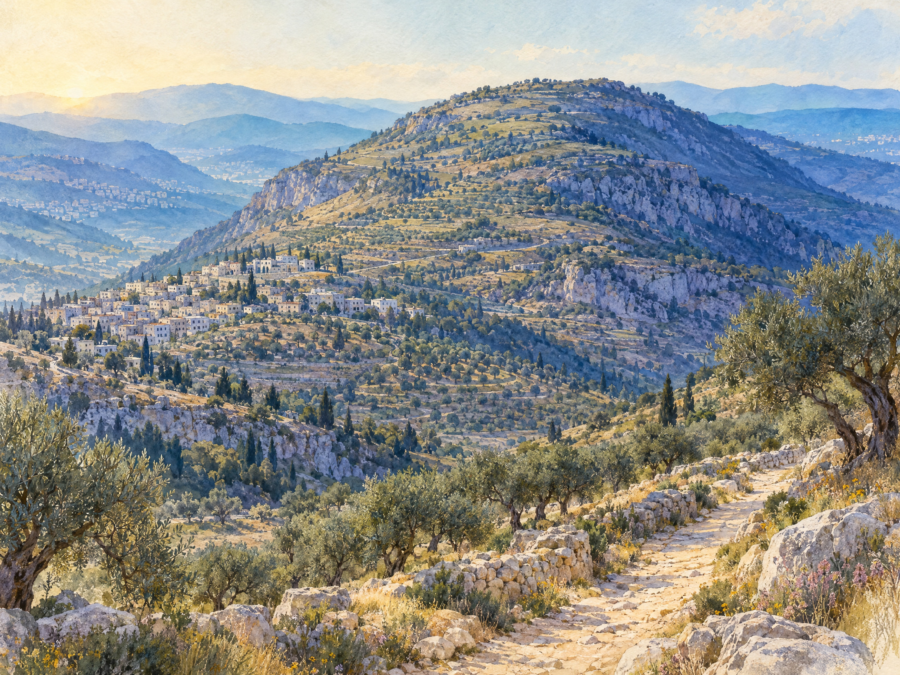
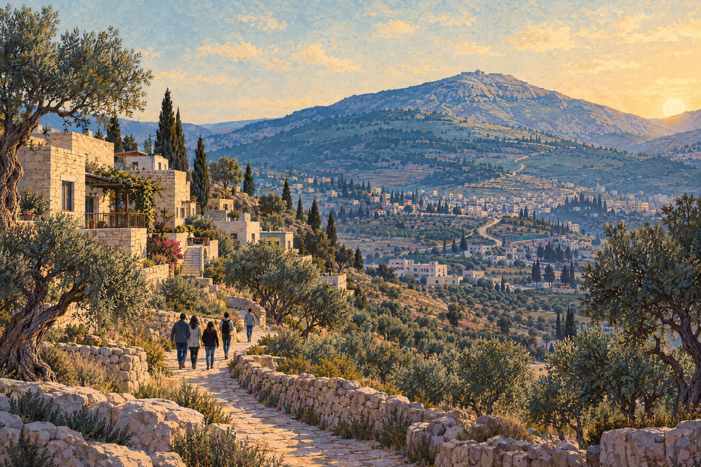

# HARVYRÐ
## Самаритянское Пятикнижие: у горы Гаризим

### Читательский том

## Содержание

- Краткое предисловие
- Глава 1. Пять книг и одна священная гора
- Глава 2. От древнего текста к средневековой рукописи
- Глава 3. Самаритянская буква и редакторская работа
- Глава 4. Три текста, а не одна лестница
- Глава 5. Кумранские родственники, но не копия
- Глава 6. Евал или Гаризим? Второзаконие 27:4
- Глава 7. Самаритянское десятое слово
- Глава 8. От Самарии к общине Гаризима
- Глава 9. Живая община у двух домов
- Заключение, краткий словарь, источники и издания

## Краткое предисловие

Самаритянское Пятикнижие — это не просто «тот же текст, но с ошибками» и не поздняя иллюстрация к истории иудаизма. Это самостоятельная древняя еврейская текстовая традиция, дошедшая до нас в средневековых рукописях и продолжающая жить в самаритянской общине. Её священный корпус состоит из пяти книг Моисея: Бытия, Исхода, Левита, Чисел и Второзакония. В центре этой традиции — Тора, Моисей, Израиль и гора Гаризим как избранное место поклонения.

В этой книге я пересказываю тексты своими словами. Каждый такой пересказ — авторский пересказ, а не цитата из современного библейского перевода. Там, где важна формулировка, приведены книга, глава и стих; длинных цитат я избегаю, чтобы читатель видел не «готовую догму», а работу с источниками.

Нужно различать три уровня материала. Первый — древние текстовые свидетельства: самаритянские рукописи, масоретская традиция еврейского текста, греческая Септуагинта и рукописи Мёртвого моря. Второй — история общины, святилища и рукописной передачи. Третий — современная жизнь самаритян, которых сегодня около девятисот или несколько менее тысячи, а не музейный «остаток древности». Эти уровни связаны, но не взаимозаменяемы.

---

## Глава 1. Пять книг и одна священная гора

### Тора как полный канон

Для самаритян каноническим Писанием является Пятикнижие — пять книг Торы. Это не «неполная Библия» и не случайная утрата последующих книг. Самаритянская религиозная традиция считает Моисееву Тору особым и исчерпывающим откровением: пророческий авторитет Моисея занимает в ней исключительное положение. Поэтому отсутствие в каноне самаритян Пророков и Писаний — граница корпуса, а не пробел, который обязательно нужно заполнить.

Пять книг образуют единое движение. Бытие рассказывает о творении, праотцах, обещании земли и семье Израиля. В авторском пересказе Быт 1:1–2:4 мир возникает по упорядочивающему слову Бога; в Быт 12:1–9 Авраам получает призвание и направляется к земле обетования; Быт 15 и 22 связывают обещание с заветом и испытанием. В Быт 28 и 35 важны места откровения, а Быт 49 завершает книгу благословениями сыновей Иакова.

Исход переводит историю семьи в историю народа. В авторском пересказе Исх 3 Моисей призван вывести Израиль из Египта; Исх 12 связывает освобождение с Пасхой; Исх 19–24 описывает Синай, завет и Декалог. Скиния в Исх 25–31 и 35–40 означает, что присутствие Бога находится среди общины, а не только в прошлом.

Левит раскрывает порядок святости: жертвы, священство, очищение, День искупления и праздники. Числа рассказывают о движении лагеря, конфликтах, священстве, пустыне и границах земли. Второзаконие превращает память в наставление: Моисей перед входом в землю повторяет закон и требует от Израиля не просто помнить события, но жить в соответствии с заветом.

### Гаризим как ось чтения

В самаритянской традиции эти книги читаются с особым вниманием к месту избрания. Втор 11:29 описывает две горы — Гаризим для благословения и Евал для проклятия. В следующем стихе упоминается район Шехема и дубравы Море; в авторском пересказе это географическая рамка, связывающая священную церемонию с центральной горной областью страны. В Втор 12, 16, 17, 18 и 26 самаритянская форма текста особенно последовательно говорит о месте, которое Бог уже избрал, тогда как масоретская форма часто оставляет это место без названия.

Гаризим — не только географическая отметка. Для самаритян это место памяти, священства, молитвы и коллективной жизни. Но нельзя смешивать текстовый слой с археологическим: стих не датируется автоматически по храму, а храм — по стиху. История самаритянского святилища и история формулировки Торы пересекаются, но не совпадают.

### Как читать расхождения

Сравнение с масоретским текстом (MT) показывает тысячи различий, но «различие» — не синоним «искажение». Многие варианты орфографические: более полное или краткое написание слова. Другие касаются местоимений, глагольных форм, синтаксиса и нормализации языка. Есть гармонизации: редактор или переписчик согласует два похожих рассказа. Есть крупные расширения, иногда общие с древними рукописями Кумрана или греческим переводом.

Поэтому вопрос следует ставить не так: «Где самаритяне испортили текст?» Точнее спросить: какие формы еврейского Пятикнижия существовали в древности, какие из них сохранились в разных общинах и какие варианты приобрели особое значение для самаритянской памяти?

**Источники к главе:** Hjelm, “The Samaritan and Jewish Versions of the Pentateuch: A Survey,” *Religions* 11/2 (2020), §§1–5, DOI 10.3390/rel11020085; Florentin and Tal, *The Samaritan Pentateuch: An English Translation with a Parallel Annotated Hebrew Text* (Open Book Publishers, 2025), pp. 14–32, 85–896; Cambridge University Library, MS Add.1846, запись “The Samaritan Pentateuch,” <https://cudl.lib.cam.ac.uk/view/MS-ADD-01846/8>.

---

## Глава 2. От древнего текста к средневековой рукописи

### Почему древняя традиция дошла в поздних списках

Самаритянская Тора древнее сохранившихся самаритянских кодексов. Это простое, но принципиальное различие. Ни один средневековый пергаменный список не является автографом Моисея или прямым материальным продолжением эпохи Второго Храма. Рукопись — свидетель цепи передачи, а не сама цепь целиком.

Cambridge Add.1846, известный также как Burnt Codex или Codex Zurbil, — пергаменный кодекс из Наблуса, около 1100 года и не позднее 1149–1150 годов. В каталоге Cambridge University Library он описан как, вероятно, древнейшая сохранившаяся рукопись Самаритянского Пятикнижия. В нём 227 листов, текст переписан пятью руками. Начало Бытия и конец Второзакония утрачены: сохранившийся текст начинается не с Быт 1:1, а примерно с Быт 1:29, а конец книги Второзакония повреждён после Втор 33:1. Дата 1149–1150 подтверждается записью на листе 103 recto, а не легендой о седой древности.

Материальная история Add.1846 особенно поучительна. На листе 137 verso есть рассказ о спасении кодекса из пожара 1201 года; на листе 188 verso — поздняя и исторически ненадёжная легенда, связывающая рукопись с Навуходоносором и Зоровавелем. Эти записи важны как история почитания рукописи, но не как датировка пергамена.

### Другие контрольные точки

Manchester Samaritan MS 1 — полный кодекс Пятикнижия, датированный 607 годом хиджры, то есть 1211 годом н. э. Каталог John Rylands Research Institute and Library называет его древнейшим датированным полным самаритянским Пятикнижием вне Наблуса. Это иной критерий, чем у Add.1846: Cambridge-кодекс старше, но неполон и не имеет простой единой даты; Manchester-кодекс моложе, зато полный и датированный.

Кодекс New York Public Library P (Ms. Heb. 228), прежде Hebrew-Samaritan Ms. 1, — полный пергаменный список 1232 года, 549 страниц, написанный самаритянским/палеоеврейским письмом. Каталог связывает его с писцом Abraham ben Israel ha-Nasi. Вертикальный колофон на листах Второзакония говорит, что это была его 74-я Тора, и сопоставляет исламскую и самаритянскую хронологии. Это свидетельство работы писца и общинной памяти, не абсолютная шкала возраста текста.

Dublin Chester Beatty MS 751, переписанный Abi Barakata в 1225 году, почти полный, стал базовым свидетелем для *The Samaritan Pentateuch: A Critical Editio Maior*, vol. 3: *Leviticus* (Stefan Schorch, De Gruyter, 2018). В нём недостающие семь листов конца Второзакония дополняются другим старым свидетелем. Выбор базового кодекса не означает, что он «единственный оригинал»: это редакционное решение, позволяющее последовательно показать варианты.

### Свиток Абиши и колофон

Особое место занимает Свиток Абиши из Наблуса. Колофон, начинающийся у Втор 6:4, приписывает письмо Абише, правнуку Аарона, и датирует его тринадцатым годом после входа Израиля в Ханаан. Это важнейшее свидетельство самаритянской самопрезентации: рукопись помещается в непосредственную линию Аарона и раннего Израиля. Но такая дата не является надёжной абсолютной датировкой сохранившегося пергамена.

I. Hjelm сообщает о писцовой дате 1065 года и о научной датировке около середины XII века, приблизительно 1149 годом, с поздними заплатами и дополнениями. Emanuel Tov осторожнее говорит о вероятном XIII веке. Gaster высказывал мнение о первоначальном свитке V–IV веков до н. э., но это не установленный возраст нынешнего предмета. Правильный вывод: Абиша — сложный, повреждённый и дополнявшийся объект; его легендарный колофон нельзя превращать в паспорт каждого фрагмента.

**Источники к главе:** Cambridge University Library, MS Add.1846, fols. 103r, 137v, 188v; John Rylands Research Institute and Library, “Samaritan Manuscripts,” <https://www.digitalcollections.manchester.ac.uk/collections/samaritan>; New York Public Library, P (Ms. Heb. 228), <https://catalog.nypl.org/record=b16307591~S1>; Hjelm, 2020, §6.1; Tov, “Proto-Samaritan Texts and the Samaritan Pentateuch,” раздел “Editions and Translations,” <http://www.emanueltov.info/docs/varia/67.Proto-SamaritanTexts.2.pdf?v=1.0>; Pérez Castro, *Séfer Abisa* (Madrid, 1959); Schorch, *Critical Editio Maior*, vol. 3 (2018).

---

## Глава 3. Самаритянская буква и редакторская работа

### Письмо не равно возрасту

Самаритянское письмо развилось из палеоеврейского, но это не значит, что каждая рукопись в нём непосредственно сохраняет графику эпохи царств. Cambridge описывает письмо Add.1846 как Samaritan bookhand, а Tov подчёркивает более позднюю историческую эволюцию формы, связанную с хасмонейской и последующими эпохами. Называть шрифт «неизменным древним израильским письмом» слишком просто.

Сходным образом нельзя выводить дату текста из одного написания буквы. Писец мог копировать древнюю формулу современным почерком; поздняя рукопись могла сохранять более раннее чтение; новая орфография могла сопровождать старую редакторскую форму.

### Как работают издания

A. von Gall, *Der hebräische Pentateuch der Samaritaner*, I–IV (Giessen, 1914–1918; переизд. Berlin, 1966), долго оставался наиболее развитым старым изданием. Но это эклектический текст: редактор выбирал чтения из ограниченного числа рукописей и не всегда печатал чтение большинства. Показателен Быт 2:11: von Gall предпочёл форму h-s-b-b, близкую MT, хотя большинство самаритянских рукописей дают h-s-w-b-b. Поэтому книгу von Gall нельзя цитировать как фотографию одного кодекса или нейтральную репродукцию «оригинала».

A. и R. Sadaqah, *Jewish and Samaritan Version of the Pentateuch* (Jerusalem, 1965), печатают самаритянский и масоретский тексты параллельно и используют Абишу и другие старые свидетели. Это удобное сравнительное издание, но параллельная страница сама по себе не решает вопрос генеалогии вариантов.

L. F. Girón-Blanc, *Pentateuco hebreo-samaritano: Génesis: edición crítica sobre la base de manuscritos inéditos* (Madrid, 1976), основан на Add.1846 и сопоставляет варианты ещё четырнадцати источников. Здесь особенно заметно, что «самаритянский текст» существует как рукописная совокупность, а не как один средневековый экземпляр.

Современный проект Schorch строится как дипломатическая *Editio Maior*. Пять аппаратов показывают: варианты рукописей, самаритянские переводные свидетельства, дополнительные знаки и вокализацию, параллели с Кумраном, LXX и Пешиттой, а также пунктуацию. Основной текст может быть набран квадратным еврейским письмом для доступности, тогда как самаритянские знаки сохраняются специальным шрифтом. Типографская форма издания не должна быть принята за вид оригинального списка.

### Перевод и устное произношение

Florentin и Tal, *The Samaritan Pentateuch: An English Translation with a Parallel Annotated Hebrew Text* (2025), используют как представляющий свидетель Nablus 6, переписанный в 1204 году. Это не утверждение, что весь текст возник в 1204 году. Перевод опирается на грамматический разбор каждого слова, устное самаритянское произношение, а также самаритянские арамейские и арабские переводы. Иными словами, письменный согласный корпус и живая интерпретация чтения работают вместе.

Компьютерный корпус DT-UCPH/sp полезен для исследователя, но требует осторожности: одинаковые согласные могут иметь иное самаритянское спряжение, чем ожидает масоретская модель. Автоматический разбор — помощник, а не замена филологическому чтению.

**Источники к главе:** von Gall, *Der hebräische Pentateuch der Samaritaner*, I–IV; Sadaqah, *Jewish and Samaritan Version of the Pentateuch* (1965); Girón-Blanc, *Pentateuco hebreo-samaritano: Génesis* (1976); Schorch, *The Samaritan Pentateuch: A Critical Editio Maior*, vol. 3 (2018); Stephen Campbell, review of Schorch, <https://www.textualcriticism.org/post/review-of-the-samaritan-pentateuch-a-critical-editio-maior>; Florentin and Tal (2025), pp. 14–32, 71–84, 85–896; Naaijer et al., “Text-Fabric Dataset of the Samaritan Pentateuch,” *Research Data Journal* 9/1 (2024), pp. 1–13, DOI 10.1163/24523666-bja10051.

---

## Глава 4. Три текста, а не одна лестница

### MT, LXX и SP

Масоретский текст — поздняя стандартизированная форма еврейского текста, известная через средневековую рукописную традицию. Септуагинта — древний греческий перевод, созданный по еврейским исходным текстам, которые могли отличаться от позднейшего MT. Самаритянское Пятикнижие — самостоятельная еврейская традиция, засвидетельствованная в полном виде средневековыми рукописями, но включающая варианты, существовавшие значительно раньше.

Отношения между ними нельзя представить как лестницу: сначала «оригинал», затем MT, затем SP или наоборот. В древности циркулировало несколько текстовых форм. Некоторые были близки MT, другие LXX, третьи — SP, а четвёртые не совпадали полностью ни с одной из них.

### Четыре типа различий

Первый тип — орфография и грамматика. Это plene/defective написание, различия местоимений, глагольных форм, синтаксическое выравнивание и особенности самаритянского еврейского. Такой вариант может менять звучание, но не обязательно содержание.

Второй тип — гармонизация. В СП Втор 10:6–7 краткий маршрут MT переработан так, чтобы согласоваться с маршрутом Чис 33:31–38. В СП Чис 20:13 добавлены материалы, напоминающие Втор 3:24–28 и 2:2–6; Чис 21:21–23 также расширен. Это редакторская работа по сведению параллельных рассказов, а не механическая случайная приписка.

Третий тип — расширение. В Чис 4:14 появляется инструкция покрыть умывальник и его подставки; сходное чтение есть в LXX, поэтому нельзя без доказательства объявлять его поздней самаритянской вставкой. В Быт 5 и 11 самаритянские хронологические формы сближаются с LXX; такое совпадение может отражать древний общий текст, а не заимствование из греческого.

Четвёртый тип — культовая локализация. Здесь особенно важны Гаризим, избранное место и самаритянское десятое слово. Но слово «идеологический» описывает функцию чтения, не обязательно его дату и происхождение. Даже явно важная для самаритян идентичность редакция могла использовать древний материал, а не создавать его из ничего.

### Почему совпадение с LXX не доказывает зависимость

Если SP и LXX расходятся с MT одинаково, возможны несколько объяснений: обе традиции сохранили древнее еврейское чтение; одна из них независимо гармонизировала текст; греческий переводчик использовал еврейскую Vorlage, близкую к самаритянской. Требуется реконструировать конкретную Vorlage LXX и проверить распределение вариантов.

То же относится к Кумрану. Совпадение SP с 4Q22 или 4Q27 показывает древность конкретного чтения, но не означает, что кумранский свиток был самаритянским или что средневековая рукопись переписана с него напрямую.

**Источники к главе:** Hjelm, 2020, art. 85; Emanuel Tov, “Proto-Samaritan Texts and the Samaritan Pentateuch”; Eugene Ulrich, “The Samaritan and Masoretic Pentateuch,” in *Sibyls, Scriptures, and Scrolls* (Leiden: Brill, 2017), pp. 1314–1329; Tov and Sidnie White, “4Q364. Reworked Pentateuch b,” *DJD* XIII (1994), pp. 197–254; Tov, “Biblical Texts and Interpretations in the Dead Sea Scrolls,” *Oxford Research Encyclopedia of Religion* (2025).

---

## Глава 5. Кумранские родственники, но не копия

### Что означает «протосамаритянский»

В исследованиях употребляется термин «протосамаритянские тексты». Это текстологическое, а не этническое обозначение. Оно не говорит, что конкретный писец был самаритянином или исповедовал позднейшую самаритянскую религию. Речь идёт о группе древних еврейских текстов Второго Храма, в которых видны формы расширения, гармонизации и орфографии, позднее особенно заметные в СП.

К близким свидетелям относят 4Q17, 4Q22 (4QpaleoExodm), 4Q27 (4QNumb), а также переработанные Пятикнижия 4Q158 и 4Q364–4Q367. Они фрагментарны, датируются эпохой Второго Храма и показывают, что текстовое многообразие возникло задолго до средневековых кодексов.

### 4Q22 и Гаризимская композиция

Особое значение имеет 4Q22. Hila Dayfani в статье “4QpaleoExodm and the Gerizim Composition” (*Journal of Biblical Literature* 141/4, 2022, pp. 673–698) аргументирует, что геризимская композиция была включена в этот длинный предсамаритянский свиток. Это пересматривает более раннее мнение, будто соответствующего блока в нём нет.

Но даже если реконструкция Dayfani верна, 4Q22 не становится «самаритянским Пятикнижием в готовом виде». Он остаётся древним фрагментарным свидетелем, а SP — поздним полным текстовым корпусом. Между ними были этапы копирования, отбора и редакторской стабилизации.

### Почему нельзя строить прямую генеалогию

Во-первых, совпадения неполны. Некоторые расширения есть в кумранских свитках, но отсутствуют в СП; некоторые чтения СП отсутствуют в соответствующем фрагменте. Во-вторых, отдельные кумранские тексты имеют собственные переработки. 4Q41 расширяет заповедь субботы во Втор 5 материалом Исх 20, но это расширение не вошло в СП. 4Q158, фрагменты 6–7, имеет собственную форму расширения синайского эпизода. В Чис 25:4 СП предлагает редакционную формулировку, которой нет в 4Q27.

В-третьих, «протосамаритянский» — кластер, а не имя одного предка. Он помогает понять древность типа текста, но не даёт нам единственной линии: «кумранский свиток — готовая самаритянская редакция — средневековый кодекс».

### Установленное и реконструируемое

Установлено, что ряд чтений СП имеет древние параллели; что крупные гармонизации существовали в эпоху Второго Храма; что в Кумране были тексты, близкие к MT, LXX, SP и не совпадающие ни с одной из этих форм. Реконструируется, но не доказано одной рукописью, сколько редакционных слоёв стоит за СП, был ли геризимский блок результатом одного акта и какое древнее свидетельство непосредственно предшествовало средневековой самаритянской традиции.

**Источники к главе:** Dayfani, “4QpaleoExodm and the Gerizim Composition,” *JBL* 141/4 (2022), pp. 673–698, DOI 10.15699/jbl.1414.2022.5; Dayfani, “The Major Additions in the Samaritan Pentateuch Tradition,” *Vetus Testamentum* 75/3 (2025), pp. 335–359; Tov and White, *DJD* XIII (1994), pp. 197–254; Hjelm, 2020; Israel Antiquities Authority, Dead Sea Scrolls Digital Library, 4Q38 (4QDeut k), <https://www.deadseascrolls.org.il/explore-the-archive/manuscript/4Q38-1?locale=en_US>.

---

## Глава 6. Евал или Гаризим? Второзаконие 27:4

### Что говорит MT

Втор 27:1–7 описывает церемонию после перехода Иордана. В авторском пересказе Моисей и старейшины велят поставить большие камни, покрыть их известью, написать на них слова Торы, воздвигнуть алтарь из необработанных камней и совершить мирные жертвы. В MT место камней и алтаря в ст. 4 названо «горой Евал»; в ст. 5–7 продолжается описание алтаря и трапезы перед Богом.

Втор 11:29 задаёт пару гор: Гаризим — гора благословения, Евал — гора проклятия. Ст. 30 связывает эту сцену с дорогой за Иорданом, районом дубравы Море и окрестностями Шехема. Поэтому уже в MT существует напряжение: благословение локализовано на Гаризиме, а алтарь в 27:4 — на Евале.

### Что читает SP

Самаритянское Пятикнижие в Втор 27:4 читает «гора Гаризим» вместо «гора Евал». В авторском пересказе получается последовательная сцена: там, где Израиль должен записать Тору, поставить камни и построить алтарь, находится Гаризим — гора благословения и избранного святилища. В конце Втор 11:30 SP добавляет локализацию «напротив Шехема», делая географическую логику ещё явнее.

Старое объяснение считало Гаризим тенденциозной самаритянской заменой Евала. Такое объяснение действительно учитывает функцию чтения: оно поддерживает самаритянскую сакральную географию и устраняет напряжение между 11:29 и 27:4. Но оно не закрывает вопрос о происхождении чтения.

### Аргументы в пользу древности Гаризима

Древнегреческая традиция требует различать слои. Обычный печатный текст LXX в Втор 27:12–13 сохраняет пару Гаризим–Евал: первая гора — гора благословения, вторая — гора проклятия. Это не значит, что вся LXX в ст. 4 единогласно читает Гаризим. В рукописи P. Giessen 13, 19, 22, 26 сообщается чтение «Гаризим» именно в 27:4. Но спорят, что это за свидетель: Rahlfs и Glaue связывали его с Самарейтиконом, тогда как Tov считал ревизией LXX. Поэтому корректно говорить о древнем греческом свидетельстве, а не безоговорочно о «единогласной LXX».

Обсуждаются также древние фрагменты Второзакония и кумранские свидетельства. Однако фрагменты, которые иногда называют 4QDeut-frag. и связывают с чтением Гаризима, остаются спорными: их подлинность, классификация и реконструкция обсуждались. Официальная запись 4Q38 подтверждает существование рукописи геродианского периода, но сама по себе не утверждает чтение Гаризима в 27:4.

### Две конкурирующие модели

Первая модель: MT сохраняет более раннее чтение Евала, а SP заменяет его Гаризимом ради самаритянской культовой полемики. В пользу модели говорит прозрачная связь с действующим святилищем Гаризима и с редакторскими усилениями места избрания.

Вторая модель: Гаризим — древнее чтение, а Евал возник в иудейской текстовой линии как замена или как форма, лучше согласующаяся с собственной иерусалимской картиной культа. В пользу модели приводят древние греческие и кумранские параллели, а также то, что самаритянская форма не обязательно была создана в поздней средневековой общине.

Ни одна модель не доказана окончательно. Археологический алтарь на Евале не решает вопрос: даже если его датировка и функция обсуждаемы, нельзя автоматически отождествить раскопанное сооружение с алтарём Втор 27. Текст и археологический объект требуют независимой аргументации.

Самый осторожный вывод таков: MT-Евал и SP-Гаризим — конкурирующие древние формы текста; чтение Гаризим имеет древние параллели, но его первоначальность не доказана. Называть SP просто «искажением» — слишком грубо; называть Гаризим бесспорно первоначальным — тоже выходит за пределы свидетельств.

**Источники к главе:** MT, Втор 11:29–30; 27:1–13; Brenton Septuagint, Втор 27:12–13, <https://thehistoricfaith.com/audio-bible/listen/septuagint/deuteronomy/27>; Samaritan Pentateuch, Втор 27:4–7, <https://intertextual.bible/text/deuteronomy-27.4/samaritan-deuteronomy-27.4>; Joosten, исследование P. Giessen, Oxford Research Archive, <https://ora.ox.ac.uk/objects/uuid:c9091a7b-e005-42f3-8334-0180e0393c45/files/md5f4060ba05c9008ded523cc04d9ef87>; Ben-Dov, “An Altar on Mt Ebal or Mt Gerizim?” <https://www.thetorah.com/article/an-altar-on-mt-ebal-or-mt-gerizim-the-torah-in-the-sectarian-debate>; Revell, “Cult Centralization in the Samaritan Pentateuch and the Origin of Deuteronomy,” *JSOT* (2014); Hjelm, 2020, §“The Cult Place”.

---

## Глава 7. Самаритянское десятое слово

### Что именно является «десятым»

В самаритянской традиции Декалог включает композицию, которой нет в обычном MT-порядке. После запрета пожелания имущества ближнего — Исх 20:17 и Втор 5:21 в масоретской нумерации — самаритянский текст помещает материал о месте, где Израиль должен установить камни, написать Тору и построить алтарь.

Это не короткая новая заповедь вроде «почитай Гаризим». Это литературно оформленный блок, составленный из Втор 11:29–30 и 27:2–7. В авторском пересказе SP говорит: когда Бог приведёт Израиль в землю, после перехода Иордана нужно поставить большие камни, записать слова закона, направиться к Гаризиму, соорудить алтарь из цельных камней, принести мирные жертвы, есть и радоваться перед Богом; место находится напротив Шехема, у дубравы Море. Этот блок появляется в SP-Исх 20:17 и SP-Втор 5:21.

### Почему композиция важна

Она превращает географию в часть структуры Декалога. Для самаритянина Гаризим — не поздний комментарий после десяти слов, а содержание самого заветного наставления. Место избрания входит в перечень фундаментальных обязанностей Израиля.

Литературно блок связывает начало и конец закона: Декалог в Исходе и Второзаконии получает рамку, ведущую к церемонии в земле. Культовая локализация становится не отдельной сноской, а способом прочесть завет как единство верности Богу, памяти о Моисее и правильного места поклонения.

### Дата и пределы вывода

Самаритянская композиция явно присутствует в средневековой рукописной традиции. Но датировка конкретных средневековых списков не равна датировке всех её слоёв. Древние параллели геризимской композиции в 4Q22 показывают, что определённые материалы существовали в эпоху Второго Храма. Они не доказывают, что современная форма десятого слова уже тогда была полностью сформирована.

Здесь полезно различать три утверждения. Первое: SP включает десятое слово — установлено. Второе: его составные материалы древнее средневековых рукописей — вероятно и в отдельных частях засвидетельствовано. Третье: единый редактор в определённую дату создал всю композицию — не доказано.

Нельзя также говорить, что самаритянское десятое слово — обязательно поздняя «вставка» в узком смысле. В древнем Пятикнижии существовали расширенные и гармонизированные формы. Но нельзя и переносить позднюю редакционную форму целиком в эпоху Моисея без текстовых оснований.

### Текст и живая практика

Для современной общины эта композиция связана с Гаризимом как с действующим священным центром. Однако текстологическая история и современное богослужение — разные виды свидетельства. Ритуал Пасхи, молитвы и календарь показывают, как традиция живёт сегодня; они не являются рукописью, которая автоматически датирует десятословную композицию.

**Источники к главе:** Samaritan Pentateuch, Исх 20:17 и Втор 5:21, <https://intertextual.bible/text/deuteronomy-5.21/samaritan-deuteronomy-5.21>; MT, Исх 20:17; Втор 5:21; Втор 11:29–30; 27:2–7; Hjelm, 2020, §5; Dayfani, 2022, pp. 673–698; Gary N. Knoppers, “Altared States,” pp. 110–111; Gallagher, “Is the Samaritan Pentateuch a Sectarian Text?”, *ZAW* 127 (2015), DOI 10.1515/zaw-2015-0007; Ben-Dov, указанная статья.

---

## Глава 8. От Самарии к общине Гаризима

### Не один момент происхождения

Историю самаритян нельзя свести к простой схеме: ассирийцы переселили чужеземцев, а они стали самаритянами. 2 Цар 17:24–41 содержит рассказ о переселениях из Куты и других мест, но это литературный и полемический текст, а не нейтральная перепись населения. После падения Северного царства действительно происходили депортации, переселения и административные перестройки, однако население Самарии не исчезло целиком.

Современные модели чаще говорят о смешанном процессе: местная североизраильская преемственность, новые переселенцы, контакты с Иудеей и соседними областями, а затем постепенное формирование особой общинной идентичности. Одни исследователи связывают её заметное оформление с персидской эпохой и святилищем Гаризима; другие — с эллинистическими конфликтами II–I веков до н. э. Надписи показывают развитое самосознание уже в первой половине II века до н. э., но не доказывают, что именно тогда община возникла из ничего.

Иосиф Флавий предлагает несовместимые истории. В *Иудейских древностях* 9.288–291 он рассказывает о кутеях, переселённых из Персии, но признаёт их почитание Яхве. В 11.340–347 он рассказывает о шехемитах и передаёт их претензию на происхождение от Ефрема и Манассии. Это полезные внешние свидетельства о спорах идентичности, но не прозрачная стенограмма самаритянского самопонимания.

### Святилище на Гаризиме

Археологически на Гаризиме засвидетельствован крупный священный комплекс, позднее город и храмовая территория. Наиболее влиятельная реконструкция, связанная с раскопками Ицхака Магена, помещает первоначальный комплекс в середину V века до н. э., в персидскую эпоху. Персидская керамика, монеты, архитектурные остатки, вотивные надписи и следы жертвоприношений поддерживают древность комплекса. Но точная датировка первой храмовой фазы остаётся дискуссионной; осторожнее говорить о святилище и его ранних слоях, чем превращать каждую археологическую фазу в прямой комментарий к Пятикнижию.

Храм был разрушен войсками Иоанна Гиркана примерно в 112/111 или 111/110 году до н. э. Jérôme Bourgel предлагает видеть в этом не только религиозную вражду, но и хасмонейскую территориальную политику: подчинение Самарии государству и иерусалимскому центру. В античности конфликт храмов, политическая интеграция и религиозная конкуренция могли действовать одновременно.

### Родство и конкуренция

Иудеи и самаритяне разделяли многие традиции: культ Яхве, Пятикнижие, священство, жертвы и рассказы об Израиле. Различия концентрировались вокруг легитимности священства, границ общины и места поклонения — Иерусалима или Гаризима. Поэтому «вечная вражда» — плохая модель. Были конфликты и полемика, но также соседство, контакты, политические связи и взаимное знание.

Самаритянское имя и самоназвание требуют осторожности. Внешнее «самаритяне» связано с Самарией; позднейшее самаритянское объяснение Shomrim как «хранителей» выражает самоидентификацию, но не автоматически решает этимологию ранних названий. Безопаснее говорить о развитии самоназвания и идентичности, а не переносить позднюю терминологию в каждый древний документ.

**Источники к главе:** Kartveit, “Theories of the Origin of the Samaritans—Then and Now,” *Religions* 10/12 (2019), art. 661; Knoppers, *Jews and Samaritans* (Oxford University Press, 2013), pp. 1–20, 61–62, 199–220; Kartveit, “Samaritan Self-Consciousness…,” *JSJ* 45 (2014), pp. 449–470; Economou, “The Aramaic Inscriptions from Mount Gerizim,” *Journal of Ancient Judaism* 15/1 (2023), pp. 154–181; Minnick, “A Samaritan Temple to Rival Jerusalem on Mount Gerizim,” *Studia Antiqua* 16/1 (2017), pp. 1–28; Bourgel, “The Destruction of the Samaritan Temple by John Hyrcanus,” *JBL* 135/3 (2016), pp. 505–523; Josephus, *Antiquitates* 9.288–291; 11.302–347; 12.257–261.

---

## Глава 9. Живая община у двух домов

### Холон и Кирьят-Луза

Сегодня самаритяне живут прежде всего в двух центрах: в районе Неве-Пинхас в Холоне, в Израиле, и в Кирьят-Лузе на горе Гаризим над Наблусом, на Западном берегу. Это не две «филиальные экспозиции» одного музея. В Холоне община встроена в израильскую городскую жизнь; жители работают, учатся и участвуют в обычных гражданских практиках. В Кирьят-Лузе самаритяне живут в палестинском социальном и административном окружении, используют арабский и иврит и имеют сложные сочетания документов и гражданских принадлежностей.

Численность нужно датировать. Gil Zohar в 2021 году приводил 814 человек; материалы Times of Israel в 2022 году — 862; выставка Museum of the Bible округляла оценку до 850. Публикации 2026 года говорят о менее чем 900 или менее чем 1000. Разница может объясняться датой, округлением и методикой подсчёта. Корректная формула: примерно 900 человек, возможно немного менее 1000 по публичным оценкам 2026 года.

### Религия и календарь

У самаритян нет раввинов; религиозное руководство принадлежит священникам, во главе с первосвященником на Гаризиме. Нельзя предполагать, что публичный представитель говорит от имени каждого члена общины: духовенство, учёные, экскурсоводы и миряне могут по-разному описывать границы традиции.

Календарь основан на Пятикнижии, а не на раввинской календарной системе. Священники вычисляют високосные годы, поэтому праздники могут отставать от еврейских почти на месяц. В 2026 году, согласно репортажу JNS, Йом-Киппур пришёлся на 20 октября, а Суккот начался 25 октября. На Пасху община поднимается на Гаризим, совершает жертвенный ритуал с овцами и козами, затем готовит и ест мясо. Это действующее богослужение, а не реконструкция для туристов.

### Язык, семьи и разнообразие

Самаритянский иврит сохраняется прежде всего в молитве, чтении Торы и мелодике; повседневная речь зависит от центра и семьи, часто включает современный иврит и арабский. Дети начинают учиться у священника или наставника в раннем возрасте; чтение Пятикнижия осваивается постепенно, без простого копирования раввинской модели бар- или бат-мицвы.

Браки внутри общины остаются важной нормой и демографической заботой, но позиции различаются. Документальные и журналистские проекты описывают браки самаритянских мужчин с женщинами извне, включая украинских жён, и спор о том, как расширять генофонд, не разрушая общинную преемственность. Нельзя приписывать всем одну позицию по смешанным бракам или обращению.

Политическая самоидентификация также неоднородна. Один человек может одновременно говорить о самаритянской принадлежности, палестинском окружении и израильской гражданской реальности; другой подчёркивает только один из этих аспектов. Формула «мост между израильтянами и палестинцами» встречается в журналистике, но не должна превращаться в универсальное описание каждого самаритянина.

### Гаризим сегодня

Живой центр Гаризима включает молитвенную жизнь, кладбище, музей, жилой квартал и ежегодные праздники. Общинные экскурсии проходят на иврите, арабском или английском. Важно видеть за рукописями людей: самаритянская Тора — не только объект истории текста, но и книга, которую читают, целуют, произносят и включают в семейную жизнь.

**Источники к главе:** Zohar, “Samaritans Number Less Than 1,000…,” *Religion Unplugged*, 26.10.2021; Times of Israel, “Film projects spotlight…,” 10.11.2022; Museum of the Bible, “The Samaritans: A Biblical People,” выставка 16.09.2022–16.04.2023; Tahan, “The Samaritans: A living bridge…,” *The New Arab*, 12.02.2026; JNS, “Ancient faith, modern lives…,” 22.09.2026; Yeshiva University Center for Israel Studies, “The Samaritans: A Biblical People,” 2022, <https://www.yu.edu/cis/samaritans-project>; Israelite Samaritan Information Institute, “Tours to Samaritan centres…,” <https://www.israelite-samaritans.com/tours/>; Hunt, “Samaritan Israelites and Jews under the Shadow of Rome,” *Religions* 14/9 (2023), art. 1149.

---

## Заключение. Читать у горы, не стирая различий

Самаритянское Пятикнижие открывает не одну простую историю, а несколько наложенных друг на друга историй. Есть древняя еврейская текстовая вариативность Второго Храма; есть самаритянская редакторская традиция, подчёркивающая Гаризим; есть средневековая рукописная передача; есть современные издания, которые по-разному выбирают базовый текст; есть живая община, продолжающая читать Тору и подниматься на гору.

MT и SP не следует превращать в моральную пару «оригинал — порча». LXX не является третьим равноправным еврейским кодексом, а греческим переводом с собственной сложной историей. Совпадение SP и LXX может говорить об общем древнем еврейском чтении, а не о заимствовании. Кумранские «протосамаритянские» рукописи показывают древность некоторых типов вариантов, но не являются готовым средневековым SP и не обязательно имеют самаритянское происхождение.

Втор 27:4 — особенно яркий пример. MT даёт Евал, SP — Гаризим. Древние греческие и кумранские свидетельства делают вопрос открытым, но не позволяют безоговорочно объявить одну форму первоначальной. Самаритянское десятое слово явно связывает Декалог с Гаризимом, однако поздняя форма рукописи не должна автоматически переноситься в каждую эпоху.

И, наконец, самаритяне — не только предмет реконструкции. Их традиция пережила разрушение храма, смену империй, уменьшение численности и современные политические границы. Серьёзное чтение требует одновременно точности к тексту и уважения к людям, для которых этот текст остаётся откровением, календарём, молитвой и домом.

---

## Краткий словарь

**MT, масоретский текст** — поздняя стандартизированная еврейская текстовая форма, известная главным образом по средневековой масоретской рукописной традиции.

**SP, Самаритянское Пятикнижие** — самаритянская еврейская текстовая традиция пяти книг Моисея.

**LXX, Септуагинта** — древний греческий перевод еврейских Писаний; для каждого варианта нужно учитывать конкретную греческую рукопись и предполагаемую еврейскую Vorlage.

**Протосамаритянский** — условное текстологическое обозначение древних еврейских рукописей, близких по ряду форм к позднейшему SP; не утверждение об этнической принадлежности писца.

**Гаризим** — гора и священный центр самаритянской традиции, связанный с благословением, избранным местом и современной общинной жизнью.

**Евал** — гора, названная в MT Втор 27:4 местом камней и алтаря; в SP этот стих читает Гаризим.

**Геризимская композиция** — совокупность материалов о Гаризиме, камнях, записи Торы и алтаре, связанная в SP с Декалогом и Втор 11; в самаритянской нумерации образует «десятое слово».

**Колофон** — запись в рукописи о писце, владельце, дате или происхождении; колофон Абиши важен как самаритянская традиция, но не даёт автоматически абсолютную датировку материала.

**Дипломатическое издание** — издание, старающееся сохранить особенности конкретного основного свидетеля, одновременно показывая варианты в аппарате.

**Эклектическое издание** — текст, составленный редактором из разных рукописей по оценке вариантов, а не буквальная копия одного списка.

**Vorlage** — предполагаемый исходный текст, лежащий за переводом, например за греческой LXX.

---

## Источники и издания

*Редакционная оговорка:* номера страниц и шифры приведены по указанным в исследовательском корпусе изданиям и каталогам. Даты современных журналистских материалов относятся к публикациям, а не к единой переписи населения. Все пересказы библейских мест в основном тексте являются авторскими пересказами.

### Первичные текстовые и рукописные источники

- **Cambridge University Library.** MS Add.1846, *The Samaritan Pentateuch* (Codex Zurbil/Burnt Codex), цифровой каталог и изображения: <https://cudl.lib.cam.ac.uk/view/MS-ADD-01846/8>.
- **John Rylands Research Institute and Library, University of Manchester.** “Samaritan Manuscripts”: <https://www.digitalcollections.manchester.ac.uk/collections/samaritan>.
- **New York Public Library, Dorot Jewish Division.** P (Ms. Heb. 228), “[Samaritan Bible]”: <https://catalog.nypl.org/record=b16307591~S1>.
- **Samaritan Pentateuch.** Параллельные публикации Втор 27:4 и Втор 5:21: <https://intertextual.bible/text/deuteronomy-27.4/samaritan-deuteronomy-27.4>; <https://intertextual.bible/text/deuteronomy-5.21/samaritan-deuteronomy-5.21>.
- **Sefaria.** MT, Втор 27:4: <https://www.sefaria.org/Deuteronomy.27.4?lang=bi>.
- **Brenton Septuagint.** Втор 27:12–13: <https://thehistoricfaith.com/audio-bible/listen/septuagint/deuteronomy/27>.
- **Israel Antiquities Authority.** 4Q38 (4QDeut k), Dead Sea Scrolls Digital Library: <https://www.deadseascrolls.org.il/explore-the-archive/manuscript/4Q38-1?locale=en_US>.
- **Flavius Josephus.** *Antiquitates Judaicae* 9.288–291; 11.302–347; 12.257–261, электронная публикация University of Chicago: <https://penelope.uchicago.edu/josephus/ant-11.html>.

### Научные издания и исследования текста

- Dayfani, Hila. “4QpaleoExodm and the Gerizim Composition.” *Journal of Biblical Literature* 141, no. 4 (2022): 673–698. DOI: 10.15699/jbl.1414.2022.5.
- Dayfani, Hila. “The Major Additions in the Samaritan Pentateuch Tradition.” *Vetus Testamentum* 75, no. 3 (2025): 335–359.
- Florentin, Moshe, and Abraham Tal. *The Samaritan Pentateuch: An English Translation with a Parallel Annotated Hebrew Text*. Cambridge: Open Book Publishers, 2025, pp. 14–32, 71–84, 85–896, 897–1032, 1033–1107. <https://www.openbookpublishers.com/books/10.11647/OBP.0415>.
- Girón-Blanc, L. F. *Pentateuco hebreo-samaritano: Génesis: edición crítica sobre la base de manuscritos inéditos*. Madrid, 1976.
- Hjelm, Ingrid. “The Samaritan and Jewish Versions of the Pentateuch: A Survey.” *Religions* 11, no. 2 (2020), article 85. DOI: 10.3390/rel11020085.
- Pérez Castro, Federico. *Séfer Abisa: edición del fragmento antiguo del rollo sagrado del Pentateuco hebreo-samaritano de Nablus*. Madrid, 1959.
- Sadaqah, A. and R. *Jewish and Samaritan Version of the Pentateuch*. Jerusalem, 1965.
- Schorch, Stefan. *The Samaritan Pentateuch: A Critical Editio Maior*. Vol. 3: *Leviticus*. Berlin: De Gruyter, 2018.
- Tov, Emanuel. “Proto-Samaritan Texts and the Samaritan Pentateuch,” раздел “Editions and Translations”: <http://www.emanueltov.info/docs/varia/67.Proto-SamaritanTexts.2.pdf?v=1.0>.
- Tov, Emanuel, and Sidnie White. “4Q364. Reworked Pentateuch b.” In *Qumran Cave 4: VIII, Parabiblical Texts*, DJD XIII, edited by James VanderKam et al., 197–254. Oxford: Clarendon, 1994.
- Ulrich, Eugene. “The Samaritan and Masoretic Pentateuch.” In *Sibyls, Scriptures, and Scrolls: John Collins at Seventy*, edited by Joel Baden, Hindy Najman, and Eibert J. C. Tigchelaar, 1314–1329. Leiden: Brill, 2017.
- von Gall, August. *Der hebräische Pentateuch der Samaritaner*. 4 vols. Giessen, 1914–1918; repr. Berlin, 1966.

### История, археология и современная община

- Bourgel, Jérôme. “The Destruction of the Samaritan Temple by John Hyrcanus.” *Journal of Biblical Literature* 135, no. 3 (2016): 505–523. DOI: 10.15699/jbl.1353.2016.3129.
- Economou, M. “The Aramaic Inscriptions from Mount Gerizim.” *Journal of Ancient Judaism* 15, no. 1 (2023): 154–181.
- Knoppers, Gary N. *Jews and Samaritans: The Origins and History of Their Early Relations*. Oxford: Oxford University Press, 2013.
- Kartveit, Magnar. “Samaritan Self-Consciousness in the First Half of the Second Century B.C.E. in Light of the Inscriptions from Mount Gerizim and Delos.” *Journal for the Study of Judaism* 45 (2014): 449–470.
- Kartveit, Magnar. “Theories of the Origin of the Samaritans—Then and Now.” *Religions* 10, no. 12 (2019), article 661. DOI: 10.3390/rel10120661.
- Minnick, J. L. “A Samaritan Temple to Rival Jerusalem on Mount Gerizim.” *Studia Antiqua* 16, no. 1 (2017): 1–28.
- Zsengellér, József. “The Samaritan Diaspora in Antiquity.” *Acta Antiqua Academiae Scientiarum Hungaricae* 56, no. 2 (2016): 157–175. DOI: 10.1556/068.2016.56.2.2.
- Hunt, Laura J. “Samaritan Israelites and Jews under the Shadow of Rome: Reading John 4:4–45 in Ephesus.” *Religions* 14, no. 9 (2023), article 1149.
- Tahan, Tarek Yousef. “The Samaritans: A living bridge to Palestine’s past.” *The New Arab*, 12 February 2026.
- Zohar, Gil. “Samaritans Number Less Than 1,000. Here’s How Their Tradition Survives In Israel.” *Religion Unplugged*, 26 October 2021.
- JNS. “Ancient faith, modern lives: Samaritans prepare for Yom Kippur and Sukkot.” 22 September 2026.
- Times of Israel. “Film projects spotlight on Israel’s tiny Samaritan community fighting for its future.” 10 November 2022.
