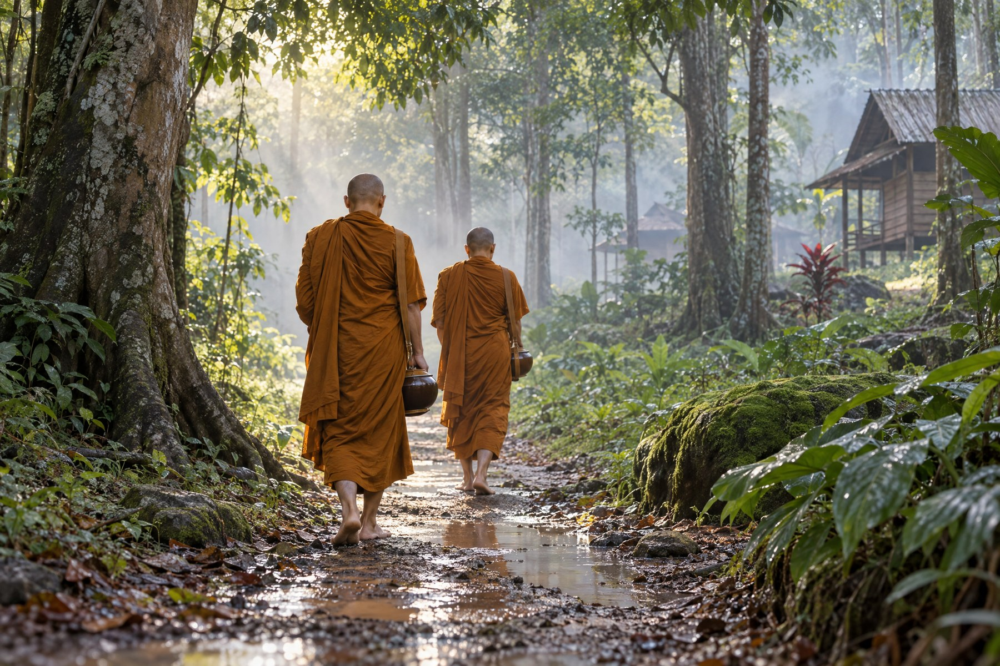
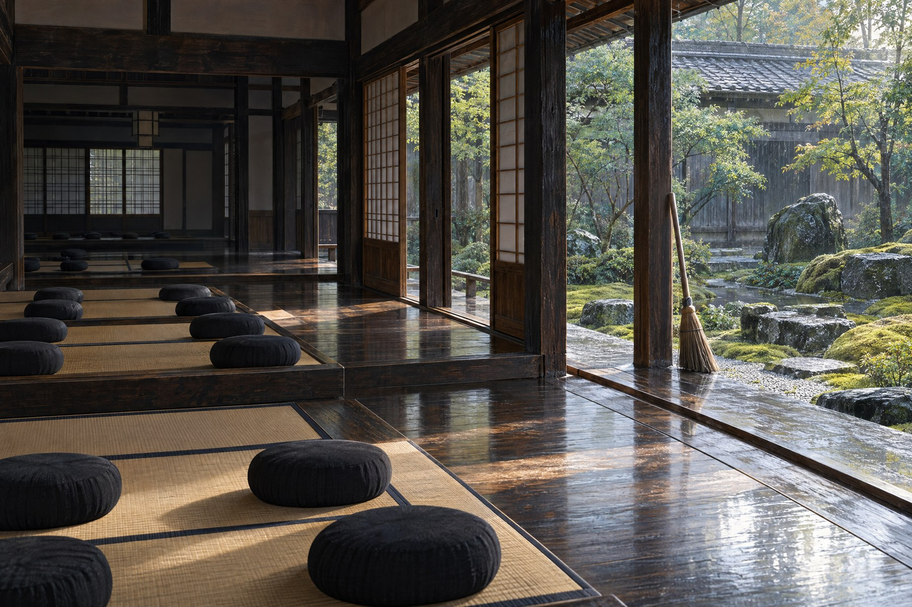

# HARVYRD — Суть писаний

# Буддийские школы: Разные пути пробуждения

Полный черновик авторского путеводителя по буддийским школам v0.1. Выбранные направления и темы, не единый канон, не перевод и не руководство по посвящённым практикам. Не опубликовано.

## Увидеть различия — не потерять живое

Издали буддизм иногда кажется одной тихой комнатой: человек сидит неподвижно, мысли утихают, мир становится яснее. Но стоит подойти ближе, и за этой дверью обнаруживаются разные языки, книги, обеты и общины. Где-то читают палийскую сутту, где-то произносят имя Амитабхи, где-то разбирают довод Нагарджуны. Эти голоса связаны, однако не повторяют друг друга.

Мы не будем выстраивать их по высоте — от якобы простого к окончательному. Тхеравада, махаяна и ваджраяна помогают наметить карту, но даже эти названия относятся к неодинаковым уровням. Ваджраяна развивается внутри махаянской рамки; мадхьямака и йогачара обозначают философские направления; чань, дзэн и Чистая земля соединяют учение с конкретными историями передачи. Границы бывают проницаемыми, но от этого не становятся ненужными.

Перед вами авторский путеводитель, а не ещё один буддийский канон. Его задача — сделать знакомство приятным и достаточно точным: понять, какой вопрос задаёт школа, на какие тексты опирается, в чём её особый акцент. Два ранних наставления прочитаны в палийской традиции через английские переводы; устройство школ объясняется главным образом по научным обзорам. Краткое чтение не заменяет живую традицию и не даёт посвящения в её практики.

### Двадцать глав — выбранная карта, не весь буддизм

Тхеравада; махаянские идеалы и философия мадхьямаки и йогачары; природа будды; тяньтай и связанные японские прочтения Лотосовой сутры; хуаянь; чань и дзэн, Сото и Риндзай; Чистая земля; ваджраяна, сингон и четыре основные тибетские линии. Многие школы, канонические собрания, национальные истории и внутренние споры оставлены за рамкой. Карта тем и реестр сокращений помещены в конце.

## Несколько различий перед дорогой

### Тхеравада

Традиция, особенно связанная со Шри-Ланкой и Юго-Восточной Азией, Палийским каноном и его толкованиями. Это не весь ранний буддизм и не единственная форма заботы о других.

### Махаяна

Широкое семейство учений и практик, в котором важен путь бодхисаттвы к состоянию будды ради живых существ. Не одна организация, не одна философия и не одинаковый для всех список книг.

### Ваджраяна

Тантрические традиции в махаянской рамке. Посвящения, обеты, ритуал и передача имеют собственный контекст. Тибетский буддизм ими не исчерпывается; эзотерическая традиция есть и в Японии.

### Школа, линия, философия

Это не взаимозаменяемые слова. Одна община может сочетать несколько видов практики, а одно философское направление — влиять на разные линии передачи.

### Канон и комментарий

Палийское, китайское и тибетское собрания не совпадают по составу. Сутра, монастырский устав, трактат и современный обзор также имеют разный статус.

### Пробуждение и благополучие

В традиционных контекстах речь идёт об освобождении от сансары, а не только об уменьшении напряжения. Современные светские прочтения существуют, но не заменяют религиозного разнообразия.

# Часть 1. Общий вопрос и тхеравада

## 01. Карта без лестницы

Традиция, философское направление и линия передачи — разные вещи. Это различие помогает читать всю книгу.

Буддизм нельзя точно описать как одну философию, окружённую местными обычаями. Его традиции различаются не только одеждой монахов и архитектурой храмов. Они по-разному объясняют цель пути, признают неодинаковые собрания текстов, передают разные обеты и способы практики. Общие понятия помогают узнавать родство, но ещё не означают полного согласия.

Тхеравада — историческая традиция, особенно связанная со Шри-Ланкой и Юго-Восточной Азией. Махаяна — широкое семейство движений, для которых определяющим стал путь бодхисаттвы к состоянию будды ради живых существ. Ваджраяна использует тантрические средства в махаянской рамке. Поэтому привычные «три направления» удобны для первого знакомства, но не являются тремя полностью независимыми и одинаково устроенными организациями.

Ниже встретятся названия другого уровня. Мадхьямака и йогачара — прежде всего философские направления. Чань, дзэн и Чистая земля — исторические традиции с собственными текстами, практиками и общинами. Ньингма, Кагью, Сакья и Гелуг — основные тибетские линии, каждая со своей внутренней историей. Один монастырь или учитель может соединять несколько наследий.

И ещё одно правило чтения: слово «хинаяна» не следует употреблять как нейтральное название тхеравады. Это полемическая категория ряда махаянских текстов, а не уважительное самоназвание живой традиции. Наш порядок глав тоже не означает движения от низшего учения к высшему. Мы сравниваем ответы на общие вопросы, а не оцениваем достоинство людей, которые этим ответам следуют.

Опорные места: [Стэнфордская философская энциклопедия: Буддийская этика в Индии](https://plato.stanford.edu/entries/ethics-indian-buddhism/) · [Стэнфордская философская энциклопедия: Будда](https://plato.stanford.edu/entries/buddha/)

## 02. Страдание и возможность освобождения

Четыре истины — не мрачный приговор, а диагноз, причина, возможность и полный образ практики.

Первая проповедь, известная как «Поворот колеса Дхаммы», начинает с четырёх благородных истин. Страдание — это не утверждение, будто всякая минута жизни невыносима, а внимательное распознавание неудовлетворительности: старения, болезни, смерти, утраты, несбывшегося желания и цепляния за изменчивое. У страдания есть происхождение — жажда, которая ищет наслаждения, продолжения существования или исчезновения. Если причина обусловлена, её можно прекратить; нирвана здесь не название релаксации, а освобождение от жажды и цепляния.

Последняя истина не сокращается до «сядьте и медитируйте». Срединный путь — благородный восьмеричный путь: правильное воззрение, правильное намерение, правильная речь, правильное действие, правильный образ жизни, правильное усилие, правильная осознанность и правильное сосредоточение. В нём мудрость, нравственная дисциплина и собранность поддерживают друг друга. Ошибка в одном звене отзывается во всём образе жизни: ясность без заботы о речи остаётся хрупкой, а добрые намерения без понимания причин страдания — недостаточными.

В раннем буддийском горизонте перерождение — не необязательная метафора, а традиционная религиозная рамка четырёх истин и кармы. Современные читатели могут по-разному к ней относиться, но не стоит молча вынимать учение из его контекста. Точно так же нирвана не обещает приятного самочувствия: это прекращение тех условий, которые поддерживают круг неудовлетворённости. Практика начинается с честного знания, что именно должно быть понято, оставлено, осуществлено и развито.

С этим связан принцип не-я, анатта. В SN 22.59 рассматриваются пять совокупностей опыта: телесная форма, ощущение приятного или неприятного, распознавание, волевые и другие формирующие процессы, сознание. Каждая изменчива и не подчиняется нам безусловно; ни одну не следует принимать за неизменное «это я». Это не приглашение отрицать людей или их боль. Учение направлено против цепляния за постоянного хозяина опыта. В отличие от адвайтического поиска неизменного Атмана, здесь нельзя просто объявить сознание вечным свидетелем и считать вопрос решённым.

Опорные места: [SN 56.11, перевод Тханиссаро Бхиккху](https://www.dhammatalks.org/suttas/SN/SN56_11.html) · [SN 22.59, перевод Тханиссаро Бхиккху](https://www.dhammatalks.org/suttas/SN/SN22_59.html) · [Стэнфордская философская энциклопедия: Будда](https://plato.stanford.edu/entries/buddha/)

## 03. Тхеравада: память палийских текстов

Традиция старейшин — не музей неизменной «религии Будды», а живая работа памяти, толкования и общины.

Тхеравада — «учение старейшин» — особенно укоренена в Шри-Ланке, Таиланде, Мьянме, Лаосе и Камбодже. Её канон называют Типитакой, «тремя корзинами»: Виная-питака хранит правила монашеской общины, Сутта-питака — беседы и наставления, Абхидхамма-питака — систематическое изложение учения. Рядом с каноном стоят комментарии, подкомментарии, хроники, ритуалы и устные линии передачи. Поэтому палийская память — не одна полка с окончательным текстом, а сложная экология чтения, рецитации и объяснения.

Важно не называть её механически неизменной «религией самого Будды». Ранние речи передавались устно и были записаны позднее; разные буддийские собрания расходятся, а позднейшие толкования формируют то, как тексты понимают сегодня. Это не обесценивает канон. Напротив, так виднее его жизненная сила: авторитет поддерживается повторением, обучением и практикой, а не только древностью бумаги. Перед нами историческая традиция, которая помнит свои источники и одновременно продолжает их истолковывать.

Но книга и повседневная религия — не одно и то же. Для мирян важны щедрость, нравственные правила, праздники, почитание Будды и поддержка монастырей. Учёный монах, лесной наставник и семья, приходящая в храм, принадлежат одной традиции, не обязуясь проживать её одинаково. Тхеравада не исчерпывается ни изучением пали, ни современными ретритами випассаны.

Опорные места: [Access to Insight: What is Theravada Buddhism?](https://www.accesstoinsight.org/theravada.html) · [Стэнфордская философская энциклопедия: Будда](https://plato.stanford.edu/entries/buddha/)

## 04. Арахант и жизнь общины

Арахант — не карикатурный эгоист, а образ освобождённого, чья ясность не отменяет заботы о других.

В тхеравадинском языке арахант — тот, кто завершил путь освобождения: жажда и неведение больше не поддерживают новое перерождение. Это не портрет холодного одиночки. Традиция говорит о любящей доброте, сострадании, сорадовании и равностности — качествах, которые направляют зрелое действие. Критика Махаяной «личного спасения» часто спорит с упрощённым образом раннего пути: в реальной тхеравадинской жизни забота о других, наставление и поддержка общины занимают заметное место.

Община держится на взаимности монахов, монахинь и мирян. Монашество задаёт строгую дисциплину, время для учёбы и созерцания; миряне поддерживают сангху, участвуют в праздниках, слушают Дхамму и принимают собственные обеты. Эти роли не надо превращать в соревнование духовной ценности. Они образуют социальную ткань, в которой освобождение мыслится не как частная услуга, а как путь, требующий условий, учителей и доверия.

Пять правил мирянина — не убивать, не брать чужого, воздерживаться от неправомерного сексуального поведения, не лгать и не употреблять опьяняющее, ведущее к беспечности. Это не универсальный список всех возможных моральных вопросов и не обещание безошибочности. Правила тренируют внимание к последствиям поступков, к намерению и к страданию других. В этом смысле нравственность — не пропуск перед «настоящей медитацией», а её почва: беспокойный, причиняющий вред ум хуже видит, что происходит.

Опорные места: [Стэнфордская философская энциклопедия: Буддийская этика в Индии](https://plato.stanford.edu/entries/ethics-indian-buddhism/) · [SN 22.59, перевод Тханиссаро Бхиккху](https://www.dhammatalks.org/suttas/SN/SN22_59.html)

## 05. Спокойствие и ясное видение

Саматха и випассана — связанные качества практики, а не названия двух обязательных соперничающих школ.

В разговоре о тхеравадинской медитации часто встречаются два палийских слова. Саматха — успокоение и устойчивость ума; випассана — прозрение, позволяющее яснее видеть изменчивость, неудовлетворительность обусловленного опыта и не-я. Их удобно различать, но не следует автоматически превращать в два независимых пути. Собранность поддерживает исследование опыта, а понимание причин цепляния меняет значение самого спокойствия.

Внутри тхеравады существуют разные наставнические линии. Тайская лесная традиция, известная, в частности, по Аджану Ману и Аджану Чаа, подчёркивает монашескую дисциплину, простоту жизни и непрерывность практики. В общинах Аджана Чаа обучение включает не только сидение в медитации, но и повседневный труд, отношения с другими и соблюдение правил. «Лесная» здесь обозначает историю и образ подготовки, а не требование, чтобы каждый монастырь непременно стоял в лесу.

Современное слово «випассана» нередко относится к ретритам и движениям прозрения, доступным мирянам. Это широкое употребление не означает, что у всех таких программ одинаковые методы, объяснения и отношение к сосредоточению. Название практики само по себе ещё не сообщает, к какой линии принадлежит учитель.

Различие не стоит сводить к противопоставлению спокойных лесных монахов и деятельных городских мирян. Лесная подготовка тоже направлена на прозрение, а миряне могут развивать глубокую собранность. Важнее спрашивать, что считается освобождающим пониманием и как медитация связана с нравственностью, воззрением и жизнью общины. Успокаивающий эффект ещё не равен буддийской цели освобождения.

Опорные места: [Access to Insight: What is Theravada Buddhism?](https://www.accesstoinsight.org/theravada.html) · [Amaravati: Ajahn Chah](https://amaravati.org/biographies/ajahn-chah/) · [SN 56.11, перевод Тханиссаро Бхиккху](https://www.dhammatalks.org/suttas/SN/SN56_11.html)

# Часть 2. Махаяна: обет и понимание

## 06. Широкий обет

Бодхичитта превращает личное пробуждение в обещание не оставлять других за бортом.

Махаяна начинается не с новой вывески, а с расширения горизонта. Бодхичитта — намерение пробудиться ради освобождения всех существ; бодхисаттва — человек, который принимает это намерение как долгую практику, а не как красивую мысль. Такой обет не отменяет личной работы: он меняет её адресата. Медитация, знание и дисциплина становятся способом уменьшать страдание не только в собственной жизни.

Важно не превратить эту картину в спор о «правильном буддизме». Махаяна не одна школа и не один канон: в Индии она развивалась вокруг разных сутр, толкований и линий практики, а затем дала множество азиатских форм. Даже слово «канон» здесь звучит осторожно: тексты и авторитеты распределялись по традициям, а не складывались в единую книгу для всех.

Старый полемический образ тхеравады как пути «эгоистов» исторически несправедлив. Тхеравадинские практики тоже культивируют любящую доброту, сострадание, радость и равностность; различие лучше искать в идеалах и акцентах, а не в наличии сердца. Широкий обет Махаяны — приглашение увеличить круг ответственности, не повод уменьшать чужую традицию.

Опорные места: [SEP: Ethics in Indian Buddhism](https://plato.stanford.edu/entries/ethics-indian-buddhism/)

## 07. Мадхьямака: пустота без провала

Нагарджуна освобождает зависимое возникновение от мечты о неизменной сущности.

Для Нагарджуны пустота — не заявление «ничего нет». Пусто то, что не обладает независимой, самодовлеющей природой. Вещи возникают благодаря причинам, частям, отношениям и обозначениям; именно поэтому они действуют и меняются. Если бы у них была каменная сущность, путь, обучение и освобождение оказались бы невозможны.

Здесь помогают две истины. В обычной, условной жизни мы говорим о людях, чашках, причинах и последствиях — и эти разговоры работают. Предельное рассмотрение показывает, что ни один предмет не стоит сам по себе, вне условий. Предельное не подменяет повседневное и не превращается в скрытый Брахман: Мадхьямака избегает и вечности, и нигилизма.

Поздние индийские мыслители спорили о том, как доказывать эту позицию и как связаны язык, рассуждение и непосредственное видение. Для путеводителя достаточно помнить главное: различия между линиями важны, но не отменяют общего жеста — ослабить цепляние за окончательные основания.

В тибетской учебной традиции закрепилось различение сватантрики и прасангики. Оно связано, среди прочего, с вопросом, следует ли выдвигать самостоятельные доказательства или прежде выявлять неприемлемые следствия позиции оппонента. Это поздняя классификация индийских мыслителей, а не названия двух совершенно обособленных индийских церквей. Её содержание также толкуют по-разному: одной формулы недостаточно, чтобы передать все споры мадхьямаки.

Опорные места: [Стэнфордская философская энциклопедия: Мадхьямака](https://plato.stanford.edu/entries/madhyamaka/) · [84000: The Heart of the Perfection of Wisdom](https://84000.co/translation/toh21)

## 08. Йогачара: как складывается опыт

Йогачара рассматривает сознание как процесс, где привычки формируют мир переживания.

Йогачара — не одна доктрина и не инструкция «всё выдумано мной», а попытка разобрать, как складывается переживаемый мир. Асанга и Васубандху развивали модель, где привычные реакции, восприятия и кармические следы образуют слоистую работу сознания. Термин «только сознание» поэтому нельзя автоматически читать как произвольный солипсизм: разные авторы понимали приоритет ума по-разному — от анализа доступного в опыте до более сильных онтологических тезисов.

В этой модели алаявиджняна, «сознание-хранилище», удерживает не душу, а поток семян и склонностей. Поступки оставляют следы; при подходящих условиях они созревают в новые способы видеть, чувствовать и реагировать. Поток обеспечивает преемственность кармы и опыта, не требуя неизменного владельца. Тексты сравнивают его с рекой: непрерывность есть, но вода постоянно меняется.

Йогачара также пытается объяснить общность мира: сходные переживания могут поддерживаться общими причинными следами, а не одиночеством одного наблюдателя. Внутри традиции были споры о внешних объектах, образах в сознании и других умах. Поэтому полезнее говорить о тонкой феноменологии и тренировке восприятия, чем приклеивать школе один ярлык «идеализм».

Другое важное различение — три природы: воображаемая, зависимая и совершенная. В упрощённом изложении речь идёт о навязанном разделении на независимые субъект и объект, о причинно обусловленном течении опыта и об отсутствии в нём приписанной двойственности. Это не три отдельных мира и не три вечные субстанции.

Опорные места: [Стэнфордская философская энциклопедия: Йогачара](https://plato.stanford.edu/entries/yogacara/)

## 09. Природа будды: язык возможности

Tathāgatagarbha говорит о возможности пробуждения, но не одним голосом и не языком вечной души.

Разговор о природе будды звучит обнадёживающе: каждый может пробудиться. Но tathāgatagarbha — не отдельная единая секта и не термин с одним неизменным значением. В разных текстах и школах он может обозначать потенциал, скрытые качества пробуждения, чистоту ума или способ переописать пустоту так, чтобы практика не казалась безнадёжной. Это язык возможности, а не готовый паспорт просветлённого.

Некоторые махаянские сочинения говорят об «эмбрионе» или «зародыше» будды, другие связывают эту тему с алаявиджняной, третьи толкуют её через таковость и отсутствие омрачений. Такие связи не складываются автоматически в одну доктрину: индийские и восточноазиатские авторы расставляли акценты по-разному. Важно читать обещание вместе с практикой очищения, обучения и сострадания.

Самая частая ошибка — услышать в природе будды знакомую метафизику атмана, вечного внутреннего «я». Буддийские толкования обычно сопротивляются такой подмене: речь идёт не о независимой субстанции, которую нужно обнаружить, а о возможности преобразования и пробуждения. Поэтому вопрос лучше ставить не «какая сущность уже живёт во мне?», а «какие условия позволяют ясности и состраданию проявиться?».

Опорные места: [Стэнфордская философская энциклопедия: Йогачара](https://plato.stanford.edu/entries/yogacara/) · [Стэнфордская философская энциклопедия: Хуаянь](https://plato.stanford.edu/entries/buddhism-huayan/)

## 10. Мудрость не без сострадания

Пробуждение проверяется тем, как знание становится заботой, выдержкой и безопасным действием.

В Махаяне мудрость не должна отрываться от сострадания. Путь бодхисаттвы часто описывают через шесть парамит: щедрость, нравственную дисциплину, терпение, усердие, сосредоточение, мудрость. Это не шесть медалей за безупречность, а шесть направлений тренировки. Щедрость учится отпускать хватку, дисциплина — не умножать вред, терпение — не отвечать болью на боль.

Усердие поддерживает долгую работу; сосредоточение делает внимание устойчивым; мудрость распознаёт зависимость и пустоту явлений. Но список не следует читать как лестницу, где первые пять можно однажды оставить позади. Мудрость направляет остальные, а остальные не дают мудрости превратиться в холодную ловкость. Вместе они проверяют, что понимание меняет способ жить.

Отсюда осторожность с «искусными средствами». Идея умелого ответа учитывает человека и обстоятельства, но не выдаёт любой рискованный поступок за святость. Нельзя прикрывать причинённый вред красивой целью или ссылкой на просветление. В реальной ситуации остаются вопросы последствий, мотива, согласия и меньшего вреда; сострадание требует не только намерения, но и ответственности за то, что произошло.

Опорные места: [SEP: Ethics in Indian Buddhism](https://plato.stanford.edu/entries/ethics-indian-buddhism/) · [SEP: Madhyamaka](https://plato.stanford.edu/entries/madhyamaka/)

# Часть 3. Восточная Азия: разные голоса махаяны

## 11. Лотосовая сутра: тяньтай и другие прочтения

Одна сутра — несколько способов увидеть путь: от Чжии до Нитирэна.

Лотосовая сутра стала для китайской традиции не столько единственным учебником, сколько картой, на которой разные пути Будды оказываются искусными средствами одной цели. Чжии, главный мыслитель Тяньтай, читал её вместе с практикой и систематизацией учений: просветление не обязано начинаться с бегства из обычного мира. Его знаменитые три истины — пустотность, условное обозначение и срединность — не три этажа реальности, а три взаимно нераздельных способа видеть всякое событие. Поэтому «единая колесница» говорит о всеобщей возможности пробуждения, не стирая различий между конкретными жизнями и практиками.

Тяньтай доводит эту логику до радикальной взаимовключённости: каждый миг опыта связан со всем целым, а заблуждение и пробуждение не становятся двумя независимыми мирами. Это не повод объявить страдание иллюзией, которую можно не замечать, а приглашение переосмыслить его условия и отвечать на них. Учение работает как перемена перспективы: временное не отменяется, но открывает больше контекста.

В Японии Тэндай продолжил китайскую линию, хотя его история и институты не тождественны Тяньтай. Нитирэн — отдельная японская традиция, не просто другое название Тэндай; для неё Лотосовая сутра получила исключительную, полемически подчеркнутую центральность; её название стало формулой религиозной практики и общественного свидетельства. Так «Лотос» звучит по-разному: у Тяньтай — как синтез, у Тэндай — как японская монастырская наследственность, у Нитирэна — как призыв сделать истину действенной в этой стране и этой жизни.

Опорные места: [Стэнфордская философская энциклопедия: Тяньтай](https://plato.stanford.edu/entries/buddhism-tiantai/)

## 12. Хуаянь: мир взаимных отражений

У Фацзана целое не поглощает вещи: оно существует через их отношения.

Хуаянь, «школа Цветочной гирлянды», выросла вокруг Аватамсака-сутры — видения мира, где всё пронизано взаимной зависимостью. Её формула «одно — всё, всё — одно» не означает, что различия исчезают в безликом единстве. Напротив, вещь становится именно этой вещью благодаря множеству связей, а целое существует только через свои части и их роли. Просветление здесь не уход от мира, а способность увидеть его сеть и отвечать на неё состраданием.

Фацзан, третий патриарх Хуаянь, систематизировал эту мысль и сделал её доступной образами. Стропило — не просто отдельный кусок дерева: его положение в доме делает его стропилом; но и дом нельзя мыслить без таких частей. В «сети Индры» каждая драгоценность отражает все остальные, а отражения отражают отражения без конца. Это образ взаимной обусловленности и перспективы, а не описание физического устройства Вселенной или буквальная космология.

Отсюда следует важная этическая интонация. Если страдание другого не отгорожено от моего мира непроницаемой стеной, безразличие становится ошибкой восприятия. Но сострадание не равно стиранию личности: сеть ценна именно множеством узлов, каждый из которых сохраняет своеобразие. Хуаянь оказала сильное влияние на чань, корейскую Хваом и японскую Кэгон, передав им язык взаимопроникновения, но эти традиции не превратились в одну школу.

Опорные места: [Стэнфордская философская энциклопедия: Хуаянь](https://plato.stanford.edu/entries/buddhism-huayan/)

## 13. Чань: пробуждение в живой встрече

Китайский чань делает ставку не на отказ от наследия, а на проверку Дхармы в отношениях и поступках.

Чань сложился в Китае между шестым и десятым веками как особый способ сделать пробуждение телесным, своевременным и межличностным. Название связано с медитацией, но школа отличалась не монополией на сидение, а языком встреч, парадоксальных рассказов и прямой проверкой понимания. Мастер и ученик сталкиваются не ради эффектной загадки: в этой живой ситуации видно, превращается ли мудрость в внимательный и ответственный поступок.

Формула «вне писаний» легко вводит в заблуждение. Чань действительно критиковал чтение как замену практике, однако его общины жили по монастырским правилам, а мастера постоянно обращались к Лотосовой, Вималакирти-, Хуаянь- и праджняпарамитским сутрам. «Не опираться на слова» не значит быть антикнижной школой; это значит не принимать текст за готовое освобождение. Будда-природа проявляется как способ взаимодействовать, а не как спрятанная субстанция внутри человека.

Из Китая чань пришёл в Японию как дзэн, в Корею как сон, во Вьетнам как тхиен; родство названий не отменяет разных историй, институтов и акцентов. Поэтому чань нельзя сводить к современной «осознанности»: его путь включает дисциплину общины, карму, этику и ответственность. Пробуждение проверяется тем, как человек говорит, трудится, встречает другого и меняет траекторию вредных привычек здесь и сейчас, в конкретной общей жизни.

Опорные места: [Стэнфордская философская энциклопедия: Чань](https://plato.stanford.edu/entries/buddhism-chan/)

## 14. Сото и Риндзай: различие акцентов

Догэн и коан — разные акценты одной дзэнской работы мудрости и сострадания.

В японском дзэн Сото и Риндзай часто описывают через два узнаваемых акцента. Сото связывают с Догэном и сикантадза — «просто сидением», где практика и реализация не разделены как средство и будущая награда. Риндзай связывают с коанами и моментами кэнсё: привычная логика доводится до предела, чтобы ученик перестал цепляться за эгоцентрические схемы и научился выражать понимание в жизни.

Это различие полезно, но не должно превращаться в строгую изоляцию методов. Сото не лишено вопросов, текстов и наставничества, а Риндзай не сводится к коллекции головоломок. Обе линии наследуют сидячую медитацию, буддийскую этику и идею, что мудрость должна воплотиться в сострадании. Даже там, где школа предпочитает безмолвное углубление или проверочный диалог, результат измеряется возвращением к повседневному миру.

Догэн не предлагал механический рецепт позы, а Риндзай — спортивное испытание на скорость ответа. Учитель нужен не как магический поставщик переживаний, а как тот, кто распознаёт самообман и удерживает направление практики. Общины, ритуалы, обучение и отношения формируют среду, в которой «прямое указание» не становится произвольной личной интуицией или частным психологическим переживанием вне живой общины и традиции. Обаку здесь оставляем за пределами главы: для короткого сравнения надёжных сведений недостаточно.

Опорные места: [Стэнфордская философская энциклопедия: Философия японского дзэн](https://plato.stanford.edu/entries/japanese-zen/)

## 15. Чистая земля: доверие и имя

Нэнбуцу — не обещание вечного комфорта, а путь к неотступлению и пробуждению.

Чистая земля начинается с Амитабхи, будды безмерного света и жизни, и с устремления родиться в Сукхавати — его поле Будды. В сутрах это не просто рай после смерти: такая среда должна поддержать бодхисаттвенный путь и сделать невозможным откат от пробуждения. Китайская традиция развивала этот путь рядом с другими школами; на японской горе Хиэй практики нэнбуцу соседствовали с Тэндай и чаньскими формами дисциплины.

Хонэн преобразовал нэнбуцу в самостоятельный путь Дзёдосю: произнесение «Наму-Амида-буцу» с доверием к обету Амиды становится доступным действием для людей, которым недоступны героические многолетние практики. Синран радикализировал тему доверия иначе, подчеркнув не заслугу повторений, а действие «другой силы» и невозможность самодовольной религиозной воли. Поэтому Дзёдосю и Дзёдосинсю — родственные, но разные японские традиции.

«Другая сила» не означает теистического Бога-Творца, который извне отменяет карму. Это язык махаянского обета, переноса заслуг и признания ограниченности собственного контроля. Нэнбуцу не покупает билет в место вечного удовольствия: Сукхавати — условие дальнейшего освобождения и помощи всем существам. Доверие здесь не пассивность, а поворот от самоприсвоения заслуг к благодарному участию в пути, который превосходит индивидуальную уверенность в себе и связывает освобождение с непосредственным благом других существ.

Опорные места: [Стэнфордская философская энциклопедия: Японская традиция Чистой земли](https://plato.stanford.edu/entries/japanese-pure-land/)

# Часть 4. Ваджраяна и тибетские линии

## 16. Ваджраяна: язык преображения

Тантрический путь внутри Махаяны — не обещание магического ускорения, а особый язык работы с образом, телом и сознанием.

Ваджраяна — не отдельная религия рядом с Махаяной, а ее тантрическое продолжение: целью остаётся состояние будды ради блага существ, а мотивацией — бодхичитта, устремление к этому пробуждению, а мудрость опирается на пустотность. Меняются средства — ритуал, иконография, мантра, визуализация и особые формы медитации. Поэтому слово «преображение» здесь точнее, чем обещание сверхъестественной силы: привычные переживания стараются увидеть и перенастроить в русле сострадания и мудрости.

Тибетский буддизм — крупнейший, но не единственный исторический контекст Ваджраяны. Японский Сингон Кукая вырос из эзотерического буддизма, который он изучал в Китае; монастырский центр Коясан, основанный им в 816 году, стал центром школы. Сходство есть, но формы, языки, ритуальные каноны и институты различны. Нельзя автоматически переносить тибетские категории на японскую почву.

«Быстрее» в рассказах о Ваджраяне не означает кнопку мгновенного пробуждения. Тантрические методы предполагают подготовку, этическую ответственность, наставника и традиционный контекст. Эффектный символ не отменяет причинности, обучения и проверки последствий: читатель знакомится с картой путей, а не получает домашнюю магическую инструкцию.

Опорные места: [Стэнфордская философская энциклопедия: Буддийская этика в Индии](https://plato.stanford.edu/entries/ethics-indian-buddhism/) · [Koyasan: History of Koyasan](https://eng-shukubo.net/about/)

## 17. Четыре тибетские линии

Ньингма, Кагью, Сакья и Гелуг — четыре исторические оптики, а не таблица победителей.

Ньингма — «древняя» линия ранних переводов; в её системе важен Дзогчен, но её нельзя сводить к одному учению. Кагью связывают с передачей от Тилопы и Наропы через Марпу, Миларепу и Гампопу; в её разных линиях заметное место занимает Махамудра. Сакья связана с монастырём Сакья и семьёй Кхон; её характерная система — Ламдре, «Путь и плод». Гелуг, выросшая вокруг наследия Цонкапы, известна систематическим обучением, диспутом и ламримом, ступенями пути. Это удобные ориентиры, не исчерпывающие портреты.

Границы не герметичны: Цонкапа учился у мастеров разных линий, а внутри каждой школы есть подлинии, монастыри и разные акценты. Даже слово «глава» требует уточнения. Далай-лама — монах Гелуг и влиятельный представитель тибетского мира, но не глава всего буддизма и не формальный глава Гелуг. Ганден Трипа, держатель трона Ганден, возглавляет именно Гелуг; это должность с меняющимся сроком, а не единый глава тибетского буддизма.

Такой реестр помогает не превращать названия в ярлыки. Одна и та же школа может быть для одного читателя философской библиотекой, для другого — монастырской дисциплиной, для третьего — линией практики. Сравнивать полезно по вопросу, тексту и институту, а не по рейтингу «самого настоящего» пути.

Опорные места: [Tibetan Nuns Project, The Four Main Schools](https://tnp.org/the-four-schools-of-tibetan-buddhism/) · [Study Buddhism, How Do the Tibetan Buddhist Traditions Differ?](https://studybuddhism.com/en/advanced-studies/abhidharma-tenet-systems/the-tibetan-traditions/how-do-the-tibetan-buddhist-traditions-differ)

## 18. Путь и прямое узнавание

Постепенность и непосредственность — разные акценты языка, а не универсальная кнопка ускорения.

Ламрим раскладывает путь по ступеням: мотивация, этическая опора, сострадание, аналитическое понимание и углубление медитации. Такая последовательность не обязана быть скучной лестницей; она показывает, как намерение, взгляд и действие поддерживают друг друга. «Постепенный» здесь означает связность причин, а не меру духовной ценности человека.

Махамудра в линиях Кагью и Дзогчен в системе Ньингма часто говорят о непосредственном узнавании природы ума, но это не одно и то же учение и не универсальная техника. У них разные термины, наставления, предварительные этапы и критерии понимания; внутри каждой традиции есть собственные объяснения. Их язык нельзя читать как утверждение вечного внутреннего атмана. «Природа ума» не превращается в неизменную душу; разговор остается внутри буддийской критики самобытия и цепляния за «я».

Эта глава намеренно не дает дыхательных, ритуальных или тантрических инструкций и не обещает мгновенной реализации. Для чтения достаточно различать указатель и опыт: фраза о прямом видении может направлять внимание, но не заменяет обучение, этику, проверку понимания и время. Быстрый образ не равен быстрому результату.

Опорные места: [Study Buddhism, How Do the Tibetan Buddhist Traditions Differ?](https://studybuddhism.com/en/advanced-studies/abhidharma-tenet-systems/the-tibetan-traditions/how-do-the-tibetan-buddhist-traditions-differ) · [Стэнфордская философская энциклопедия: Буддийская этика в Индии](https://plato.stanford.edu/entries/ethics-indian-buddhism/)

## 19. Учитель, доверие и границы

Линия передачи объясняет форму обучения, но не отменяет согласие, безопасность и право сказать «нет».

В традиционном тибетском контексте посвящение, обеты и линия передачи связывают ученика с определенным корпусом практик и наставлений. Авторитет учителя здесь не просто харизма: он встроен в ритуал, дисциплину, комментарии и отношения преемственности. Поэтому обещание «секретной» практики вне контекста — повод не ускоряться, а спросить, что именно передается, кому и на каких условиях.

Доверие не равно безусловному подчинению. Никакая ссылка на просветление, карму или преданность не делает вред, унижение, сексуальное давление, финансовое принуждение или изоляцию нормой. Ученик может остановиться, обратиться за независимой помощью, сохранить личные границы и не принимать практику, пока нет ясного согласия и безопасной процедуры выхода.

Последний абзац — современная редакционная рекомендация, а не приписывание конкретного правила источникам. Она нужна потому, что исторические языки послушания читаются сегодня в реальных отношениях власти. Критерий зрелого чтения прост: традиционный авторитет должен быть совместим с ответственностью, информированным согласием и возможностью задавать неудобные вопросы.

Опорные места: [Стэнфордская философская энциклопедия: Буддийская этика в Индии](https://plato.stanford.edu/entries/ethics-indian-buddhism/) · [Study Buddhism, How Do the Tibetan Buddhist Traditions Differ?](https://studybuddhism.com/en/advanced-studies/abhidharma-tenet-systems/the-tibetan-traditions/how-do-the-tibetan-buddhist-traditions-differ)

## 20. Читать различия, не выбирать победителя

Финальная навигация: различать тексты, контексты и голоса, не превращая путеводитель в совет вступать в школу.

Практический читательский навык — спрашивать, что перед глазами: сутра, тантра, философский трактат, житийный рассказ, комментарий, монастырская инструкция или современный обзор. Эти жанры делают разные утверждения и требуют разной проверки. Сводить религиозное и философское к универсальному «снятию стресса» значит потерять вопросы освобождения, кармы, обета, знания и общины, даже если некоторые практики действительно переживаются как успокаивающие.

Реестр тибетского мира шире четырех главных школ: Джонанг сохраняет собственную линию и доктринальные акценты; ньеварский буддизм показывает городскую гималайскую форму, не сводимую к тибетской монастырской карте. Бон — самостоятельная религия с пересечениями и обменами с буддизмом, но не «пятая школа буддизма». Эти примеры нужны не для нового рейтинга, а чтобы карта не выдавала удобную классификацию за всю историю.

Путеводитель заканчивается не выбором победителя и не советом немедленно вступать в общину. Лучше читать рядом: название линии, конкретный текст, место, перевод и голос автора. Различие — не ошибка системы, а способ увидеть, как буддийские традиции по-разному отвечают на вопрос о пробуждении и о том, как жить до него.

Опорные места: [Tibetan Nuns Project, The Four Main Schools](https://tnp.org/the-four-schools-of-tibetan-buddhism/) · [Study Buddhism, How Do the Tibetan Buddhist Traditions Differ?](https://studybuddhism.com/en/advanced-studies/abhidharma-tenet-systems/the-tibetan-traditions/how-do-the-tibetan-buddhist-traditions-differ)

## Вернуться к людям с более ясной картой

После знакомства с буддийскими школами хочется удержать короткую формулу. Но лучшим итогом может оказаться не формула, а более внимательный слух. Слово «пустота» не всегда звучит одинаково; доверие не везде означает одно и то же; неподвижное сидение ещё не рассказывает, как понимает путь человек рядом.

Необязательно стирать эти различия, чтобы уважать их носителей. И необязательно превращать уважение в обязанность согласиться. Можно читать медленно, замечать собственные поспешные выводы и возвращать каждому высказыванию его место: раннее наставление, махаянская сутра, философский трактат, голос учителя, современное исследование.

Эта книга заканчивается там, где начинается более точное знакомство. Карта нужна не для того, чтобы заменить местность, а чтобы мы реже принимали первое увиденное окно за весь дом.

# Карта выбранных тем

## 1. Карта традиций

Глава 01: Тхеравада, Махаяна и Ваджраяна как пересекающиеся исторические рамки; различие традиции и философской школы.

## 2. Четыре истины

Глава 02: страдание, происхождение, прекращение и полный восьмеричный путь; религиозный контекст перерождения.

## 3. Палийская память

Глава 03: география Тхеравады, Типитака, комментарии и историчность передачи.

## 4. Арахант и сангха

Глава 04: арахант, сострадание, монашество, миряне и пять правил.

## 5. Спокойствие и прозрение

Глава 05: samatha/vipassanā, лесные традиции и современные движения прозрения без инструктажа.

## 6. Обет бодхисаттвы

Бодхичитта, бодхисаттва, множественность махаянских школ и канонов; корректное сравнение с тхеравадой.

## 7. Мадхьямака

Нагарджуна, пустота как отсутствие независимой сущности, зависимое возникновение, две истины; осторожно о различиях линий.

## 8. Йогачара

Асанга и Васубандху, слоистое сознание, алаявиджняна как изменяющийся поток, неоднозначность mind-only и критика солипсизма.

## 9. Природа будды

Tathāgatagarbha как язык возможности; разные интерпретации и школы, связь с практикой; не автоматический атман.

## 10. Парамиты мудрости и сострадания

Шесть парамит полным перечнем; взаимосвязь мудрости и сострадания; искусные средства не оправдывают вред.

## 11. Лотосовая сутра: тяньтай и другие прочтения

Чжии, три истины, единая колесница; различие Тэндай и Нитирэн; центральность Лотоса у Нитирэна.

## 12. Хуаянь: мир взаимных отражений

Аватамсака, Фацзан, взаимозависимость и сеть Индры как метафора, а не физика; различия сохраняются.

## 13. Чань: пробуждение в живой встрече

Китайская история, embodied-встреча, тексты и этика; связи, но не тождество дзэн, сон и тхиен.

## 14. Сото и Риндзай: различие акцентов

Догэн и сикантадза, Риндзай и коаны; пересечение методов, роль учителя и общины; Обаку не развёрнута.

## 15. Чистая земля: доверие и имя

Амитабха, Сукхавати, нэнбуцу, Хонэн/Дзёдосю и Синран/Дзёдосинсю; другая сила не Бог-Творец и не вечный курорт.

## 16. Ваджраяна: язык преображения

Ваджраяна как тантрическая ветвь Махаяны; бодхичитта, пустотность, ритуально-медитативные средства; японский Сингон Кукая и Коясан как отдельный контекст; без обещаний магического ускорения.

## 17. Четыре тибетские линии

Ньингма и ранние переводы/Дзогчен; Кагью и передача/Махамудра; Сакья и Ламдре; Гелуг, Цонкапа, диспут и ламрим; неполная эксклюзивность; Далай-лама не глава всего буддизма, Ганден Трипа — формальный глава Гелуг.

## 18. Путь и прямое узнавание

Ламрим как постепенный путь; Махамудра Кагью и Дзогчен Ньингма как разные контексты непосредственного узнавания; не-атман; без дыхательных/ритуальных инструкций и обещаний мгновенной реализации.

## 19. Учитель, доверие и границы

Посвящение, линия передачи и обеты в традиционном контексте; современная редакционная рамка безопасности, согласия и неподчинения вреду, не приписанная источникам.

## 20. Читать различия, не выбирать победителя

Практический финал без совета вступать; различение сутры, тантры, трактата и обзора; религиозное/философское не сводится к снятию стресса; Джонанг, ньеварский буддизм и Бон как расширение реестра.

# Что сжато и что оставлено за рамкой

## Часть 1. Общий вопрос и тхеравада

### Устная передача, запись и комментарии — Сжато

Оставлены устройство Типитаки и роль последующего толкования; подробная история редакций требует отдельной книги.

Тхеравада представлена как исторически развивающаяся традиция, а не дословно неизменная запись всех слов Будды.

[Место в источнике](https://www.accesstoinsight.org/theravada.html)

### SN 56.11 и SN 22.59 — Сжато

Четыре истины, восьмеричный путь и не-я изложены авторским русским пересказом, без полного перевода наставлений.

Сохранены религиозная цель освобождения и традиционная связь с прекращением перерождения.

[Место в источнике](https://www.dhammatalks.org/suttas/SN/SN56_11.html)

### Саматха, випассана и лесная традиция — Сохранён контекст

Даны различия акцентов и пример линии Аджана Чаа, но не полный обзор медитативных школ и не техническое руководство.

Спокойствие и прозрение не представлены как обязательно раздельные школы; монашеская жизнь не сведена к технике сидения.

[Место в источнике](https://amaravati.org/biographies/ajahn-chah/)

## Часть 2. Махаяна: обет и понимание

### Подробная реконструкция происхождения и институциональной истории Махаяны — Сжато

Главы знакомят с обетом и идеями, а не дают полный исторический очерк.

Махаяна описана как множество развивавшихся традиций с общим бодхисаттвенным идеалом.

[Место в источнике](https://84000.co/translation/toh21)

### Полная полемика Buddhapālita, Bhāvaviveka и Candrakīrti о методе аргументации — Сжато

Сохранена только осторожная рамка внутренних различий, чтобы не перегружать путеводитель.

Общий тезис пустоты и две истины изложены без сведения их к нигилизму.

[Место в источнике](https://plato.stanford.edu/entries/madhyamaka/)

### Детальная таксономия восьми сознаний, трёх природ и логико-эпистемологической ветви — Сжато

Нужен живой обзор формирования опыта, а не учебник доктринальной истории.

Сохранены Асанга, Васубандху, алаявиджняна, кармические семена и неоднозначность mind-only.

[Место в источнике](https://plato.stanford.edu/entries/yogacara/)

### Перевод и длинные цитаты из текста сутры — Сохранён контекст

Лицензионное ограничение и авторский формат: использованы только факты и общий контекст, без адаптации перевода и длинного цитирования.

Контекст праджняпарамиты, бодхисаттвы и пустоты как отсутствия собственной природы.

[Место в источнике](https://84000.co/translation/toh21)

### Казуистические примеры насилия, войны, аборта и эвтаназии — Требует отдельного решения или сверки

Они требуют отдельного этического разбора и могут ошибочно превратить исключения в разрешение вреда.

Принцип: искусность не отменяет сострадание, ответственность и оценку последствий.

[Место в источнике](https://84000.co/translation/toh21)

## Часть 3. Восточная Азия: разные голоса махаяны

### Развёрнутая диалектика само-переописания и взаимного включения в Тяньтай — Сжато

Глава рассчитана на путеводный, а не монографический объём.

Три истины, единая колесница и связь пробуждения с обычным опытом.

[Место в источнике](https://plato.stanford.edu/entries/buddhism-tiantai/)

### Японская рецепция Тэндай и Нитирэн — Сохранён контекст

Нужно предотвратить отождествление японских традиций с китайским Тяньтай.

Тэндай продолжает линию, Нитирэн формирует отдельную традицию с исключительной центральностью Лотоса.

[Место в источнике](https://plato.stanford.edu/entries/buddhism-tiantai/)

### Десять тайн и технические уровни дхарма-реальности Хуаянь — Сжато

Сохранён образный и этический каркас без перегрузки терминологией.

Фацзан, взаимозависимость, сеть Индры и несведение различий.

[Место в источнике](https://plato.stanford.edu/entries/buddhism-huayan/)

### Подробные физиологические инструкции по дыханию и позе дзэн — За рамкой рассказа

Пользователь просил не превращать главу в набор техник.

Сидение, коан и практика-реализация упомянуты как акценты, не как инструкция.

[Место в источнике](https://plato.stanford.edu/entries/japanese-zen/)

### Сложная история китайского чань и поздних японских школ — Сжато

Нужен маршрутный обзор связей без ложного единства.

Китайское происхождение и разные восточноазиатские траектории дзэн, сон и тхиен.

[Место в источнике](https://plato.stanford.edu/entries/buddhism-chan/)

### Обаку как отдельная японская линия дзэн — За рамкой рассказа

Для этой главы достаточно сравнения Сото и Риндзай; отдельная линия Обаку оставлена за пределами краткого обзора.

Обаку не смешивается с двумя рассматриваемыми линиями.

[Место в источнике](https://plato.stanford.edu/entries/japanese-zen/)

### Индийская и китайская предыстория сутр Чистой земли и перенос заслуг — Сжато

Сохранены происхождение пути, Амитабха и японские переосмысления в пределах главы.

Сукхавати как среда неотступления, нэнбуцу, Хонэн и Синран.

[Место в источнике](https://plato.stanford.edu/entries/japanese-pure-land/)

## Часть 4. Ваджраяна и тибетские линии

### Ваджраяна описывается как ветвь Махаяны с общей бодхичиттой и отличающимися тантрическими средствами. — Сохранён контекст

Разведены общий махаянский горизонт и особенности ритуала, иконографии и медитативных методов.

Основные различия изложены в соответствующей главе; подробности доступны по ссылке на источник.

[Место в источнике](https://plato.stanford.edu/entries/ethics-indian-buddhism/)

### Исторические рассказы о необычных действиях тантрических мастеров. — Сжато

Оставлена этическая рамка без оправдания нарушения границ и без инструкций.

Основные различия изложены в соответствующей главе; подробности доступны по ссылке на источник.

[Место в источнике](https://plato.stanford.edu/entries/ethics-indian-buddhism/)

### Подробная история представителей школ и руководителей линий. — Сжато

Для читательской карты сохранены различия школ и уточнение о Далай-ламе и Ганден Трипа.

Основные различия изложены в соответствующей главе; подробности доступны по ссылке на источник.

[Место в источнике](https://tnp.org/the-four-schools-of-tibetan-buddhism/)

### Подробные дыхательные, визуализационные, ритуальные и тантрические инструкции. — За рамкой рассказа

Путеводитель объясняет контексты методов, но не заменяет обучение и не предназначен для самостоятельной практики.

Основные различия изложены в соответствующей главе; подробности доступны по ссылке на источник.

[Место в источнике](https://studybuddhism.com/en/advanced-studies/abhidharma-tenet-systems/the-tibetan-traditions/how-do-the-tibetan-buddhist-traditions-differ)

### Рекомендации о согласии, безопасности и возможности выйти из отношений. — Сохранён контекст

Это современная редакционная рамка, а не реконструкция нормативов конкретной школы.

Основные различия изложены в соответствующей главе; подробности доступны по ссылке на источник.

[Место в источнике](https://plato.stanford.edu/entries/ethics-indian-buddhism/)

# Как читать эту версию

Это полный черновик нашего путеводителя, но не полные тексты первоисточников и не полный обзор буддийских школ. Порядок глав — читательский маршрут, а не лестница духовного превосходства и не исчерпывающее генеалогическое древо.

Выбраны несколько широко представленных традиций. Не разобраны подробно все ранние индийские школы, абхидхармические системы, винайные линии, корейские и вьетнамские школы, непальские традиции, все японские направления, джонанг и многочисленные тибетские ответвления. Самостоятельная тибетская традиция бон не представлена как школа буддизма. Национальные истории, современная политика, институциональные конфликты и состояние конкретных общин не исследовались.

Канонические и исторические утверждения различаются. Если традиция считает сутру словом Будды или передаёт историю основания, это не означает, что книга выдаёт религиозное признание за доказательство исторического авторства. Современные научные статьи также являются интерпретациями, а не голосом всех буддистов.

Образы, переходы и повседневные примеры написаны для этой книги. Это не официальный перевод, не инструкция к медитационному ретриту и не руководство по тантрическим практикам. Замечания о личных границах и безопасности обозначают редакционную позицию; духовный авторитет не отменяет согласия и ответственности.

# Источники

Первичные тексты и современные объяснения здесь не смешаны. SN56.11 и SN22.59 прочитаны по английским переводам Тханиссаро Бхиккху; они помогают обозначить ранние опорные темы. «Сутра сердца» привлечена для контекста праджняпарамиты и различий канонических версий, а не пересказана целиком. Школы представлены преимущественно через научные обзоры Stanford Encyclopedia of Philosophy и отмеченные источники самих традиций. Ни Палийский канон, ни китайская Трипитака, ни тибетские Кангьюр и Тенгьюр не прочитаны для этого тома целиком.

У каждого источника ниже указан действительный выбранный охват. Санскрит, пали, китайский, японский и тибетский оригиналы не сверялись филологически; критические издания и рукописи не проверялись.

## [Стэнфордская философская энциклопедия: Буддийская этика в Индии](https://plato.stanford.edu/entries/ethics-indian-buddhism/)

Разделы о нравственной дисциплине, основных направлениях и сострадании; современный научный обзор.

## [Стэнфордская философская энциклопедия: Будда](https://plato.stanford.edu/entries/buddha/)

Выбранные объяснения раннего учения, не-я, кармы и перерождения; современный научный обзор.

## [SN 56.11, перевод Тханиссаро Бхиккху](https://www.dhammatalks.org/suttas/SN/SN56_11.html)

Текст наставления о четырёх истинах и восьмеричном пути в английском переводе; не русский канонический перевод.

## [SN 22.59, перевод Тханиссаро Бхиккху](https://www.dhammatalks.org/suttas/SN/SN22_59.html)

Текст наставления о пяти совокупностях и не-я в английском переводе.

## [Access to Insight: What is Theravada Buddhism?](https://www.accesstoinsight.org/theravada.html)

Обзор канона, истории передачи, этики и взаимосвязи саматхи и випассаны; изложение изнутри традиции.

## [Amaravati: Ajahn Chah](https://amaravati.org/biographies/ajahn-chah/)

Биографическая справка и описание монастырской подготовки в линии Аджана Чаа; источник общины.

## [Стэнфордская философская энциклопедия: Мадхьямака](https://plato.stanford.edu/entries/madhyamaka/)

Нагарджуна, пустота, зависимое возникновение, две истины и различия комментаторских линий.

## [Стэнфордская философская энциклопедия: Йогачара](https://plato.stanford.edu/entries/yogacara/)

Асанга и Васубандху, модели сознания, алаявиджняна, cittamātra, три природы и природа будды.

## [Стэнфордская философская энциклопедия: Хуаянь](https://plato.stanford.edu/entries/buddhism-huayan/)

Связь пустоты и взаимозависимости, китайские интерпретации природы будды и взаимное проникновение явлений.

## [84000: The Heart of the Perfection of Wisdom](https://84000.co/translation/toh21)

Контекст праджняпарамиты, бодхисаттвы и пустоты; без длинных цитат.

## [Стэнфордская философская энциклопедия: Тяньтай](https://plato.stanford.edu/entries/buddhism-tiantai/)

Выбранные темы: вводные положения и разделы о трёх истинах и Лотосовой сутре.

## [Стэнфордская философская энциклопедия: Чань](https://plato.stanford.edu/entries/buddhism-chan/)

Выбранные темы: история, воплощённая практика, тексты, этика и природа будды.

## [Стэнфордская философская энциклопедия: Философия японского дзэн](https://plato.stanford.edu/entries/japanese-zen/)

Выбранные темы: коан, сикантадза, Сото/Риндзай и практика.

## [Стэнфордская философская энциклопедия: Японская традиция Чистой земли](https://plato.stanford.edu/entries/japanese-pure-land/)

Выбранные темы: Амитабха, Сукхавати, нэнбуцу, Хонэн и Синран.

## [Tibetan Nuns Project: The Four Main Schools of Tibetan Buddhism](https://tnp.org/the-four-schools-of-tibetan-buddhism/)

Обзор традиций: Ньингма, Кагью, Сакья, Гелуг, Ганден Трипа, Далай-лама, Джонанг и Бон.

## [Koyasan: History of Koyasan](https://eng-shukubo.net/about/)

Историческая справка: история Кукая, передача эзотерических учений, основания Коясана и роль Коясана как центра Сингон.

## [Study Buddhism: How Do the Tibetan Buddhist Traditions Differ?](https://studybuddhism.com/en/advanced-studies/abhidharma-tenet-systems/the-tibetan-traditions/how-do-the-tibetan-buddhist-traditions-differ)

Сравнительный обзор: общие основания четырех традиций, различия в объяснении пустотности и ума, сочетание сутры, тантры, ритуала и медитации, внутренне гармонизирующая позиция.
