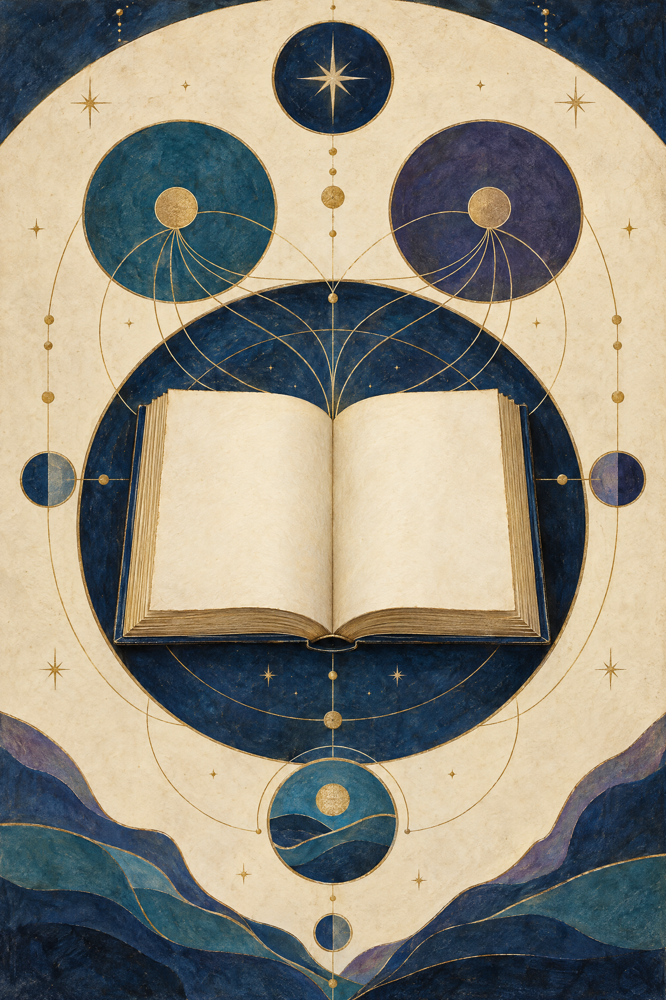
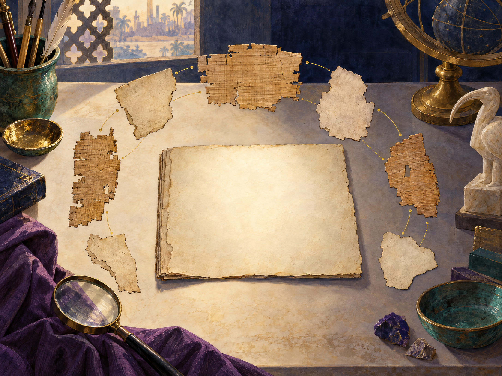

# Кефалайи Учителя

## Коптское манихейское собрание в рукописи, чтении и реконструкции

**HARVYRÐ · чтения о текстах и традициях**

*Краткое уважительное введение в Coptic Kephalaia — конкретное собрание глав, а не перевод всего манихейского Писания.*

---

## Об этой книге

«Кефалайи Учителя» дошли до нас не как целая книга с прозрачной историей, а как коптская рукописная традиция, которую исследователи читают по двум разным папирусным кодексам. Между сохранившейся строкой, редакторским восстановлением, переводом и толкованием есть важные различия. Эта книга старается показывать их, а не скрывать.

Здесь нет перевода полного корпуса. Все изложения содержания — оригинальные краткие пересказы и пояснения, написанные для этого издания. Современные защищённые переводы не воспроизводятся. Термин «Кефалайи Учителя» в заглавии относится прежде всего к берлинскому кодексу 1Ke; рядом с ним рассматривается отдельный дублинский кодекс 2Ke, связанный с ним в исследовательских реконструкциях.

## Содержание

1. Имя, которое говорит о форме
2. Две рукописи, а не один том
3. Медине-Мади и путь к читателю
4. Что именно мы читаем
5. Голос Учителя и многообразие тем
6. Часть большой, фрагментарной библиотеки
7. Свой голос, чужая полемика и современные чтения
8. Как читать «Кефалайи» внимательно

## 1. Имя, которое говорит о форме

Слово *kephalaia* обычно передают как «главы» или «основные пункты». Название описывает форму собрания: материал разбит на пронумерованные разделы, у многих есть заголовки, а начало часто задаёт тему и голос говорящего. Само название, однако, не означает, что перед нами законченный трактат, составленный одним автором от начала до конца.

Коптские «Кефалайи» часто представляют материал как наставление Мани. Иногда рядом оказывается вопрос ученика, иногда — рассказ, толкование, пример или притча. Такое литературное оформление помогает увидеть авторитетную традицию, связанную с Мани, но не превращает текст в стенограмму его речи. Между историческим учителем и дошедшей до нас коптской редакцией лежат поколения передачи и редакционной работы. [1] [2]

Для описания формы исследователи используют слово *erotapokrisis* — «вопрос и ответ». Это полезная характеристика части собрания и отдельных способов организации глав. Но она не должна превращаться в жёсткий шаблон: не всякая глава состоит из одной пары вопроса и ответа, а внутри корпуса встречаются разные литературные формы. [3]

Поэтому удобнее говорить о кефалайическом корпусе: собрании глав, которое сохраняет и перерабатывает манихейские учения в дидактической форме. В нём видны тематические группы и редакционные слои, но их точные границы остаются предметом исследования. Образ единой книги с бесспорно восстановленным первоначальным планом был бы слишком уверенным.

## 2. Две рукописи, а не один том

В разговоре о «Кефалайях» важно различать два физических кодекса.

- **1Ke**, или **K**: Berlin P. Berol. 15996, берлинский кодекс, озаглавленный «Кефалайи Учителя»; его следует сверять с каталогом папирусов Берлинских музеев. [17]
- **2Ke**, или **K(Dub)**: Codex C из собрания Chester Beatty в Дублине, известный как «Кефалайи мудрости моего господина Мани»; библиотека предоставляет цифровой просмотр листа. [16]

У этих кодексов разные названия, история хранения и редакционные особенности. Они связаны тем, что исследователи предполагают общую последовательность глав и более крупную компиляцию. Но это гипотеза о литературной связи, а не свидетельство того, что когда-то существовал один физический том в той форме, в какой мы видим его сейчас. [1] [4] [5]

В научной литературе встречается обозначение 1Ke и 2Ke. Оно удобно, но не должно сглаживать разницу между свидетелями. Когда говорится о конкретном месте текста, полезно уточнить, к какому кодексу, главе и изданию оно относится. Ссылка просто на «Кефалайи» иногда оставляет неясным, идёт ли речь о Берлине, Дублине или о корпусе в целом.

Реконструкция предполагает, что 1Ke мог завершаться около глав 205–210, а 2Ke продолжал последовательность и доходил до 347-й главы. Последний уверенно читаемый номер в 1Ke — 199; в 2Ke начало сохранившейся нумерации приходится на 220. Между ними есть утраченные участки. Поэтому общая нумерация правдоподобна и научно полезна, но её нельзя считать простой записью, полностью сохранённой на папирусе. [1] [4]

*Условный образ разрозненных свидетельств и исследовательской работы. Он не воспроизводит и не реконструирует конкретный лист «Кефалай».*

## 3. Медине-Мади и путь к читателю

Два кодекса «Кефалай» входят в группу коптских манихейских рукописей, которую принято связывать с Медине-Мади в Египте. Историю находки относят к 1929 году. Однако ранняя история комплекса и происхождение отдельных предметов описаны не так уверенно, как хотелось бы: атрибуцию места находки обсуждают, и осторожные научные обзоры сами отмечают эту неопределённость. Поэтому уместно говорить о «так называемой библиотеке Медине-Мади», а не выдавать каждую деталь её происхождения за установленный факт. [5]

Рукописи оказались разделены между несколькими собраниями. Берлинский кодекс 1Ke известен по инвентарному обозначению P. Berol. 15996; дублинский 2Ke — это Codex C в библиотеке Chester Beatty. Оба каталожных ориентира помогают проверить, что речь идёт о разных материальных свидетелях. Части берлинского материала обнаруживались и в других местах; так, венские фрагменты K 11010a–h связывают с отсутствующими страницами 311–330 того же кодекса. Это дополнительные листы 1Ke, а не ещё один отдельный «Кефалай». [4] [5] [16] [17]

Коптские кодексы создавались и использовались задолго до современной научной классификации. Их датируют примерно концом IV — началом V века, часто ориентировочно около 400 года. Этот диапазон относится к сохранившимся рукописям. Он сам по себе не датирует каждый рассказ или учение внутри компиляции и не доказывает, что все её слои были первоначально написаны по-коптски. [1] [5]

Папирусы хрупки, а листы повреждены, утрачены или рассеяны. Издатели и кодикологи работают не только с текстом, но и с тем, как листы складывались в тетради, где сохранились края, что можно сопоставить с другими частями и где данных уже недостаточно. Разные оценки первоначального объёма 2Ke могут считать разные вещи: реконструируемый кодекс и доступные страницы. Поэтому цифры объёма нужно читать с пояснением, а не объединять в одну якобы точную меру. [4]

## 4. Что именно мы читаем

Печатная страница — это не то же самое, что поверхность папируса. Между ними есть несколько уровней.

Сначала исследователь видит следы чернил и волокон: сохранившиеся буквы, промежутки, повреждения, границы листа. Затем редактор устанавливает чтение, сравнивая видимые знаки, контекст и параллельные места. Там, где текст утрачен, в научном издании могут появиться квадратные скобки, многоточия или другие обозначения лакуны и восстановления. После этого переводчик выбирает, как передать грамматику, смысл и стиль на другом языке. Наконец, читатель или историк предлагает интерпретацию — например, как связаны два фрагмента или к какой теме относится глава.

Эти шаги не равнозначны. Сохранившаяся буква — материальное свидетельство. Восстановленная буква — аргументированное редакторское решение. Перевод — ещё один слой выбора. Историческое объяснение — интерпретация, которую можно пересматривать.

История публикации тоже не сводится к одному тому. Берлинские части выходили поэтапно в изданиях разных редакторов. Книга Иэна Гарднера 1995 года стала важным английским переводом и комментарием к опубликованной тогда части 1Ke, но не является переводом всего 1Ke и не включает дублинский 2Ke. Дублинский кодекс долгое время был известен в том числе по факсимиле; критическое издание его частей выходит постепенно. В 2018 году была опубликована часть с коптским текстом и английским переводом глав 321–347. [2] [5] [6]

Для внимательного чтения полезно спрашивать: это знак на папирусе, редакторское восстановление, переводческий выбор или гипотеза о композиции? Ответ иногда меняет оттенок утверждения. Пустое место в рукописи нельзя заполнять только потому, что подходящая фраза хорошо звучит. Параллельный текст может помочь, но не всегда доказывает, что именно так выглядел утраченный участок. [2] [4]

## 5. Голос Учителя и многообразие тем

«Кефалайи» создают впечатление разговора об учении: глава задаёт тему, голос наставника объясняет её, а вопросы и ответы помогают двигаться от тезиса к разъяснению. Но корпус не ограничивается одним видом речи. В нём соседствуют богословское изложение, толкование, рассказы, притчи и иные формы. Это собрание, где учение передаётся через несколько литературных способов, а не сухой список определений. [1] [3]

Среди основных тем — устройство мира и его происхождение, божественные и демонические силы, возникновение человеческого состояния, время и спасение. Другие разделы обращаются к Мани, его посланничеству, религиозной общине и её практике. Обсуждаются небесные миры и астрологические представления. Это широкий набор тем, но их наличие не означает, что любая глава объясняет один и тот же тезис одинаково или что корпус образует полностью согласованную систему без внутренних различий. [1] [2]

В некоторых частях 2Ke исследователи выделяют условные внутренние блоки, включая так называемую «книгу Иисуса» и следующий за ней иранский блок. Эти названия — инструменты анализа. Они помогают заметить смену материалов и культурных рамок, но не обязательно совпадают с заголовками, поставленными автором или переписчиком как окончательное деление всего собрания. [1] [6]

Коптская форма, в которой мы читаем главы, не делает собрание простым отражением одной местной общины. Переводные традиции и перемещение текстов между регионами могли менять язык и контекст. Поэтому осторожная формулировка говорит о манихейском материале, дошедшем в коптской редакции, а не о том, будто весь корпус возник в Египте именно в том виде, который сохранился в папирусах.

## 6. Часть большой, фрагментарной библиотеки

Манихейские тексты не сохранились в одном языке и одном архиве. Учёные работают с рукописями и фрагментами на коптском, греческом, сирийском, среднеперсидском, парфянском, согдийском, старотюркском, китайском и других языках. Одни свидетельства происходят из Египта, другие — из Центральной Азии или китайского Турфана, третьи дошли в переводах, цитатах и сочинениях авторов, споривших с манихеями. *Corpus Fontium Manichaeorum* отражает этот широкий и разнородный корпус в названиях своих языковых и региональных серий. [7] [8]

Сохранность резко различается. Где-то имеется значительный текст, где-то — несколько страниц, отдельные листы или фрагменты, которые нельзя уверенно соединить. Турфанские коллекции охватывают множество языков и письменностей; каталоги подчёркивают, что многие единицы — именно фрагменты без полного текста, заглавия или надёжной атрибуции. Наличие рукописного фрагмента на определённом языке ещё не означает, что целая книга на этом языке сохранилась. [10] [11]

Китайский «Трактат манихейский китайский» — пример более протяжённого и хорошо сохранившегося свидетельства, которое исследователи сопоставляют с материалом из других языков. Такая параллель обогащает сравнение, но не превращает китайский текст в копию конкретной главы 1Ke или 2Ke. У каждой рукописи своя история передачи. [9]

Исследователи обсуждают также перечни сочинений, приписываемых Мани. В литературе встречаются разные способы их группировки и подсчёта. Сами произведения не дошли в одном полном авторском архиве; часть известна через поздние свидетельства или переводы. Поэтому «Кефалайи» нельзя называть всей манихейской Библией, полным корпусом Мани или переводом его канона. Это один из важных, но ограниченных сегментов многоязычной традиции. [8]

*Условная современная визуальная метафора разговора и передачи. Она не изображает исторических лиц, конкретное учение или древний ритуал.*

## 7. Свой голос, чужая полемика и современные чтения

Коптские «Кефалайи» — внутренний литературный источник манихейской традиции. Это не «чистый» голос без истории: текст прошёл редакционную передачу, включает разные материалы и сохранился частично. Но его жанр и контекст отличаются от полемических сочинений внешних авторов.

Августин и другие позднеантичные авторы важны для изучения конкретных споров и общин. Их сочинения помогают понять, как манихеи представляли себя в публичной дискуссии и как их описывали оппоненты. При этом полемика имеет собственные цели. В ней обвинения, выбор цитат и способы изображения противника могут подчиняться богословскому спору. Поэтому её нельзя читать так, будто это нейтральная запись внутреннего вероучения всех манихеев. [12] [13] [14]

Самоназвания тоже зависели от языка и ситуации. Исследование коптских и латинских материалов показывает, что слово «манихей» не является обычным внутренним самоназванием в сохранившихся коптских текстах, тогда как в латинском публичном контексте некоторые фигуры могли называть себя христианами. Это не противоречие, которое следует разрешить одним универсальным ярлыком: разные тексты обращены к разным читателям и используют разные словари. Отсутствие слова в уцелевшем корпусе не доказывает, что оно никогда не звучало в живой речи. [12]

Современные местные практики, в которых почитается Мани, — отдельная тема. Исследование Cao’an в Китае описывает местное переплетение преданий, буддийской среды, народной религии и семейной этики. Это важно для понимания того, как образы Мани живут в конкретном современном контексте. Но такое наблюдение не доказывает непрерывной передачи древних «Кефалай» или неизменного существования одной доктрины с поздней античности до наших дней. [15]

Уважительное чтение не требует считать все источники одинаковыми. Оно требует указывать, кто говорит, когда, на каком языке, для какой аудитории и через какой тип текста. Тогда внутреннее собрание глав, латинский диспут и современная локальная практика могут быть сопоставлены, не сливаясь в единую воображаемую общину.

## 8. Как читать «Кефалайи» внимательно

Есть несколько практических правил, которые помогают не потерять разницу между текстом и реконструкцией.

- Уточняйте кодекс: 1Ke в Берлине или 2Ke в Дублине.
- Уточняйте, о чём идёт речь: о сохранившемся фрагменте, опубликованном тексте, переводе или научной интерпретации.
- Считайте номера глав и предполагаемые внутренние разделы удобными ориентирами, но не доказательством бесспорного первоначального плана.
- Читайте слова внешних оппонентов как свидетельства спора, а не как нейтральный пересказ внутреннего учения.
- Не переносите современные локальные формы почитания на древность без отдельного доказательства.

Каталоги, факсимиле и критические издания не отменяют неопределённость. Они дают возможность её точнее увидеть. Исследователь может назвать, что сохранилось, какое чтение предложено и на чём основано восстановление. Читатель может следовать за этой цепочкой, не принимая каждую гипотезу за окончательный ответ. [2] [4] [16] [17]

«Кефалайи Учителя» ценны именно как конкретное свидетельство: коптская манихейская компиляция, переданная в нескольких физических кодексах и собранная современной наукой по частям. Их чтение становится яснее, если не требовать от них того, чего рукописи не обещают: единого авторского тома, полного канона или неизменного голоса всех манихейских общин.

## Краткий словарь

**1Ke / 2Ke.** Условные современные обозначения двух разных коптских кодексов «Кефалай». 1Ke — берлинский P. Berol. 15996; 2Ke — дублинский Chester Beatty Codex C.

**Кодекс.** Рукописная книга, составленная из листов и тетрадей. В этом издании слово относится к физическому свидетелю, а не к абстрактной литературной традиции.

**Лакуна.** Утраченное или нечитаемое место рукописи.

**Реконструкция.** Предложенное исследователем восстановление чтения, порядка или структуры на основании сохранившихся данных. У реконструкций может быть разная степень уверенности.

**Факсимиле.** Воспроизведение рукописной страницы, позволяющее видеть материальный свидетель; оно не равнозначно транскрипции или переводу.

**Эротапокритическая форма.** Литературная форма, организованная как вопрос и ответ. Это полезное описание отдельных особенностей «Кефалай», но не обязательная схема каждой главы.

## Литература и доступ к источникам

Ниже приведены страницы академических изданий, университетских проектов, библиотек и научных исследований, использованные для подготовки этого читательского введения. Внешние ссылки ведут к описаниям и материалам; доступность полного текста зависит от издателя или библиотеки.

[1]: https://www.iranicaonline.org/articles/kephalaia/ "KEPHALAIA — Encyclopaedia Iranica"
[2]: https://brill.com/display/title/2240?language=en "The Kephalaia of the Teacher: The Edited Coptic Manichaean Texts in Translation with Commentary — Iain Gardner"
[3]: https://doi.org/10.1484/M.IPM-EB.1.101144 "Coptic Answers to Manichaean Questions: The Erotapokritic Nature of the Kephalaia — Timothy Pettipiece"
[4]: https://dlib.nyu.edu/awdl/isaw/isaw-papers/29-4/ "Towards a Comparative Manichaean Manuscriptology — Anna Benkato, ISAW Papers 29.4"
[5]: https://www.iranicaonline.org/articles/coptic-manichean-texts/ "COPTIC MANICHEAN TEXTS — Encyclopaedia Iranica"
[6]: https://brill.com/downloadpdf/display/book/9789004363403/B9789004363403_002.pdf "The Chapters of the Wisdom of My Lord Mani: Part III, Pages 343–442 (Chapters 321–347)"
[7]: https://www.brepols.net/series/CFM "Corpus Fontium Manichaeorum — Series Overview"
[8]: https://www.iranicaonline.org/articles/iran-ix1-religions-in-iran/iran-ix12-manicheism/ "Iran ix. Religions in Iran: Manicheism — Encyclopaedia Iranica"
[9]: https://www.iranicaonline.org/articles/cosmogony-iii/ "Cosmogony and Cosmology iii. In Manicheism — Encyclopaedia Iranica"
[10]: https://turfan.bbaw.de/projekt-en.html "Turfan Studies — Berlin-Brandenburg Academy of Sciences and Humanities"
[11]: https://staatsbibliothek-berlin.de/die-staatsbibliothek/abteilungen/orient/aufgaben-profil/veroeffentlichungen/berlin-turfan-collection "The Berlin Turfan-Collection — Staatsbibliothek zu Berlin"
[12]: https://hts.org.za/index.php/hts/article/view/1358/3438 "Manichaean exonyms and autonyms — Nils A. Pedersen"
[13]: https://hts.org.za/index.php/hts/article/view/1355/3434 "Not to depart from Christ: Augustine between Manichaean and Catholic Christianity — Jason D. BeDuhn"
[14]: https://www.cambridge.org/core/journals/harvard-theological-review/article/aspects-of-antimanichaean-polemics-in-late-antiquity-and-under-early-islam/8EF14E617765AF2B39B3ED8D07297331 "Aspects of Anti-Manichaean Polemics in Late Antiquity and under Early Islam — Sarah Stroumsa and Guy G. Stroumsa"
[15]: https://www.mdpi.com/2077-1444/15/2/185 "Cao’an in the Ancestral World: Contemporary Manichaeism and Its Local Cultural Context — Y. Wang"
[16]: https://cbl01.intranda.com/viewer/image/Pma_1_239-240/1/ "Chester Beatty Library: Kephalaia folio viewer"
1. [KEPHALAIA — Encyclopaedia Iranica](https://www.iranicaonline.org/articles/kephalaia/)
2. [The Kephalaia of the Teacher: The Edited Coptic Manichaean Texts in Translation with Commentary — Iain Gardner](https://brill.com/display/title/2240?language=en)
3. [Coptic Answers to Manichaean Questions: The Erotapokritic Nature of the Kephalaia — Timothy Pettipiece](https://doi.org/10.1484/M.IPM-EB.1.101144)
4. [Towards a Comparative Manichaean Manuscriptology — Anna Benkato, ISAW Papers 29.4](https://dlib.nyu.edu/awdl/isaw/isaw-papers/29-4/)
5. [COPTIC MANICHEAN TEXTS — Encyclopaedia Iranica](https://www.iranicaonline.org/articles/coptic-manichean-texts/)
6. [The Chapters of the Wisdom of My Lord Mani: Part III, Pages 343–442 (Chapters 321–347)](https://brill.com/downloadpdf/display/book/9789004363403/B9789004363403_002.pdf)
7. [Corpus Fontium Manichaeorum — Series Overview](https://www.brepols.net/series/CFM)
8. [Iran ix. Religions in Iran: Manicheism — Encyclopaedia Iranica](https://www.iranicaonline.org/articles/iran-ix1-religions-in-iran/iran-ix12-manicheism/)
9. [Cosmogony and Cosmology iii. In Manicheism — Encyclopaedia Iranica](https://www.iranicaonline.org/articles/cosmogony-iii/)
10. [Turfan Studies — Berlin-Brandenburg Academy of Sciences and Humanities](https://turfan.bbaw.de/projekt-en.html)
11. [The Berlin Turfan-Collection — Staatsbibliothek zu Berlin](https://staatsbibliothek-berlin.de/die-staatsbibliothek/abteilungen/orient/aufgaben-profil/veroeffentlichungen/berlin-turfan-collection)
12. [Manichaean exonyms and autonyms — Nils A. Pedersen](https://hts.org.za/index.php/hts/article/view/1358/3438)
13. [Not to depart from Christ: Augustine between Manichaean and Catholic Christianity — Jason D. BeDuhn](https://hts.org.za/index.php/hts/article/view/1355/3434)
14. [Aspects of Anti-Manichaean Polemics in Late Antiquity and under Early Islam — Sarah Stroumsa and Guy G. Stroumsa](https://www.cambridge.org/core/journals/harvard-theological-review/article/aspects-of-antimanichaean-polemics-in-late-antiquity-and-under-early-islam/8EF14E617765AF2B39B3ED8D07297331)
15. [Cao’an in the Ancestral World: Contemporary Manichaeism and Its Local Cultural Context — Y. Wang](https://www.mdpi.com/2077-1444/15/2/185)
16. [Chester Beatty Library: Kephalaia folio viewer](https://cbl01.intranda.com/viewer/image/Pma_1_239-240/1/)
17. [Berlin Papyrus Database — Staatliche Museen zu Berlin](https://www.smb.museum/en/museums-institutions/aegyptisches-museum-und-papyrussammlung/collection-research/research/berlin-papyrus-database/)

[17]: https://www.smb.museum/en/museums-institutions/aegyptisches-museum-und-papyrussammlung/collection-research/research/berlin-papyrus-database/ "Berlin Papyrus Database — Staatliche Museen zu Berlin"
