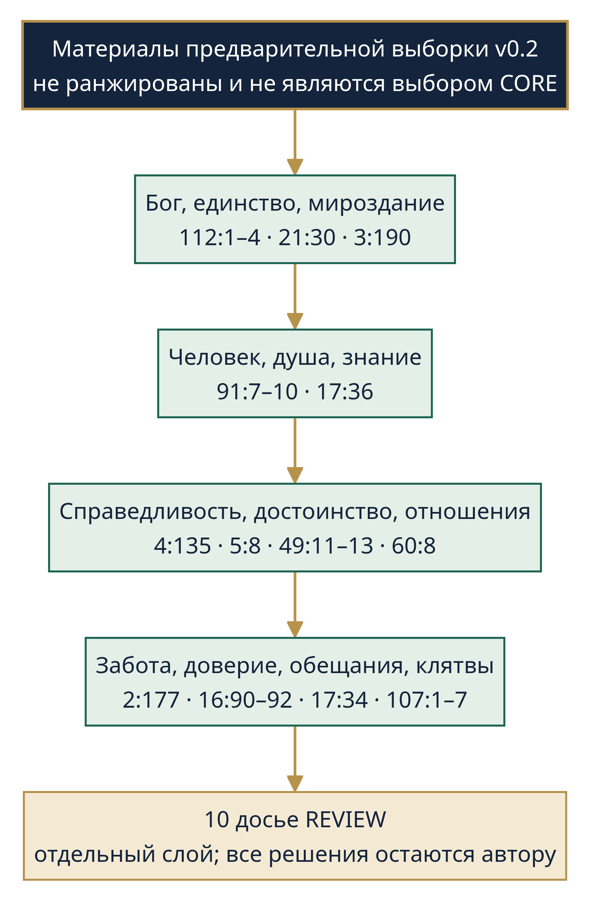
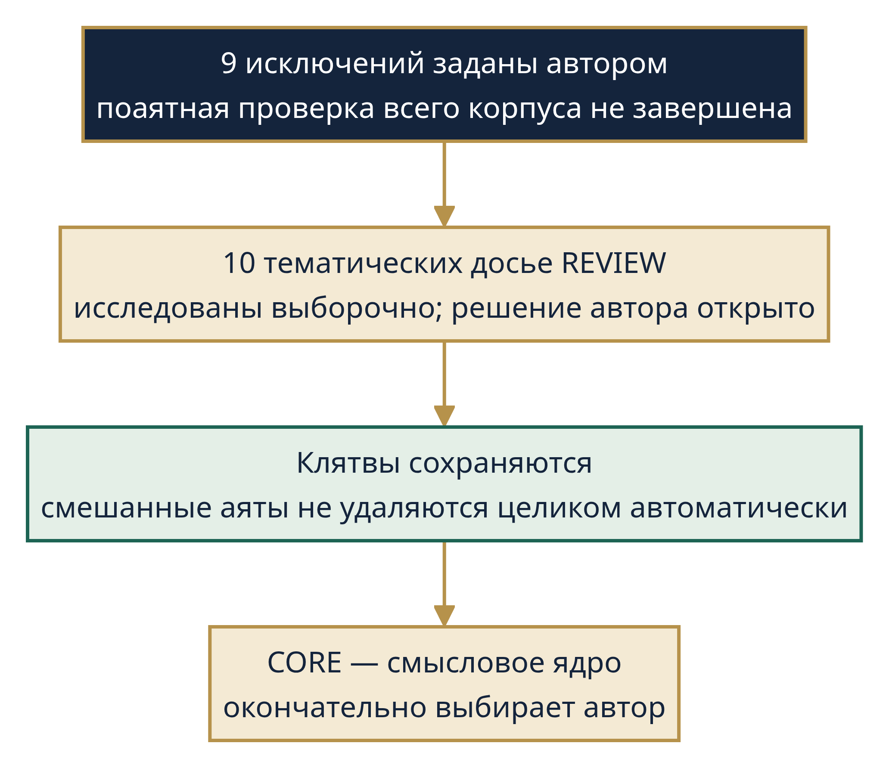
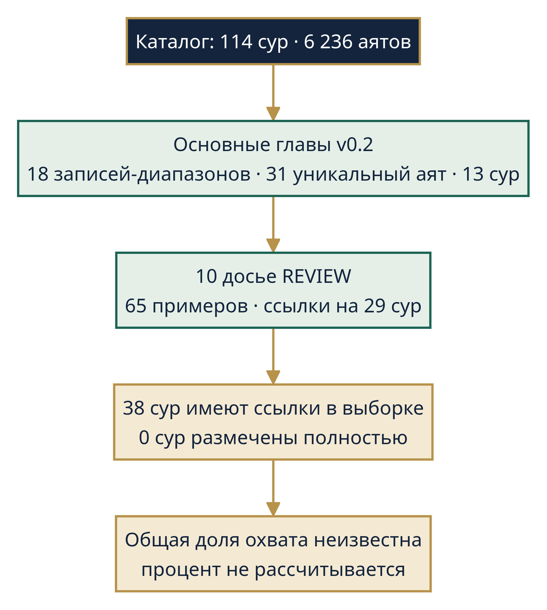
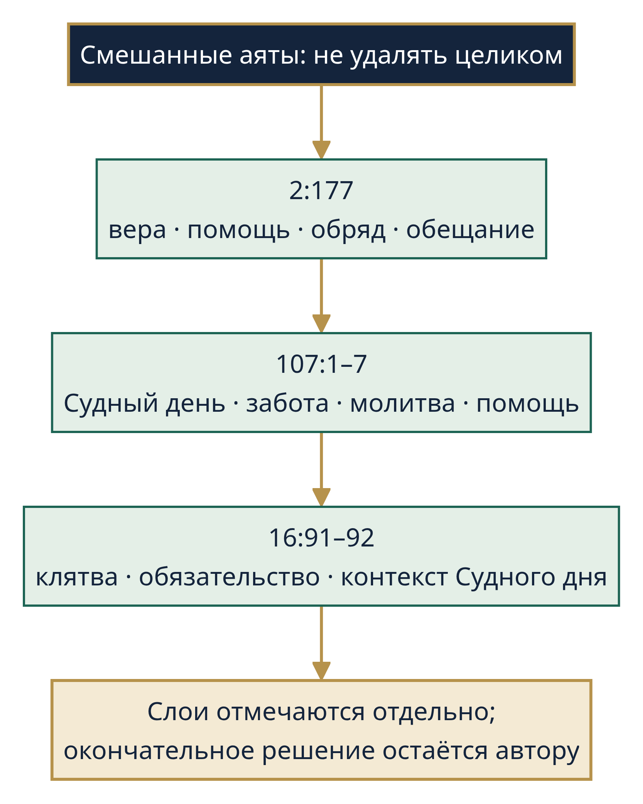
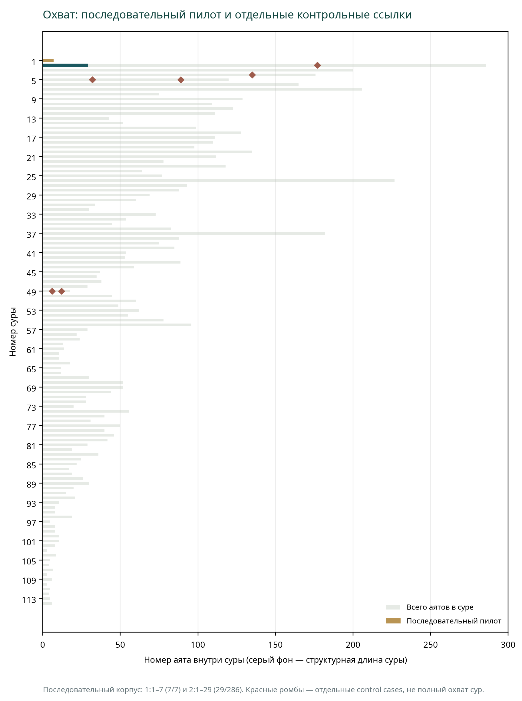
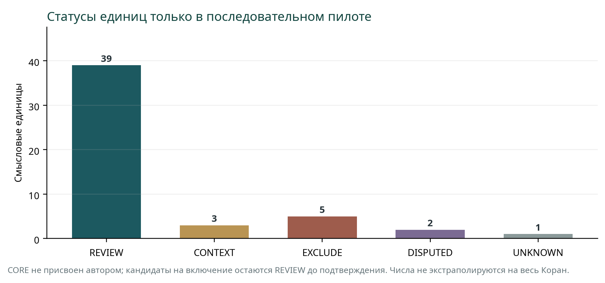
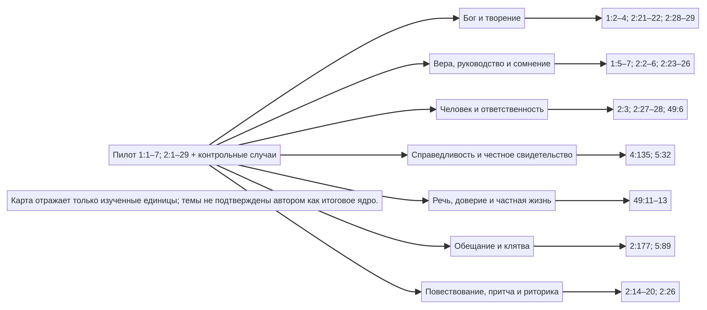
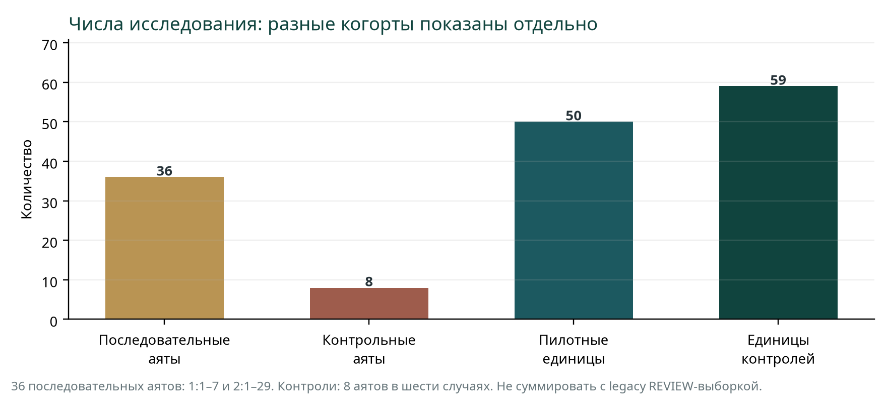
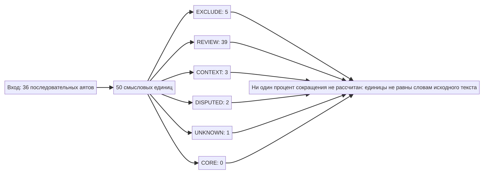

# HARVYRÐ — ХАРВИРД

## Суть с писаний

**Писание первое — КОРАН**  
Авторское исследование и смысловое изложение  
**Erwann Harvyrð** · Эрван Харвирд  
Авторская концепция серии: Velan (унаследованное обозначение v0.3; просит подтверждения владельца)  
**Статус псевдонима: PROPOSED** · цифровое написание: HARVYRD  
**v0.4 · проверяемая пилотная редакция · 13 октября 2026 года**

> Это авторская сравнительно-религиоведческая и философская работа. Она не является переводом Корана, не заменяет чтение первоисточника и не формулирует новое исламское учение.

> **Фактическая граница v0.4.** Последовательная смысловая разметка выполнена для 1:1–7 и 2:1–29: 36 аятов. Дополнительно разобраны шесть контрольных случаев в восьми аятах: 2:177, 4:135, 5:32, 5:89, 49:6 и 49:11–13. Нумерация — стандартная куфийская; структурный каталог содержит 114 сур и 6 236 аятов. [18] Это не означает, что они все исследованы: 114-сурная карта — только указатель. Унаследованный реестр v0.3 содержит 18 записей диапазонов, 31 уникальный аят в 13 сурах и 65 примеров REVIEW в 29 сурах; они не равны новому последовательному анализу. Ни одна сура не объявлена полностью исследованной в богословском или филологическом смысле. Все перенесённые из v0.3 читательские главы и «карта возможного смыслового ядра» являются EDITORIAL SYNTHESIS, не повторно аудированными целиком и не равными окончательному выбору CORE автором.

## Содержание

[TOC]

---

## Предисловие: что здесь выбирается

Серия HARVYRÐ — «Харвирд» задумана как проект внимательного чтения древних и священных писаний. Мы не пересказываем Писание целиком и не пытаемся подменить его кратким конспектом. Мы спрашиваем, какие смысловые линии можно проследить в тексте, если исследователь заранее обозначает свои вопросы, сохраняет контекст и не скрывает собственные решения.

В этой первой книге рассматривается Коран. Её замысел — проследить возможные идеи о Боге, мироздании, человеке, познании, нравственности и отношениях. Это не богословское заключение и не суждение о том, что является «настоящим» исламом. Это самостоятельный авторский исследовательский проект, который должен оставаться открытым для проверки и пересмотра.

Девять тематических исключений в задании утверждены автором проекта. Они не расширяются по усмотрению редактора. Десять других категорий оставлены автором в статусе REVIEW. Ни одна из них в этой редакции не объявляется окончательно исключённой. Где несколько тем соединены в одном аяте, мы описываем только тот смысловой аспект, который исследуется, и прямо отмечаем соседние элементы, которые нельзя без потерь вынести за скобки.

Само «смысловое ядро» здесь **не выбрано за Velan**. В последней части собраны возможные линии, которые проявились в ограниченной выборке. Это материал для авторского решения, а не его замена.

## Как читать эту книгу

В тексте различаются четыре слоя. **Аят** — место в первоисточнике. **Перевод** — способ передать его смысл на другом языке; разные переводы могут иначе расставлять оттенки. **Традиционное толкование** — объяснение, принадлежащее определённой религиозной школе или автору. **Авторское смысловое изложение** — формулировка этой книги, предназначенная для обсуждения, а не дословная цитата.

Все пассажи без кавычек — редакционные пересказы. Длинные фрагменты переводов не воспроизводятся. Ссылки ведут на страницу аята, где читатель может открыть арабский текст, выбранные переводы и тафсир. В v0.4 выполнено последовательное сопоставление русских версий Кулиева и Османова для 1:1–7 и 2:1–29; контрольные примеры сверены по русской странице Кулиева, арабскому тексту, лексико-грамматическим материалам и указанным тафсирам. Это ограниченный пилот, а не полная колляция переводов или рецензирование специалистом. Унаследованные главы v0.3 остаются исследовательским черновиком и не объявляются заново полностью верифицированными.

> **Научный комментарий · описание и оценка.** Академический анализ текста и нормативное рассуждение о том, как следует понимать исламское право, — разные типы высказывания. Khaled Abou El Fadl прямо характеризует свою статью об этике и праве как нормативную и убеждающую, а не просто описательную. Здесь она служит примером необходимости обозначать позицию исследователя, а не подтверждением единственно верного прочтения. [7]

Для навигации используется распространённая куфийская нумерация: 114 сур и 6 236 пронумерованных аятов. Другие традиционные системы счёта границ аятов существуют; выбранная нумерация — рабочая договорённость, а не утверждение об отсутствии вариантов. Библиографическое описание структуры сверяется с [Britannica](https://www.britannica.com/topic/Quran), лингвистическая навигация — с [Quranic Arabic Corpus](https://corpus.quran.com/), а страницы текста и переводов — с [Quran.com](https://quran.com/).

## Часть I. Мироздание и его порядок

### 1. Единство как исходная рамка

Короткая сура «аль-Ихляс» строится вокруг утверждения единства Бога и отказа от представления о Нём как о части ряда подобных существ. Её сжатость сама по себе выразительна: речь не о перечне свойств мира, а о предельно сосредоточенной рамке, через которую верующий читает реальность. В этой книге такой ход описывается как монотеистическая исходная позиция текста, а не как нейтральное доказательство, обязательное для каждого читателя.

Из этой рамки следует важный методический вопрос: если Бог мыслится единым и несопоставимым, какие пределы это задаёт человеческим притязаниям на абсолютное знание и власть? Ответ не следует автоматически из одного короткого отрывка; он требует сопоставления с другими местами Корана и традициями толкования. Поэтому вывод о скромности человека здесь — исследовательская гипотеза, а не буквальная формула суры.

**Опора:** Коран [112:1–4](https://quran.com/112). Эта ссылка ведёт на текст суры; смысловое изложение выше не является цитатой.

### 2. Мир как предмет внимательного взгляда

В Коране природа не просто фон человеческой жизни. Чередование ночи и дня, устройство небес и земли становятся знаками, обращёнными к людям, способным размышлять. Здесь наблюдение и вера не выступают как две заранее враждующие области: текст предлагает смотреть на порядок мира и задаваться вопросом о его смысле. Однако коранический образ «знака» — богословская интерпретация природы, а не научная теория в современном смысле.

Аят [21:30](https://quran.com/21/30) соединяет образ разделённых небес и земли с происхождением живого из воды. В читательском изложении важно не превращать этот образ в предсказание современной космологии или биологии. Сходство формулировки с поздней научной моделью ещё не доказывает, что аят говорит именно о ней. Для этой книги достаточно более осторожного чтения: природный мир представлен как связное творение, которое побуждает к размышлению.

> **Научный комментарий · Коран и естествознание.** В академической литературе различают научную экзегезу, которая привлекает научные данные для объяснения аятов, и более сильное утверждение, будто сам текст содержит конкретные современные научные открытия. История этих подходов неоднородна и спорна. Поэтому сходство образа с поздней теорией само по себе не подтверждает, что аят предсказывает её. [1]

**Опоры:** Коран [3:190](https://quran.com/3/190), [21:30](https://quran.com/21/30). Соседние аяты местами соединяют размышление с молитвой и представлениями о будущей жизни; данная глава не объявляет эти категории окончательно исключёнными и не приписывает им отсутствующий в источнике смысл.

### 3. Человек внутри мира, но не его хозяин

Коран обращается к человеку как к существу, способному замечать, выбирать, благодарить и отвечать за поступки. Человеческое положение двойственно: человек достоин обращения и нравственного призыва, но не обладает безграничным знанием. Природные образы поэтому могут работать не только как картина мироздания, но и как напоминание о человеческой мере.

В [91:7–10](https://quran.com/91/7) о душе говорится в связи с распознаванием добра и зла и нравственным самоочищением. Это не современная психологическая теория и не подробная схема устройства личности. В пределах данного отрывка можно осторожно выделить лишь связь между внутренним нравственным различением и ответственностью за направление собственной жизни. Полные богословские трактовки души намного шире этого пересказа.

**Опора:** Коран [91:7–10](https://quran.com/91/7).

## Часть II. Человек, разум и проверка знания

### 4. Не следовать за тем, чего не знаешь

Один из наиболее ясных текстовых ориентиров для темы познания находится в [17:36](https://quran.com/17/36): человеку предлагается не утверждать и не принимать то, для чего у него нет знания, а слух, зрение и внутреннее разумение связываются с ответственностью. В этой формуле важна не только возможность знать, но и обязанность проверять основания суждения.

Такое чтение не следует расширять до утверждения, будто Коран предлагает современный научный метод. В аяте нет описания лабораторного эксперимента, процедуры рецензирования или конкретной теории источников. Здесь есть более общий нравственный принцип: не выдавать предположение за достоверное знание и не освобождать себя от ответственности за то, что услышал, увидел или решил.

> **Научный комментарий · контекстуальный подход.** Akbar и Saeed описывают контекстуальное чтение как один из современных методов работы с этико-правовыми аятами. Они отмечают, что этот подход ещё требует теоретической разработки; он не является нейтральным консенсусом и не даёт редактору права произвольно переписывать текст. Здесь контекст используется как проверка границ вывода. [2]

Контекст усиливает эту мысль. Непосредственно перед ним упоминаются распоряжение имуществом сироты и честность меры и веса ([17:34–35](https://quran.com/17/34)). Значит, речь идёт не только об отвлечённом рассуждении: достоверность и ответственность связаны с материальными действиями, доверием и справедливостью. Эти соседние предписания — самостоятельные темы, и их нельзя незаметно растворить в современной идее «критического мышления».

> **Научный комментарий · связь соседних пассажей.** M. A. S. Abdel-Haleem разбирает, как в некоторых местах Корана временное отступление от темы может связывать соседние наставления; его пример касается другого фрагмента — 2:238–240. Это полезное напоминание проверять композиционную связь, но не доказательство, что всякая соседняя последовательность имеет один бесспорный замысел. [6]

### 5. Слово может поддерживать достоинство — или разрушать его

В [49:11–12](https://quran.com/49/11) текст осуждает насмешку, уничижительные прозвища, необоснованные подозрения, слежку и злословие. Поэтическое сравнение в двенадцатом аяте показывает, насколько сильным может быть риторический образ. В пересказе мы не повторяем это сравнение дословно, но сохраняем его функцию: речь обращает внимание на моральную тяжесть унижения другого человека за его спиной.

Адресат этих аятов обозначен внутри текста как верующие. Поэтому некорректно скрывать адресата или выдавать современную универсальную формулировку за дословное содержание. При этом более широкая человеческая перспектива звучит в следующем аяте: различие народов и племён описано как возможность узнавать друг друга ([49:13](https://quran.com/49/13)). Внутри одной суры соседствуют как обращение к общине, так и обращение к людям вообще; это различие важно сохранить.

Из этой группы мест можно извлечь осторожную мысль о речи как форме общественного действия: слово способно унизить, обвинить или поддержать взаимное узнавание. Но текст не отменяет необходимости различать правдивую критику, доказанное свидетельство и злословие. Сводить все эти категории к одному понятию «негативных слов» было бы неточно.

**Опоры:** Коран [49:11](https://quran.com/49/11), [49:12](https://quran.com/49/12), [49:13](https://quran.com/49/13).

## Часть III. Нравственность и ответственность

### 6. Справедливость начинается с проверки себя

В [4:135](https://quran.com/4/135) справедливое свидетельство противопоставлено личной склонности и прямо распространяется на случаи, когда оно может быть невыгодно самому человеку, его родителям или близким. В [5:8](https://quran.com/5/8) адресатам сказано не позволять неприязни к другой группе вести к несправедливости. Оба места связывают оценку суждений с неудобной задачей: быть беспристрастным не только к чужим, но и к своим интересам.

Это не означает, что два аята снимают исторические, правовые или общинные контексты. В обоих текстах есть религиозный адресат и обращение к Богу. Смысл книги не в том, чтобы удалить этот слой, а в том, чтобы различить: перед нами наставление конкретной общине и одновременно формулировка, которую можно обсуждать как этический ориентир. Такое обсуждение — авторский вывод.

Справедливость здесь не сводится к одинаковому обращению с любыми обстоятельствами. В одном случае подчёркнута независимость свидетельства от родства и достатка, в другом — от чувства неприязни. Это два разных риска пристрастия, а не универсальная инструкция по разрешению всех конфликтов.

**Опоры:** Коран [4:135](https://quran.com/4/135), [5:8](https://quran.com/5/8), [16:90](https://quran.com/16/90).

### 7. Добро — не только намерение

Аят [16:90](https://quran.com/16/90) соединяет справедливость с благодеянием и заботой о близких, противопоставляя им разрушительное поведение. В [2:177](https://quran.com/2/177) нравственная добродетель раскрывается через несколько слоёв сразу: веру, помощь родственникам, сиротам и нуждающимся, религиозные практики, верность обещаниям и стойкость в испытании. Этот аят не позволяет без оговорки свести религиозность только к социальному действию — как и только к обряду.

Короткая сура «аль-Маун» резко сближает вопрос веры с отношением к сироте и нуждающемуся, а также с тем, как выглядит поклонение, лишённое заботы. Пересказ этого места можно сформулировать так: религиозное самоописание подвергается проверке через отношение к уязвимому человеку. Но в самой суре присутствует и молитва; поскольку обряды отнесены к REVIEW, этот элемент здесь отмечен, а не изъят без решения автора.

Сочетание этих мест показывает не готовую современную социальную программу, а повторяющуюся связь между нравственной добродетелью и конкретным обращением с другими. Кто именно и при каких условиях несёт обязанность помощи — отдельный вопрос, который зависит от текста, толкования и исторической практики.

> **Научный комментарий · история исламской этики.** Обзор Atif Khalil показывает, что этические идеи в исламской истории разрабатывались в разных дисциплинах — богословии, философии, суфийской мысли и праве — и получали неодинаковые объяснения. Поэтому такие слова, как «справедливость» и «добродетель», здесь обозначают исследовательские темы, а не готовые определения, одинаковые во всех школах. [3]

**Опоры:** Коран [16:90](https://quran.com/16/90), [2:177](https://quran.com/2/177), [107:1–7](https://quran.com/107). В [2:177](https://quran.com/2/177) и [107:1–7](https://quran.com/107) нравственная линия соединена с элементами категорий REVIEW; они не выданы за однозначно отделённые от обряда.

### 8. Благодарность как внимание к дару и пределу

В [31:12](https://quran.com/31/12) мудрость Лукмана связана с благодарностью. Текст не описывает благодарность как технику хорошего настроения или способ гарантировать успех. Она направлена к Богу и представлена как благо для самого благодарного; Бог при этом не нуждается в человеческой признательности.

Такой смысл можно прочитать как дисциплину внимания: замечать то, что человек не создал собственными силами, и не считать себя мерой всего существующего. Это уже философское изложение редактора, а не буквальный перевод. В следующем отрывке повествовательная сцена переходит к советам Лукмана сыну. Мы не превращаем её в доказательство биографических фактов и не утверждаем, что современная категория «психологической устойчивости» присутствует в тексте.

**Опора:** Коран [31:12](https://quran.com/31/12). История Лукмана как повествование имеет статус REVIEW; здесь исследуется только смысловой ход, непосредственно заданный выбранным аятом.

## Часть IV. Отношения, слово и обещание

### 9. Различие не обязано превращаться в отчуждение

В [49:13](https://quran.com/49/13) разнообразие народов и племён представлено как условие взаимного узнавания. Этот образ открывает возможность говорить об отношениях без требования, чтобы все люди стали одинаковыми. При этом аят сохраняет собственную религиозную меру достоинства — праведность перед Богом. Было бы неполно пересказать его только как современный лозунг о культурном многообразии и умолчать о богословской рамке.

Аят [60:8](https://quran.com/60/8) допускает доброе и справедливое отношение к тем, кто не воюет с адресатами и не изгоняет их из жилищ. Его условие нельзя опустить: это не абстрактное утверждение вне исторического конфликта. Соседний текст содержит границу, поэтому этот аят нельзя использовать как универсальную декларацию, не прочитав контекст. Вместе эти места позволяют обсуждать уважение и справедливость, сохраняя конкретные адреса и оговорки.

**Опоры:** Коран [49:13](https://quran.com/49/13), [60:8–9](https://quran.com/60/8). В читательском изложении используется только формулировка 60:8; 60:9 указывается как контекстуальная граница, а не пересказывается.

### 10. Договор и обещание держат доверие

В [17:34](https://quran.com/17/34) забота об имуществе сироты соединена с требованием исполнять обязательство. В [16:91–92](https://quran.com/16/90) обещание и клятва обсуждаются в связи с возможностью обмана и общественной лояльности. Здесь клятва не является «лишней» темой: она остаётся важной, как требует авторское решение проекта.

Смысловой вывод не состоит в том, что все формы обещания равнозначны юридическому договору. Текстовый контекст задаёт свои религиозные и общественные отношения. Но можно увидеть общий этический нерв: слово создаёт ожидание, а разрыв между обещанным и сделанным причиняет ущерб доверию. Этот вывод обозначен как философское прочтение, не как дословная цитата.

> **Научный комментарий · клятва как речевая форма.** Devin J. Stewart рассматривает клятвы как один из жанров коранической речи и подчёркивает, что жанровый анализ нужно сочетать с лексикой, грамматикой и контекстом. Отдельное исследование Abdel-Haleem посвящено переводческим трудностям клятв в 79-й и 100-й сурах; оно не решает вопрос о 16:91–92, но показывает, почему риторическую форму нельзя незаметно свести к обычному обещанию. Клятвы в выборке сохранены, как задано автором проекта. [4], [5]

В одном ряду оказываются свидетельство, мера, имущество сироты и клятва. Они показывают, что ответственность перед Богом связывается с практическими отношениями — с тем, как человек распоряжается чужим доверием и общими правилами.

**Опоры:** Коран [16:91–92](https://quran.com/16/90), [17:34–35](https://quran.com/17/34), [2:177](https://quran.com/2/177).

## Часть V. Повествование как способ размышления

Истории Корана — не иллюстративные вставки, которые можно вынуть из текста без потерь. Они связаны с обращением к общине, с образом пророческой речи, с повторением сюжетов и с религиозным представлением о Боге. Поэтому их нельзя превращать в набор свободных «универсальных притч», заранее очищенных от богословия.

В этой предварительной редакции история Лукмана служит лишь ограниченным примером. [31:12](https://quran.com/31/12) связывает мудрость и благодарность, а следующий фрагмент открывает обращение отца к сыну. Но данный проект ещё не выполнил последовательную разметку всех коранических повествований, не сопоставил варианты традиционного толкования и не установил историческую достоверность рассказов. Поэтому выводы об этом блоке имеют статус **REVIEW**.

> **Научный комментарий · жанр не заменяет контекст.** Исследование жанров помогает спрашивать, кто говорит, кому и с какой речевой целью. Но, по выводу Stewart, жанровые наблюдения следует соединять с грамматикой, лексикой и близким контекстом; исчерпывающего перечня жанров Корана пока нет. Здесь это вспомогательный вопрос к чтению, а не способ превратить повествование в свободную притчу. [4]

Для будущего анализа каждой истории нужен минимум из четырёх шагов: прочитать весь повествовательный отрывок; определить, кто и кому говорит; отделить содержание рассказа от позднего толкования; после этого обсуждать, какие идеи можно перенести в философское изложение без стирания религиозного смысла. Изображения пророков и сцен откровения в этой книге не используются.

## Часть VI. Десять открытых исследовательских вопросов

Все десять категорий ниже получили отдельные тематические досье и выборочные проверки конкретных мест. Это не означает поаятного анализа всего Корана и не является рекомендацией автоматически сохранить или исключить темы. Для каждой категории отмечены самостоятельный смысл, зависимость от практики или контекста и возможная потеря при удалении. **Все статусы остаются REVIEW; окончательное решение и выбор смыслового ядра принадлежат Velan.** Сокращённые формулировки ниже — варианты для обсуждения, не утверждённый автором текст книги.

### 11. Обряды, молитвы, пост и паломничество — REVIEW

**Наблюдение.** В исследованных местах поклонение связано с памятью о Боге, благодарностью, самоограничением и нравственной ответственностью. Например, 29:45 связывает молитву с удержанием от дурного; 2:183–185 соединяет пост с богобоязненной внимательностью, ниспосланием руководства, облегчением для больного и путника и благодарностью; 22:27 показывает паломничество как движение людей к Священному дому.

**Контекст и возможная потеря.** Это не полный свод обрядов или исламского права: правила распределены по тексту и имеют оговорки о времени, болезни, путешествии, опасности и общине. Удаление категории ослабит связь веры с телесной и календарной практикой, а также покажет меньше о том, как норма соотносится с обстоятельствами. Возможная краткая формулировка: *практики поклонения связывают память о Боге с нравственной дисциплиной и благодарностью, но их конкретный режим и правовые толкования требуют отдельного контекста.* Опоры: [2:183–185](https://quran.com/2/183-185), [4:103](https://quran.com/4/103), [22:27–37](https://quran.com/22/27-37), [29:45](https://quran.com/29/45).

### 12. Пищевые запреты и ритуальная чистота — REVIEW

**Наблюдение.** Тема касается Божьего установления границ дозволенного, благодарности и самоограничения; в ряде мест нужда смягчает запрет. Ритуальное очищение связано с молитвой и прямо сопровождается оговорками о болезни, путешествии и отсутствии воды.

**Контекст и возможная потеря.** Запреты нельзя сводить к доказанным современным медицинским причинам, а омовение — к общему санитарному правилу. При удалении исчезнет важная связка между телесной практикой, поклонением, благодарностью, милостью в нужде и вопросом о праве объявлять дозволенное и запретное. Возможная краткая формулировка: *коранические пищевые и очистительные нормы выражают границы религиозной практики, но их мотивы и последующая правовая детализация неоднородны.* Опоры: [2:173](https://quran.com/2/173), [5:3](https://quran.com/5/3), [5:6](https://quran.com/5/6), [6:145](https://quran.com/6/145), [16:115–116](https://quran.com/16/115-116).

### 13. Брак, развод, гендерные нормы и наследство — REVIEW

**Наблюдение.** В исследованных фрагментах семья представлена одновременно как область милости и ответственности и как предмет конкретного правового регулирования. 30:21 говорит о браке как знамении; другие места ограничивают причинение вреда при разводе и устанавливают имущественные права и доли.

**Контекст и возможная потеря.** Корпус содержит как взаимность и защиту уязвимых, так и асимметричные роли и доли; это напряжение нельзя сгладить современным лозунгом о равенстве или одним переводом. Поздние тафсир и фикх — отдельные слои. Удаление категории скроет, как нравственная речь соотносится с семейными институтами и конкретными нормами наследства. Возможная краткая формулировка: *кораническая семейная тема соединяет милость и ограничение вреда с предписаниями, чьи гендерные и правовые асимметрии требуют явного обсуждения.* Опоры: [30:21](https://quran.com/30/21), [2:228–231](https://quran.com/2/228-231), [4:7–11](https://quran.com/4/7-11), [4:19](https://quran.com/4/19), [4:34–35](https://quran.com/4/34-35).

### 14. Сделки, долги и имущественные правила — REVIEW

**Наблюдение.** Имущественные отношения связаны с доверием, справедливостью, взаимным согласием, письменной фиксацией обязательств и заботой о должнике в затруднении. В 2:282 процедура записи долга отвечает на человеческую забывчивость и риск спора; 2:280 предлагает отсрочку должнику в трудности.

**Контекст и возможная потеря.** Наследственные доли, свидетельские правила и распределение fay’ исторически и юридически конкретны; их нельзя объявлять готовым современным кодексом экономики. При удалении потеряется важная демонстрация того, как вера связывается с договором, ресурсами и зависимостью. Возможная краткая формулировка: *Коран придаёт хозяйственным отношениям нравственный вес — через честность, доказуемость обязательств и внимание к уязвимой стороне, — не предлагая тем самым единой современной экономической системы.* Опоры: [2:280–282](https://quran.com/2/280-282), [4:11](https://quran.com/4/11), [4:29](https://quran.com/4/29), [5:1](https://quran.com/5/1), [59:7](https://quran.com/59/7).

### 15. Земные правовые наказания — REVIEW

**Наблюдение.** В отдельных текстах наказание соседствует с ограничением возмездия, возможностью прощения или покаяния, требованием доказательств и мотивом защиты общественной жизни. Например, 2:178–179 соединяет возмездие с прощением и компенсацией и объяснением сохранения жизни; 24:4 задаёт высокий порог свидетельств для обвинения.

**Контекст и возможная потеря.** Эти места предполагают публичную процедуру и адресованы общине; их нельзя превращать в современный универсальный уголовный кодекс. Поздняя правовая рецепция шире самого текста и должна быть отделена от него. Исключение всей категории удалит и правовое напряжение между санкцией, доказательством, милостью и покаянием. Возможная краткая формулировка: *правовые фрагменты требуют читать вместе с процедурой, ограничениями и возможностью прощения; они не дают основания переносить поздние правовые системы прямо в текст Корана.* Опоры: [2:178–179](https://quran.com/2/178-179), [5:33–40](https://quran.com/5/33-40), [24:2](https://quran.com/24/2), [24:4–5](https://quran.com/24/4-5), [4:15–16](https://quran.com/4/15-16).

### 16. Полемика и осуждение других верований — REVIEW

**Наблюдение.** Полемика помогает тексту очертить монотеистические утверждения и границы общины; при этом в выборке есть нравственные ограничения самой полемики — требование спорить достойно и запрет оскорблений, способных вызвать ответную эскалацию.

**Контекст и возможная потеря.** Адресаты и тон различаются; нельзя свести эту тему ни к «ненависти», ни к современной доктрине равенства религий. Исключение скроет напряжение между исключительными истинностными притязаниями, отсутствием принуждения, корректным спором и конкретными общинно-политическими ситуациями. Возможная краткая формулировка: *Коран утверждает собственную монотеистическую позицию, одновременно ограничивая некоторые формы межрелигиозной полемики; содержание зависит от адресата и контекста.* Опоры: [6:108](https://quran.com/6/108), [29:46](https://quran.com/29/46), [2:109](https://quran.com/2/109), [2:256](https://quran.com/2/256), [5:51](https://quran.com/5/51), [109:1–6](https://quran.com/109).

### 17. Исторические рассказы о пророках — REVIEW

**Наблюдение.** Рассказы работают как напоминание и назидание, показывают повторяющиеся ответы людей на пророческий призыв и связывают настоящее послание с более ранними историями. Коран сам говорит о функции рассказов — укреплении сердца и уроке для размышляющих ([11:120](https://quran.com/11/120), [12:111](https://quran.com/12/111)).

**Контекст и возможная потеря.** Повествования не образуют непрерывную биографическую хронику; детали, известные из тафсира и сīры, нельзя незаметно приписывать самому тексту. Если удалить категорию, исчезнет один из основных способов коранического рассуждения о вере, выборе, стойкости и ответственности. Возможная краткая формулировка: *пророческие рассказы — не просто примеры, а форма богословского напоминания и размышления; пересказ должен сохранять адресата и отличать Коран от позднейших повествовательных дополнений.* Опоры: [7:59–64](https://quran.com/7/59-64), [2:125–129](https://quran.com/2/125-129), [11:120](https://quran.com/11/120), [12:111](https://quran.com/12/111), [19:16–36](https://quran.com/19/16-36), [20:99](https://quran.com/20/99), [26:10–68](https://quran.com/26/10-68).

### 18. Сатана, джинны и искушение — REVIEW

**Наблюдение.** Иблис показан как противник, а искушение — как внушение, ложное обещание и постепенное следование «шагам»; Коран также описывает джиннов как нравственно неоднородных существ, способных слышать откровение и выбирать.

**Контекст и возможная потеря.** Иблис не равен Богу, а все джинны не отождествлены с Сатаной. Тема пересекается с пищевыми нормами и молитвой о защите; позднюю демонологию не следует выдавать за прямое содержание. Исключение категории ослабит анализ ответственности, выбора и ложного знания о Боге. Возможная краткая формулировка: *коранический образ искушения подчёркивает уязвимость, но не снимает ответственности человека; невидимые существа не образуют одной нравственно однородной группы.* Опоры: [2:34](https://quran.com/2/34), [2:168–169](https://quran.com/2/168-169), [7:20–22](https://quran.com/7/20-22), [18:50](https://quran.com/18/50), [41:36](https://quran.com/41/36), [72:1–15](https://quran.com/72/1-15), [114:4–6](https://quran.com/114/4-6).

### 19. Воскресение, Судный день и жизнь после смерти — REVIEW

**Наблюдение.** Эсхатологический горизонт связывает Божью власть над жизнью и смертью с человеческой ответственностью и будущим воздаянием. Небольшие поступки не объявляются незначительными; отрицание воскресения в ряде мест показано как спор о возможностях знания и творения.

**Контекст и возможная потеря.** Эти тексты в значительной мере не зависят от обряда, но их риторика обращена к определённым адресатам; детальная схема посмертных состояний требует иных источников и традиций. Исключение категории уберёт важную мотивационную связку между творением, целью человеческой жизни и ответственностью. Возможная краткая формулировка: *воскресение и суд задают в Коране горизонт личной ответственности, но эта выборка не исчерпывает эсхатологию и не реконструирует позднейшую догматику.* Опоры: [45:22, 26](https://quran.com/45/22-26), [36:78–83](https://quran.com/36/78-83), [75:36](https://quran.com/75/36), [99:6–8](https://quran.com/99/6-8).

### 20. Повторы и риторические обращения — REVIEW

**Наблюдение.** Повтор — не только стилистический орнамент: рефрены возвращают внимание к теме, вопросы побуждают адресата к самооценке, а повторяющиеся формулы могут усиливать назидание. Так работают, например, рефрен о благах в суре 55 и вопросы о знании, поведении и размышлении.

**Контекст и возможная потеря.** Функция зависит от адресата, места в суре и ритма; перевод может менять впечатление. Сокращение дублирующих редакторских объяснений возможно, но вырезание повторов самого Писания — иное композиционное решение. Удаление категории скроет устную, ритмическую и композиционную сторону текста. Возможная краткая формулировка: *повтор организует внимание и возвращает читателя к теме; его функцию следует объяснять в контексте, а не считать пустым дублированием.* Опоры: [55:13](https://quran.com/55/13), [77:15](https://quran.com/77/15), [2:44](https://quran.com/2/44), [39:9](https://quran.com/39/9), [4:82](https://quran.com/4/82), [54:17](https://quran.com/54/17).

*Подробные исследовательские заметки, выбранные примеры, оговорки и библиография по каждой категории приведены в [техническом досье REVIEW](research/review_dossiers.md). Категории остаются открытыми; наличие предложенных кратких формулировок не означает, что автор их утвердил.*

## Часть VII. Карта возможного смыслового ядра — не окончательный выбор

В ограниченной выборке проявились несколько линий, которые могут стать материалом для авторского отбора. Первая — единство Бога как исходная теологическая рамка. Вторая — мир как предмет наблюдения и размышления. Третья — человеческая ответственность за суждение и слово. Четвёртая — справедливость, которую следует искать даже вопреки собственной выгоде и неприязни. Пятая — связь нравственного утверждения с конкретным отношением к сироте, нуждающемуся и человеку, которому дано обещание.

Эти линии не объявлены независимыми от веры и религиозной практики. В ряде мест они прямо соединены с молитвой, верой в будущий суд, общинной жизнью или богословским обращением к Богу. Некоторые из этих смежных категорий ещё не решены автором. Из-за этого преждевременно утверждать, что перед нами окончательное «ядро» после фильтра.

Исследовательский вопрос остаётся открытым: **какие из этих идей Velan хочет выбрать для своей книги, какие оставить только как контекст, а какие не включать в авторскую композицию?** Ответ на него должен быть сформулирован автором после изучения реестра и десяти открытых категорий. Данный раздел — карта наблюдений в малой выборке, не авторское решение.

## Приложение A. Метод отбора и редакционные статусы

### Единица анализа

Единицей работы может быть отдельный смысловой фрагмент внутри аята, а не только весь аят. Для полноценного реестра каждая такая единица должна иметь устойчивый идентификатор, ссылку на суру и аят, краткое содержание, тематические метки, статус, аргументацию, контекст и источник. В этой редакции детальная сегментация выполнена только для выбранных примеров; общая база смысловых единиц ещё не создана.

### Рабочие статусы

| Статус | Значение |
|---|---|
| CORE | Фрагмент выбран автором для основной книги. В v0.2 такие решения не присваивались от имени Velan. |
| EXCLUDE | Фрагмент исключён из читательской версии по утверждённой автором категории. |
| REVIEW | Решение не принято. Все десять категорий углублённого изучения остаются здесь. |
| CONTEXT | Фрагмент необходим для понимания соседнего содержания или редакционного решения. |
| COMPRESS | Допускается краткое изложение при сохранении существенных оговорок. |
| UNKNOWN | Значение или статус не установлены; непонятность не приравнивается к отсутствию смысла. |

Схема показывает: девять исключений заданы автором; десять REVIEW не переводятся автоматически в EXCLUDE; CORE выбирает автор. В этой редакции ядро не утверждено.

### Четыре слоя высказывания

При подготовке каждой главы нужно отдельно записывать: (1) что стоит в арабском тексте; (2) как выбранный перевод передаёт фразу; (3) что говорят выбранные тафсиры; (4) какой вывод предлагает автор книги. В v0.2 прямые длинные цитаты не приводятся; сравнительная сверка нескольких русских переводов отложена.

## Приложение B. Карта 114 сур и фактического охвата

Следующий каталог отражает нумерацию и число аятов, показанные в каталоге Quran.com; суммарное число — 6 236 в выбранной системе. Это **структурная карта**, а не свидетельство тематической проверки каждой суры. «Выборочная ссылка» означает, что отдельные аяты этой суры использованы в настоящем тексте; остальные аяты суры не считаются рассмотренными. «Не размечена» означает отсутствие индивидуальной тематической обработки в данной редакции.

В основных главах представлено 18 записей-диапазонов и 31 уникальный пронумерованный аят в 13 сурах. Десять досье REVIEW дополнительно содержат 65 записей-примеров со ссылками на 29 сур; некоторые ссылки — диапазоны, а темы пересекаются. Вместе с основной выборкой хотя бы одна ссылка есть на 38 сур (четыре суры присутствуют в обоих слоях). Это разные показатели, они не суммируются в проценты и не означают полного прочтения охваченных сур. В таблице «Выборка» обозначает ссылки основных глав, «REVIEW» — ссылки исследовательских досье, «Выборка + REVIEW» — оба слоя, «—» — отсутствие ссылок в этой версии. Ни одна сура не размечена полностью.

*Каталог сур и отметки проверки формируются в производственном приложении, а не из ручной экстраполяции тем.*

## Приложение C. Реестр использованных аятов

| № | Ссылка | Предварительная смысловая единица | Статус выборки | Сверка / оговорка |
|---|---|---|---|---|
| 1 | 112:1–4 | Единство Бога как исходная богословская рамка | REVIEW | Смысл изложен кратко; не претендует на исчерпывающее толкование. |
| 2 | 21:30 | Природный мир и жизнь как повод к размышлению | REVIEW | Не используется как современное научное предсказание. |
| 3 | 3:190 | Устройство мира как знак для размышляющих | REVIEW | Соседний контекст содержит и религиозные элементы. |
| 4 | 91:7–10 | Душа, нравственное различение и самоочищение | REVIEW | Не отождествляется с современной психологической теорией. |
| 5 | 17:36 | Не утверждать без знания; отвечать за восприятие и суждение | REVIEW | Читался вместе с 17:34–35 о доверии, мере и имуществе. |
| 6 | 49:11 | Насмешка, уничижительные прозвища и достоинство | REVIEW | Адресат — верующие; нельзя скрывать контекст обращения. |
| 7 | 49:12 | Необоснованные подозрения, слежка и злословие | REVIEW | Риторическое сравнение не повторяется дословно. |
| 8 | 49:13 | Разнообразие народов и взаимное узнавание | REVIEW | Не сводится к современному лозунгу; сохранена богословская рамка. |
| 9 | 4:135 | Беспристрастность свидетельства вопреки близости и выгоде | REVIEW | Смысловая мысль выделена из религиозного наставления. |
| 10 | 5:8 | Не позволять неприязни вести к несправедливости | REVIEW | Адресат и контекст не объявлены универсальным кодексом. |
| 11 | 16:90 | Справедливость, благодеяние и забота о близких | REVIEW | Соседние аяты содержат клятвы и другие незакрытые темы. |
| 12 | 2:177 | Добродетель соединяет веру, помощь, практику, верность и терпение | REVIEW | Смешанный аят; не разрезан на окончательное ядро. |
| 13 | 107:1–7 | Социальное отношение и религиозная практика в одном коротком тексте | REVIEW | Не удалять молитву автоматически; категория остаётся REVIEW. |
| 14 | 31:12 | Мудрость и благодарность в наставлении Лукмана | REVIEW | Не представляется как биографический факт. |
| 15 | 17:34 | Забота об имуществе сироты и верность обязательству | REVIEW | Это правовой и этический контекст одновременно. |
| 16 | 16:91–92 | Клятва, обещание и недопустимость обмана ими | REVIEW | Клятвы сохраняются; поздний правовой вывод не делается. |
| 17 | 60:8 | Доброе и справедливое отношение при обозначенном условии | REVIEW | Соседний аят 60:9 отмечает контекстуальную границу; не пересказывается. |
| 18 | 3:191 | Размышление о сотворённом связано с молитвой и эсхатологией | REVIEW | Перечислено как контекст, не классифицировано отдельно. |

Ссылки в реестре — не цитаты, а указатели на исходный текст. В отдельном CSV/XLSX содержатся дополнительные поля источника и проверки.

## Приложение D. Исключения и смешанные случаи

### Девять утверждённых исключений

| Код | Категория по заданию | Редакционное правило |
|---|---|---|
| E01 | Райские награды и наслаждения | Исключать из основного читательского изложения; соседнюю самостоятельную мысль не удалять автоматически. |
| E02 | Гурии и райские спутницы | Исключать из основного читательского изложения. |
| E03 | Ад и адские мучения | Не воспроизводить длинные устрашающие описания; сохранять ссылки в техническом реестре при полном анализе. |
| E04 | Проклятия | Не переносить проклятие в авторский голос; смешанные смыслы рассматривать отдельно. |
| E05 | Устрашение наказаниями и мучениями | Не воспроизводить как воздействующий читательский материал. |
| E06 | Предписания убивать | Исключать сами призывы; запрет несправедливого убийства и ценность жизни не приравнивать к ним. |
| E07 | Войны, сражения, военные действия, добыча | Исключать из читательского ядра; не скрывать важную контекстуальную оговорку при анализе соседнего фрагмента. |
| E08 | Джихад как самостоятельная тема | Исключать как самостоятельную тему; различение значений вести в исследовательских материалах. |
| E09 | Многожёнство | Исключать из основной читательской версии по утверждённому решению автора. |

Смешанный аят не становится целиком исключённым автоматически. Если в одном месте есть исключённый материал и самостоятельная мысль о справедливости, милосердии или честности, следует записать обе единицы и обосновать, какой именно текст пересказывается. Ни одна такая операция не должна создавать впечатление, будто пересказ передаёт полный смысл аята.

### Десять категорий REVIEW

Обряды и молитва; пищевые нормы и ритуальная чистота; семейное право и гендерные нормы; сделки и имущественные предписания; земные наказания; религиозная полемика; истории; сатана и джинны; воскресение и будущая жизнь; повторы и риторика. Они не переводятся в EXCLUDE без решения Velan.

## Отчёт о фактическом охвате этой редакции

В v0.2 структурно перечислены все 114 сур и 6 236 пронумерованных аятов по каталогу Quran.com. Это **не** означает, что содержание всех 6 236 аятов было исследовано. В основных читательских главах приведены 18 записей-диапазонов и 31 уникальный пронумерованный аят в 13 сурах; десять целевых досье REVIEW содержат 65 записей-примеров со ссылками на 29 сур. Вместе основная выборка и REVIEW дают ссылки на 38 сур (четыре пересекаются); часть примеров — диапазоны и пересекающиеся ссылки. Полная поаятная разметка, разбор всех смысловых единиц и подсчёт исключённых фрагментов не выполнены. Поэтому процент сохранённого или исключённого содержания **неизвестен**.

В выборке использованы первичные страницы Quran.com с арабским текстом, английским переводом и доступными тафсирами; для навигации проверены Quranic Arabic Corpus и Britannica. Не выполнено обязательное для окончательного издания сопоставление нескольких авторитетных русских переводов. Не выполнена полная проверка прав на конкретные русские переводы, поэтому длинные цитаты не воспроизводятся. Выводы о богословских школах, исторической достоверности повествований и соотношении этики с правом в этой версии предварительны.

**Издательская оговорка.** Иллюстрации в этой предварительной редакции созданы специально для проекта и не изображают пророков, людей или сцены откровения. Это художественные образы, не исторические свидетельства. PDF для печати имеет увеличенные внутренние поля, но не является обложкой с корешком и вылетами для конкретной типографии.

# Приложение E. Проверяемый пилот v0.4

## Что было реально проверено

**Арабские термины (не цитаты-аят):** al-baʾs (البأس) и fawqahā (فَوْقَهَا).

Последовательный корпус — все семь аятов суры 1 и первые двадцать девять аятов суры 2. Для каждой записи определена отдельная смысловая единица, сохранены соседний контекст, статус фильтра и основание решения. Первичный арабский текст и русская версия Эльмира Кулиева открывались на Quran.com; независимая русская версия Османова сверялась на Quran-for-all. Quranic Arabic Corpus использовался точечно, когда переводческая разница меняет смысл. [8] [9] [10] [11]

Пилот не выбирает окончательное смысловое ядро вместо автора. Статус `REVIEW` означает, что решение не принято; поле `proposed_status` хранит возможную редакционную рекомендацию отдельно. `UNKNOWN` для начальных букв 2:1 не означает, что значение ложно или отсутствует в традиции. `DISPUTED` отмечает переводческое или интерпретационное расхождение. `EXCLUDE` применяется только к совпавшим единицам, а не автоматически ко всему аяту.

### Черновой читательский фрагмент

**EDITORIAL SYNTHESIS — предложенный черновик, не подтверждённое ядро.** В этих начальных отрывках мир представлен как творение и условие человеческой жизни, а вера выражена не только как убеждение, но и как отношение к другим людям. В тексте рядом оказываются хвала и милость, молитва и помощь, напоминание о Судном дне, а также образы руководства и заблуждения. Это не одно универсальное определение религии: молитвенная форма, теологическое утверждение и нравственный мотив остаются различимы. [8] [9]

В 2:22–29 человек показан среди даров мира, призыва к поклонению, религиозного спора и размышления о создании. Аят 2:27 говорит о нарушении завета и разрыве связей, но не позволяет автоматически заменить «завет» любой клятвой или современным договором. Аяты 2:28–29 включают воскресение и образ семи небес; они сохраняются как утверждения текста, без попытки представить их современным научным прогнозом. Эти смыслы пока REVIEW и ждут авторского выбора. [9] [11]

### Последовательный пилот: важные границы

| Место | Наблюдение | Статус и граница |
|---|---|---|
| 1:4; 2:4; 2:28 | Судный день, будущая жизнь и возвращение к Богу | REVIEW R09; это не E01/E03/E05. |
| 2:7; 2:10 | Метафоры внутреннего состояния соседствуют с наказанием | Образ сердца остаётся REVIEW; только отдельные угрозы получили E05. |
| 2:17–20 | Огонь, гром, молния и телесные образы в притчах | REVIEW/R10; огонь притчи не приравнен к аду E03. |
| 2:24 | Завершение вызова из 2:23 соседствует с огненной угрозой | Связь сохранена как CONTEXT; угроза огнём — EXCLUDE E03/E05. |
| 2:25 | Условия веры/дел соседствуют с описанием райской награды | Условие сохранено в CONTEXT; награда EXCLUDE E01; E02 не выводится из «очищенных супругов». |
| 2:26 | Пример с комаром и грамматически/переводчески сложный сравнительный оборот | DISPUTED; варианты Кулиева и Османова не сведены к одному. |
| 2:27 | Завет, связи и порча перечислены в одном описании | Разделены на три единицы; не превращать завет в клятву без основания. |

## Контрольные случаи смешанных аятов

Эти разборы не заменяют последовательный анализ. Их задача — проверить, можно ли разделить темы без скрытой потери контекста. Для каждого контрольного случая в реестре сохранены ссылка, наблюдение, смысловое резюме, статусы, переводческие варианты и основания. [19] [20] [21] [22] [23] [24]

- **2:177 — праведность, вера и обязательства.** Внутри одного аята различены вера, помощь, молитва, закят, обязательства и терпение. Прежний статус REVIEW сохранён. Выражение al-baʾs (البأس) передаётся как «битва» у Кулиева, тогда как другие лексические и переводческие материалы допускают более широкий контекст трудности; соответствующий фрагмент DISPUTED, а не автоматически исключён по E07. [19]
- **4:135 — справедливое свидетельство.** Раздельно размечены общая обязанность, свидетельство против себя и родных, равное отношение к богатому и бедному, влияние страсти, искажение или уклонение от свидетельства. Унаследованный статус REVIEW сохранён; решение о CORE не принято. [20]
- **5:32 — жизнь и правовая оговорка.** Моральная аналогия убийства и спасения жизни отделена от оговорки о возмездии и порче. Последняя остаётся REVIEW/R05; она не превращена в предписание убивать E06. Стих 5:33 проверен лишь как соседний контекст, не включён в смысловой блок 5:32. [21]
- **5:89 — клятва и искупление.** Смысл непреднамеренной клятвы, намеренной клятвы, ответственности за данное слово и бережного соблюдения клятв сохраняется согласно прямому заданию автора. Порядок кормления, одежды, освобождения и поста отмечен отдельно как REVIEW/R01; это не основание скрыто превращать клятву в ритуальный запрет. На странице Кулиева замечена опечатка с соединением слов; в книге она не цитируется. [22]
- **49:6 — проверка сообщения.** Текст связывает проверку сообщения с предотвращением вреда, совершённого по неведению, и последующим сожалением. Референт fāsiq и оттенки повеления fatabayyanū передаются по-разному; исторический рассказ в тафсире не объявляется независимо проверенным историческим фактом. Единицы — REVIEW; кандидат CORE не утверждён. [23]
- **49:11–13 — речь, частная жизнь и человеческие различия.** Отдельно размечены насмешка, унизительные прозвища, подозрение, слежка, злословие, человеческое происхождение, народы и племена, взаимное узнавание и taqwa. Образ поедания мёртвого брата — риторическая метафора, не буквальное предписание или описание кары. Унаследованный REVIEW сохранён, CORE не утверждён. [24]

## Тематическая карта и смысловое ядро

Наиболее ясные кандидаты для следующего шага — милость и ответственность, справедливое свидетельство, сохранение жизни, проверка сообщений, уважительная речь и ответственное отношение к обещаниям. Они не представлены как финальный авторский выбор. В текущем реестре 5:89 даёт узкий пример подтверждённого содержания о клятвах; остальные подобные идеи остаются REVIEW или предложениями CORE.

## Как читать диаграммы объёма

В пилоте обработаны 36 последовательных аятов и создано 50 смысловых записей. Шесть контролей охватывают восемь аятов и 59 контрольных записей. Эти когорты показаны отдельно и не суммируются с унаследованным корпусом. Для сырого исходного текста не рассчитывался словный объём: корпуса переводов имеют разные сегментации, а повторное распространение больших объёмов текста требует отдельной проверки прав. Поэтому отношение «до/после» и процент сокращения не приводятся. Объём созданного редакционного пилотного текста посчитан в отчёте полноты отдельной мерой.

## Исследовательская карта и решения, которые ждут автора

Для остальных десяти категорий REVIEW в этой редакции не ставится окончательная точка. Унаследованные 65 примеров и их источники сохранены в приложенных таблицах; текущий последовательный пилот проверяет лишь конкретные примеры, названные выше. Многожёнство, пищевые запреты, наследство, исторические рассказы пророков и другие темы не объявляются отсутствующими только потому, что не попали в текущую последовательную выборку.

## Иллюстрации и источники

Художественные изображения в рабочей книге унаследованы из набора `assets/` версии v0.3: космос, природа, архитектура, книга, знание, справедливость, отношения и абстрактное смысловое ядро. Это авторские концептуальные иллюстрации проекта, не документальные изображения и не реконструкции исторических сцен. Исходные промпты и отдельные лицензии прежней поставкой не зафиксированы; перед публичным коммерческим распространением потребуется аудит прав. Смысловые диаграммы v0.4 построены детерминированно из реестра и доступны в исходном виде Mermaid/PNG в `research/figures_v04/`. [18]

Quran.com ограничивает повторное использование содержимого сайта личными некоммерческими целями; Quran Foundation API terms отдельно требуют письменную коммерческую лицензию для продажи/перераспространения QF Content. Этот пилот использует авторские парафразы и прямые ссылки, не воспроизводит длинные переводные фрагменты. Это не юридическое заключение и не разрешение на коммерческую печать. Quranic Arabic Corpus используется точечно с указанием источника, а не копируется как база данных. [12] [13] [14]

## Что осталось незавершённым

1. Последовательный анализ 2:30–286 и всех аятов сур 3–114.
2. Полная поаятная или смысловая разметка всего корпуса, с двойной независимой проверкой и контекстом.
3. Решение автора по CORE-предложениям, REVIEW и спорным переводам.
4. Полное сравнение надёжных русских переводов и экспертная проверка арабского языка/тафсира.
5. Юридическая проверка прав на переводы, иллюстрации и окончательное использование имени Harvyrð.
6. Вычисление сопоставимого исходного словного объёма и метрики сокращения; сейчас приводятся только фактические количества аятов/записей и объём нового текста.

> **Вывод о полноте:** это проверяемая пилотная редакция, а не завершённое исследование всех 114 сур и не окончательная книга с авторски утверждённым смысловым ядром.

## Источники и дальнейшая проверка

- [Quran.com — чтение Корана, отдельные аяты, переводы и доступные тафсиры](https://quran.com/). Для точечных ссылок в книге приведены прямые страницы соответствующих аятов.
- [Quranic Arabic Corpus](https://corpus.quran.com/). Лингвистическая разметка, синтаксический treebank и онтология понятий. Сам ресурс оговаривает, что абсолютная точность аннотации невозможна; использовать его как языковой инструмент, не как замену тафсиру.
- [Encyclopaedia Britannica, “Qurʾān”](https://www.britannica.com/topic/Quran). Справка о структуре, сюрах, аятах и истории коранического текста. Статья отмечает наличие разных систем счёта границ аятов и указывает, что наиболее распространённая сегодня система насчитывает 6 236.
- Abdullah Saeed and Ali Akbar, “Contextualist Approaches and the Interpretation of the Qur’ān,” *Religions* 12, no. 7 (2021), [doi:10.3390/rel12070527](https://www.mdpi.com/2077-1444/12/7/527). Представляет контекстуальный подход как одну из современных интерпретационных позиций, а не как нейтральный консенсус.
- Khaled Abou El Fadl, “Qurʾanic Ethics and Islamic Law,” *Journal of Islamic Ethics* (2017), [Brill](https://brill.com/view/journals/jie/1/1-2/article-p7_2.xml). Автор прямо обозначает свою работу как нормативную и убеждающую, а не просто описательную; здесь она используется как пример необходимости различать исследовательское описание и нормативный вывод.

### Академические работы, на которые ссылаются научные комментарии

1. Majid Daneshgar, “The Qurʾān and Science, Part I: The Premodern Era,” *Zygon: Journal of Religion and Science* 58, no. 4 (2023): 952–969. [DOI](https://doi.org/10.1111/zygo.12931).
2. Ali Akbar and Abdullah Saeed, “Contextualist Approaches and the Interpretation of the Qur’ān,” *Religions* 12, no. 7 (2021), article 527. [DOI](https://doi.org/10.3390/rel12070527).
3. Atif Khalil, “Ethics in Islam,” *St Andrews Encyclopaedia of Theology*, University of St Andrews (2025). [Статья](https://www.saet.ac.uk/Islam/Ethics).
4. Devin J. Stewart, “Speech Genres and Interpretation of the Qur’an,” *Religions* 12, no. 7 (2021), article 529. [DOI](https://doi.org/10.3390/rel12070529).
5. M. A. S. Abdel-Haleem, “The Translational Challenges Presented by Qur’anic Oaths: A Study of Q. 79 and Q. 100,” *Journal of Qur’anic Studies* 25, no. 3 (2023): 139–147. [DOI](https://doi.org/10.3366/jqs.2023.0558).
6. M. A. S. Abdel-Haleem, “Structural Coherence in the Qur’an: How to See the Connections,” in *Structural Dividers in the Qur’an*, ed. Marianna Klar (Routledge, 2020). [DOI](https://doi.org/10.4324/9781003010456-12).
7. Khaled Abou El Fadl, “Qurʾanic Ethics and Islamic Law,” *Journal of Islamic Ethics* 1, nos. 1–2 (2017): 7–28. [Статья](https://brill.com/view/journals/jie/1/1-2/article-p7_2.xml).

[1]: https://doi.org/10.1111/zygo.12931 "Majid Daneshgar, The Qurʾān and Science, Part I: The Premodern Era (2023)"
[2]: https://doi.org/10.3390/rel12070527 "Ali Akbar and Abdullah Saeed, Contextualist Approaches and the Interpretation of the Qur’ān (2021)"
[3]: https://www.saet.ac.uk/Islam/Ethics "Atif Khalil, Ethics in Islam, St Andrews Encyclopaedia of Theology (2025)"
[4]: https://doi.org/10.3390/rel12070529 "Devin J. Stewart, Speech Genres and Interpretation of the Qur’an (2021)"
[5]: https://doi.org/10.3366/jqs.2023.0558 "M. A. S. Abdel-Haleem, The Translational Challenges Presented by Qur’anic Oaths (2023)"
[6]: https://doi.org/10.4324/9781003010456-12 "M. A. S. Abdel-Haleem, Structural Coherence in the Qur’an (2020)"
[7]: https://brill.com/view/journals/jie/1/1-2/article-p7_2.xml "Khaled Abou El Fadl, Qurʾanic Ethics and Islamic Law (2017)"

[8]: https://quran.com/al-fatihah "Quran.com, Al-Fatihah"
[9]: https://quran.com/al-baqarah/1-29/translations/quran.ru.kuliev "Quran.com, Al-Baqarah 2:1–29, Arabic and Kuliev Russian"
[10]: https://quran-for-all.com/translations/ru_osmanov "Quran-for-all, Osmanov Russian translation"
[11]: https://corpus.quran.com/documentation "Quranic Arabic Corpus documentation"
[12]: https://quran.com/terms-and-conditions "Quran.com Terms and Conditions"
[13]: https://api-docs.quran.foundation/legal/developer-terms/ "Quran Foundation Developer Terms"
[14]: https://corpus.quran.com/download "Quranic Arabic Corpus data and terms"
[15]: https://openfontlicense.org/ "SIL Open Font License"
[16]: https://search.worldcat.org/search?q=Harvyr%C3%B0 "WorldCat exact query: Harvyrð"
[17]: https://search.worldcat.org/search?q=Harvyrd "WorldCat exact query: Harvyrd"
[18]: https://www.britannica.com/topic/Quran "Encyclopaedia Britannica, Quran"
[19]: https://quran.com/al-baqarah/177/translations/quran.ru.kuliev "Quran.com, 2:177"
[20]: https://quran.com/an-nisa/135/translations/quran.ru.kuliev "Quran.com, 4:135"
[21]: https://quran.com/al-maidah/32/translations/quran.ru.kuliev "Quran.com, 5:32"
[22]: https://quran.com/al-maidah/89/translations/quran.ru.kuliev "Quran.com, 5:89"
[23]: https://quran.com/al-hujurat/6/translations/quran.ru.kuliev "Quran.com, 49:6"
[24]: https://quran.com/al-hujurat/11-13/translations/quran.ru.kuliev "Quran.com, 49:11–13"
