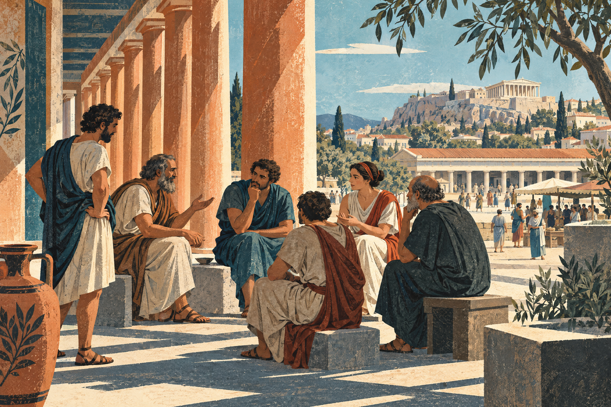
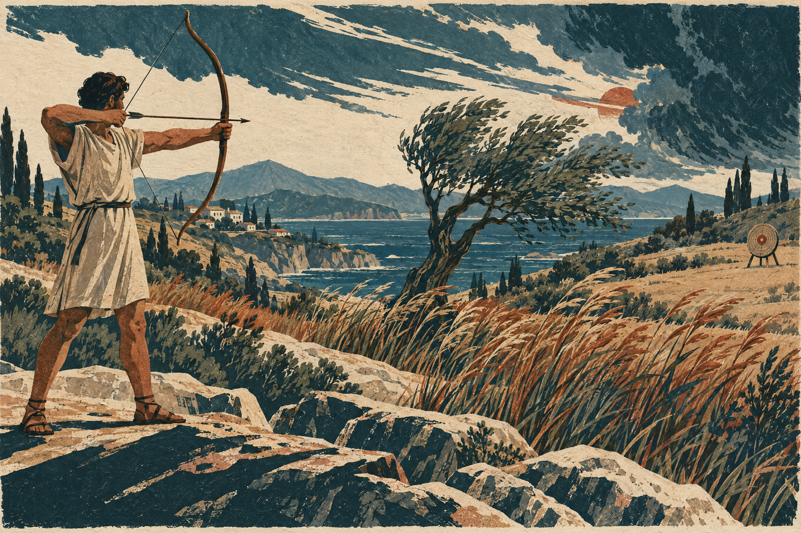

# Стоицизм
## Как действовать достойно в мире, который нам не подчиняется

**Полный иллюстрированный черновик · версия 1 · для чтения и обсуждения**

Стоицизм начинается не с приказа «будь сильным». Он начинается с неудобного вопроса: что останется основанием хорошей жизни, если обстоятельства перестанут нам помогать?

Здоровье может ухудшиться. Продуманное дело — провалиться. Люди, чьё признание нам важно, — не понять нас. Стоики не обещают обезопасить человека от этих событий. Они предлагают перенести центр тяжести: с обладания удачным миром на качество собственного участия в нём.

Но здесь легко ошибиться. Речь не о том, чтобы перестать любить, подавить чувства или молча терпеть несправедливость. Стоический идеал — человек, который старается ясно видеть происходящее, разумно выбирать и справедливо обращаться с другими, даже когда ему страшно и трудно. Спокойствие важно, но оно не выше совести.

*Иллюстрация 1. Философия выходит на городскую площадь. Художественная реконструкция беседы у афинского портика, а не изображение установленного исторического события.*

## 1. Школа под портиком

Около 300 года до нашей эры Зенон из Китиона основал в Афинах философскую школу. Её название связано с Расписной стоей — портиком на городской площади, где собирались и учили первые стоики. Греческое *stoa* и означает портик, крытую колоннаду.

Это был эллинистический мир, возникший после походов Александра Македонского: с большими царствами, движением людей и культур, соперничеством философских школ. Вопрос о хорошей жизни не возник тогда впервые, но получил новые ответы. Стоики, эпикурейцы и скептики по-разному объясняли, чему можно доверять и как жить среди перемен.

Зенона сменил Клеанф. Затем Хрисипп превратил учение в подробно разработанную систему. Во II–I веках до нашей эры важными фигурами стали Панэций и Посидоний; этот этап часто называют Средней Стоей, хотя границы периода условны.

Сегодня стоицизм чаще узнают по авторам римской эпохи. Сенека писал философские письма и трактаты и был советником Нерона. Эпиктет, переживший рабство и получивший свободу, учил философии; его беседы записал ученик Арриан. Марк Аврелий, римский император в 161–180 годах, оставил записи для собственного нравственного упражнения — книгу, известную по-русски как «Наедине с собой» или «Размышления».

Их нельзя читать как трёх одинаковых наставников. Письмо другу, разговор учителя с учениками и личная запись императора решают разные задачи. Кроме того, ни одного полного сочинения первых трёх руководителей школы не сохранилось: раннее учение восстанавливают по фрагментам и свидетельствам, в том числе полемическим. Поэтому популярная подборка афоризмов — ещё не вся Стоя.

Источник: [Stanford Encyclopedia of Philosophy: история школы и сохранность текстов, §§ 1.1–1.3](https://plato.stanford.edu/entries/stoicism/).

## 2. Философия, а не отдельная религия

Стоицизм правильнее представлять как философскую школу и способ жизни, а не как религию с обязательным обращением, единым священным писанием и общей церковной организацией. Но было бы другой ошибкой объявить древних стоиков современными светскими психологами.

В их картине мира присутствовали Бог, Зевс, провидение и разумный порядок космоса. Божественное они связывали с действующим разумным началом самой природы, а не просто с существом, находящимся вне мира. Эти представления были частью объяснения того, почему разумная жизнь должна согласовываться с устройством целого.

Стоическая философия включала три взаимосвязанные области. **Логика** учила рассуждать, разбирать высказывания и проверять основания знания. **Физика** исследовала природу, причинность и устройство мира — в том числе то, что мы сегодня отнесли бы к метафизике и теологии. **Этика** отвечала на вопрос, как жить.

Без логики легко принять впечатление за истину. Без представления о мире трудно понять своё место в нём. Без этики знания не превращаются в достойную жизнь. Так видели эту связь сами стоики; насколько этику можно отделить от их физики, исследователи обсуждают и сегодня.

Современный читатель может заимствовать отдельные практики, не принимая древнюю космологию. Это осмысленная возможность, но её стоит честно называть современной адаптацией, а не полным воспроизведением античной системы.

Источник: [SEP: единство системы и жизнь согласно природе, §§ 1.2, 4.1](https://plato.stanford.edu/entries/stoicism/).

## 3. Главный поворот: что делает жизнь хорошей

Для стоиков безусловное благо — добродетель, а безусловное зло — порок. Это самая радикальная и одновременно самая непривычная часть их учения.

«Добродетель» здесь не означает удобную для окружающих покорность или безупречную репутацию. Речь о совершенстве разумного характера: способности понимать, что следует делать, и последовательно действовать на этом основании. Традиционно выделяют четыре главные добродетели.

**Мудрость** помогает различать действительное благо, зло и то, что само по себе не делает нас лучше или хуже. **Справедливость** направляет отношения с людьми. **Мужество** позволяет не отдавать решение страху. **Умеренность** не даёт желанию присвоить себе всю власть над поступком.

Это не четыре независимых достижения. Храбрость без понимания может оказаться безрассудством. Самодисциплина без справедливости — эффективным обслуживанием жестокости. Стоический идеал требует согласованности характера.

Представим, что человек добился успеха обманом. С точки зрения стоиков, желанный результат не превращает поступок в хороший. Другой человек честно защищал важное дело, но проиграл. Поражение само по себе не делает его нравственно хуже. Однако одного приятного убеждения «я старался» тоже недостаточно: нужно проверить знания, мотивы, средства и качество решения.

Стоическое счастье — *эвдаймония* — поэтому ближе к благополучной, состоявшейся жизни как целому, чем к непрерывно приятному состоянию. Можно чувствовать удовольствие и поступать дурно. Можно испытывать боль и не предавать того, что считаешь правильным.

Идеал мудреца у стоиков чрезвычайно строг. Большинство людей находятся не в состоянии достигнутой мудрости, а в пути к ней. Читать эту философию полезнее как работу над суждениями и поступками, а не как повод выдать себе звание невозмутимого человека.

Источник: [SEP: цель жизни и добродетель, §§ 4.1–4.2](https://plato.stanford.edu/entries/stoicism/).

## 4. Если здоровье «безразлично», зачем лечиться?

В стоическом словаре здоровье, деньги, общественное положение и даже сама жизнь относятся к «безразличному». Слово звучит опасно, если услышать в нём бытовое «мне всё равно».

Стоики имеют в виду другое: эти вещи сами по себе не определяют нравственное качество человека и не составляют безусловного блага. Здоровье можно употребить на помощь людям или на причинение вреда. Богатство не гарантирует справедливости. Болезнь не доказывает испорченности характера.

При этом среди внешних вещей различают предпочтительные и непредпочтительные. При прочих равных разумно выбирать здоровье, достаточные средства, безопасность и дружеские связи, а не болезнь и нужду. Но предпочтение не должно превращаться в разрешение добывать желаемое любой ценой.

Отсюда следует не отказ от заботы, а изменение её основания. Лечиться разумно. Помогать заболевшему разумно. Добиваться безопасных условий труда разумно. Но нельзя заключать, что заболевший человек тем самым прожил нравственно неудачную жизнь.

И всё же древний тезис остаётся жёстким: стоики считали добродетель достаточной для счастья даже при тяжёлых внешних обстоятельствах. Не стоит смягчать его до банального «характер тоже важен». Современный читатель вправе не согласиться, что крайняя боль, утрата или лишения никак не уменьшают человеческого благополучия. Именно здесь проходит одна из серьёзных границ спора со Стоей.

Источник: [Internet Encyclopedia of Philosophy: стоическая этика, внешние вещи и словарь понятий](https://iep.utm.edu/stoicism/).

## 5. Что зависит от нас — и чего эта формула не обещает

«Энхиридион», или «Руководство», Эпиктета начинается с различения того, что в нашей власти, и того, что не в нашей власти. К первому он относит собственные суждения, стремления и выбор; ко второму — тело, имущество, репутацию и общественное положение.

На первый взгляд это странно. Разве мы не можем влиять на здоровье и репутацию? Можем. Но влиять — не значит распоряжаться окончательным результатом. Я могу подготовиться к разговору; я не могу гарантировать чужое согласие. Могу заботиться о теле; не могу сделать его неуязвимым.

Внутренняя работа тоже не является волшебной кнопкой. Человек не всегда мгновенно выбирает, что почувствовать или какая мысль возникнет. Древний идеал власти над суждением не следует превращать в обвинение человека с тревогой, травмой или истощением. Способность замечать и пересматривать оценки развивается и имеет реальные ограничения.

Для повседневного применения удобно различать три вопроса: какой выбор сейчас делаю я; на что могу повлиять; чего не могу гарантировать. Это современная поясняющая рамка, а не дословная трёхчастная схема Эпиктета.

Допустим, вы подали важную заявку. Ваша работа — проверить факты, написать ясно, соблюсти условия и не прибегать к обману. Можно запросить обратную связь и исправить слабые места. Но заставить другого человека выбрать именно вас нельзя. Стоическая практика не отменяет цель; она не позволяет сделать собственную нравственную ценность заложницей чужого решения.

Первоисточник: [Эпиктет, «Энхиридион», §§ 1–5](https://classics.mit.edu/Epictetus/epicench.html). Русское изложение здесь — авторский пересказ, а не цитата из опубликованного перевода.

*Иллюстрация 2. Тщательная подготовка не равна власти над исходом. Образ лучника помогает увидеть различие между качеством действия и удачей; иллюстрация не обещает безошибочности самого действующего.*

## 6. Между впечатлением и согласием

Вы открываете сообщение и видите короткое: «Нужно поговорить». Первое впечатление возникает почти само собой: случилось что-то плохое. Следующий шаг менее заметен: предположение превращается в уверенность — «мной недовольны», «всё испорчено».

Стоиков интересует именно этот переход. Возникшее представление ещё не обязано стать признанной истиной. Можно спросить: что действительно известно? Что я добавил? Достаточно ли оснований, чтобы согласиться с этой оценкой?

Эта работа со «согласием» — не позитивное мышление. Нельзя заменить «всё ужасно» столь же необоснованным «всё прекрасно». Иногда опасность реальна. Иногда с нами действительно обошлись несправедливо. Ясность требует не отрицать факт, а отделять его от лишних выводов.

«Мне отказали» — описание события. «Теперь моя жизнь ничего не стоит» — дополнительная оценка. «Человек нарушил договорённость» — возможный проверяемый факт. «Все люди всегда предают» — обобщение, для которого одного случая недостаточно.

Поэтому стоическая логика не чужда повседневности. Она начинается там, где мы перестаём выдавать силу переживания за доказательство истинности мысли.

Основание: [SEP: стоическая логика и теория познания, § 3](https://plato.stanford.edu/entries/stoicism/); [Эпиктет, «Энхиридион», §§ 1, 5](https://classics.mit.edu/Epictetus/epicench.html).

## 7. Эмоции: не каменное лицо

Бытовое слово «стоический» часто означает человека, который ничего не показывает. Но внешняя сдержанность не доказывает ни мудрости, ни душевного здоровья.

Древние стоики стремились к *апатейе* — свободе от страстей. Это не современная апатия, при которой всё теряет смысл. Страсти в их техническом понимании связаны с ошибочными оценками: например, когда внешняя потеря признаётся безусловным злом, уничтожающим возможность хорошей жизни.

При этом стоическая традиция различает страсти, первые непроизвольные реакции и разумные «благие чувства». Можно вздрогнуть от неожиданного звука. Можно испытывать разумную радость, желать людям добра и проявлять осторожность. Идеал не сводится к эмоциональной пустоте.

Но не следует и полностью модернизировать древних. Их требования строже популярного совета «принимайте любые чувства»: они действительно хотели устранить определённые формы страха, вожделения, наслаждения и душевной скорби, понимаемые как ошибочные движения души. Современному читателю некоторые рассуждения об утрате близких могут показаться суровыми — и это не просто недоразумение перевода.

Практическая граница особенно важна: нельзя говорить горюющему или пострадавшему, что его беда существует только в голове. Реальны и утрата, и причинённый вред, и нужда в поддержке. Вопрос о собственных оценках не отменяет ответственности причинителя вреда. Полезная современная адаптация помогает человеку обрести пространство для действия, а не стыдит его за боль.

Источник: [IEP: апатейя и стоическое понимание эмоций, § 4](https://iep.utm.edu/stoicism/).

## 8. Судьба не освобождает от действия

Древние стоики представляли космос причинно упорядоченным. Отсюда возникает возражение: если происходящее определяется судьбой, зачем стараться?

Стоический ответ состоит не в отрицании причинности, а в том, что наши рассуждения, решения и действия сами входят в неё. Обращение к врачу может быть условием выздоровления. Подготовка — условием хорошего выступления. Отказ действовать тоже имеет последствия.

В истории философии такую попытку совместить причинную обусловленность с ответственностью называют совместимостью детерминизма и ответственности. Это сложная и спорная позиция, а не доказательство, что проблема свободы воли окончательно решена.

«Жить согласно природе» у стоиков также не означает следовать любому импульсу: раз я злюсь, значит, грубость естественна и потому правильна. Человеческую природу они понимали как разумную и общественную; её развитие должно вести к осмысленному, согласованному действию.

Принять уже случившееся — значит признать реальность отправной точки. Это не значит одобрить поступок обидчика, отказаться от суда или перестать исправлять устройство жизни. Можно не питать ненависть и требовать ответственности. Можно признать болезнь и искать лечение. Можно не гарантировать победу и всё-таки защищать другого.

Наконец, древняя вера в провидение не обязывает современного читателя объявлять каждую катастрофу «подарком вселенной». Утверждать, что мы понимаем благой смысл чужой трагедии, — совсем не то же самое, что учиться разумно действовать после неё.

Источник: [SEP: стоическая физика, причинность и этика](https://plato.stanford.edu/entries/stoicism/).

## 9. Не крепость одиночки, а общий мир

Если сохранить из стоицизма только внутреннюю невозмутимость, получится философия, которая слишком легко служит равнодушию. Но справедливость для стоиков — не необязательное дополнение к личной устойчивости.

Важное понятие здесь — *ойкейосис*. Его трудно передать одним словом; в данном контексте оно помогает описать развитие признания чего-то своим, близким, требующим заботы. Стоическая мысль связывает заботу о себе с расширением внимания к другим людям. В традиции Гиерокла этот смысл выражает образ кругов близости: от себя и семьи к более широкому человеческому сообществу.

Космополитизм Стои — представление о людях как участниках общего мирового сообщества — позволяет спросить не только «что выгодно мне», но и «что справедливо по отношению к другим». У Марка Аврелия работа над раздражением постоянно соседствует с напоминанием о нашей общественной природе.

Это не стирает исторических противоречий. Стоики жили в обществах с рабством, неравноправием и имперским насилием. Из универсального разума они не вывели общей программы современных прав человека. Биографии Сенеки и Марка Аврелия также нельзя превращать в жития безупречных людей. Между философским идеалом и политической практикой остаётся расстояние.

Для сегодняшнего читателя этот раздел можно проверить простым вопросом: делает ли моя «стойкость» меня надёжнее для других — или только позволяет дольше не замечать их нужды?

Источники: [SEP: Марк Аврелий, справедливость и космополис, § 3](https://plato.stanford.edu/entries/marcus-aurelius/); [IEP: ойкейосис и космополитизм](https://iep.utm.edu/stoicism/).

*Иллюстрация 3. Устойчивость становится этической, когда помогает участвовать в общем деле. Современная интерпретация стоического мотива общественности, не античная историческая сцена.*

## 10. Практика без культа суровости

Ниже — современные упражнения, опирающиеся на стоические темы. Это не перевод древнего распорядка и не обещание лечебного эффекта. Их цель — внимательнее выбирать, а не постоянно оценивать себя по шкале «достаточно ли я стоик».

### Перед трудным делом

Назовите задачу и добавьте к внешней цели требование к способу действия. Не только «добиться согласия», но и «изложить основания ясно, выслушать возражение, не унизить собеседника». Заранее допустите обычные помехи: задержку, непонимание, усталость. У Эпиктета подобный приём показан на примере посещения общественной бани, где возможны толчки, шум и кражи: важно помнить не только о купании, но и о собственном поведении.

### Когда захватывает оценка

Запишите одной строкой событие, второй — свою интерпретацию, третьей — возможный следующий шаг. Например: «ответа пока нет»; «я решил, что меня игнорируют»; «уточню срок и вернусь к своей работе». Если факты указывают на опасность, следующим шагом должна стать защита, а не тренировка терпения.

### При столкновении желаний

Спросите себя, какую цену придётся заплатить не деньгами, а характером. Потребуется ли солгать? Использовать зависимость другого? Скрыть существенный риск? Самообладание здесь означает не способность терпеть всё больше, а способность отказаться от дурного средства ради заманчивого результата.

### После дня

Выберите один эпизод: где я поспешил с выводом, где действовал справедливо, что можно исправить? Завершите конкретным действием — уточнить факт, извиниться, вернуть обещанное. Дневник полезен не количеством самообвинений, а переходом от наблюдения к исправлению.

### При напоминании о конечности

Не нужно подробно воображать гибель близких, чтобы помнить о хрупкости жизни. Можно спросить мягче: что я откладываю, как будто время гарантировано? Кому стоит уделить внимание сейчас? Если размышление о потерях усиливает тревогу, его разумно прекратить. Философская практика не заменяет медицинской и психологической помощи.

Опора для первого упражнения: [Эпиктет, «Энхиридион», § 4](https://classics.mit.edu/Epictetus/epicench.html). О личных записях как нравственном упражнении: [SEP о Марке Аврелии, § 1.1](https://plato.stanford.edu/entries/marcus-aurelius/).

## 11. Один пример целиком

Представим, что партнёр по проекту сорвал договорённость и публично возложил ответственность на вас.

Нестоическая карикатура предлагает либо взорваться, либо «ничего не чувствовать». Более серьёзная работа начинается иначе. Сначала следует признать факт переживания: вы злитесь и тревожитесь. Само появление реакции не требует немедленного поступка.

Затем надо выяснить, что можно подтвердить: содержание договорённости, сроки, переписку, реальный ущерб. Важно отделить это от догадок о намерениях и от катастрофического вывода, будто один конфликт определяет всю вашу жизнь.

После этого возникает этический выбор. Мужество может потребовать выступить с возражением. Справедливость — не приписывать человеку того, чего он не делал. Умеренность — не устраивать травлю. Мудрость — выбрать подходящий канал и признать собственную долю ошибки, если она есть.

Практический результат может включать письменное уточнение фактов, пересмотр обязанностей, прекращение сотрудничества или обращение за юридической помощью. Ни один из этих шагов не противоречит отказу от ненависти. И ни один не гарантирует немедленного восстановления репутации.

Стоический вопрос в конце звучит не «получилось ли мне не переживать», а «насколько разумно и справедливо я распорядился тем, что мог сделать». Этот пример — авторская современная иллюстрация, не случай из древнего текста.

## 12. Что стоит оставить открытым

Стоицизм предлагает сильную опору: не смешивать нравственное достоинство с удачей, не спешить соглашаться с впечатлением, не отдавать поступок страху и помнить о других людях. Но ценность этих идей не обязывает принять каждый древний тезис.

Можно спорить, достаточно ли добродетели для счастья в условиях крайнего страдания. Можно сомневаться, что разумный провиденциальный порядок действительно существует. Можно считать древний идеал освобождения от скорби чрезмерно суровым. И нужно замечать случаи, когда призыв к внутренней свободе подменяет изменение несправедливых условий.

Критическое чтение не разрушает знакомство со Стоей. Оно делает его философским: мы не просто повторяем авторитетную фразу, а выясняем её основания, последствия и пределы.

Стоицизм не обещает, что мир перестанет причинять боль. Его наиболее плодотворное предложение скромнее и труднее: не предоставлять боли, выгоде или чужому признанию единолично решать, каким человеком мы будем в следующем поступке.

## С чего начать чтение

**Эпиктет, «Энхиридион».** Короткий вход в различение своего и несвоего. Начните с §§ 1, 4 и 5, но не превращайте отдельные жёсткие формулы в универсальный совет человеку в беде. [Открытый английский текст](https://classics.mit.edu/Epictetus/epicench.html).

**Марк Аврелий, «Наедине с собой».** Читать небольшими фрагментами, помня, что это личные напоминания, а не последовательный учебник. [Академическое введение в книгу и её жанр](https://plato.stanford.edu/entries/marcus-aurelius/).

**Сенека, «Нравственные письма к Луцилию».** Следующий шаг для знакомства с философией в форме разговора о жизни. Обзор Стои помогает увидеть, где личный голос автора принадлежит более широкой традиции.

**Для общей карты:** [Stanford Encyclopedia of Philosophy — Stoicism](https://plato.stanford.edu/entries/stoicism/) и [Internet Encyclopedia of Philosophy — Stoicism](https://iep.utm.edu/stoicism/). Это более подробные справочные статьи, а не обязательная подготовка к первому чтению.

---

*Об этой версии. Это самостоятельный авторский путеводитель, не перевод и не критическое издание древних сочинений. Современные примеры и упражнения обозначены как адаптации. Три иллюстрации созданы заново специально для этого черновика с помощью генеративной графики; они не являются историческими свидетельствами. Версия предназначена для полного предварительного просмотра. Одобрение публикации этой версии не получено; в GitHub она не загружена.*
