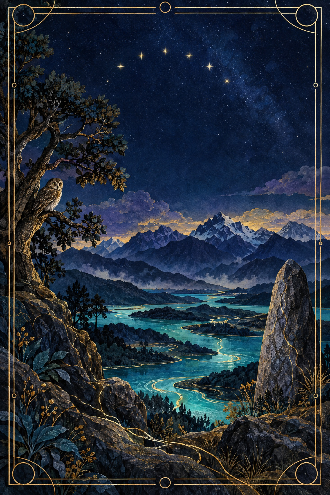
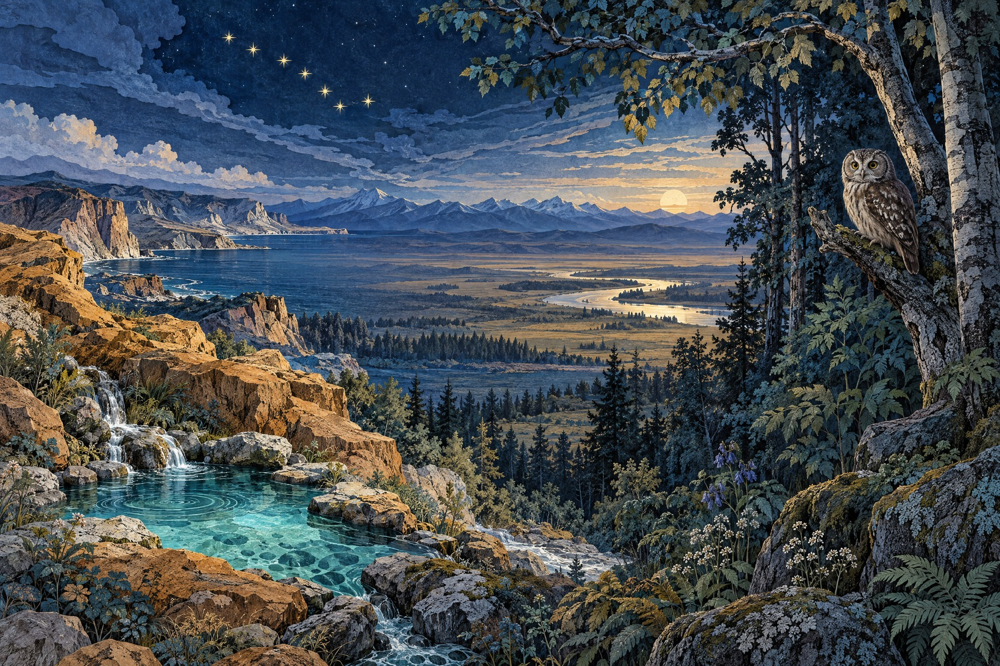
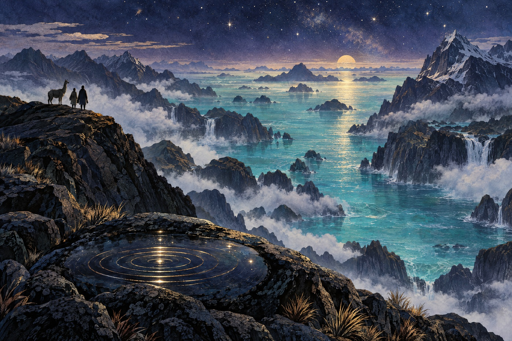
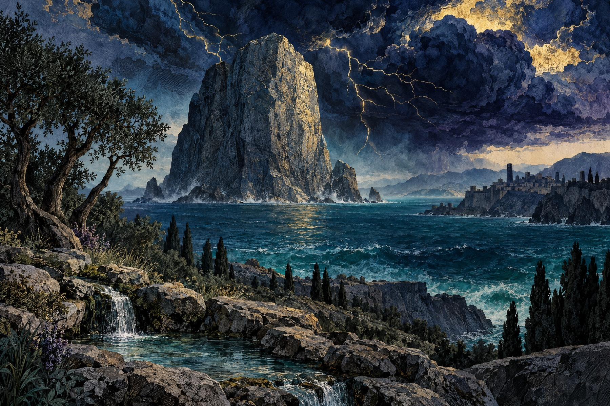
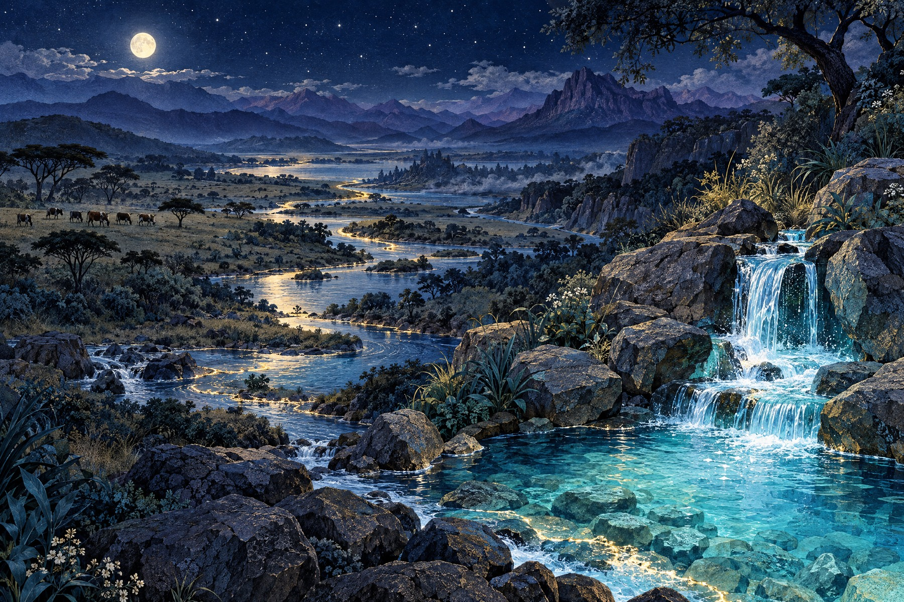

# Предания народов мира

## Том III. Память земли и света

**24 истории и очерка о том, как передают мир**

Полный иллюстрированный редакционный черновик. Для чтения и обсуждения; не опубликован.

## Не всё становится сказкой

В первых двух томах было пятьдесят два сюжета. Эта книга продолжает собрание, но меняет угол зрения: нас интересует не только то, что рассказано, но и то, как рассказ дошёл до читателя. Голос певца, пиктографическая рукопись, табличка с обломанным краем, музейный рассказ, песня, исполненная в общине, сохраняют прошлое по-разному.

Здесь можно встретить ламу, которая раньше человека узнаёт о надвигающейся воде, и каменного противника бога грозы. Но рядом с ними будут главы без обычной сказочной развязки. Олонхо нельзя свести к одному приключению, а маланган — заменить выдуманной легендой. Если источник рассказывает о способе помнить, книга тоже должна говорить о памяти, а не притворяться древним сказителем.

Поэтому в томе два ясно обозначенных жанра. **Пересказ** передаёт ход конкретного опубликованного повествования своими словами. Он не является дословным переводом. **Очерк** знакомит с традицией, её свидетельствами и передачей; он не выдаётся за рассказ носителя. Там, где знание неполно, мы оставляем пробел видимым.

Двадцать четыре главы — не двадцать четыре независимых религии и не полная карта мира. Три соседних андских рассказа взяты из одного корпуса Уарочири: так лучше видно, как местные сюжеты разговаривают друг с другом. В других разделах рядом оказываются разные способы связывать землю, воду, город и общину. Такое соседство — редакционная композиция, а не утверждение об общем происхождении традиций.

## Чей голос мы слышим

После каждой главы помещён небольшой раздел «Версия, передача и границы». Он объясняет, какая именно запись или публикация лежит перед нами, кто участвовал в её передаче и чего источник не позволяет утверждать. Ссылки ведут к текстам, музейным материалам и научным справочникам. Современное описание традиции не подменяет её собственную речь; старое внешнее свидетельство не становится беспристрастным только потому, что оно древнее.

Особенно осторожно мы обращаемся с живыми религиями и знаниями коренных народов. Открытая музейная публикация позволяет обсудить опубликованное, но не даёт права восстанавливать закрытые обряды, воспроизводить чужие права на изображения или объявлять одну версию обязательной для всех. Мы не добавляли тайных подробностей ради занимательности.

Сюжеты первых двух томов исключены по их оглавлениям. Совпадающие мотивы — вода, птица, свет, испытание — сами по себе не делают два рассказа одним и тем же. Но они также не доказывают единой мировой религии: сходство стоит заметить, а вывод о родстве требует отдельных свидетельств.

## Об изображениях

Для этого тома созданы пять новых иллюстраций. Они соединяют акварельную фактуру, гравюрную линию и современную цифровую живопись; глубокий индиго соседствует с бирюзой, фиолетовым и золотом. Это символические редакционные композиции, созданные с помощью генеративной модели, а не фотографии, этнографические реконструкции или традиционные изображения носителей культуры. Они не воспроизводят закрытые знаки и не служат источником сведений об обрядах, одежде или облике божеств.

Читать книгу можно подряд, следуя от земли к воде, камню и свету. Можно начать с отдельного рассказа. В обоих случаях полезно задержаться у его источника: иногда путь текста оказывается не менее важным, чем путь героя.

## Содержание

**I. Земля, которая помнит**

- [1. Джанкаву](#chapter-1)
- [2. Семь сестёр](#chapter-2)
- [3. Серебряные капли](#chapter-3)
- [4. Анналы сотворения](#chapter-4)
- [5. Голос олонхосута](#chapter-5)
- [6. Урал-батыр и живая вода](#chapter-6)

**II. Вода, которая меняет мир**

- [7. Уарочири: Кунирайя и Кавильяка](#chapter-7)
- [8. Уарочири: лама предупреждает о потопе](#chapter-8)
- [9. Уарочири: рождение Париакаки](#chapter-9)
- [10. Небесная женщина](#chapter-10)
- [11. Дине: переход миров](#chapter-11)
- [12. Маланган северной Новой Ирландии](#chapter-12)

**III. Камень, гром и город**

- [13. Иллуянка](#chapter-13)
- [14. Улликумми](#chapter-14)
- [15. Угарит: дворец Ваала](#chapter-15)
- [16. Нума и Эгерия](#chapter-16)
- [17. Святовит и Аркона](#chapter-17)
- [18. Латышские дайны и Солнце](#chapter-18)

**IV. Свет, который передают**

- [19. Энгаи и происхождение скота — масаи](#chapter-19)
- [20. Память, лва и община — гаитянское воду](#chapter-20)
- [21. Как живут патаки — лукуми](#chapter-21)
- [22. Тонпа Шенраб и предание бон](#chapter-22)
- [23. Свет и Тьма — манихейский рассказ](#chapter-23)
- [24. Живая вода и мир Света — мандейство](#chapter-24)

# I. Земля, которая помнит

## 1. Джанкаву

*Йолнгу, северо-восток Арнемленда · Пересказ*

Из земли духов Бурралку вышли брат и две сестры — Джанкаву. Они увидели на горизонте грозовую тучу и решили плыть к ней через море. В долблёном каноэ лежали священные предметы, а весло Мавалан отбивало воду. Ночь настигла путников в пути. Каждый удар весла поднимал пресную воду, хотя море вокруг оставалось солёным: так дорога уже становилась будущей землёй.

Путники замечали всё, что двигалось в море, и пели об этом: рыбах, китах, осьминогах, морских птицах. Из конической циновки выходили вещи и существа, которым предстояло занять своё место. Утренние звёзды одна за другой приблизились к Ялангбаре. Они показали берег до восхода солнца, и первый луч осветил песчаные дюны Балма.

У трёх каменных островов — Вулпинбуй, Гаррангарранбуй и Бавули — странники услышали гул воды и увидели лори, вылетавших из каменных углублений. Дальше им встретился Громовник Джамбуал. Путь пролёг мимо острова Га’кубавуй, Валинины и Билапины к берегу Бипинины. Приближаясь, они бросали на воду нарукавные и головные украшения.

В музейном публичном изложении путь продолжается по Ялангбаре с востока на запад. Предметы делаются местностью: перья становятся грядами песка, циновка — островом, палочки — скалами, а воткнутые в землю копья прорастают деревьями и источниками. Джанкаву называют животных и растения, рождают людей и устанавливают связи кланов с местами. Так происхождение не отделяется от обязанностей перед страной.

У берега они встречают следы чужого присутствия: в музейном изложении это люди, занятые обработкой трепанга. Джанкаву различают собственную землю и землю другой половины общества (moiety — одна из двух половин общества) и направляют пришельцев туда, где им положено быть. В таком эпизоде карта оказывается одновременно родословной и законом. Она не обещает всякому слушателю свободный доступ к каждому месту: право рассказывать и право входить зависят от принадлежности и передачи.

Путешествие тем самым остаётся живым отношением, а не далёким началом времён.
Его карта складывается из памяти, движения и права называть место.

### Версия, передача и границы

Здесь использована публичная версия Ваньюби Марики, опубликованная [Kluge-Ruhe](https://madayin.kluge-ruhe.org/experience/pieces/djankawu-wanarr-dhawu-1-djankawu-creation-story-1/), и музейный очерк [National Museum of Australia](https://www.nma.gov.au/exhibitions/yalangbara/djangkawu-ancestors). Рассказ связан с живописной серией Мавалана Марики 1959 года и наследием клана Рирратджингу. Участок Балма обозначен музеем как закрытый; закрытые церемониальные сведения здесь не пересказываются.

## 2. Семь сестёр

*анангу, марту и нгаанъятъярра, пустыни Австралии · Очерк*

Семь сестёр — Минйипуру, также Кунгкарангкалпа, — идут через огромную страну, а за ними следует Юрла, или Вати Ниру, мужское существо-предок. В публичном музейном рассказе это не камерная сказка о далёких звёздах, а путь по земле: песня отмечает воду, скалы, растения, стоянки и переходы. Погоня служит нитью, на которую нанизано знание местности.

Сёстры движутся не одинаково. Старшая, Кампукурта, задаёт направление, а остальные сохраняют собственные голоса и отношения. В одних произведениях они мелькают среди охотничьего ландшафта, в других собираются у определённого места. Преследователь не превращается в романтического героя: его настойчивость — угроза, от которой сёстры уходят, предупреждая друг друга и используя особенности страны.

На полотне «Охотничьи угодья» сестры — лишь один слой огромной карты. Рядом читаются знания о сезонах, огне, животных, постоянной воде и временных водоёмах. В другой работе три сестры начинают изображение после возвращения на Пангкал — место, связанное с их жизнью в пустыне до контакта с белыми людьми. Масштаб картины показывает не «декорацию мифа», а страну как действующего носителя памяти.

Музейная форма важна и потому, что позволяет услышать несколько общин, а не одного внешнего рассказчика. Художники показывают собственные участки пути, а кураторы объясняют варианты написаний и названий. Посетителю предлагается не разгадка, а ответственное следование маршруту: узнать, чья земля изображена, кто имеет право говорить о ней и какие знания остаются за пределами выставочного зала.

Так семь сестёр остаются одновременно небесным образом и картой человеческой ответственности.
Погоня не отменяет различий между голосами тех, кто хранит маршрут.

Рассказ существует в песне, танце, изображении и маршруте. Слово inma обозначает церемоническую песню и танец, а Jukurrpa — не просто «сон», но систему отношений предков, людей и мест. Поэтому музей не предлагает одну окончательную фабулу. Он показывает, как разные общины ведут посетителя по своим участкам общей линии, сохраняя различия названий и ответственности.

### Версия, передача и границы

Глава основана на созданной под руководством аборигенных носителей знаний выставке [Songlines: Tracking the Seven Sisters](https://digital-classroom.nma.gov.au/songlines-tracking-seven-sisters), которую направляли носители знаний от марту, APY (земли и общины анангу Питджантджатжара Янкунтжатжара) и нгаанъятъярра. Это публичный музейный очерк, не перевод тайной песни. Варианты земель не сведены в универсальную «австралийскую легенду», а закрытые церемониальные детали не реконструируются.

## 3. Серебряные капли

*Айны, Хоккайдо · Пересказ*

Сова говорит о себе сама: она — камуй, покровитель деревни, и летит над селением, распевая о серебряных и золотых каплях. У берега дети стреляют в прекрасную птицу. Богатые дети промахиваются, а бедный мальчик принимает простую стрелу; сова сама подставляет лапу. Когда она падает, мальчик защищает её от насмешек и побоев, добегает до маленького дома и вносит птицу через почётное окно.

Из дома выходят старик и старуха. Они бедны, но сова видит в них знаки прежнего достоинства: когда-то они были хозяевами, а теперь обнищали. Старик благодарит камуй и обещает наутро проводить её с инау; сова остаётся на ночь. В полночь она снова поёт о серебряных и золотых каплях. Вокруг неё рассыпаются сокровища, и маленький дом быстро становится большим золотым домом: появляется алтарь, богатая одежда и убранство.

Затем сова внушает семье сон о причине своего дара: она пожалела человека, которого прежние бедняки, разбогатев, унижали, и потому поселилась в человеческом доме. Утром семья видит, что сон стал явью. Старик вырезает и украшает инау, старуха готовит дрова, воду и вино; через два дня для камуй устраивают пир с шестью чанами вина. Мальчик приглашает всю деревню, в том числе тех, кто прежде смеялся над его семьёй.

Увидев изменившийся дом, приглашённые смущаются. Старик говорит, что камуй пожалела их, а они никогда не желали другим зла; он предлагает снова стать друзьями. Люди приносят извинения, затем два-три дня пируют, танцуют и мирятся. После окончания праздника сова прощается с богами огня, дома и очага и возвращается в своё жилище. Там она созывает близких и дальних камуй на собственный пир, рассказывает о посещении человеческой деревни и одаривает гостей инау.

В финале деревня живёт мирно, мальчик вырастает, женится и становится заботливым сыном. В начале каждого пира он посылает сове инау и вино; сова остаётся за людьми, охраняя человеческую землю. Это продолжение конкретной песни «Silver Droplets Fall Fall All Around», а не общая легенда об айнской сове.

### Версия, передача и границы

Это конкретная песня «Silver Droplets Fall Fall All Around» из [Ainu shin’yōshū Юкиэ Тири в переводе Кёко Сэлден](https://apjjf.org/chiri-yukie/3026/article). Русский текст — самостоятельный пересказ доступного английского перевода, а не его копия. Юкиэ Тири записала айнский текст и перевела его на японский после устной передачи от бабушки Монасинуок и приёмной матери Каннари Мацу; статья не распределяет именно эту песню между двумя рассказчицами.

## 4. Анналы сотворения

*Наси, западная Юньнань · Очерк*

У «Анналов сотворения» нет удобного открытого русского пересказа, который позволил бы честно развернуть их в сказку. Поэтому перед нами очерк рукописи. В цифровой записи Библиотеки Конгресса её титул по-английски дан как *Translation of the Entire Text of the “Yao Annals of Creation”*. На страницах рядом стоят цветные знаки письма дунба и китайский текст.

Само устройство книги уже многое говорит о передаче. Знаки дунба записывают диалект западных наси, чья историческая среда связана с долиной реки Ли в Юньнани. Это не иллюстрации к готовой повести, а письменные подсказки корпуса, который традиционно требовал знания жреца дунба. Картинка, знак, ритуальная память и китайское пояснение встречаются на одном листе, но не становятся полностью взаимозаменяемыми.

Каталожное описание сообщает, что рукопись связывает происхождение мира и людей с непрерывными переселениями наси и испытанием предков природой. В центре названы Чаоцзэн Лиэнь, предок народа, и его жена Чэньхун Баобай. В этом же поле находятся восхищение мудростью и героизмом, верная любовь, социальная жизнь, религиозная философия и брачные нормы.

Даже датировка требует осторожности. Библиотека даёт каталожный диапазон, а не рассказ о моменте создания конкретного листа и не доказательство, что весь корпус возник одновременно. Описание также называет книгу героическим эпосом и классикой дунба, но эти слова принадлежат музейной классификации. Они помогают найти жанровый масштаб, однако не заменяют чтения знаков и китайской части страницы.

Такой материал нельзя превращать в гладкую космогонию с придуманными речами. Рукопись одновременно хранит историю, миф, религиозный текст и художественный образ. Её «сюжет» существует в связке изображения и чтения, а не только в последовательности событий, которую можно без потерь извлечь из каталога. Для книжной главы важнее показать эту форму памяти, чем заполнить пробелы красивыми подробностями.

### Версия, передача и границы

Использована цифровая единица [Library of Congress, *Annals of Creation*](https://www.loc.gov/resource/gdcwdl.wdl_03025/?st=brief): неизвестный автор, один двуязычный том, оригинал в Национальной библиотеке Китая; каталог датирует его 900–999 годами. Полного прочитанного сюжета в доступной текстовой расшифровке нет, поэтому это очерк рукописи. Наси и дунба здесь не объявляются неизменной «религией Китая вообще».

## 5. Голос олонхосута

*Саха, Якутия · Очерк*

Олонхо — не название одной книги, которую можно пересказать от начала до конца. Так называют и якутскую эпическую традицию, и её отдельные произведения. В них встречаются богатыри, божества, духи и животные, но цель эпоса не сводится к приключению одного героя. Через древние конфликты он говорит о порядке мира, судьбе народа и испытаниях жизни в суровой стране.

Олонхосут не просто читает стихи. Он чередует пение с речитативным рассказом. Стиховая часть даёт персонажам голос и ритм, прозаическая связывает действия, переходы и объяснения. Исполнитель должен владеть голосом, актёрской сменой ролей, красноречием и импровизацией. Поэтому один и тот же эпический материал живёт не как неподвижная страница, а как событие перед слушателями.

Размеры различны: ЮНЕСКО указывает от десяти до пятнадцати тысяч стихов. Такова не мера «правильного» текста, а диапазон традиции. У каждой общины был свой рассказчик и богатый репертуар, поэтому множество версий циркулировало рядом. Семья передавала исполнение как развлечение и как обучение: слушатель учился не только помнить героев, но и слышать устройство мира, отношения и последствия выбора.

В XX веке политические и технологические перемены ударили по этой передаче. После перестройки интерес к олонхо вырос, но число мастеров оставалось малым, многие были уже стары. Сегодня эпос нельзя отделить от вопроса о голосе: сохранение означает не только печать текста, но и продолжение практики, в которой певец рассказывает, играет и заново собирает длинное произведение для конкретной аудитории.

Отсюда следует и особая роль паузы, тембра и смены регистра. Там, где на бумаге видна строка, слушатель слышит чью-то речь — человеческую, божественную или звериную. Нельзя восстановить отдельное произведение, перечислив только его мотивы. Без исполнителя исчезают темп, напряжение и способность эпоса отвечать на настоящее, которую отмечает описание ЮНЕСКО.

### Версия, передача и границы

Опорен обзор [ЮНЕСКО об олонхо](https://ich.unesco.org/en/RL/olonkho-yakut-heroic-epos-00145); исполнительский контекст дополнен исследованием [В. В. Илларионова](https://www.diu.edu/documents/gialens/Vol7-3/Illarionov_PerformanceTradition.pdf). Конкретный эпос намеренно не выбран: глава описывает устройство жанра и посредника — олонхосута, не выдавая общее описание за единственный записанный сюжет.

## 6. Урал-батыр и живая вода

*Башкиры, Южный Урал · Пересказ*

В записанном варианте, известном как «Урал-батыр», первыми людьми на окружённой водой земле становятся Янбирде и Янбике. У них рождаются Шульган и Урал. Семья не знает болезни и смерти, но старшие считают, что смерть следует приносить живым существам самим. Уже здесь намечается вопрос эпоса: можно ли одолеть смерть и что именно следует назвать бессмертием.

Братья узнают о роднике Яншишма — источнике живой воды. Их дороги расходятся. Шульган тянется к власти и вступает в союз с силами тьмы; Урал ищет воду не ради одной человеческой жизни. В страну входят дэвы, говорящие животные, крылатые кони, птицы и владыки подземного мира. Чудесное здесь не украшение: оно строит трёхчастную вселенную неба, земли и подземно-водного пространства.

Путь Урала проходит через испытания и столкновения. Ему помогают Акбузат и Хумай. Живая вода оказывается не простой наградой богатырю. Достигнув источника, Урал отдаёт её природе и делает бессмертной землю, а не собственное тело. В этом жесте герой отличается от брата: он не присваивает силу, а возвращает её миру, где она поддержит будущих людей и животных.

Конец не отменяет смерти. Старик, обречённый жить вечно, и последние слова самого Урала раскрывают смысл подвига: человек не сохраняется телом навсегда. Его продолжает доброе дело. Поэтому эпос заканчивается не обещанием победить закон природы, а нравственным выбором. Урал становится батыром не потому, что получил воду, а потому, что употребил её для других.

Вода в этой версии не просто волшебный предмет, который герой уносит домой. Она меняет устройство мира, а вместе с ним — масштаб ответственности. Урал действует в пространстве, где колодцы, реки, горы и племена получают память о событиях. Поэтому итоговая победа имеет космологический и общественный смысл: жизнь продолжается не благодаря одному бессмертному телу, а благодаря сохранённому миру.

### Версия, передача и границы

Пересказ опирается на конкретный стихотворно-прозаический вариант, записанный в 1910 году М. А. Бурангуловым от сэсэнов Габита Аргынбаева и Хамита Альмухаметова, и на перевод С. Г. Шафикова в трёхъязычном издании 2003 года, доступном в [Project Suyun](http://suyun.info/index.php?p=uralbatir&LANG=ENG). Сведения о записи и хранении сверены с [Башкирской энциклопедией](http://bashenc.online/en/articles/104706/). Продолжение «Акбузат» и другие варианты сюда не включены.

# II. Вода, которая меняет мир

## 7. Уарочири: Кунирайя и Кавильяка

*Уарочири, западные Анды · Пересказ*

Кавильяка была прекрасной и гордой хуакой. Кунирайя Виракоча хотел стать отцом её ребёнка, но не явился открыто: превратившись в птицу, он положил своё семя в плод лукумы и уронил плод рядом с ней. Кавильяка съела лукуму, не зная о подвохе, и родила сына.

Когда мальчик подрос, Кавильяка созвала могущественных существ и велела ребёнку самому найти отца. Нарядные претенденты собрались вместе, а Кунирайя пришёл в облике оборванца. Мальчик пополз прямо к нему. Кунирайя открыл свою истинную природу, но Кавильяка не приняла такого отца: схватив сына, она побежала к морю у Пачакамак. В погоне Кунирайя расспрашивал животных, одних благословляя за помощь, других проклиная за бесполезный ответ.

У моря Кавильяка и её сын превратились в скалы; эти камни связываются с островами Пачакамак у побережья Перу. Кунирайя продолжил путь, а рассказ сохранил не романтическую историю, а цепь превращений, бегства и отношений между хуакой, человеком, животными и берегом.

### Версия, передача и границы

Пересказ проверен по доступной записи испанского трактата Франсиско де Авилы [*Tratado y relación de los errores…* в Mythos Atlas](https://mythosatlas.com/sources/avila-tratado-huarochiri): там прямо указаны плод лукумы, превращение Кунирайи в птицу, сын Кавильяки и превращение обоих в камень у Пачакамак. Для научного корпуса и колониального контекста см. [*The Huarochirí Manuscript* Саломона и Уриосте](https://utpress.utexas.edu/9780292730533/). Я не выдаю этот краткий доступный пересказ за непрочитанный полный перевод Саломона/Уриосте.

## 8. Уарочири: лама предупреждает о потопе

*Уарочири, западные Анды · Пересказ*

Хозяин заметил, что его лама перестала есть и стояла, понурив голову. Он рассердился: животное должно было пастись, а не печалиться. Но лама знала больше человека. Она сказала, что океан вот-вот поднимется и через пять дней покроет землю. Спастись можно лишь на Вилька-Кото — горе, вершина которой выше будущей воды.

Человек не стал спорить. Он взял с собой запас пищи и повёл ламу к горе. Когда они добрались, вершина уже была тесна от животных. Там оказались те, кому обычно не приписывают пророческого дара: звери и птицы, словно весь живой мир заранее получил одно и то же предупреждение. Вскоре вода хлынула и поднялась до склонов. Пять дней она держала землю под собой, а затем отступила к обычному океанскому уровню.

После бедствия мир не вернулся к прежнему виду. Лиса, промокшая в воде, вышла с потемневшим хвостом — так рассказ объясняет её чёрную окраску. Человек снова стал умножаться, и человеческая жизнь продолжилась от маленького убежища на горе. Спасение здесь не похоже на победу над природой: человек выживает потому, что услышал животное, а животное — потому, что его знание было принято всерьёз.

Вилька-Кото остаётся не отвлечённой «горой спасения», а узнаваемой частью ландшафта Уарочири. Поэтому потоп одновременно космический и местный: он объясняет происхождение людей, поведение лисы и память о горе, которую можно увидеть. Вода стирает старый порядок, но оставляет следы, по которым новый мир можно прочесть.

### Версия, передача и границы

Сюжет передан по публичному изложению Марка Айзака [The Flood in World Myth and Folklore](https://www.curioustaxonomy.net/home/FloodMyths/25SAAn/quechua.html), где указаны страницы научного перевода Саломона и Уриосте (1991); контекст рукописи проверен по [Fordham Vistas](https://vistas.ace.fordham.edu/themes/pre-columbian-texts/primordial-flood/history-visual-culture/). Это не свободная полная публикация перевода: детали переданы без дословных цитат. Колониальная запись могла вступать в диалог с библейским рассказом о потопе.

## 9. Уарочири: рождение Париакаки

*Уарочири, западные Анды · Пересказ*

Париакака не появляется на свет обычным младенцем: он выходит из пяти соколиных яиц. Затем пять соколов становятся людьми, и из этого человеческого облика возникает сила Париакаки — божества дождя и грозы.

Когда Париакака узнаёт о Тамта Намке, человеке, который называл себя богом и требовал поклонения, он отвечает ему не речью и не состязанием, а водой: поднимается дождь. Париакака отвечает ему не речью и не состязанием, а водой: он поднимается как дождь.

Дождь превращается в силу, способную смыть дома, людей и лам. Поток несёт всё к океану. Даже дерево Пульяо, образовавшее арку между горами Льянтапа и Вичока, не становится надёжным убежищем: жившие в нём обезьяны, туканы и другие птицы также оказываются захвачены стихией. Мир, который считал себя устойчивым, раскрывается как склон перед грозовым небом.

В этом эпизоде Париакака — не просто победитель чудовища и не герой с человеческой биографией. Его рождение из яиц и действие дождём соединяют происхождение и подвиг: он приносит с собой именно ту силу, из которой складывается его имя в мире рассказа. Потоп не даёт зрелища мести; он устанавливает границу между самозваным богом и властью, которая действительно меняет землю.

### Версия, передача и границы

Выбран конкретный эпизод рождения и первого уничтожения Тамта Намки по публичному пересказу с библиографической ссылкой на Salomon & Urioste, 1991, pp. 59–60: [CuriousTaxonomy](https://www.curioustaxonomy.net/home/FloodMyths/25SAAn/quechua.html). Научный корпус — перевод с кечуа Фрэнка Саломона и Джорджа Л. Уриосте, издатель University of Texas Press; описание передачи и колониального контекста см. [здесь](https://utpress.utexas.edu/9780292730533/). Полный свободный текст главы не найден, поэтому это не цитата и не попытка выдать поздний пересказ за единственную версию.

## 10. Небесная женщина

*Онайда, Хауденоса́уни · Пересказ*

В начале под землёй не было суши — только вода, птицы и водные животные. Высоко над ними лежал Небесный мир. В его центре росло огромное дерево, чьи плоды давали свет. Однажды женщина упала через отверстие, оставшееся после того, как дерево вырвали с корнем. Птицы увидели свет её тела и поняли: внизу ей негде будет стоять.

Животные стали искать землю. Бобр нырнул первым, затем гагара и другие существа; один за другим они возвращались без добычи. Наконец ондатра исчезла в воде надолго и всплыла мёртвой, с крошечным комком земли в сжатых лапках. Животные положили землю на спину большой черепахи. Земля начала расти, и на ней появилась Северная Америка — остров, который в этой версии создаётся не одиночеством героя, а совместным усилием многих тел.

Лебеди подняли женщину на крыльях и перенесли на новую землю. Она родила близнецов. Один из них стал Добрым духом, другой, появившийся мучительно и причинивший смерть матери, — злым. Добрый дух повесил голову женщины в небе: она стала солнцем; из других частей возникли луна и звёзды. То, что было погребено, осталось в земле как источник пищи.

Два брата продолжили работу, но всякое созидание встречало искажение. Прямые деревья сменялись корявыми, съедобные плоды — ядовитыми, чистые ручьи — опасными потоками. В конце Добрый дух победил брата и изгнал его под землю, однако зло не исчезло: оно осталось в мире и в каждом человеческом сердце. Поэтому рассказ не обещает безупречного человека. Он объясняет смешение пользы и вреда как древнее устройство самой земли.

### Версия, передача и границы

Использована публичная версия [Oneida Indian Nation](https://www.oneidaindiannation.com/the-haudenosaunee-creation-story), рассказанная Келлером Джорджем, членом Волчьего клана Совета Нации; он указывает, что услышал её от прабабушки по материнской линии. Это именно она, а не другая версия [Oneida Nation](https://oneida-nsn.gov/our-ways/creation-story/), где иначе рассказаны дерево, рождение и имена близнецов. Текст не объединяет варианты и не представляет одну передачу как универсальную для всех Хауденоса́уни.

## 11. Дине: переход миров

*Дине / навахо, юго-запад Северной Америки · Пересказ*

В записи Вашингтона Мэтьюза Первый мир окружён темнотой и океанами по четырём сторонам. В его середине поднимаются цвета рассвета и дня: белый на востоке, синий на юге, жёлтый на западе, тёмный на севере. Здесь живут первые существа — среди них насекомые, которых рассказ называет народами. У мира есть порядок, но его обитатели нарушают его ссорами и проступками.

Четыре владыки сторон перестают принимать их. После очередного разлада вода окружает землю и становится непроходимой. Люди поднимаются кругами к небу. Там Голубой, принадлежащий народу ласточек, показывает отверстие на востоке. Через него они выходят во Второй мир — синий, пустой и почти лишённый пищи.

Разведчиками становятся саранча и белая саранча. Они идут на восток, юг, запад и север и всякий раз возвращаются с одной вестью: край мира — обрыв, за которым нет растений, зверей и гор. Ласточки знали это с самого начала, но пришельцы должны были сами пройти расстояние и убедиться. Встретившись, оба народа признают сходство и начинают обращаться друг к другу как родные.

Так переход не выглядит простой лестницей к «лучшему месту». Первый мир заканчивается из-за нарушения отношений, а Второй сначала оказывается бесплодным. Выход возможен благодаря воде, насекомым, птицам и знанию направления. Миры соединены не только дверью, но и обязанностью научиться жить с теми, кто уже населяет следующий уровень.

Цвета здесь не декоративны: они организуют время и стороны света. Белое, синее, жёлтое и тёмное сменяют друг друга, пока вода не замыкает круг. Поэтому переход — это не только движение вверх, но и повторное обучение пространству, где каждый край имеет собственный народ и собственный голос.

Материал Мэтьюза подробно перечисляет названия мест и существ; в русском пересказе сохранён общий ход перехода, но не перегружены топонимические списки. Это позволяет услышать не каталог, а ритм странствия.

### Версия, передача и границы

Выбран конкретный публичный текст [The Story of the Emergence from Navajo Legends](https://open.maricopa.edu/worldmythologyvolume1godsandcreation/chapter/the-story-of-the-emergence-from-navajo-legends/), опубликованный в *Navajo Legends* Вашингтона Мэтьюза (1897) и размещённый Maricopa Open Educational Resources. Это историческая англоязычная запись, а не «официальная версия» Diné Bahaneʼ: публичные передачи различаются, а часть знаний может иметь церемониальные ограничения. Поэтому здесь пересказаны только открытые эпизоды именно этого текста, без смешения с поздними популярными схемами четырёх или пяти миров.

## 12. Маланган северной Новой Ирландии

*Северная Новая Ирландия, Папуа — Новая Гвинея · Очерк*

Маланган — не миф о начале мира и не единая повесть с героями. Так называют комплекс посмертных церемоний и связанные с ними резные и расписные формы на севере Новой Ирландии. Похороны и траур проходят раньше; затем община готовит финальную церемонию, иногда месяцами или годами. Нужны пиры, свиньи, раковинные деньги, танцы и работа специально приглашённых резчиков.

В кульминации изготовленные фигуры, маски, столбы и доски выставляют во временной ограде или доме показа. Каждая форма связана с определённым умершим и одновременно с предками, клановым тотемом и живыми родственниками. Это не портрет в европейском смысле: образ представляет жизненную силу или душу, а человеческие и животные элементы соединяют биографию с правами и отношениями клана.

Образы могут включать рыб, птиц и духовных существ. В музейном примере человеческая фигура окружена летучими рыбами; каждый элемент отсылает к особому проявлению силы, поддерживающей клан. В другой резьбе у основания показан каменный окунь, меняющий пол с возрастом: природная особенность становится ключом к мифу о происхождении социальной группы. Такие изображения не иллюстрируют один текст — они работают внутри обряда, памяти и права на форму.

После завершения церемонии умерший считается отправленным в мир предков, а живые освобождаются от обязательств перед ним. Маланган мог быть сожжён, оставлен гнить или продан внешнему человеку; сохранялись главным образом маски и инструменты для будущих обрядов. Право на определённый образ и сопровождающие его действия напоминает авторское право, но здесь оно связано со статусом, наследованием и ответственностью.

Отсюда следует особый взгляд на музейный предмет. Резьба, выставленная за стеклом, когда-то была частью временного действия, а не самостоятельной «вещью искусства». Её сложность хранит не только мастерство резчика, но и сеть обязательств: кто имеет право заказать форму, кто участвует в пире, кого она представляет и когда её присутствие должно закончиться.

### Версия, передача и границы

Очерк основан на музейных описаниях [Metropolitan Museum of Art](https://www.metmuseum.org/essays/new-ireland), [карточке погребальной резьбы](https://www.metmuseum.org/art/collection/search/319853), [Australian Museum](https://australian.museum/about/history/exhibitions/death-the-last-taboo/burial-malagan-ceremony-new-ireland/) и обзоре [Smarthistory/British Museum](https://smarthistory.org/malangan/). Они описывают региональную практику, музейные предметы и публичные сведения, а не рассказ конкретного современного носителя. Маланган неоднороден по языкам и кланам; поэтому здесь нет вымышленного «сюжета маланган» и не раскрываются непубличные церемониальные знания.

# III. Камень, гром и город

## 13. Иллуянка

*Анатолийская хеттская традиция · Пересказ*

Пуруллийский праздник Нерика хранит не один рассказ о поединке бога Грозы со змеем Иллуянкой, а два. Сам текст помещает их рядом. Поэтому здесь они не сливаются в «единую версию»: различие между ними — часть самого свидетельства. [Mythos Atlas, пересказ CTH 321](https://mythosatlas.com/stories/storm-god-and-illuyanka)

В первом рассказе змей побеждает бога в месте Кишкилушша. Бог зовёт на помощь богов, а Инaра действует не силой. Она устраивает пир с вином и другими напитками и находит смертного Хупашию из Зигаратты. Он соглашается помочь, попросив взамен близости с богиней. Инaра наряжается, выманивает Иллуянку из норы, и змей приходит вместе с детьми. Они едят и пьют, пока не могут пролезть обратно. Тогда Хупашия выходит из укрытия и связывает их верёвкой; бог Грозы с богами убивает змея.

Победа не превращает человеческого помощника в героя. Инaра строит для Хупашии дом на утёсе и запрещает смотреть в окно, пока её нет. Через двадцать дней он нарушает запрет и видит жену с детьми. Он просит отпустить его домой — и на этом табличка ломается. Что случилось дальше, источник не сообщает. Наказание или смерть Хупашии — позднее предположение, а не сохранившийся эпизод.

Вторая версия начинается иначе: змей отнимает у бога сердце и глаза. Чтобы вернуть их, бог женится на дочери бедняка; у них рождается сын. Повзрослев, сын женится на дочери Иллуянки. По совету отца он просит у тестя сердце и глаза как свадебный подарок и получает их. Восстановленный бог снова вступает в бой у моря. Сын, оказавшийся рядом со змеем, говорит, что теперь принадлежит его дому, и просит отца не щадить его. Бог убивает и Иллуянку, и собственного сына. Здесь победа оплачена не хитростью пира, а сознательной утратой.

### Версия, передача и границы

Паспорт: CTH 321, хеттская запись анатолийского материала, связанная с Пурулли и культом бога Грозы Нерика; современный перевод и комментарий — [Harry A. Hoffner, *Hittite Myths*](https://books.google.com/books/about/Hittite_Myths_Second_Edition.html?id=YEhEEQAAQBAJ), краткий онлайн-пересказ — [Mythos Atlas](https://mythosatlas.com/stories/storm-god-and-illuyanka). Название Иллуянка означает «змей» или «дракон». Первая версия обрывается после окна Хупашии; две версии не следует исправлять друг другом.

## 14. Улликумми

*Хуррито-хеттская традиция · Пересказ*

Кумарби не смиряется с властью Тешуба, бога бури. Ему нужен противник, которого нельзя победить обычным оружием, — существо из камня. В «Песни об Улликумми» мальчик рождается от Кумарби и скалы, а затем его ставят на плечо древнего великана Упеллури, несущего небо и землю. Каменный ребёнок растёт так быстро, что становится угрозой самому устройству мира. [Güterbock, *The Song of Ullikummi*](https://journeytothewestresearch.com/wp-content/uploads/2020/05/the-story-of-ullikummi.pdf)

Улликумми назван именем, которое связывают с уничтожением города Кумми. Его рост — не просто чудо природы. Он должен достичь неба, вытеснить Тешуба и вернуть старым силам господство. Его замечает бог солнца: каменная масса поднимается от моря: вода доходит чудовищу до пояса, а голова касается небес. Неподвижность здесь страшнее ярости: враг не вступает в спор, а одной величиной меняет границу между уровнями мира. Его рождение заранее задумано как оружие против царского порядка, а не как самостоятельное природное чудо. Так подчёркнут замысел Кумарби.

Боги пытаются понять, что делать. Иштар хочет приблизиться к исполину, но песня не превращает её попытку в победу. Тешуб собирает союзников; в тексте звучат тревожные вопросы о том, кто сможет вынести такую силу. Старый Упеллури, на чьём плече стоит чудовище, говорит, что прежде не заметил его: он не чувствовал даже, как когда-то разделили небо и землю. Эта деталь связывает битву с памятью о первичном устройстве космоса.

Наконец Эа приносит древний резак — инструмент, которым некогда отделили небо от земли. Его используют против камня, чтобы отсечь Улликумми от опоры. Но сохранившийся текст не даёт уверенной развязки. Последние таблички и фрагменты переходят к речи богов и угрозе; издательская разметка заканчивается словами «первая табличка… текст не закончен» и «продолжение». Поэтому нельзя рассказывать о поражении или гибели Улликумми как о дошедшем финале.

### Версия, передача и границы

Паспорт: CTH 345, хурритский сюжет, записанный по-хеттски на табличках Хаттусы; критическое издание и перевод — [H. G. Güterbock, JCS 5](https://journeytothewestresearch.com/wp-content/uploads/2020/05/the-story-of-ullikummi.pdf). [Britannica](https://www.britannica.com/topic/Song-of-Ullikummi) подтверждает основную фабулу о каменном сыне Кумарби. Текст фрагментарен: есть утраты строк и колонок, а конец первой таблички прямо помечен как незавершённый. Глава останавливается там, где останавливается источник.

## 15. Угарит: дворец Ваала

*Угаритская традиция · Пересказ*

После победы над Яммом Ваал ещё не вполне царь. Ему нужен дом, из которого власть станет видимой и постоянной. Он посылает богов-посланников к Асират, матери богов, и добивается, чтобы она ходатайствовала перед Элом. В угаритском тексте строительство дворца — не бытовая сцена, а оформление нового положения Ваала среди богов. Дом закрепляет результат борьбы и одновременно делает его зависимым от согласия старшего божества. [Smith and Pitard, *The Ugaritic Baal Cycle II*](https://www.ldsscriptureteachings.org/wp-content/uploads/2019/12/The-Ugaritic-Baal-Cycle-Volume-II.pdf)

Котар-ва-Хасис, мастер и создатель оружия, получает заказ. Спорят о материале и облике дома: Ваалу нужен не временный шатёр, а дворец, соответствующий царю. В повествовании перемежаются решения богов, работа мастера и торжественные формулы. Драгоценные металлы — серебро и золото — обозначают не роскошь ради роскоши, а прочность царской власти и блеск её присутствия на горе Цафон.

Особенно важен вопрос об окне. После завершения дворца Ваал открывает окно. Из дворца Ваал посылает голос и дождь, а дом становится местом, откуда его сила действует на землю. Архитектурное решение оказывается политическим: царь получает канал между небом, богами и людьми.

Затем Ваал приглашает богов на пир. Новый дом предъявляет его как владыку, но признание не окончательно: далее цикл ведёт к посольству к Моту, смерти и возвращению. Здесь рассказ намеренно ограничен дворцом. Мы не пересказываем весь цикл и не выдаём пир за счастливый финал истории Ваала.

Таблички не образуют гладкой современной повести. В некоторых местах писец сокращает переходы, а повреждённые колонки оставляют только отдельные слова. В KTU 1.4 VIII сохранилось начало речи Ваала о доме из серебра и дворце из золота, но следующие строки сильно разрушены; исследователь отмечает лакуну примерно в двадцать строк. [Комментарий к KTU 1.4 VIII](https://www.ldsscriptureteachings.org/wp-content/uploads/2019/12/The-Ugaritic-Baal-Cycle-Volume-II.pdf)

### Версия, передача и границы

Паспорт: KTU/CAT 1.3–1.4, угаритские клинописные таблички XIII века до н. э.; перевод с комментарием — Mark S. Smith and Wayne T. Pitard. Сохранившийся материал — часть цикла о Ваале, а не самостоятельная «книга дворца». Реконструкции последовательности отмечены как реконструкции; лакуны не заполняются вымышленными речами или сценами.

## 16. Нума и Эгерия

*Римская историографическая легенда · Пересказ*

После гибели Ромула римлянам нужен не новый воитель, а царь, который научит город жить по правилам. Они выбирают Нуму Помпилия, сабинянина из Кур. Ливий представляет его человеком справедливым и благочестивым. Нума соглашается на власть не ради походов: его задача — превратить вооружённое поселение в общину с календарём, обрядами и привычкой к миру. [Ливий, *История Рима* 1.18–21](https://topostext.org/work/142)

Ливий пишет, что Нума притворялся, будто по ночам советуется с Эгерией в роще у источника. Он сообщает о её роли в рассказе, но не представляет себя очевидцем встречи с божественной супругой и не записывает наставлений дословно. Роща посвящена Каменам; так легендарный рассказ связывает царские установления с водой, рощей и женским божественным знанием, сохраняя дистанцию историографического повествования.

Нума делит год на двенадцать лунных месяцев и вводит вставные месяцы, чтобы календарь не отставал от солнца. Он различает дни, пригодные для дел, и дни запрета. Затем учреждает жреческие должности: постоянного фламина Юпитера, фламинов Марса и Квирина, весталок с обетом целомудрия, двенадцать Салиев, которые несут священные щиты и совершают шествие, и понтифика, хранящего правила жертв.

Религия у Ливия — не украшение царства. Понтифик надзирает и за общественными, и за частными обрядами, погребениями и умилостивлением духов умерших. Нума учреждает ежегодную службу Верности: фламины едут к её храму в закрытой колеснице, с покрытыми руками. Мир становится его главным достижением: соседи начинают видеть в Риме не лагерь, а город, связанный клятвами. Так легенда объясняет не только происхождение богослужения, но и саму римскую дисциплину повседневности. Это важная черта рассказа Ливия.

Однако это не биография, проверенная архивом. Поздний Ливий собирает традиции, объясняющие происхождение римских институтов. Современное издательское примечание подчёркивает, что единственный исторический факт о Нуме — его имя; Эгерия и встречи в роще принадлежат легендарному образу царя-законодателя. [Oxford Scholarly Editions](https://www.oxfordscholarlyeditions.com/classics/display/10.1093/actrade/9780198144328.book.1/actrade-9780198144328-div2-39)

### Версия, передача и границы

Паспорт: Тит Ливий, *Ab Urbe Condita* 1.18–21, римская историография конца I века до н. э., в данном случае — перевод [ToposText](https://topostext.org/work/142). Это не независимая запись раннего Рима и не доказательство исторической Эгерии. Пересказ следует Ливию и отдельно отмечает историческую неопределённость, не превращая легендарную сцену в реконструкцию обряда.

## 17. Святовит и Аркона

*Западнославянское свидетельство · Очерк*

О Святовите мы здесь слышим не голос древнего певца, а рассказ Саксона Грамматика. В книге XIV он описывает осаду Арконы на Рюгене датскими войсками в 1168 году. Город стоит на высоком утёсе: три стороны защищены морем и крутизной, западная — валом и деревянными укреплениями. В центре находится деревянный храм, который Саксон описывает глазами христианского историка, опирающегося на память о походе. [Саксон, книга XIV, очерк текста](https://www.jassa.org/?p=2182)

Внутри, по его описанию, стоял огромный деревянный идол с четырьмя головами и четырьмя шеями. Две головы смотрели вперёд, две назад; в каждой паре одна обращалась влево, другая вправо. В правой руке бог держал рог, который жрец ежегодно наполнял напитком и по его испарению гадал об урожае. Рядом находились узда, седло и большой меч с серебряными деталями.

Особое место занимал белый конь. Только жрец мог его кормить и ездить на нём. Раняне верили, что ночью конь уносит Святовита на войну, потому утром он бывает мокрым и вспотевшим. Перед походом жрец проводил его через три пары скрещённых копий. Поднятая первой правая нога означала удачу; неблагоприятный знак заставлял отложить поход. Это рассказ о процедуре гадания, а не сохранившийся миф о небесных приключениях бога.

Осенью народ собирался у храма, приносил скот и участвовал в пире. Жрец выпивал из рога, просил богатства и победы, а затем прятался за высоким медовым пирогом: пожелание, чтобы в следующем году его не было видно, означало рост достатка. Саксон сообщает также о податях, военной добыче, казне и почитании Святовита за пределами острова.

После взятия города идола свалили, вытащили из храма и разрубили на дрова. Рассказ о демоне в облике чёрного животного и о торжестве христианства особенно ясно показывает авторскую обработку. [Перевод фрагмента разрушения](https://tianmu.org/good-work-library/slavic/general-texts/the-destruction-of-the-temple-at-arkona-saxo-grammaticus). Утрата самого культа означает утрату его местного контекста; из этого свидетельства нельзя собирать цельный «миф Святовита».

### Версия, передача и границы

Паспорт: Саксон Грамматик, *Gesta Danorum*, книга XIV, созданная в конце XII — начале XIII века при епископе Абсалоне, руководителе кампании. Это позднее христианское описание конкретного храма, ритуалов и его разрушения, а не запись дохристианского эпоса. Название Святовит/Свантевит и детали идола передаются в версии Саксона; реконструкции утраченного мифа исключены.

## 18. Латышские дайны и Солнце

*Латышская фольклорная традиция · Очерк*

Латышская дайна — короткая песня, а не глава единого мифологического эпоса. Один текст может соединять домашнюю работу, родство, календарный обряд и космический образ. Поэтому Солнце в корпусе выступает по-разному: как светило, родственная фигура, хозяйка небесного дома и участница брачных отношений. Сводить все песни о Saule к одной последовательной истории значит заменить корпус удобной схемой. [Электронное издание 12 томов](https://latviandainas.lib.virginia.edu/index.html%3Flang=eng&section=intro.html)

Проверенный пример — запись **33861-1** в Dainu Skapis. В ней спрашивается, где взять невест для братьев: одному достанется дочь Солнца, другому — служанка Бога. Одному помогает Бог, другому сияет Солнце. Несколько строк превращают небесные фигуры в участников семейного выбора, но не объясняют происхождение мира и не продолжаются в большой фабуле. [Текст и паспорт записи 33861-1](https://www.dainuskapis.lv/meklet/800/saule)

Эта лаконичность — не недостаток, а форма памяти. Повтор, параллель и замена одного родственника другим позволяют песне работать в разных обрядах и обстоятельствах. В других группах Солнце может ехать, плакать, сиять над дорогой или вступать в родство с сыновьями Бога; такие мотивы сопоставимы, но не обязаны образовывать один рассказ. Исследовательские «sun-songs» также рассматривают песни как корпус с индивидуальными номерами источника, а не как рассеянные фрагменты одной поэмы. [V. Vīķis-Freibergs, “The Sun-Songs of Latvian Folklore”](https://www.jstor.org/stable/43210876)

Собирательская история важна не меньше образов. Исходное издание *Latvju dainas* Кр. Баронса выходило в шести томах в 1894–1915 годах; электронное издание Imanta 1952–1956 годов — отдельная 12-томная редакция. Dainu Skapis и UVA представляют разные редакционные и поисковые пути к корпусу: сайт UVA объясняет нумерацию и различает номер песни и географический код под текстом. Поэтому 33861-1 здесь указан как ID проверенной записи, а не как универсальная «дайна номер 33861».

В результате Солнце предстаёт не персонажем одного сюжета, а узлом отношений: брака, родства, труда, пути и достатка. Такой очерк честнее, чем искусственно собранная сказка с началом и концом, которых корпус не даёт.

### Версия, передача и границы

Паспорт: латышские народные песни, собирательский и редакторский корпус *Latvju dainas*; конкретная проверенная запись — Dainu Skapis **33861-1**, Аизпутский край, приход Рокайши, собрание Елгавского латышского общества. Dainu Skapis и UVA — разные редакционные/поисковые представления корпуса; UVA сообщает о 12 томах и о том, что цифры под песнями обозначают место сбора. **33861-1** — ID записи, а не номер песни. Перевод строк не выдумывается: пересказ опирается на опубликованный латышский текст и отмечает, что дайны не составляют единого священного канона.

# IV. Свет, который передают

## 19. Энгаи и происхождение скота — масаи

*Масаи · Пересказ*

В локальной версии, записанной проектом Project FUEL вместе с общиной деревни Лосимингори в районе Аруши, история начинается с Энгаи — божества, связанного с небом и жизненным порядком. Скот принадлежит не только хозяйству: он составляет основу обмена, пищи, брачных договорённостей и общественного достоинства. Поэтому вопрос о его происхождении одновременно объясняет, откуда взялась обязанность пасти и делиться.

Когда небо и земля ещё были соединены, Энгаи передал скот людям. В этой версии животные спустились к масаи через корни священной смоковницы. Дерево становится не декорацией, а переходом между уровнями мира: небесный дар входит в человеческое пространство по живому пути. Получив стада, люди должны были не просто владеть ими, а беречь их, находить пастбища и поддерживать их жизнь.

Такой сюжет не утверждает, что скот — товар, созданный для безграничного накопления. Его ценность возникает из ответственности. Молоко, кровь, мясо и животные участвуют в повседневном выживании и обрядах, а стадо связывает семьи с землёй, сезоном дождей и будущим поколения. Так можно прочитать связь происхождения скота и заботы о нём: дар сохраняется благодаря труду пастухов. Это редакционное толкование опубликованного рассказа, а не отдельная заповедь, приведённая в источнике.

Внешнее слово «миф» легко превращает эту логику в экзотическую картинку о «воинах и коровах». Но лосимингорская запись показывает другое: это короткое объяснение отношений между Энгаи, людьми, деревом и животными, встроенное в живую память конкретного места. Оно не заменяет другие масайские рассказы и не даёт права говорить от имени всех пастушеских общин Восточной Африки. Его центр — отношения пастуха со стадом, а не происхождение всего мира.

### Версия, передача и границы

Основа пересказа — цифровой проект [Project FUEL и Google Arts & Culture о масаи](https://artsandculture.google.com/story/meet-the-maasai-project-fuel/fwVReALoKkv56A?hl=en), созданный при участии общины Лосимингори; формула о передаче скота через корни смоковницы представлена также на странице [Maasai community](https://artsandculture.google.com/project/maasai-community). Это локальная опубликованная версия, а не «канон масаи». Источник не даёт полного ритуального контекста, поэтому здесь нет реконструированных диалогов и скрытых обрядовых подробностей.

## 20. Память, лва и община — гаитянское воду

*Гаитянское воду · Очерк*

Гаитянское воду возникало в колониальном Сен-Доминге в условиях насильственного переселения, разрыва родственных линий и запрета африканских религиозных практик. Людей намеренно разлучали с языками и общинами, а рабовладельческий порядок стремился лишить их прошлого и будущего. Воду стало одним из способов собирать заново социальную ткань: память о мёртвых, песни, танцы, молитвы и помощь живым соединялись в общинной религии.

Лва (lwa) — духи, с которыми выстраиваются отношения почитания, просьбы и взаимного обязательства. У семьи может быть свой лва-расин — «корневой» покровитель; общины объединяются в храмы-общины, унфо, и братства, где служители — унган и манбо — помогают толковать опыт и вести церемонии. Встреча с лва не сводится к театральному образу: она переживается через музыку, ритм, приветствия, подношения и, в некоторых церемониях, состояние одержимости, которое верующие понимают как присутствие духа.

Память здесь не только рассказ о прошлом. Похороны восстанавливают связь умершего с предками; календарные праздники собирают семьи и соседей; язык гаитянского креоля несёт молитвы, песни и обучение. Исследователи подчёркивают, что традиция долго передавалась устно, а с середины XX века стала одновременно устной и текстовой. Книги и записи не отменили живой передачи: смысл сохраняется в голосах, телах, мелодиях и отношениях наставника с общиной.

Католические изображения, святые и местные формы не делают воду маскировкой или «суммой суеверий». Это история преобразования африканских наследий в креольском обществе, где люди выбирали доступные языки и символы, переживая рабство, колониализм и преследование. Стереотипы о куклах, «чёрной магии» и врождённой враждебности повторяют старую расистскую оптику и заслоняют воду как религию достоинства, памяти и взаимной поддержки. Внутри этой истории община не растворяется в образе «экзотического культа»: она спорит, учится, заботится о больных и умерших, распределяет роли и переживает политические перемены. Лва становятся частью конкретных отношений, а не персонажами массового хоррора.

### Версия, передача и границы

Это очерк по [Anthropology Encyclopedia: Haitian Vodou](https://www.anthroencyclopedia.com/entry/haitian-vodou) и интервью [Birmingham Museum of Art о церемониях, песнях и священных предметах](https://www.artsbma.org/curator-chat-haitian-vodou-ceremonies-songs-and-sacred-objects/). Оба источника описывают публично обсуждаемые формы, но подчёркивают, что воду — религия с посвящениями и часть знаний не предназначена для посторонних. Поэтому глава не выдаёт внешний обзор за полное описание веры и не раскрывает закрытые ритуальные инструкции.

## 21. Как живут патаки — лукуми

*Лукуми · Очерк*

Лукуми, или La Regla de Ocha-Ifá, сложилось на Кубе из йорубских наследий, опыта рабства и креольской истории острова. Его правильнее видеть не как «перевезённую мифологию», а как религию домов, родства и практики. В центре находятся ориша и эгун — божественные силы и почитаемые предки; их связь с высшим началом и аше (ashé), жизненной действенной силой, раскрывается в песнях, дарах, советах и церемониях.

Патаки — священные истории, связанные с конкретным ориша. Они не лежат в одном общедоступном сборнике, который одинаково читают все. Их рассказывают и вспоминают в доме, на празднике, во время обучения или в связи с вопросом человека. У каждого ориша есть собственные истории, пища, числа, цвета, танцы и барабанные ритмы. Поэтому патаки живут не только в словах: слушатель узнаёт рассказ в музыке, движении, предмете на алтаре и выборе действия.

Основная единица передачи — иле, «дом», часто называемый по-испански casa-templo. Инициированные и стремящиеся к посвящению образуют линию наставничества; священник или жрица ведёт «духовных детей», а со временем передаёт им обязанности и право заботиться о других. Бабалао участвует в гадании и определении духовных потребностей. Так знание наследуется не отвлечённым чтением, а отношениями, практикой и ответственностью перед домом.

Католические соответствия — например, Чанго со святой Варварой или Огун со святым Георгием — показывают историю контакта, но не отменяют африканскую структуру лукуми. Публичный рассказ должен также учитывать частный характер многих церемоний. Не следует превращать патаки в набор «экзотических легенд» или описывать посвящение как инструкцию. Важно, что традиция продолжает меняться в кубинской диаспоре, сохраняя дома, язык песен и связи между поколениями. Память патаки поэтому может быть гибкой: один и тот же ориша раскрывается через разные обстоятельства дома и человека. Эта вариативность не означает произвола, поскольку её ограничивают авторитет наставника, ритм обряда и признанная цепь преемственности.

### Версия, передача и границы

Основной источник — обзор [Harvard Pluralism Project о La Regla de Ocha-Ifá и Lukumi](https://pluralism.org/%E2%80%9Csanter%C3%ADa%E2%80%9D-the-lucumi-way); исторический контекст дополнен материалом [University of Miami об афрокубинских религиях](https://cuba.miami.edu/arts-culture/afro-cuban-religion-surviving-and-thriving-underground/index.html). Здесь нет пересказа отдельного патаки: опубликованные источники надёжно описывают, как такие истории передаются и связываются с ориша, но не дают одной версии, которую можно было бы честно выдать за общую для всех домов.

## 22. Тонпа Шенраб и предание бон

*Бон · Очерк*

В традиции бон Тонпа Шенраб Миво — учитель и основатель религиозной линии. Публичные изображения показывают его в царском одеянии, среди учеников, семьи и людей, которым он передаёт учение. На одной тибетской картине он едет на колеснице, запряжённой слонами, посещает разные народы, принимает знаки уважения, подношения из ячменной муки и ритуальные сосуды. Это не бытовой портрет, а визуальное житие: последовательность мест и встреч превращает учителя в источник передаваемого порядка.

Бон не стоит описывать как безымянный «добуддийский шаманизм». Современная религия имеет собственные тексты, классификации, ритуалы и линии наставников, хотя её история тесно переплетена с тибетским буддизмом. В преданиях Шенраб получает знание, учит людей и оставляет образ пути, где освобождение связано не с одним эпизодом творения, а с дисциплиной, передачей и правильным отношением к миру.

Письменная фиксация жития складывалась постепенно. Исследование происхождения этого образа связывает оформление биографии с периодом второй волны распространения буддизма в Тибете, примерно X–XI веками. Тексты mDo ’dus стали важным этапом канонизации; в их повествовательной ткани заметны более ранние устные рассказы, дуньхуанские тибетские материалы и переработанные модели буддийских жизнеописаний. Это не доказывает, что вся традиция была «заимствована»: письменная форма часто собирает и переоформляет живые предания.

Так передача происходит сразу в нескольких средах: учитель обучает ученика, рукопись закрепляет последовательность, а живопись делает эпизоды видимыми для общины. Изображение колесницы, слонов, семьи, дракона и подношений напоминает, что бонское знание передаётся не только словами. Но датированная картина XVIII–XIX веков свидетельствует о поздней истории художественного образа, а не напрямую о времени жизни Шенраба. Для читателя это важное различие между преданием и датировкой источника. Житие может быть религиозно действенным и исторически поздно записанным одновременно; одно утверждение не отменяет другого. Так сохраняется уважение к бонской самоидентификации без подмены её критической историей.

### Версия, передача и границы

Для публичного очерка использованы исследование [The Emergence of a Myth](https://scholarlypublications.universiteitleiden.nl/access/item%3A2959970/view) и описание картины [Rubin Museum: Tonpa Shenrab with Episodes from His Life](https://rubinmuseum.org/collection/c2006-66-610/). Первое изучает формирование житийной традиции, второе описывает конкретную живопись Амдо XVIII–XIX веков. Историческую датировку Шенраба глава не устанавливает: источники позволяют говорить о развитии предания и письменной передачи, но не о проверяемой биографии древнего человека.

## 23. Свет и Тьма — манихейский рассказ

*Манихейство · Пересказ по научному изложению*

До возникновения космоса существуют две природы: царство Отца Величия и царство Тьмы. Каждое имеет собственные силы и области. Тьма не просто пустота, куда ещё не дошёл свет. Когда её властитель пытается вторгнуться в светлое царство, Отец Величия вызывает из себя Мать Жизни, а она — Первочеловека. Его имя не означает земного Адама: перед нами божественный защитник.

Первочеловек выходит против врага с пятью светлыми силами — воздухом, ветром, светом, водой и огнём. Они отдают себя Тьме как пищу. В передаче, которой мы следуем, это одновременно поражение и ловушка для противника. Пять сил оказываются поглощены, свет смешивается с Тьмой. Сам Первочеловек теряет сознание; очнувшись, он просит Отца о спасении.

Следует новое порождение светлых сил. Живой Дух зовёт Первочеловека из глубины, и тот отвечает. Зов и Ответ тоже получают самостоятельное божественное значение. Вместе с Матерью Жизни Живой Дух освобождает Первочеловека, но рассеянный свет ещё нельзя вернуть одним движением. Спасение защитника не завершает космической работы.

Из тел и кож побеждённых демонов устраиваются области мира и небеса. Космос здесь не просто дом, однажды построенный для человека: он становится устройством извлечения света. Из освобождённого светового вещества создаются солнечный и лунный «корабли», а также колёса ветра, воды и огня. Следующее порождение, Третий Посланник, приводит эти механизмы в движение. История происхождения мира превращается в историю длительного освобождения.

Земной человек возникает позднее Первочеловека. Различие важно: в человеческом теле тоже заключён свет, но оно не тождественно первому божественному защитнику. Отсюда понятна связь космического рассказа с манихейской жизнью: спасение требует знания о своём происхождении и участия в возвращении световой души.

### Версия, передача и границы

Основа — раздел «The Manichean system» научной статьи [Encyclopaedia Iranica: Cosmogony and Cosmology iii. In Manicheism](https://www.iranicaonline.org/articles/cosmogony-iii/). Он следует прежде всего сирийскому изложению христианского автора Феодора бар Конаи конца VIII века, сопоставляя его с другими свидетельствами. Это внешний, полемический посредник; статья обсуждает возможность его опоры на подлинные сирийские манихейские тексты. Русская глава пересказывает именно научное изложение, а не выдаёт себя за перевод сочинения Мани. Коптские, иранские и греко-латинские источники сохраняют другие имена и акценты. Здесь охвачен только начальный космогонический ряд, не весь рассказ о судьбе мира.

## 24. Живая вода и мир Света — мандейство

*Мандейство · Очерк*

Мандейская картина мира строится на различии Мира Света и Мира Тьмы. Мир Света принадлежит Жизни — Великой Жизни, Царю Света, Великому Разуму — и множеству светлых существ. Он не изображён как далёкая абстракция: его порядок продолжается в обрядах, именах, молитвах и движении души после смерти. Мир Тьмы связан с хаотическими водами, Руха, Ур и планетарными силами.

В научном обзоре мандейской космологии светлые эманации идут от Первой Жизни к Второй, Третьей и Четвёртой; среди их имён — Йошамин, Абатур и Птхайл. Птхайл становится демиургом и создаёт земной мир — тибиль — при участии тёмных сил. Тело первого человека Адама относится к созданному миру, но его оживляющая сущность, душа или внутренний Адам, приходит из Света. Отсюда задача мандейства — не обожествить материю, а помочь световой душе вернуться к своему источнику.

«Живая вода» — ярдна, текущая вода, связанная с верхним миром Жизни. Масбута, полное крещение, совершается в реке или канале: вода очищает, соединяет участника с Миром Света и поддерживает его религиозную жизнь в общине. Это повторяемый обряд, а не только одноразовое вступление. Важны также белая одежда, миртовый венец, хлеб и вода, рукопожатие кушта. Ритуал не является воспроизведением одного древнего спектакля: его смысл поддерживается повторением и присутствием священнослужителя.

После смерти душа проходит опасный путь к дому Жизни. Обряд масикта, «восхождение», сопровождает её омовениями, поминальной пищей и чтением. В опубликованном описании космологии душа освобождается от тела и проходит сорок пять дней через небесные сторожевые места, пока не достигает мира Света. Так вода связывает начало, очищение и посмертное возвращение, но не стирает различие между телом, космосом и душой.

### Версия, передача и границы

Основной источник описанной космологии и обрядов — научная статья Курта Рудольфа [Encyclopaedia Iranica: Mandaeans ii. The Mandaean Religion](https://www.iranicaonline.org/articles/mandaeans/mandaeans-ii-the-mandaean-religion/). О переводе и сопоставлении рукописей книги творения см. также описание диссертации [С. Альдихиси о «Гинза Рабба»](https://discovery.ucl.ac.uk/1444088/). Каталожное резюме этой работы не заменяет чтения полного перевода. «Гинза Рабба» сохранилась в разных рукописях, и исследование сопоставляет варианты. Поэтому глава не называет приведённую последовательность единственной редакцией и не воспроизводит закрытые литургические формулы. Для мандейцев вода — не метафора, а материальная среда обряда и жизни общины. Но внешнее описание не заменяет участия в традиции: оно фиксирует понятия и последовательность, доступные в опубликованных исследованиях, не присваивая себе право говорить от имени всех современных мандейских общин.

# Источники и дальнейшее чтение

Ссылки ниже собраны из всех глав. Паспорта после рассказов поясняют, что именно подтверждает каждый источник; справочная статья и полный перевод выполняют разные задачи.

1. [Kluge-Ruhe](https://madayin.kluge-ruhe.org/experience/pieces/djankawu-wanarr-dhawu-1-djankawu-creation-story-1/)

2. [National Museum of Australia](https://www.nma.gov.au/exhibitions/yalangbara/djangkawu-ancestors)

3. [Songlines: Tracking the Seven Sisters](https://digital-classroom.nma.gov.au/songlines-tracking-seven-sisters)

4. [Ainu shin’yōshū Юкиэ Тири в переводе Кёко Сэлден](https://apjjf.org/chiri-yukie/3026/article)

5. [Library of Congress, *Annals of Creation*](https://www.loc.gov/resource/gdcwdl.wdl_03025/?st=brief)

6. [ЮНЕСКО об олонхо](https://ich.unesco.org/en/RL/olonkho-yakut-heroic-epos-00145)

7. [В. В. Илларионова](https://www.diu.edu/documents/gialens/Vol7-3/Illarionov_PerformanceTradition.pdf)

8. [Project Suyun](http://suyun.info/index.php?p=uralbatir&LANG=ENG)

9. [Башкирской энциклопедией](http://bashenc.online/en/articles/104706/)

10. [*Tratado y relación de los errores…* в Mythos Atlas](https://mythosatlas.com/sources/avila-tratado-huarochiri)

11. [*The Huarochirí Manuscript* Саломона и Уриосте](https://utpress.utexas.edu/9780292730533/)

12. [The Flood in World Myth and Folklore](https://www.curioustaxonomy.net/home/FloodMyths/25SAAn/quechua.html)

13. [Fordham Vistas](https://vistas.ace.fordham.edu/themes/pre-columbian-texts/primordial-flood/history-visual-culture/)

14. [Oneida Indian Nation](https://www.oneidaindiannation.com/the-haudenosaunee-creation-story)

15. [Oneida Nation](https://oneida-nsn.gov/our-ways/creation-story/)

16. [The Story of the Emergence from Navajo Legends](https://open.maricopa.edu/worldmythologyvolume1godsandcreation/chapter/the-story-of-the-emergence-from-navajo-legends/)

17. [Metropolitan Museum of Art](https://www.metmuseum.org/essays/new-ireland)

18. [карточке погребальной резьбы](https://www.metmuseum.org/art/collection/search/319853)

19. [Australian Museum](https://australian.museum/about/history/exhibitions/death-the-last-taboo/burial-malagan-ceremony-new-ireland/)

20. [Smarthistory/British Museum](https://smarthistory.org/malangan/)

21. [Mythos Atlas, пересказ CTH 321](https://mythosatlas.com/stories/storm-god-and-illuyanka)

22. [Harry A. Hoffner, *Hittite Myths*](https://books.google.com/books/about/Hittite_Myths_Second_Edition.html?id=YEhEEQAAQBAJ)

23. [Güterbock, *The Song of Ullikummi*](https://journeytothewestresearch.com/wp-content/uploads/2020/05/the-story-of-ullikummi.pdf)

24. [Britannica](https://www.britannica.com/topic/Song-of-Ullikummi)

25. [Smith and Pitard, *The Ugaritic Baal Cycle II*](https://www.ldsscriptureteachings.org/wp-content/uploads/2019/12/The-Ugaritic-Baal-Cycle-Volume-II.pdf)

26. [Ливий, *История Рима* 1.18–21](https://topostext.org/work/142)

27. [Oxford Scholarly Editions](https://www.oxfordscholarlyeditions.com/classics/display/10.1093/actrade/9780198144328.book.1/actrade-9780198144328-div2-39)

28. [Саксон, книга XIV, очерк текста](https://www.jassa.org/?p=2182)

29. [Перевод фрагмента разрушения](https://tianmu.org/good-work-library/slavic/general-texts/the-destruction-of-the-temple-at-arkona-saxo-grammaticus)

30. [Электронное издание 12 томов](https://latviandainas.lib.virginia.edu/index.html%3Flang=eng&section=intro.html)

31. [Текст и паспорт записи 33861-1](https://www.dainuskapis.lv/meklet/800/saule)

32. [V. Vīķis-Freibergs, “The Sun-Songs of Latvian Folklore”](https://www.jstor.org/stable/43210876)

33. [Project FUEL и Google Arts & Culture о масаи](https://artsandculture.google.com/story/meet-the-maasai-project-fuel/fwVReALoKkv56A?hl=en)

34. [Maasai community](https://artsandculture.google.com/project/maasai-community)

35. [Anthropology Encyclopedia: Haitian Vodou](https://www.anthroencyclopedia.com/entry/haitian-vodou)

36. [Birmingham Museum of Art о церемониях, песнях и священных предметах](https://www.artsbma.org/curator-chat-haitian-vodou-ceremonies-songs-and-sacred-objects/)

37. [Harvard Pluralism Project о La Regla de Ocha-Ifá и Lukumi](https://pluralism.org/%E2%80%9Csanter%C3%ADa%E2%80%9D-the-lucumi-way)

38. [University of Miami об афрокубинских религиях](https://cuba.miami.edu/arts-culture/afro-cuban-religion-surviving-and-thriving-underground/index.html)

39. [The Emergence of a Myth](https://scholarlypublications.universiteitleiden.nl/access/item%3A2959970/view)

40. [Rubin Museum: Tonpa Shenrab with Episodes from His Life](https://rubinmuseum.org/collection/c2006-66-610/)

41. [Encyclopaedia Iranica: Cosmogony and Cosmology iii. In Manicheism](https://www.iranicaonline.org/articles/cosmogony-iii/)

42. [Encyclopaedia Iranica: Mandaeans ii. The Mandaean Religion](https://www.iranicaonline.org/articles/mandaeans/mandaeans-ii-the-mandaean-religion/)

43. [С. Альдихиси о «Гинза Рабба»](https://discovery.ucl.ac.uk/1444088/)

