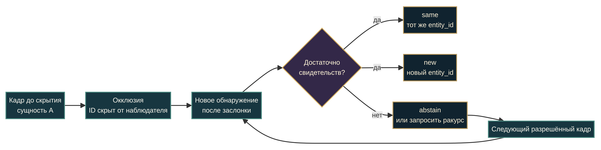
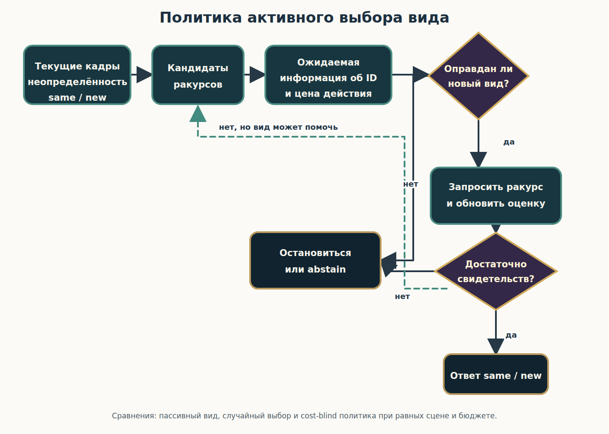

# За заслонкой

## Идентичность объекта, смена ракурса и выбор следующего взгляда

**Иллюстрированная научная мини-книга · редакция 30 октября 2026 года · v1**

> Художественная обложка задаёт настроение, но не является научной схемой или данными.

### О чём эта книга

Представьте предмет, который на мгновение исчезает за непрозрачной ширмой. Когда он появляется снова, нужно решить: это прежний предмет или новый, похожий на него? Сложность растёт, если изменилась точка зрения, предмет стал казаться меньше, рядом двигались похожие объекты или видимый признак противоречит траектории.

Эта книга разбирает, что именно можно заключить из исследований окклюзии и активного восприятия, и предлагает отдельный план проверки, в котором система сама выбирает следующий ракурс. Главный вывод с самого начала: узнавание категории, слежение за движущейся точкой и установление тождества конкретного объекта — разные задачи.

Все пять новых гипотез активного выбора ракурса имеют статус **PROPOSED / NOT RUN** — предложены, но не запускались. В книге нет результатов испытаний Заучита, вымышленных выборок или обещаний научной новизны.

### Содержание

1. [Что значит «тот же объект»](#1-что-значит-тот-же-объект)
2. [Что уже показали исследования — и чего они не показали](#2-что-уже-показали-исследования--и-чего-они-не-показали)
3. [От наблюдения к выбору ракурса](#3-от-наблюдения-к-выбору-ракурса)
4. [Пять новых гипотез AVO-01—AVO-05](#4-пять-новых-гипотез-avo-01avo-05)
5. [Как проверять, не подменяя вопрос](#5-как-проверять-не-подменяя-вопрос)
6. [Что уже подготовлено в проекте](#6-что-уже-подготовлено-в-проекте)
7. [Источники](#источники)

---

# 1. Что значит «тот же объект»

У вопроса «что я вижу?» есть несколько уровней. **Классификация** отвечает, к какому типу относится предмет: чашка, куб или игрушка. **Сопоставление** связывает два появления — например, этот ли жетон был показан раньше. **Отслеживание** сохраняет связь между объектом и его положением во времени. **Идентичность** в узком смысле этой книги — решение, продолжает ли новое обнаружение прежнюю сущность или перед нами новый объект.

Похожие изображения не гарантируют тождества. И наоборот: один объект может выглядеть иначе из-за поворота, расстояния, освещения или частичного перекрытия. Поэтому задача должна задавать независимую «истину»: в симуляции её может хранить скрытый неизменяемый `entity_id`. Если объект продолжал существовать за экраном, это `same`; если его удалили и появился другой, это `new`. Видимое сходство — свидетельство, а не определение идентичности.

Третий ответ нужен не меньше первых двух: **недостаточно данных** (`abstain`). Если два возможных мира дают наблюдателю одинаковые кадры, нельзя требовать от него угадать скрытую метку. Можно остановиться, сообщить неопределённость или запросить ещё один ракурс — если такой ракурс способен помочь и его цена оправдана.

*Научная схема: скрытый `entity_id` известен только оценщику. Художественные иллюстрации ниже не кодируют экспериментальные наблюдения.*

## Что может служить свидетельством

Наблюдатель может использовать продолжение движения до и после заслонки, форму и метки поверхности, взаимное расположение частей, глубину, геометрию заслонки и то, какие траектории вообще возможны. При нескольких объектах важны расстояния между кандидатами и пересечения их путей. Но каждый признак может стать ненадёжным: траектория двусмысленна, рисунок закрыт, поверхность изменилась, а ракурс открыл новые стороны предмета.

Идентичность следует отделять от неопределённости. Скрытый ID в симуляторе может быть однозначным даже тогда, когда доступная наблюдателю информация не позволяет решить задачу. Тогда корректная оценка политики — не только доля верных ответов, но и способность не делать уверенный вывод без достаточных оснований.

*Иллюстрация-метафора. Световой след — художественный образ, а не доказательство физической непрерывности объекта.*

---

# 2. Что уже показали исследования — и чего они не показали

## Люди: поведение зависит от возраста и устройства задачи

Исследования младенцев дают ограниченные поведенческие свидетельства: некоторые условия поддерживают восприятие единого частично закрытого объекта; отдельные работы изучают ожидания появления за заслонкой, использование признаков для индивидуации и предсказание скрытой траектории [1] [2] [3] [4]. Эти результаты зависят от конкретной геометрии, возраста и меры — например, времени взгляда или отслеживания движения. Они не доказывают неограниченную способность сохранять идентичность при любых изменениях ракурса и масштаба.

У взрослых соответствие объекта после краткой окклюзии зависело и от пространственно-временных, и от поверхностных признаков в искусственной задаче [5]. Теория «файлов объектов» описывает интеграцию информации, связанной с последовательными предъявлениями, но это не прямой тест физической окклюзии или выбора камеры [6]. Recognition-by-components помогает обсуждать устойчивость распознавания к изменению вида; сам по себе этот подход не является экспериментом на непрерывную идентичность после заслонки [7].

## Животные: результат нельзя переносить на человеческие понятия

В исследовании с кеа некоторые птицы отслеживали скрытые жетоны или конечные точки траекторий, но результаты заметно различались между особями и не всегда устойчиво повторялись. Там не проверяли смену ракурса или масштаба [8]. Поведение животных нельзя превращать в утверждение о человеческом понимании, сознании или субъективном опыте.

## Модели и компьютерное зрение: локализация не равна тождеству

Рекуррентная вычислительная модель могла предсказывать появление скрытого движущегося объекта; согласие такой модели с ранее опубликованными данными младенцев не доказывает, что она раскрыла механизм младенческого восприятия [9]. Работа с NAO использовала симуляцию и простое самоокклюзирование шара, а не внешний тест переидентификации физического робота [10].

В компьютерном зрении OPNet оценивал локализацию цели в синтетических видео с окклюзией и переносом, а TCOW — сегментацию целей, контейнеров и заслонок в синтетических и размеченных реальных видео [11] [12]. Эти задачи важны для отслеживания, но метрики IoU и локализации не являются доказательством когнитивной «постоянности объекта» или same-vs-new идентичности.

## Физический робот: узкий результат, а не общий тест

Физическая платформа с камерой отслеживала движущуюся точку и предсказывала её положение при окклюзии; точность снижалась с увеличением интервала. Это полезный ориентир по предсказанию движения, но не тест конкретной идентичности при смене ракурса, масштаба или замене объекта [13].

## Активное восприятие — широкая область, а не доказательство AVO

Литература по активному восприятию изучает выбор фиксаций, действий, камерных положений и ракурсов в самых разных задачах. Например, в физической комнате 72 взрослых искали заранее заданные игрушечные предметы, в том числе частично закрытые; исследование текстур с маской проверяло, как три участника выбирают фиксации для решения «пятнистая или полосатая», а полевые записи мармозеток описывали визуально направляемую охоту [14] [15] [16]. Это разные виды свидетельств: реальный поиск цели, искусственная категоризация и естественное поведение животных.

Робототехнические работы включают физическое манипулирование видом для распознавания категории, активное исследование похожих предметов гуманоидным роботом, планирование следующего вида и обход заслонки, поиск заранее известной цели, а также выбор камеры для удержания манипулируемого объекта в поле зрения симулятора [17] [18] [19] [20] [21] [22]. В симуляционных работах по амодальному распознаванию агент перемещался, чтобы лучше распознать заранее заданный закрытый объект [23]. Обзоры систематизируют активную робототехническую визию, планирование видов и активное распознавание объектов [24] [25] [26] [27].

## Четырнадцать источников: вклад и границы

- **[14] Поиск людей в комнате.** В физической комнате 72 участника искали заранее заданные игрушечные объекты и меняли положение тела/взгляда, чтобы увидеть скрытые предметы; это активный поиск цели, а не память о том, тот ли это экземпляр после заслонки.
- **[15] Активные фиксации на текстурах.** Три взрослых выбирали, куда смотреть в частично открываемой двумерной текстуре; категоризация улучшалась при накоплении информации, но цель была классом текстуры, а не идентичностью предмета.
- **[16] Охота мармозеток.** 288 полевых видеозаписей описывают активное зрительное сопровождение добычи в естественных условиях; не было контролируемой манипуляции идентичностью, окклюзией и повторным появлением.
- **[17] Робот STAIR.** Физический робот менял вид и манипулировал предметами для распознавания категорий вроде чашек и степлеров; активные действия сравнивались с пассивным и случайным выбором, но теста same-vs-new не было.
- **[18] Активное исследование на гуманоиде.** Симуляционные и реальные робототехнические тесты сообщали более эффективное активное многосенсорное распознавание похожих предметов и вклад проприоцепции; это не проверка непрерывности идентичности после заслонки.
- **[19] Next-best-view для мобильного робота.** Платформа Scitos G5 выбирала следующий вид; в опыте с препятствиями распознала цель в 17 из 20 проб, но не решала, является ли предмет после исчезновения той же сущностью.
- **[20] RGB-D и квадрокоптер.** На задаче распознавания активный выбор вида с отбором признаков дал 91,87% ± 0,7 против 84,48% ± 1,4 у полно-признакового случайного baseline при меньшем числе наблюдений; это распознавание/изменение объектов, не пост-окклюзионный same-vs-new тест.
- **[21] Гуманоид и известная цель.** Робот искал заранее заданный объект, выбирая ракурс для 3D-локализации; это поиск местоположения, а не повторная идентификация после окклюзии.
- **[22] Манипуляция в симуляции.** В задании толкания объектов среди заслоняющих предметов активная камера+манипулятор показали 0,663 ± 0,038 успеха против 0,618 ± 0,008 у неподвижной камеры; работа изучала зрение для действия, а не same/new память.
- **[23] Воплощённое амодальное распознавание.** В симуляции активный маршрут дал 93,7% точности классификации на заданном шаге против 92,9% у пассивного; агент предсказывал класс, рамку и маску известного частично закрытого объекта, а не индивидуальную идентичность.
- **[24] Обзор активного зрения в робототехнике.** Обзор систематизирует методы планирования сенсора для разных робототехнических задач; это не новый контролируемый эксперимент на идентичность.
- **[25] Концептуальный обзор активного восприятия.** Статья объясняет, зачем активный агент выбирает, что, когда и откуда воспринимать; в ней нет собственного same-vs-new теста или выборки участников.
- **[26] Обзор планирования видов.** Систематизирует системы и алгоритмы для реконструкции, распознавания категорий, позы и сцен; не показывает пост-окклюзионное решение об идентичности.
- **[27] Обзор активного распознавания объектов.** Таксономия методов выбора сенсорных действий, видов и модальностей; это синтез области, а не новая проверка same-vs-new.

Некоторые из этих работ уже учитывают стоимость действия, информационный выигрыш или конкурируют с пассивными/случайными стратегиями [17] [19] [20] [21]. Поэтому AVO-02 не объявляет новой саму идею cost-aware выбора ракурса: он проверяет, помогает ли ожидаемая информация именно о метке same/new в задаче тождества.

**Но ни одна из этих четырнадцати проверенных записей не задаёт прямой тест:** после заслонки агент должен установить, вернулась ли та же сущность или появилась новая, и сам выбрать следующий ракурс ради этой конкретной метки. Это ограничение применимости этих записей к поставленной задаче, а не утверждение, что во всей научной литературе такой тест никогда не проводился. Классификация категории, локализация, сегментация и next-best-view не равны same-vs-new переидентификации [14]–[27].

**Граница вывода:** проектный пробел ниже — узкая формулировка в проверенном корпусе проекта, а не заявление, что активное восприятие или выбор ракурса новы для науки. Различие важно: предыдущие материалы уже задают кадры или готовые сцены для оценивания; предложенный следующий шаг — проверить политику, которая сама выбирает недорогой взгляд именно ради разрешения same-vs-new неопределённости.

*Иллюстрация-метафора. Несколько изображений напоминают о преобразованиях вида; они не являются пиксельно-контролируемой парой стимулов.*

---

# 3. От наблюдения к выбору ракурса

Пассивная система получает заданные кадры. Активная система может выбирать действие: повернуть камеру, сместиться, приблизить обзор или запросить следующий кадр. Чтобы выяснить, помогает ли именно выбор ракурса, нужно сравнить системы при сопоставимых возможностях и бюджетах.

Ключевой вопрос не «какой вид самый информативный вообще?», а **какой доступный и оправданный по цене вид лучше различает прежнюю сущность и замену?** Панорамный обзор может сообщить много о сцене или категории, но не показать тот знак, который отличает два похожих экземпляра. С другой стороны, поворот камеры может быть дорогим и ничего не добавить, если оба возможных объекта выглядят одинаково со всех доступных точек.

*Иллюстрация-метафора; это не изображение запущенного агента или экспериментального результата.*

## Минимальная политика выбора

Для каждого возможного наблюдения политика может оценивать ожидаемое изменение неопределённости именно о тождестве, цену действия и вероятность, что новый ракурс различит текущие гипотезы. В простом виде: если ожидаемая польза для решения same-vs-new превышает цену и риск действия, запросить ракурс; иначе остановиться или воздержаться. Формула должна быть конкретизирована заранее, а не подогнана после результатов.

Эта схема задаёт структуру сравнения, а не единственно верную математическую формулу. «Информация» должна быть измерена относительно метки идентичности, а не общей сложности сцены или категории.

---

# 4. Пять новых гипотез AVO-01—AVO-05

**Все гипотезы ниже: PROPOSED / NOT RUN.** Не проводились ни симуляционные прогоны, ни тесты на людях, ни испытания на физическом роботе. Численные пороги, объёмы выборок, длительность и стоимость действий должны быть выбраны и зарегистрированы до подтверждающего теста.

## AVO-01 — информативный ракурс против пассивного и случайного выбора

**Гипотеза.** Политика, выбирающая вид, ожидаемо полезный для идентичности, будет реже ошибаться в same-vs-new, чем пассивное получение заранее заданного вида или случайный выбор доступного вида при сопоставимом бюджете наблюдений.

**Контроли.** Пассивный просмотр, случайная точка из того же набора допустимых действий и matched-блок без дополнительного кадра. Выравниваются начальные кадры, время, число запросов, цена действий и распределение same/new. В задаче должны быть примеры, где дополнительный вид действительно различает кандидатов, и примеры, где не различает.

**Метрики.** Same-vs-new accuracy и d′, ложные same/new по отдельности, число запросов, задержка, стоимость перемещения камеры и итоговый риск после решения.

**Что опровергнет.** Если политика не превосходит пассивный и случайный baseline при сопоставимых бюджетах и достаточной чувствительности, преимущество информативного выбора в этой задаче не подтверждено. Если интервалы неопределённости широки, результат остаётся неопределённым, а не становится доказательством равенства.

## AVO-02 — ценность информации об идентичности с учётом цены

**Гипотеза.** Выбор по ожидаемому снижению неопределённости same/new с учётом стоимости действия даст более выгодный компромисс качество—затраты, чем выбор по общей неопределённости сцены или по «максимуму информации» без цены.

**Контроли.** Сравнить cost-aware оценку информации об идентичности с общей/классовой информацией, с cost-blind вариантом и с простым правилом остановки. Все политики видят одинаковые кандидаты ракурсов и имеют одинаковые ограничения на действия.

**Метрики.** Ошибки идентичности на единицу стоимости, кривая качество—цена, количество действий и стоимость до решения, ложные уверенные ответы и калибровка. Отдельно фиксируется, у какой политики появилось новое свидетельство именно о том же/новом объекте.

**Что опровергнет.** Если учёт цены не улучшает заранее выбранный компромисс или не превосходит сопоставимые общие и cost-blind правила, гипотеза практической пользы cost-aware identity information не подтверждается. Нельзя подменять этот исход просто ростом общего качества восприятия.

## AVO-03 — искать признак идентичности, а не только класс

**Гипотеза.** При нескольких похожих экземплярах политика выберет ракурс, который открывает экземплярный признак — метку, выемку, шов или взаимное расположение деталей, — а не только признак, полезный для определения класса.

**Контроли.** Сравнить same-vs-new внутри одной категории с отдельной задачей классификации категории. Добавить пару, где категория очевидна, но экземпляры похожи; отдельные условия, где виден только классовый признак или только различающий признак экземпляра. Контролировать видимость, ракурс, цену и частоту признаков.

**Метрики.** Точность и d′ идентичности отдельно внутри класса, доля выбранных видов, открывающих различающий признак, ошибки «тот же/новый» и точность классификации как отдельный исход.

**Что опровергнет.** Если выигрыш исчезает внутри одной категории или политика выбирает виды, полезные только для класса, но не улучшает same-vs-new, утверждение о целенаправленном поиске признаков идентичности не подтверждается.

## AVO-04 — перепроверять, когда это поможет; останавливаться, когда не поможет

**Гипотеза.** При разрешимой неопределённости система запросит дополнительный вид, если ожидаемая информация оправдывает цену. При принципиально неразличимых наблюдениях она остановится или воздержится, вместо того чтобы бесконечно пересматривать сцену или уверенно угадывать.

**Контроли.** Информативный дополнительный ракурс, заведомо неинформативный ракурс и видимый диагностический случай. Сравнить режим с `abstain/recheck` с forced-choice и с вариантом без повторной проверки при сопоставимом бюджете и цене.

**Метрики.** Selective risk и покрытие, калибровка/Brier, ошибки false-same и false-new, доля полезных и ненужных запросов, число повторов, стоимость и задержка.

**Что опровергнет.** Если перепроверки не снижают риск там, где кадр информативен, или часто продолжаются там, где новое наблюдение не может разделить кандидатов, политика не демонстрирует заявленную избирательность. Если воздержание не снижает selective risk относительно forced-choice, защитный исход не подтверждён.

*Иллюстрация-метафора неопределённости: она не задаёт конкретную вероятность и не кодирует скрытый ответ.*

## AVO-05 — перенос на новые объекты и геометрию заслонок

**Гипотеза.** Преимущество политики сохранится на ранее не встречавшихся объектах и геометриях заслонок, а не только на новых кадрах тех же знакомых форм.

**Контроли.** Разделить train/validation/test по идентичностям объектов, семействам формы и материалам, геометрии заслонок, условиям камеры и seed. В тесте должны быть целые группы, не представленные в обучении. Сравнить с пассивной, случайной и cost-aware политиками на тех же ограничениях. Не допускать вариантов одного объекта в разные разделы.

**Метрики.** d′/accuracy, false-same/false-new, selective risk, калибровка, число действий и цена по каждому удержанному типу объекта или заслонки; отдельно сообщать худшие группы и разброс независимых запусков.

**Что опровергнет.** Если преимущество наблюдается только на знакомых экземплярах или знакомой геометрии, а на разделённых группах исчезает, заявленный перенос не подтверждён. Случайная разбивка кадров при пересечении идентичностей между выборками не является достаточной проверкой переноса.

---

# 5. Как проверять, не подменяя вопрос

## Основа — уже предложенные OBJ-01—OBJ-05

В опубликованном проекте уже описана серия предложений о наблюдательной задаче. Они задают, что считать тождеством и какие трудные условия проверить; AVO добавляет следующий вопрос — **кто и как выбирает наблюдение**.

- **OBJ-01:** меняется ли различение same/new при короткой и длинной окклюзии?
- **OBJ-02:** что меняют окклюзия, ракурс и масштаб, рассмотренные отдельно и во взаимодействии?
- **OBJ-03:** как система взвешивает признак поверхности и траекторию, когда они расходятся по надёжности?
- **OBJ-04:** растут ли подмены идентичности при похожих объектах и пересечении путей?
- **OBJ-05:** когда нужно ответить `abstain` или запросить повторную проверку вместо принудительного выбора?

В протоколе для каждого модуля есть matched-контроли, метрики, условия опровержения и оговорки о недостаточной чувствительности. В частности, нулевой результат без мощности не равен доказанной эквивалентности, а потолочная точность не подтверждает общую способность [28].

## Что обязано оставаться одинаковым

В matched-парах по возможности уравниваются путь, число видимых кадров, награда, доступные действия, цена и вычислительный бюджет. Иначе политика может «победить» за счёт дополнительных кадров, более щедрой награды или подсказки в маршруте. Истинная метка должна происходить из независимого журнала симулятора, а не восстанавливаться из ответа модели.

Оценщик хранит закрытый `entity_id`, родословную события, удаление/продолжение объекта и состояние заслонки. Система получает только разрешённые кадры, временные отметки и доступные действия. Пары same/new балансируются; возможные утечки ID, будущего кадра, seed и метки условия проверяются автоматически до запуска.

## Базовые сравнения и метрики

Нужны по меньшей мере пассивный baseline, случайный выбор ракурса и политика, которая учитывает стоимость и неопределённость именно идентичности. Отдельно полезны forced-choice без отказа и простая стратегия nearest-trajectory, чтобы понять, приносит ли активный выбор пользу сверх очевидного эвристического решения. Конкретная реализация baseline фиксируется до теста.

Доля правильных ответов недостаточна. Следует отдельно считать ложное `same`, ложное `new`, перестановки ID, точность/чувствительность, калибровку уверенности, selective risk при разном покрытии, число запросов, цену действия и задержку. Для переноса отчёт разбивается по новым объектам, семействам формы и геометрии заслонки, а не только усредняется по всем кадрам.

## Правила интерпретации

Значения порогов, границы эквивалентности и первичные сравнения нельзя выбирать после просмотра тестовых результатов. Независимые прогоны нужны для оценки вариативности; кадры из одного прогона не являются независимыми повторениями. Нулевой эффект при низкой чувствительности — неопределённость. Результат в синтетическом симуляторе не доказывает поведение людей, животных или физического робота.

**Эта книга не предполагает, что система сознательна.** Совпадение идентификатора в контролируемой задаче — функциональная метрика, а не свидетельство субъективного опыта, человеческих понятий или общего понимания мира.

---

# 6. Что уже подготовлено в проекте

На дату этой редакции репозиторий содержит отдельное дополнение OBJ с обзором 13 публикаций, протокол бенчмарка OBJ-01—OBJ-05, десять текстовых синтетических сцен и JSONL-компаньон с README и схемой [28] [29] [30] [31]. Эти материалы не следует принимать за готовый датасет: десять сцен — текстовые карточки для ручной инспекции, а не отрендеренные испытания. JSONL — машинно-читаемая запись тех же сцен, а не результат запуска модели.

Новая часть книги — активный выбор ракурса и AVO-01—AVO-05. Она описывает **проектный пробел**, который можно проверить, но не объявляет его научной новизной. Следующий научный шаг — специфицировать условия, стоимость действий, правила разделения данных и первичные метрики; затем провести отдельный предварительно зарегистрированный пилот и только после этого — подтверждающее тестирование.

---

# Источники

## Идентичность, окклюзия и непрерывность

[1] Philip J. Kellman & Elizabeth S. Spelke (1983). “Perception of partly occluded objects in infancy.” *Cognitive Psychology*, 15(4), 483–524. [DOI: 10.1016/0010-0285(83)90017-8](https://doi.org/10.1016/0010-0285(83)90017-8).

[2] Anamaria Aguiar & Renée Baillargeon (1999). “2.5-Month-Old Infants' Reasoning about When Objects Should and Should Not Be Occluded.” *Cognitive Psychology*, 39(2), 116–157. [DOI: 10.1006/cogp.1999.0717](https://doi.org/10.1006/cogp.1999.0717).

[3] Teresa Wilcox & Renée Baillargeon (1998). “Object Individuation in Infancy: The Use of Featural Information in Reasoning about Occlusion Events.” *Cognitive Psychology*, 37(2), 97–155. [DOI: 10.1006/cogp.1998.0690](https://doi.org/10.1006/cogp.1998.0690).

[4] Kerstin Rosander & Claes von Hofsten (2004). “Infants' emerging ability to represent occluded object motion.” *Cognition*, 91(1), 1–22. [DOI: 10.1016/S0010-0277(03)00166-5](https://doi.org/10.1016/S0010-0277(03)00166-5).

[5] Andrew Hollingworth & Steven L. Franconeri (2009). “Object Correspondence across Brief Occlusion Is Established on the Basis of both Spatiotemporal and Surface Feature Cues.” *Cognition*, 113(2), 150–166. [DOI: 10.1016/j.cognition.2009.08.004](https://doi.org/10.1016/j.cognition.2009.08.004).

[6] Daniel Kahneman, Anne Treisman & Brian J. Gibbs (1992). “The reviewing of object files: Object-specific integration of information.” *Cognitive Psychology*, 24(2), 175–219. [DOI: 10.1016/0010-0285(92)90007-O](https://doi.org/10.1016/0010-0285(92)90007-O).

[7] Irving Biederman (1987). “Recognition-by-components: A theory of human image understanding.” *Psychological Review*, 94(2), 115–147. [DOI: 10.1037/0033-295X.94.2.115](https://doi.org/10.1037/0033-295X.94.2.115).

[8] Amalia P. M. Bastos & Alex H. Taylor (2019). “Kea (Nestor notabilis) represent object trajectory and identity.” *Scientific Reports*, 9, 19759. [DOI: 10.1038/s41598-019-56380-4](https://doi.org/10.1038/s41598-019-56380-4).

[9] A. Franz & J. Triesch (2010). “A unified computational model of the development of object unity, object permanence, and occluded object trajectory perception.” *Infant Behavior and Development*, 33(4), 635–653. [DOI: 10.1016/j.infbeh.2010.07.018](https://doi.org/10.1016/j.infbeh.2010.07.018).

[10] Sarah Bechtle, Guido Schillaci & Verena V. Hafner (2016). “On the Sense of Agency and of Object Permanence in Robots.” *Proceedings of the 6th Joint IEEE International Conference on Development and Learning and on Epigenetic Robotics*, 166–171. [DOI: 10.1109/DEVLRN.2016.7846812](https://doi.org/10.1109/DEVLRN.2016.7846812).

[11] Aviv Shamsian, Ofri Kleinfeld, Amir Globerson & Gal Chechik (2020). “Learning Object Permanence from Video.” In *Computer Vision – ECCV 2020*, 35–50. [DOI: 10.1007/978-3-030-58517-4_3](https://doi.org/10.1007/978-3-030-58517-4_3).

[12] Basile Van Hoorick, Pavel Tokmakov, Simon Stent, Jie Li & Carl Vondrick (2023). “Tracking through Containers and Occluders in the Wild.” *Proceedings of the IEEE/CVF Conference on Computer Vision and Pattern Recognition*, 13802–13811. [Official CVF record](https://openaccess.thecvf.com/content/CVPR2023/html/Van_Hoorick_Tracking_Through_Containers_and_Occluders_in_the_Wild_CVPR_2023_paper.html).

[13] J-C Park, JH Lim, H Choi & D-S Kim (2012). “Predictive Coding Strategies for Developmental Neurorobotics.” *Frontiers in Psychology*, 3, 134. [DOI: 10.3389/fpsyg.2012.00134](https://doi.org/10.3389/fpsyg.2012.00134).

## Активное восприятие и выбор ракурса

[14] T. C. Wu & J. K. Tsotsos (2025). “Real-world visual search goes beyond eye movements: Active searchers select 3D scene viewpoints too.” *PLOS ONE*, 20(7), e0319719. [DOI: 10.1371/journal.pone.0319719](https://doi.org/10.1371/journal.pone.0319719).

[15] Scott Cheng-Hsin Yang, Máté Lengyel & Daniel M. Wolpert (2016). “Active sensing in the categorization of visual patterns.” *eLife*, 5, e12215. [DOI: 10.7554/eLife.12215](https://doi.org/10.7554/eLife.12215).

[16] Victoria Ngo, Julia C. Gorman, María Fernanda De la Fuente, Antonio Souto, Nicola Schiel & Cory T. Miller (2022). “Active vision during prey capture in wild marmoset monkeys.” *Current Biology*, 32(15), 3423–3428.e3. [DOI: 10.1016/j.cub.2022.06.028](https://doi.org/10.1016/j.cub.2022.06.028).

[17] Quoc V. Le, Ashutosh Saxena & Andrew Y. Ng (2010). “Active Perception: Interactive Manipulation for Improving Object Detection.” Stanford University technical report. [Author-hosted report](http://ai.stanford.edu/~quocle/activevision.pdf).

[18] Björn Browatzki, Vadim Tikhanoff, Giorgio Metta, Heinrich H. Bülthoff & Christian Wallraven (2012). “Active object recognition on a humanoid robot.” *Proceedings of the 2012 IEEE International Conference on Robotics and Automation*, 2021–2028. [DOI: 10.1109/ICRA.2012.6225218](https://doi.org/10.1109/ICRA.2012.6225218).

[19] Christopher McGreavy, Lars Kunze & Nick Hawes (2016). “Next Best View Planning for Object Recognition in Mobile Robotics.” *Proceedings of the 34th Workshop of the UK Planning and Scheduling Special Interest Group*, CEUR Workshop Proceedings, 1782, 1–9. [Official paper](https://ceur-ws.org/Vol-1782/paper_6.pdf).

[20] Christian Potthast, Andreas Breitenmoser, Fei Sha & Gaurav S. Sukhatme (2016). “Active multi-view object recognition: A unifying view on online feature selection and view planning.” *Robotics and Autonomous Systems*, 84, 31–47. [DOI: 10.1016/j.robot.2016.06.013](https://doi.org/10.1016/j.robot.2016.06.013).

[21] Alexander Andreopoulos, Stephan Hasler, Heiko Wersing, Herbert Janssen, John K. Tsotsos & Edgar Körner (2011). “Active 3D Object Localization Using a Humanoid Robot.” *IEEE Transactions on Robotics*, 27(1), 47–64. [DOI: 10.1109/TRO.2010.2090058](https://doi.org/10.1109/TRO.2010.2090058).

[22] Ricson Cheng, Arpit Agarwal & Katerina Fragkiadaki (2018). “Reinforcement Learning of Active Vision for Manipulating Objects under Occlusions.” *Proceedings of The 2nd Conference on Robot Learning*, Proceedings of Machine Learning Research, 87, 422–431. [PMLR paper](https://proceedings.mlr.press/v87/cheng18a.html).

[23] Jianwei Yang, Zhile Ren, Mingze Xu, Xinlei Chen, David J. Crandall, Devi Parikh & Dhruv Batra (2019). “Embodied Amodal Recognition: Learning to Move to Perceive Objects.” *Proceedings of the IEEE/CVF International Conference on Computer Vision*, 2040–2050. [Official CVF paper](https://openaccess.thecvf.com/content_ICCV_2019/html/Yang_Embodied_Amodal_Recognition_Learning_to_Move_to_Perceive_Objects_ICCV_2019_paper.html).

[24] Shengyong Chen, Youfu Li & Ngai Ming Kwok (2011). “Active vision in robotic systems: A survey of recent developments.” *The International Journal of Robotics Research*, 30(11), 1343–1377. [DOI: 10.1177/0278364911410755](https://doi.org/10.1177/0278364911410755).

[25] Ruzena Bajcsy, Yiannis Aloimonos & John K. Tsotsos (2018). “Revisiting active perception.” *Autonomous Robots*, 42(2), 177–196. [DOI: 10.1007/s10514-017-9615-3](https://doi.org/10.1007/s10514-017-9615-3).

[26] Rui Zeng, Yuhui Wen, Wang Zhao & Yong-Jin Liu (2020). “View planning in robot active vision: A survey of systems, algorithms, and applications.” *Computational Visual Media*, 6(3), 225–245. [DOI: 10.1007/s41095-020-0179-3](https://doi.org/10.1007/s41095-020-0179-3).

[27] Yuheng Wang, Jiayi Li, Zihao Du, Tao Xue & Tao Zhang (2026). “Algorithmic Perspectives on Active Object Recognition Systems: A Survey.” *Tsinghua Science and Technology*, 31(3), 1307–1325. Published online 19 December 2025; issue date June 2026. [DOI: 10.26599/TST.2025.9010096](https://doi.org/10.26599/TST.2025.9010096).

## Связанные проектные материалы

[28] Дополнение OBJ о тождестве объектов после окклюзии (29 октября 2026). GitHub, `book-collections/zauchit/research-dossier/zauchit-object-identity-occlusion-addendum-2026-10-29-v1.md`.

[29] Протокол бенчмарка OBJ-01—OBJ-05 (29 октября 2026). GitHub, `book-collections/zauchit/research-dossier/zauchit-object-identity-occlusion-benchmark-protocol-2026-10-29-v1.md`.

[30] Набор десяти синтетических текстовых сцен OBJ-01—OBJ-05 (29 октября 2026). GitHub, `book-collections/zauchit/research-dossier/zauchit-object-identity-occlusion-synthetic-scenes-2026-10-29-v1.md`.

[31] JSONL-компаньон сцен и README/Schema (30 октября 2026). GitHub, `book-collections/zauchit/research-dossier/zauchit-object-identity-occlusion-synthetic-scenes-2026-10-30-v1.jsonl`.
