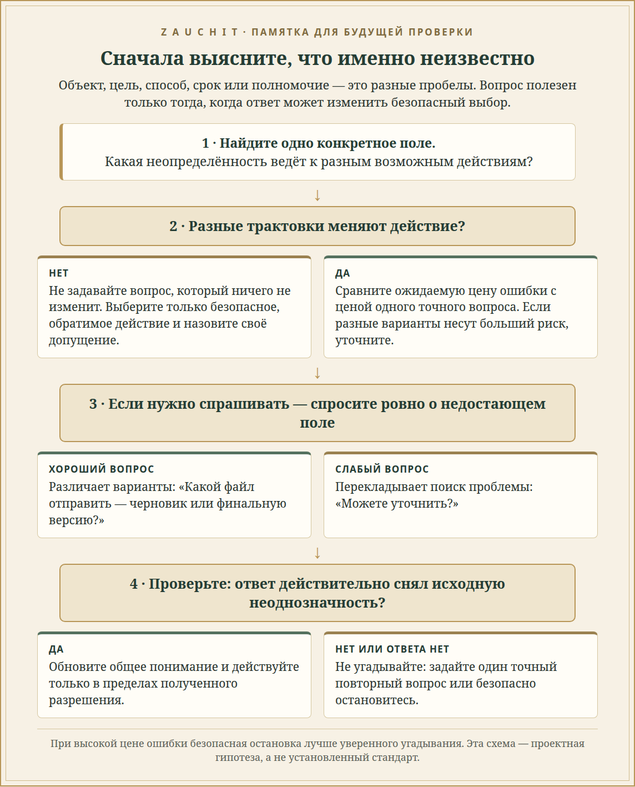

# Уточнить, прежде чем действовать

## Как выбрать точный вопрос и проверить, что общее понимание восстановлено

**Исследовательское дополнение к Zauchit · 31 октября 2026 · v1.0**  
**Статус:** обзор источников и проектные гипотезы; предложенный тест не запускался, участники не набирались, данные не собирались.

> **Главная находка**  
> Не всякая неопределённость требует вопроса — и не всякий вопрос помогает. Полезная система должна сначала определить, *какой именно элемент решения неизвестен* (референт, цель, способ, срок или полномочие), затем сравнить ожидаемую цену ошибки с ценой дополнительного хода, задать короткий вопрос, различающий возможные действия, и после ответа проверить, исчезло ли исходное расхождение. Это исследовательский синтез, а не уже проверенный алгоритм.

*❧ · ✦ · ❧*

## В чём практическая проблема

Представим просьбу: «Перешли Марине последнюю версию». Если в истории есть две Марины или несколько документов, системе может быть неизвестно не «насколько она уверена вообще», а конкретно — **какую пару “получатель × документ” имел в виду человек**. Общий вопрос «Можете уточнить?» перекладывает поиск проблемы на пользователя. Уверенный выбор наугад рискует отправить не тот файл не тому адресату.

Эти случаи содержат по меньшей мере три разные задачи:

- **Обнаружить пробел:** есть ли несколько правдоподобных прочтений, которые ведут к разным действиям?
- **Локализовать его:** какое поле не определено — объект, цель, способ, срок, адресат или разрешение?
- **Исправить и проверить:** какой минимальный вопрос разделит варианты, и подтверждает ли ответ именно нужное поле?

Исследования давно рассматривают вопросы-уточнения как средство восстановить понимание, а более новые работы добавляют оценку неопределённости, стоимости вопроса и последствий действия.[1–6] Однако это не одно и то же: способность заметить риск не гарантирует, что система задаст точный вопрос; хороший вопрос не гарантирует, что ответ будет правильно встроен в общий контекст.

## Что показывают исследования

### 1. Исправление разговора устроено поэтапно

В анализе естественных разговоров Schegloff, Jefferson и Sacks описывают, как участники обнаруживают и исправляют проблемы речи и понимания. Часто говорящий сам исправляет свою реплику; если проблема требует вмешательства собеседника, участники используют способы уточнения, которые помогают локализовать источник непонимания.[1] Это важный ориентир для диалоговой системы: не трактовать каждую неясность как повод для широкого допроса, а искать локальную точку, где разошлись возможные прочтения.

**Ограничение:** это анализ человеческих разговоров, а не эксперимент по безопасности цифрового помощника. Он описывает организацию ремонта реплик, но не устанавливает оптимальный порог для автоматического действия.

### 2. Общее понимание надо не предполагать, а устанавливать

Clark и Brennan рассматривают grounding — совместное установление того, что собеседники поняли друг друга. Для этого важны не только слова, но и доступные подтверждения, канал общения и цена обратной связи.[2] В терминах ИИ это означает: ответ пользователя должен быть свидетельством о конкретном недостающем факте, а не просто ещё одной строкой текста, после которой система автоматически объявляет задачу ясной.

**Ограничение:** это теоретическая глава о коммуникации, не сравнительный тест современных LLM и не спецификация готового протокола.

### 3. Цена вопроса и качество вопроса — отдельные части решения

Wang и Ai построили риск-управляемую систему conversational search. Она выбирает между показом результатов и уточнением с учётом не только полноты запроса, но и качества доступного вопроса; авторы также моделируют терпение и переносимость пользователя к плохим вопросам. В симуляциях на MSDialog, Ubuntu Dialog Corpus и OpenDialKG политика превосходила несколько базовых стратегий в большинстве экспериментальных условий.[3]

Это важная поправка к простому правилу «если не уверен — спроси»: вопрос сам может быть неуместным, а череда уточнений может утомить пользователя.

**Ограничение:** это симуляции диалогового поиска с пользовательскими моделями; результат не доказывает, что та же политика безопасна при отправке писем, платежах или других внешних действиях.

### 4. Неуверенность модели не равна человеческому желанию уточнить

В совместной диалоговой задаче Testoni и Fernández показали, что неопределённость модели не повторяет человеческие паттерны запросов на уточнение. Их стратегия, строившая вопросы на оценке неопределённости самой модели, улучшила успешность задачи относительно ряда альтернатив.[4] Это предостерегает от обучения политики только на том, когда люди в датасете задавали вопрос: пропущенный человеком вопрос ещё не означает, что система может безопасно действовать.

**Ограничение:** вывод относится к конкретной задаче совместного диалога и её показателям успеха; он не задаёт универсальную формулу вопроса для всех действий.

### 5. Скрытое расхождение общего контекста трудно заметить

Sarkar и коллеги изучили сбои grounding в технических беседах Ubuntu IRC. Различия в предположениях и убеждениях собеседников часто сопровождались «трением» в диалоге; это трение было связано с успешностью решения задачи. LLM распознавали явные случаи лучше, чем тонкие, зависящие от прагматики и предметной области.[5]

Для агента важен вывод: некоторые проблемы выглядят как обычное продолжение разговора, пока не выяснено, что у пользователя и системы разные представления о том, *какой объект, состояние или предыдущий шаг уже общий*.

**Ограничение:** наблюдаемая связь с успехом не доказывает, что трение само по себе причинно вызывает неудачу; корпус технических IRC-диалогов не представляет все бытовые и профессиональные сценарии.

### 6. Люди учитывают риск ошибки, а не только сам факт сомнения

В препринте 2026 года Tsvilodub, Mulligan, Snider, Hawkins и Franke проверяют выбор между уточняющим вопросом и действием. В двух экспериментах варьировали неопределённость относительно цели или референта и стоимость альтернативного ответа либо ошибочного действия. В первом участвовали 125 человек; во втором — 120, двое исключены после проверки внимания. В среднем большая неопределённость и более дорогая ошибка делали уточнение привлекательнее, а прямое действие — менее привлекательным.[6]

Это ближе всего к правилу «сначала спросить, если цена неверного действия велика», но всё ещё не готовый автоматический policy. В статье предлагается модель ожидаемого сожаления: спрашивать стоит, когда возможная потеря от действия без полной информации превышает цену получения уточнения.

**Ограничение:** это arXiv-препринт, не следует называть его рецензированной журнальной статьёй. Сценарии и ответы участников не равны наблюдению за помощником, который реально выполняет действия; перенос на живое использование остаётся открытым.

## Что уже есть в проекте — и чего ещё не хватает

В материалах Zauchit уже рассматриваются выбор полезной проверки при ограниченном бюджете и связь неоднозначной референции со знаниями конкретного партнёра. Поэтому новая тема **не** повторяет общий вопрос «когда спросить, а когда действовать». Она сужает следующий шаг: как обнаружить *тип* недостающей информации и задать вопрос, который различает действия, а не просто сообщает «модель сомневается».[7]

Рабочая схема состоит из четырёх звеньев:

1. **Найти место расхождения.** Например, референт («какой файл?»), цель («для чего использовать?»), способ («как именно?»), срок («когда?») или полномочие («можно ли отправлять?»).
2. **Оценить последствия.** Если разные прочтения ведут к одному и тому же безопасному, обратимому результату, дополнительный вопрос может быть лишним. Если они ведут к разным или труднообратимым внешним действиям, цена угадывания выше.
3. **Сформулировать минимальный разделяющий вопрос.** Хороший вопрос должен исключать хотя бы одну опасную альтернативу, а не просить пользователя заново пересказать всю задачу.
4. **Проверить ответ.** Ответ принят как разрешение только если он различает исходные варианты. Если после ответа остаются две разные трактовки, не считать общее понимание восстановленным.

> **Рабочее правило — гипотеза, а не установленный стандарт**  
> Сравнивать ожидаемую потерю от лучшего немедленного действия с ценой одного точного уточнения. При высокой цене ошибки предпочитать уточнение или безопасную остановку; при низкой цене и обратимом результате можно действовать с явно названным предположением. Не спрашивать о деталях, которые не изменят действие.

*❧ · ✦ · ❧*

## Проверяемые гипотезы для Zauchit

Ни одна из гипотез ниже не проверялась. Это предложения для будущего эксперимента, а не результаты исследования.

### H1. Точное уточнение полезнее общего

Когда имеется ровно один критичный пробел, вопрос, назвавший это поле и предложивший различающие варианты, даст больше правильно разрешённых эпизодов и потребует меньше ходов, чем общий вопрос «уточните, пожалуйста», при одинаковом лимите вопросов и токенов.

**Пример:** вместо «Что вы имеете в виду?» — «Какой файл отправить: `План_черновик` или `План_финал`?» Тест должен сравнить не красоту формулировки, а то, уменьшил ли вопрос число возможных действий.

### H2. Риск действия меняет порог уточнения

При одинаковой неопределённости повышение цены ошибочного действия увеличит долю точных уточнений или безопасных остановок; повышение цены пользовательского хода снизит число вопросов главным образом в низкорисковых, обратимых случаях. Иными словами, стоимость ошибки и стоимость вопроса должны оцениваться совместно, а не превращаться в один порог уверенности.

### H3. Ответ нужно проверить на разрешающую силу

Политика, которая после ответа проверяет, снято ли исходное неоднозначное поле, реже выполнит неверное действие, чем политика, считающая любой ответ достаточным подтверждением. Важно измерять и лишние повторные вопросы: проверка не должна превращаться в бесконечный цикл.

### H4. При высоком риске молчание или неясный ответ не равны разрешению

Если пользователь не ответил либо ответ оставил неоднозначность, система чаще должна остановиться или предложить безопасный обратимый следующий шаг, а не угадывать. Это особенно важно для внешних действий; в первом прототипе их следует тестировать только в закрытой симуляции.

## Как проверить без реальных внешних действий

Сначала создать закрытый синтетический набор задач с известным правильным решением. В каждом эпизоде намеренно оставить один пробел: референт, цель, способ, срок или полномочие. Затем независимо варьировать неопределённость, последствия ошибки и стоимость дополнительного хода. Ни пользовательские данные, ни реальные отправки, оплаты или изменения аккаунтов для такой проверки не нужны.

Сравнить не менее пяти политик при одинаковом бюджете:

- **Всегда действовать** — контроль риска угадывания.
- **Всегда уточнять** — контроль лишних вопросов.
- **Порог общей уверенности** — простая модель «спросить при низкой уверенности».
- **Учитывать только цену действия** — проверить, что добавляет цена вопроса.
- **Локализовать пробел и проверять ответ** — предлагаемая политика.

Для каждого эпизода заранее разметить: какое поле отсутствует, какие ответы различают варианты и какое действие безопасно при неразрешённой неопределённости. Первичные метрики: доля неверных действий, успешность задачи и точность выбора поля для вопроса. Вторичные: уместность вопроса, число ходов, задержка, доля лишних вопросов, доля ответов, после которых неоднозначность остаётся, и качество безопасной остановки. Отдельно показать результаты при низком и высоком риске — среднее по всем случаям может скрыть опасный сдвиг.

До запуска надо зафиксировать бюджет, правила разметки, минимально полезную разницу и критерий остановки. Первый проход — автоматизированные seeds на синтетических сценариях; только затем можно планировать добровольный человеческий пилот на безвредных ситуациях. Такие числа как размер выборки и границы решения следует рассчитать по пилоту, а не выдавать заранее за универсальные пороги.

## Что осталось открытым

- Насколько хорошо система может *локализовать* источник неоднозначности отдельно от общей оценки собственной уверенности?
- Уменьшает ли целевой вопрос число ошибок после учёта его длины, времени ответа и раздражения пользователя?
- Как отличать ответ, который действительно разрешил референт, от ответа вроде «обычный», который всё ещё допускает несколько объектов?
- Может ли одна политика учитывать и риск действия, и цену пользовательского внимания, не задавая избыточные вопросы?
- Как переносить выводы с симуляций и текстовых задач на мультимодальные контексты, инструменты и долгие совместные задачи?

Наиболее полезный ближайший тест — сравнить общий порог уверенности с локализацией поля и проверкой ответа в одной и той же закрытой среде. Это отделит «агент знает, что сомневается» от более практичного навыка: «агент знает, *что именно* нужно выяснить, и замечает, когда ответ этого ещё не сделал».

> **Статус проекта**  
> Это исследовательское предложение. Эксперименты не запускались; люди не набирались; никакие реальные пользовательские инструкции, переписки или внешние действия не анализировались.

*❧ · ✦ · ❧*

## Источники

### [1] Ремонт реплик в обычном разговоре

Schegloff, E. A., Jefferson, G., & Sacks, H. (1977). *The preference for self-correction in the organization of repair in conversation.* **Language, 53**(2), 361–382. Теоретически и эмпирически влиятельный анализ очередности и самоисправления в разговоре.

[DOI 10.2307/413107](https://doi.org/10.2307/413107) · [JSTOR](https://www.jstor.org/stable/413107)

### [2] Установление общего основания

Clark, H. H., & Brennan, S. E. (1991). *Grounding in communication.* In L. B. Resnick, J. M. Levine, & S. D. Teasley (Eds.), **Perspectives on Socially Shared Cognition**, 127–149. American Psychological Association.

[DOI 10.1037/10096-006](https://doi.org/10.1037/10096-006)

### [3] Риск-управляемый разговорный поиск

Wang, Z., & Ai, Q. (2022). *Simulating and Modeling the Risk of Conversational Search.* **ACM Transactions on Information Systems, 40**(4), Article 85. В статье предложена симуляция терпения пользователя и политика выбора между уточняющим вопросом и выдачей результата.

[Страница первоисточника на arXiv](https://arxiv.org/abs/2201.00235) · [DOI издателя](https://doi.org/10.1145/3507357)

### [4] Когда спрашивать: неопределённость человека и модели

Testoni, A., & Fernández, R. (2024). *Asking the Right Question at the Right Time: Human and Model Uncertainty Guidance to Ask Clarification Questions.* **Proceedings of EACL 2024**, 258–275.

[ACL Anthology](https://aclanthology.org/2024.eacl-long.16/) · [DOI 10.18653/v1/2024.eacl-long.16](https://doi.org/10.18653/v1/2024.eacl-long.16)

### [5] Расхождение общего контекста в технических диалогах

Sarkar, R., Srikanth, N., Pellegrin, T., Rudinger, R., Bonial, C., & Resnik, P. (2025). *Understanding Common Ground Misalignment in Goal-Oriented Dialog: A Case-Study with Ubuntu Chat Logs.* **Proceedings of ACL 2025, Volume 1: Long Papers**, 3200–3215.

[ACL Anthology](https://aclanthology.org/2025.acl-long.161/) · [DOI 10.18653/v1/2025.acl-long.161](https://doi.org/10.18653/v1/2025.acl-long.161)

### [6] Выбор между действием и уточнением при неопределённости

Tsvilodub, P., Mulligan, K., Snider, T., Hawkins, R. D., & Franke, M. (2026). *Act or Clarify? Modeling Sensitivity to Uncertainty and Cost in Communication.* arXiv:2602.02843, версия 3. Препринт; не маркировать как рецензированную публикацию.

[arXiv:2602.02843](https://arxiv.org/abs/2602.02843) · [Текст версии 3](https://arxiv.org/html/2602.02843v3)

### [7] Связь с уже поставленными гипотезами Zauchit

В проекте уже есть H8 о знаниях конкретного партнёра при неоднозначных инструкциях и эксперимент E18 о выборе полезной проверки при ограниченном бюджете. Это дополнение предлагает тестировать более узкое звено — локализацию недостающего поля и проверку, что ответ действительно устранил неоднозначность.

[Реестр гипотез Zauchit](https://github.com/velantrian/Velantrim-Memory-Ruslan/blob/main/book-collections/zauchit/research/hypotheses.md) · [План новых экспериментов Zauchit](https://github.com/velantrian/Velantrim-Memory-Ruslan/blob/main/book-collections/zauchit/expanded/research/experiments_new.md)

---

**Версия:** v1.0 · **Дата:** 31 октября 2026  
**Изменения:** новый источник-синтез, уточнённый открытый вопрос, четыре непроверенные гипотезы и проект закрытого теста. Не является отчётом о проведённом эксперименте.
