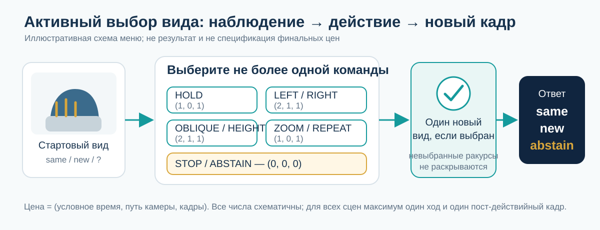
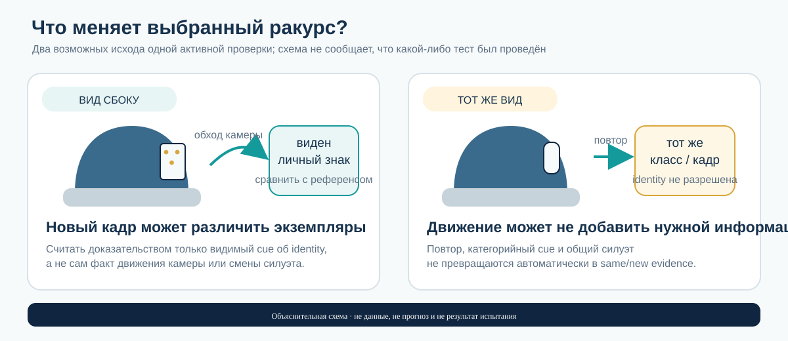

# Активные иллюстративные сцены для протокола AVO

**Дата:** 31 октября 2026 года · **Версия:** v1  
**Статус всего документа и каждой карточки:** **SYNTHETIC / ILLUSTRATIVE / NOT TESTED**  
**Связанный протокол:** [AVO-01—AVO-05, v1](zauchit-object-identity-active-viewpoint-benchmark-protocol-2026-10-30-v1.md)  
**Индекс коллекции:** [book-collections/README.md](../../README.md)

Это десять придуманных текстовых карточек — по две на каждый модуль AVO-01—AVO-05. Они показывают, как превратить протокол выбора ракурса в конкретные контрасты и ожидаемые наблюдения. Это не датасет, не рендеры и не результаты: сцены не запускались, симулятор, модели, эксперимент, пользовательское исследование и робот не использовались.

> **Граница интерпретации.** Карточки иллюстрируют функциональные решения `same`, `new` и `abstain` в синтетическом проекте. Они не проверяют человеческое понимание, сознание, субъективный опыт, биологический механизм, безопасность реального робота или перенос на физический мир. Не назначены выборки, мощность, вероятности точности, пороги либо критерии успеха.

## Две схемы

## Как читать и безопасно передавать карточки

Каждая карточка состоит из **model-facing input** и следующего за ним **evaluator-only блока**. В рабочий вход модели разрешено копировать только первый блок карточки. Не копируйте к нему evaluator-only текст, разметку пар, ответный ключ, таблицу исходов действий, метрики, идентификаторы, статус удержанной группы или сведения о том, какой ход информативен. Карточки даны текстом для ручного разбора; никаких изображений они не содержат.

В model-facing блоке системе доступны только описание уже наблюдавшихся кадров, меню команд с относительной ценой и вопрос `same / new / abstain`. Все действия выполнимы. Ответ до действия разрешён; либо можно выбрать ровно одну камеру-команду, получить один пост-действийный кадр и затем ответить или воздержаться. Не предусмотрены повторные действия после этого кадра.

### Одинаковые рамки для всех десяти карточек

| Команда | Что получает участник | Относительная цена `(время, путь камеры, кадры)` |
|---|---|---:|
| `HOLD` | Следующий кадр с той же позы камеры; сцена на время осмотра заморожена | `(1, 0, 1)` |
| `LEFT` / `RIGHT` | Один боковой обход камеры вокруг заслонки | `(2, 1, 1)` |
| `OBLIQUE` / `HEIGHT` | Один диагональный или приподнятый вид | `(2, 1, 1)` |
| `ZOOM` | Один крупный план с той же позиции | `(1, 0, 1)` |
| `REPEAT` | Точный повтор текущего вида при том же состоянии сцены | `(1, 0, 1)` |
| `STOP` / `ABSTAIN` | Остановиться без нового кадра и сообщить `same`, `new` или `abstain` | `(0, 0, 0)` |

Цены — только **иллюстративные относительные единицы**, не измеренные задержки, метры, значения utility или норматив протокола. Для каждой пары обе карточки имеют одинаковый стартовый кадр, меню, состояния сцены, цену каждой команды, горизонт и бюджет: максимум одна выбранная команда и один новый кадр; предельный бюджет — два условных временных тика, один путь камеры и один дополнительный кадр. Сцена неподвижна во время осмотра, поэтому разные длительности команд не смешиваются с движением объекта. В AVO-02 различие цены между доступными командами — намеренная манипуляция внутри обеих пар; сама карта цен одинакова в карточках пары.

`PASSIVE-FIXED` — внешний контроль, не выбор из меню: он показывает заранее заданный пост-окклюзионный ракурс при том же лимите кадров, не спрашивая у системы, какой вид выбрать. `RANDOM` выбирает команду из общего меню без доступа к evaluator-разметке. `GREEDY-CUE` — замороженная эвристика заметности видимого признака; ей недоступен скрытый ID, будущий кадр или evaluator-карта. `COST-AWARE` оценивает ожидаемую информацию именно о `same/new` относительно объявленной в карточке цены; вес цены и правило решения здесь не фиксируются. `ABSTAIN` — допустимый терминальный ответ, особенно когда доступный ход не может разделить гипотезы. Эти описания задают логику сравнения, **не предсказывают исход** ни для одной политики.

## Карточки

### AVO-01 · карточка 01 — облет открывает экземплярный знак

**Статус:** SYNTHETIC / ILLUSTRATIVE / NOT TESTED.

**Model-facing input — единственный блок для модельного входа.** До заслонки был виден круглый синий жетон с тремя маленькими точками, расположенными треугольником у заднего края. После окклюзии видна фронтальная сторона похожего синего жетона; точки скрыты. Категория понятна, но по текущему виду остаются возможны `same` и `new`. Выберите одну команду из общего меню либо остановитесь; после не более чем одного нового кадра ответьте `same`, `new` или `abstain`.

**Evaluator-only — не передавать модели.** Неподвижное состояние; стартовые кадры и цены совпадают с карточкой 02. Неизменный ID ранее наблюдавшейся сущности `E-AVO01-REF`. В этой ветви текущая сущность сохраняет ID `E-AVO01-CONT`; ground truth `same` (`E-AVO01-REF → E-AVO01-CONT`). Идентифицируемость до действия: **неидентифицируемо для identity**, категория различима. После `LEFT`: идентифицируемо по совпавшей тройке точек. После иных ходов: identity остаётся неидентифицируемой; вид категории или повтор не считается новым identity-свидетельством.

**Ожидаемые наблюдения по действиям (evaluator-only).** `HOLD` — фронтальный силуэт, точки закрыты; `LEFT` — видны три точки в том же треугольном порядке, что в референсе; `RIGHT` — гладкий боковой край без точки сравнения; `OBLIQUE/HEIGHT` — другой силуэт, категория та же, задний знак не читается; `ZOOM` — крупнее тот же фронт, знак всё ещё закрыт; `REPEAT` — точный дубль исходного кадра; `STOP/ABSTAIN` — нового наблюдения нет. Только `LEFT` информативен для идентичности; остальные действия повторяют или уточняют категорию, но не различают экземпляры.

**Политики, ожидаемая логика (не прогноз результатов).** Passive-fixed не выбирает `LEFT` по текущему наблюдению; random может взять любой допустимый ход без гарантии нужного вида; greedy-cue ориентируется лишь на доступную заметность и не знает закрытый знак; cost-aware может выбрать `LEFT`, только если ожидаемая identity-информация оправдывает его объявленную цену по заранее заданному правилу; abstain-policy может остановиться до кадра при недостаточной ожидаемой пользе или ответить по увиденному знаку после кадра.

**Безопасное правило.** Не делать вывод о сохранении ID только по совпавшему цвету/категории; если знак после выбранного вида не наблюдался, допустим `abstain`. **Метрика:** balanced accuracy `same/new` и доля действий, открывших action-induced identity cue, на идентифицируемой страте AVO-01. **Риск/сбой:** засчитать категориальный вид, повтор или сам факт движения камеры как identity evidence.

**Matched pair/control:** карточка 02 имеет тождественный модельный старт и меню, но скрытая сущность заменена. Контроль пассивного/случайного выбора — сравнение с `PASSIVE-FIXED`, `RANDOM` и no-additional-frame на том же состоянии, без раскрытия альтернативных ракурсов.

### AVO-01 · карточка 02 — тот же активный ход, другая скрытая сущность

**Статус:** SYNTHETIC / ILLUSTRATIVE / NOT TESTED.

**Model-facing input.** До заслонки был виден круглый синий жетон с тремя маленькими точками, расположенными треугольником у заднего края. После окклюзии видна фронтальная сторона похожего синего жетона; точки скрыты. Категория понятна, но по текущему виду остаются возможны `same` и `new`. Выберите одну команду из общего меню либо остановитесь; после не более чем одного нового кадра ответьте `same`, `new` или `abstain`.

**Evaluator-only — не передавать модели.** Тот же immutable reference ID `E-AVO01-REF`, но за заслонкой появился новый immutable ID `E-AVO01-REPL`; ground truth `new`. Стартовые пиксели, время, меню, цены, геометрия доступных путей и лимит кадров совпадают с карточкой 01. До действия: **неидентифицируемо для identity**, категория различима. После `LEFT`: идентифицируемо; новая тройка точек имеет другую конфигурацию и не совпадает с референсом. После других действий: identity неидентифицируема.

**Ожидаемые наблюдения по действиям (evaluator-only).** `HOLD` — тот же фронтальный силуэт, точки закрыты; `LEFT` — видна тройка точек, конфигурация отличается от референса; `RIGHT` — гладкий боковой край без различающего признака; `OBLIQUE/HEIGHT` — видна лишь категория и иной силуэт; `ZOOM` — увеличен фронтальный участок, задний знак скрыт; `REPEAT` — точное повторение исходного изображения; `STOP/ABSTAIN` — новых данных нет. Для `same/new` внутри этой пары информативен только результат `LEFT`; его сравнение с предыдущим видимым знаком разделяет гипотезы.

**Политики, ожидаемая логика (не прогноз результатов).** Passive-fixed получает заданный ракурс, а не выбирает различающий ход; random не использует скрытый факт замены; greedy-cue следует только видимым признакам; cost-aware соотносит ожидаемое уменьшение неопределённости identity с ценой, не используя evaluator key; abstain-policy воздерживается, если идентифицирующий знак не появился, и может решить после информативного кадра.

**Безопасное правило.** `new` допустим лишь по видимому несовпадению экземплярного знака; при неинформативном виде ответ не выводится из самого факта окклюзии. **Метрика:** same/new balanced accuracy по паре, отдельно false-same/false-new и открытие identity cue; не считать две карточки независимыми экспериментами. **Риск/сбой:** модель угадывает новую сущность из паузы/окклюзии, либо выдаёт уверенный `same` по общей категории.

**Matched pair/control:** карточка 01 — та же сцена и тот же активный ход с противоположной скрытой меткой; `PASSIVE-FIXED`, `RANDOM` и no-additional-frame — контроль выбора ракурса, не предсказание ответа.

### AVO-02 · карточка 03 — цена информативного обхода

**Статус:** SYNTHETIC / ILLUSTRATIVE / NOT TESTED.

**Model-facing input.** До заслонки был виден зелёный шестигранный жетон с узкой V-образной насечкой на дальней грани и слабым зернистым рисунком у переднего края. После заслонки фронтальная сторона похожего зелёного жетона; насечка не видна, а рисунок слишком мелок для сравнения без увеличения. Цвет и форма указывают на ту же категорию, но не позволяют решить `same/new`. Выберите одну команду из общего меню с её ценой либо остановитесь; после максимум одного кадра ответьте `same`, `new` или `abstain`.

**Evaluator-only — не передавать модели.** Reference ID `E-AVO02-REF`; продолживший ID `E-AVO02-CONT`; ground truth `same`. До действия identity неидентифицируема, категория различима. `RIGHT` обход раскрывает насечку, совпадающую с референсом, при цене `(2,1,1)`; дешёвый `ZOOM` увеличивает фронт, но насечка остаётся скрыта. Идентифицируемость возникает только после фактически информативного вида.

**Ожидаемые наблюдения по действиям (evaluator-only).** `HOLD` — фронтальный вид, только категория; `LEFT` — гладкая дальняя грань без насечки; `RIGHT` — насечка видна и сопоставима с референсом, identity-информативно; `OBLIQUE/HEIGHT` — крупнее видна форма грани, но не насечка; `ZOOM` — зернистый рисунок у переднего края совпадает с референсом, но он общий для класса и даёт только категорийную информацию; `REPEAT` — прежние пиксели; `STOP/ABSTAIN` — новый кадр не добавляется. Дешёвый крупный план даёт только общую информацию; затратный обход — identity cue.

**Политики, ожидаемая логика (не прогноз результатов).** Passive-fixed не оптимизирует действие; random не учитывает информацию на единицу цены; greedy-cue может выбрать визуально заметную грань без оценки identity/cost; cost-blind identity-IG рассматривает ожидаемую identity-информацию без цены; cost-aware оценивает компромисс и может заплатить за `RIGHT` лишь если он оправдан заранее заданной функцией цены; abstain-policy останавливается, когда доступная информация не оправдывает действие по замороженному правилу. Численный вес цены здесь не задан.

**Безопасное правило.** Не подменять identity-сигналом увеличение масштаба или категориальную уверенность; использовать `same` лишь после видимой проверки насечки. **Метрика:** внутри AVO-02 — quality–cost trade-off, identity errors на единицу объявленной цены и decision quality при равном лимите; не агрегировать эти условные цены с другими модулями. **Риск/сбой:** решение по классу вместо экземпляра, либо невалидное послетестовое изменение веса цены.

**Matched pair/control:** карточка 04 сохраняет меню и карту цен, но переносит индивидуальный сигнал в дешёвый вид. В обеих карточках одинаковы старт, время состояния, path costs, число кадров и лимит; различается только расположение identity cue относительно команд.

### AVO-02 · карточка 04 — доступный дешёвый identity-ракурс

**Статус:** SYNTHETIC / ILLUSTRATIVE / NOT TESTED.

**Model-facing input.** До заслонки был виден зелёный шестигранный жетон с узкой V-образной насечкой на дальней грани и слабым зернистым рисунком у переднего края. После заслонки фронтальная сторона похожего зелёного жетона; насечка не видна, а рисунок слишком мелок для сравнения без увеличения. Цвет и форма указывают на ту же категорию, но не позволяют решить `same/new`. Выберите одну команду из общего меню с её ценой либо остановитесь; после максимум одного кадра ответьте `same`, `new` или `abstain`.

**Evaluator-only — не передавать модели.** Reference ID `E-AVO02-REF`; replacement ID `E-AVO02-REPL`; ground truth `new`. Начальные кадры те же, что у карточки 03. Индивидуальный микрорельеф на передней кромке скрыт разрешением стартового вида, но открывается `ZOOM` с ценой `(1,0,1)`; `RIGHT` также показывает заднюю метку-замену с ценой `(2,1,1)`. До действия identity неидентифицируема, после `ZOOM` или `RIGHT` — идентифицируема.

**Ожидаемые наблюдения по действиям (evaluator-only).** `HOLD` — фронтальный кадр, знак ниже различимости, категория доступна; `LEFT` — гладкая боковая грань, только категория; `RIGHT` — видна новая задняя метка, несовпадающая с референсом; `OBLIQUE/HEIGHT` — видна форма и зелёный цвет, но метка недостаточно читаема; `ZOOM` — микрорельеф на передней кромке различим и не совпадает с референсом; `REPEAT` — исходные пиксели без нового разрешения; `STOP/ABSTAIN` — без дополнительного evidence. `ZOOM` и `RIGHT` identity-информативны, но различаются ценой; остальные кадры дают класс, повтор или отсутствие данных.

**Политики, ожидаемая логика (не прогноз результатов).** Passive-fixed не выбирает новый ракурс; random не оптимизирует затраты; greedy-cue может предпочесть заметную фронтальную деталь, но не обязательно сравнивает затраты; cost-blind identity-IG учитывает доступное identity-свидетельство, но не цену; cost-aware может предпочесть дешёвый `ZOOM`, если заранее замороженная оценка считает его достаточным, и не обязан выбирать более дорогой ход с тем же типом свидетельства; abstain-policy разрешает остановку, если ценность кадра ниже заранее заданного, но здесь не численного, правила.

**Безопасное правило.** Цена не является доказательством `new`; ответ основывается на видимой несовместимости индивидуального признака, а при недостаточном разрешении допускается `abstain`. **Метрика:** та же внутримодульная quality–cost кривая, cost-aware vs cost-blind identity-IG и ошибки на единицу цены. **Риск/сбой:** сравнивать цены после просмотра результата, принять крупный классический вид за identity cue или потратить больший бюджет, чем разрешено.

**Matched pair/control:** карточка 03 — тот же старт, бюджет и cost map, но дешёвый вид там не открывает экземплярную деталь. Это парный контраст доступности равноценной identity-информации при разной цене; он не задаёт универсальную стоимость/порог.

### AVO-03 · карточка 05 — категорийный признак против личной метки

**Статус:** SYNTHETIC / ILLUSTRATIVE / NOT TESTED.

**Model-facing input.** До окклюзии был показан один из двух белых керамических дисков одной категории: общий выпуклый логотип в центре и маленькая треугольная выемка на обратной стороне. После окклюзии виден другой белый диск с тем же логотипом; выемка пока закрыта. Категория подтверждается, но видимые данные совместимы с `same` и `new`. Выберите одну команду из общего меню или остановитесь; затем ответьте `same`, `new` или `abstain`.

**Evaluator-only — не передавать модели.** Reference ID `E-AVO03-REF`; продолживший ID `E-AVO03-CONT`; ground truth `same`. До действия категория identifiable, identity non-identifiable. `RIGHT` раскрывает выемку, совпадающую с референсом; это экземплярный cue. `ZOOM` подчёркивает общий логотип и помогает лишь категории. После `RIGHT` identity identifiable; после остальных команд индивидуальная гипотеза не разрешена.

**Ожидаемые наблюдения по действиям (evaluator-only).** `HOLD` — фронтальный вид и общий логотип; `LEFT` — внешняя кромка без выемки, категория; `RIGHT` — обратная сторона с выемкой, сравнимой с референсом, identity-информативно; `OBLIQUE/HEIGHT` — видны материал и общий логотип, не выемка; `ZOOM` — логотип крупнее, только class cue; `REPEAT` — точное повторение; `STOP/ABSTAIN` — без нового наблюдения. Нельзя считать категорийную информацию достаточной для индивидуального `same/new`.

**Политики, ожидаемая логика (не прогноз результатов).** Passive-fixed оставляет выбор ракурса расписанию; random не различает значимость категории и экземпляра; greedy-cue может предпочесть более заметный логотип; cost-blind identity-IG предпочитает ожидаемый сигнал о `same/new`; cost-aware учитывает цену относительно именно identity-сигнала; abstain-policy воздерживается, если не увидела различающую выемку, даже когда категория очевидна.

**Безопасное правило.** Не засчитывать category accuracy как within-class identity. `same` допустим после совпадения индивидуальной выемки; при её невидимости — `abstain`. **Метрика:** within-class balanced accuracy `same/new`, доля открытий ранее скрытого instance cue и отдельный учёт ошибок category-only. **Риск/сбой:** модель называет категорию правильно, но всё равно ошибочно выдаёт это за идентификацию экземпляра.

**Matched pair/control:** карточка 06 имеет тот же класс, общий логотип, исходную неопределённость и цену каждого вида, но никакая команда не показывает различающей индивидуальной метки. Пара отделяет полезность категории от сведения о конкретной сущности.

### AVO-03 · карточка 06 — категория видна, экземпляр неразличим

**Статус:** SYNTHETIC / ILLUSTRATIVE / NOT TESTED.

**Model-facing input.** До окклюзии был показан один из двух белых керамических дисков одной категории: общий выпуклый логотип в центре и маленькая треугольная выемка на обратной стороне. После окклюзии виден другой белый диск с тем же логотипом; выемка закрыта. Категория подтверждается, но видимые данные совместимы с `same` и `new`. Выберите одну команду из общего меню или остановитесь; затем ответьте `same`, `new` или `abstain`.

**Evaluator-only — не передавать модели.** Reference ID `E-AVO03-REF`; скрытая новая сущность `E-AVO03-REPL`; ground truth `new`. Треугольная выемка и общий логотип — общие признаки этой категории: у референса и замены они одинаковы и не различают экземпляры. Иного индивидуального cue нет. До и после любой команды identity **неидентифицируема**, категория различима. Oracle-знание нового ID не создаёт допустимое свидетельство для участника.

**Ожидаемые наблюдения по действиям (evaluator-only).** `HOLD` — логотип и белая форма; `LEFT` — та же категорийная кромка; `RIGHT` — на обратной стороне видна та же треугольная выемка у обоих кандидатов, поэтому это только категорийное, не identity-свидетельство; `OBLIQUE/HEIGHT` — общий профиль диска; `ZOOM` — больший логотип; `REPEAT` — тот же кадр; `STOP/ABSTAIN` — новых сведений нет. Все изображения раскрывают максимум категорию/общие свойства или повтор; ни одно не разделяет `same` от `new`.

**Политики, ожидаемая логика (не прогноз результатов).** Passive-fixed видит предписанный кадр; random может увеличить категорийное сведение, но не identity; greedy-cue может выбрать самый заметный логотип и ошибочно принять его за цель, что в оценке не маркируется как identity-свидетельство; cost-blind/cost-aware не должны превращать отсутствие разделяющего сигнала в информативный; abstain-policy может корректно остановиться без ответа о скрытом ID.

**Безопасное правило.** `abstain` допустим и здесь предпочтительнее необоснованной уверенности; скрытое знание evaluator не является подсказкой. **Метрика:** within-class selective risk/coverage и доля ложного превращения class cue в identity cue, отдельно от точности категории. **Риск/сбой:** forced-choice на неидентифицируемой сцене, overclaim на общем логотипе или подсчёт неизвестного ответа как обычной ошибки same/new.

**Matched pair/control:** карточка 05 — same class, но после одного доступного действия появляется настоящий индивидуальный cue. Равны стартовые данные, время, цена, меню и бюджет; изменяется только идентифицируемость объекта на уровне экземпляра.

### AVO-04 · карточка 07 — одна разрешающая перепроверка

**Статус:** SYNTHETIC / ILLUSTRATIVE / NOT TESTED.

**Model-facing input.** Перед окклюзией был показан матовый латунный винт с одной короткой продольной насечкой под головкой. После заслонки видна головка похожего винта, нижняя часть скрыта; силуэт и категория совпадают. Начальных данных недостаточно, чтобы отличить продолжение от замены. Выберите максимум одну команду из общего меню либо остановитесь; затем ответьте `same`, `new` или `abstain`.

**Evaluator-only — не передавать модели.** Reference ID `E-AVO04-REF`; continued ID `E-AVO04-CONT`; ground truth `same`. Начальный identity status: **неидентифицируемо**; category identifiable. После `OBLIQUE/HEIGHT` видна насечка, совпадающая с reference, и решение становится идентифицируемым. Остальные действия не снимают неоднозначность. За одну пробу разрешён один recheck, затем обязательная остановка.

**Ожидаемые наблюдения по действиям (evaluator-only).** `HOLD` — головка винта, насечка закрыта; `LEFT`/`RIGHT` — боковой контур без нижней насечки; `OBLIQUE/HEIGHT` — нижний край и совпавшая насечка открыты, identity-информативно; `ZOOM` — больше тот же верхний вид, метка не читается; `REPEAT` — повтор исходного кадра; `STOP/ABSTAIN` — без дополнительного свидетельства. После informative вида ответить по насечке; после любого иного — identity остаётся неидентифицируемой, recheck исчерпан.

**Политики, ожидаемая логика (не прогноз результатов).** Passive-fixed не может адаптивно проверить нижнюю грань; random может выбрать любой вид, не зная его пользы; greedy-cue может выбрать заметный крупный план, который не открывает насечку; cost-aware соотносит ожидаемую ценность одноразовой перепроверки с её ценой; abstain-policy может один раз проверить ожидаемо различающий вид, а затем воздержаться, если индивидуального сигнала нет.

**Безопасное правило.** Не повторять бесконечно; один доступный recheck, затем решение или abstain. **Метрика:** selective risk–coverage и калибровка/Brier с отдельной стратой informative recheck. **Риск/сбой:** не использовать разрешающий вид, преждевременно выбрать same/new либо продолжать неограниченные проверки.

**Matched pair/control:** карточка 08 имеет то же состояние камеры, видимый силуэт, расписание, меню и стоимость одного recheck, но в ней ни один разрешённый вид не создаёт уникального cue. Это парный контроль стратегии остановки, а не новый тест категории.

### AVO-04 · карточка 08 — истинная неидентифицируемость и допустимое abstain

**Статус:** SYNTHETIC / ILLUSTRATIVE / NOT TESTED.

**Model-facing input.** Перед окклюзией был показан гладкий матовый латунный винт без насечек, текста, царапин или цветовых различий. После заслонки видна головка визуально такого же винта; нижняя часть закрыта. Исходные данные совместимы с продолжением и заменой. Выберите максимум одну команду из общего меню либо остановитесь; затем ответьте `same`, `new` или `abstain`.

**Evaluator-only — не передавать модели.** Reference ID `E-AVO04-REF`; replacement ID `E-AVO04-REPL`; ground truth `new`. Два кандидата полностью наблюдательно эквивалентны при каждом разрешённом ходе. До и после действия identity **неидентифицируема**, категория видима. Правильное решение может быть `abstain`, несмотря на то что evaluator знает, что ID сменился.

**Ожидаемые наблюдения по действиям (evaluator-only).** `HOLD` — тот же гладкий верх; `LEFT`/`RIGHT` — гладкие боковые поверхности без меток; `OBLIQUE/HEIGHT` — тот же профиль; `ZOOM` — более крупная гладкая поверхность; `REPEAT` — точные исходные пиксели; `STOP/ABSTAIN` — новых данных нет. Все доступные виды дают одинаковое свидетельство при `same` и `new`, то есть только категорию/повтор/неинформативное наблюдение. Действие не может сделать hidden ID видимым.

**Политики, ожидаемая логика (не прогноз результатов).** Passive-fixed, random и greedy-cue могут выбирать разные виды, но ни один из них не должен получать кредит за identity-информацию, которой нет; cost-blind/cost-aware не находят основание для повторных бесполезных действий по карте наблюдений; abstain-policy завершает эпизод без forced choice либо после одного разрешённого бесполезного recheck.

**Безопасное правило.** Не угадывать ground truth и не трактовать доступный evaluator-only ID как модельное знание; остановиться и сообщить `abstain`. **Метрика:** selective risk–coverage, калибровка/Brier и стоимость бесполезного recheck на intrinsic non-identifiability страте. **Риск/сбой:** ложноуверенный `new` по самому факту окклюзии, бессмысленные повторные проверки или искусственное повышение coverage forced-choice ответами.

**Matched pair/control:** карточка 07 имеет тот же протокол одного recheck, но существует доступный индивидуальный вид. Сравнение относится к остановке и калибровке; скрытая метка карточки 08 не должна превращать его в угадайку.

### AVO-05 · карточка 09 — новый семейный контур объекта

**Статус:** SYNTHETIC / ILLUSTRATIVE / NOT TESTED. Ниже не показаны никакие train/test-подсказки.

**Model-facing input.** До окклюзии был виден янтарный трёхзубчатый зажим с двумя небольшими отверстиями на внутренней дуге. После заслонки видна только часть похожего янтарного предмета; отверстия и профиль зубцов не полностью различимы. Категория предмета видна, но остаются возможны `same` и `new`. Выберите одну команду из общего меню или остановитесь; затем ответьте `same`, `new` или `abstain`.

**Evaluator-only — не передавать модели.** Reference ID `E-AVO05-REF`; continued ID `E-AVO05-CONT`; ground truth `same`. Оценочная группа скрыто удерживает новое семейство геометрии объекта: это evaluator metadata, не характеристика payload. Initial identity non-identifiable, category identifiable; `LEFT` раскрывает пару отверстий и контур, совпадающие с референсом. После `LEFT` идентифицируемо; другие виды не открывают полный instance cue.

**Ожидаемые наблюдения по действиям (evaluator-only).** `HOLD` — фрагмент янтарного корпуса, индивидуальные отверстия закрыты; `LEFT` — оба отверстия и три зубца видны и совпадают с референсом, identity-информативно; `RIGHT` — гладкая боковая стенка, категория; `OBLIQUE/HEIGHT` — виден один зубец, но он общий; `ZOOM` — крупнее фрагмент без полного контура; `REPEAT` — тот же частичный вид; `STOP/ABSTAIN` — кадра нет. Никакой action не несёт label разбиения; только наблюдаемые отверстия могут разделять индивидуальность.

**Политики, ожидаемая логика (не прогноз результатов).** Passive-fixed использует назначенный вид; random не знает принадлежность к удержанной группе; greedy-cue ориентируется на доступную форму, но не на split; cost-aware может выбрать `LEFT`, если ожидаемое identity-свидетельство оправдывает общую цену; abstain-policy может воздержаться, если cue после хода по-прежнему неполон. Никто не получает названия группы или provenance.

**Безопасное правило.** Не выводить `same` из того, что предмет «похож» или принадлежит знакомой категории; сравнивать только реально видимый экземплярный контур. **Метрика:** перенос на удержанной группе объектов и разброс/worst-group по заранее определённым факторам, отдельно false-same/false-new. **Риск/сбой:** решение по привычному шаблону категории, утечка семейства/seed/имени файла или вывод о переносе по одному примеру.

**Matched pair/control:** карточка 10 удерживает другой фактор — геометрию заслонки. В model-facing блоках обеих карточек намеренно отсутствуют слова «held-out», названия split, ID, seed, fold, provenance, ожидаемый правильный ход и evaluator-метки.

### AVO-05 · карточка 10 — новая геометрия заслонки

**Статус:** SYNTHETIC / ILLUSTRATIVE / NOT TESTED. Ниже не показаны никакие train/test-подсказки.

**Model-facing input.** До окклюзии был виден белый прямоугольный жетон с одной диагональной насечкой у нижнего края. После заслонки виден только верхний прямоугольный фрагмент похожего белого жетона; нижний край скрыт. Категория понятна, но по начальному виду остаются возможны `same` и `new`. Выберите одну команду из общего меню или остановитесь; затем ответьте `same`, `new` или `abstain`.

**Evaluator-only — не передавать модели.** Reference ID `E-AVO05-REF`; replacement ID `E-AVO05-REPL`; ground truth `new`. Оценочная группа скрыто удерживает новое семейство геометрии заслонки, а не объекта; model-facing pixels, меню и cost table не содержат метки группы. До действия identity non-identifiable, категория identifiable. `OBLIQUE/HEIGHT` обходит фигурную кромку и открывает насечку; она отличается от референса, поэтому после этого хода identity identifiable.

**Ожидаемые наблюдения по действиям (evaluator-only).** `HOLD` — верхняя часть белого жетона, нижний край закрыт; `LEFT`/`RIGHT` — боковые фрагменты за новой кромкой заслонки без насечки; `OBLIQUE/HEIGHT` — нижняя диагональная насечка открыта и не совпадает с референсом, identity-информативно; `ZOOM` — увеличен верхний участок, класс виден, насечка скрыта; `REPEAT` — прежние пиксели; `STOP/ABSTAIN` — новых данных нет. Различающий признак принадлежит объекту; сам факт необычной заслонки — не evidence о `same/new`.

**Политики, ожидаемая логика (не прогноз результатов).** Passive-fixed не адаптируется к скрытой кромке; random не имеет доступа к hidden split; greedy-cue учитывает наблюдаемую геометрию заслонки, но не её label; cost-aware сопоставляет ожидаемую identity-информацию `OBLIQUE/HEIGHT` с объявленной ценой; abstain-policy разрешает ответ лишь после видимого различия, иначе останавливается. Train/test provenance недоступен каждому методу.

**Безопасное правило.** Не считать новизну/форму заслонки сигналом о замене предмета; `new` допустим только после несовпадающей видимой насечки. **Метрика:** удержанный перенос по геометрии заслонки, разброс и worst-group анализ при равных бюджетах, с раздельными false-same/false-new. **Риск/сбой:** утечка названия удержанной группы, спутывание заслонки с объектом или вывод о переносе без представленных групп.

**Matched pair/control:** карточка 09 имеет тот же лимит одного хода/кадра и тот же вектор затрат; там удержан фактор формы самого объекта. В обоих случаях метаданные split, будущие кадры и oracle-label должны отсутствовать во входе модели.

## Сводный evaluator-only ключ

Все строки ниже остаются вне model input. Immutable entity ID относятся к evaluator-журналу; их нельзя кодировать в имени файла, seed, порядке предъявления, watermark, свойствах кадра или публичном имени карточки.

| Карточка | Immutable ID референса → текущей сущности | Ground truth | Идентифицируемость до → после информативного хода | Основной action-induced identity cue |
|---|---|---|---|---|
| AVO-01 / 01 | `E-AVO01-REF` → `E-AVO01-CONT` | same | нет → да после LEFT | Совпавшая треугольная тройка точек |
| AVO-01 / 02 | `E-AVO01-REF` → `E-AVO01-REPL` | new | нет → да после LEFT | Несовпавшая конфигурация точек |
| AVO-02 / 03 | `E-AVO02-REF` → `E-AVO02-CONT` | same | нет → да после RIGHT | Совпавшая V-образная насечка |
| AVO-02 / 04 | `E-AVO02-REF` → `E-AVO02-REPL` | new | нет → да после ZOOM или RIGHT | Несовпадающий микрорельеф или задняя метка |
| AVO-03 / 05 | `E-AVO03-REF` → `E-AVO03-CONT` | same | нет → да после RIGHT | Совпавшая треугольная выемка |
| AVO-03 / 06 | `E-AVO03-REF` → `E-AVO03-REPL` | new | нет → нет | Нет уникального cue; только класс |
| AVO-04 / 07 | `E-AVO04-REF` → `E-AVO04-CONT` | same | нет → да после OBLIQUE/HEIGHT | Совпавшая нижняя насечка |
| AVO-04 / 08 | `E-AVO04-REF` → `E-AVO04-REPL` | new | нет → нет | Наблюдения same/new эквивалентны; abstain допустим |
| AVO-05 / 09 | `E-AVO05-REF` → `E-AVO05-CONT` | same | нет → да после LEFT | Совпавшие отверстия и контур нового семейства |
| AVO-05 / 10 | `E-AVO05-REF` → `E-AVO05-REPL` | new | нет → да после OBLIQUE/HEIGHT | Несовпавшая насечка за новой кромкой заслонки |

В AVO-03 / 06 и AVO-04 / 08 ground truth известен только evaluator. По самому наблюдению корректный участник может не различить `same/new` и воздержаться. «Идентифицируемо после хода» означает, что **конкретный** ход открывает сравнимый cue; если этого не произошло, статус остаётся неидентифицируемым. Категория может быть идентифицирована во всех десяти карточках, но это не заменяет identity.

## Проверки целостности до любого будущего исследования

- Извлечь только model-facing блоки; evaluator-only ключ, список исходов, названия групп и таблицу ответов хранить отдельно от входа модели.
- Для AVO-05 полностью исключить из модельного payload split labels и метаданные, включая module/fold/train/validation/test, hidden ID, seed, filename, порядок и provenance. Публичные карточки не содержат исполняемых split-меток.
- Сверить у пар один и тот же исходный кадр, время состояния, допустимые действия, цену каждой одноимённой команды, путь камеры, число кадров и stopping rule. В AVO-02 разница стоимости между действиями заявлена заранее и одинакова внутри пары.
- Разделять action-selected кадр, заранее заданный passive-fixed кадр и отсутствие дополнительного кадра; не приписывать исходный кадр выбранному действию.
- До запуска любого исследования отдельно определить preregistration, критерии, cost weights и статистический план. Этот пакет их не задаёт и не даёт разрешения на запуск.
