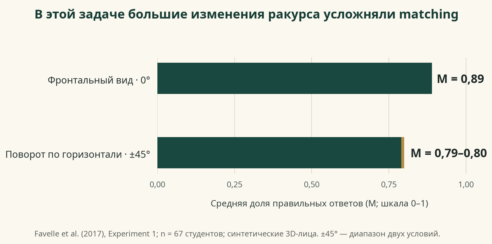
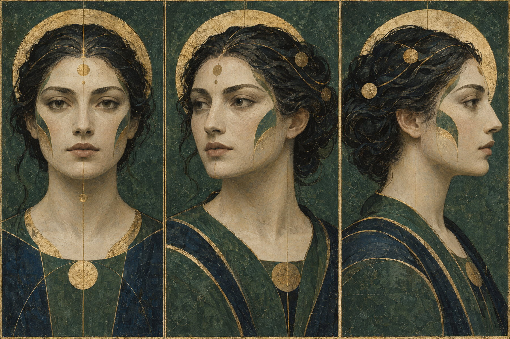
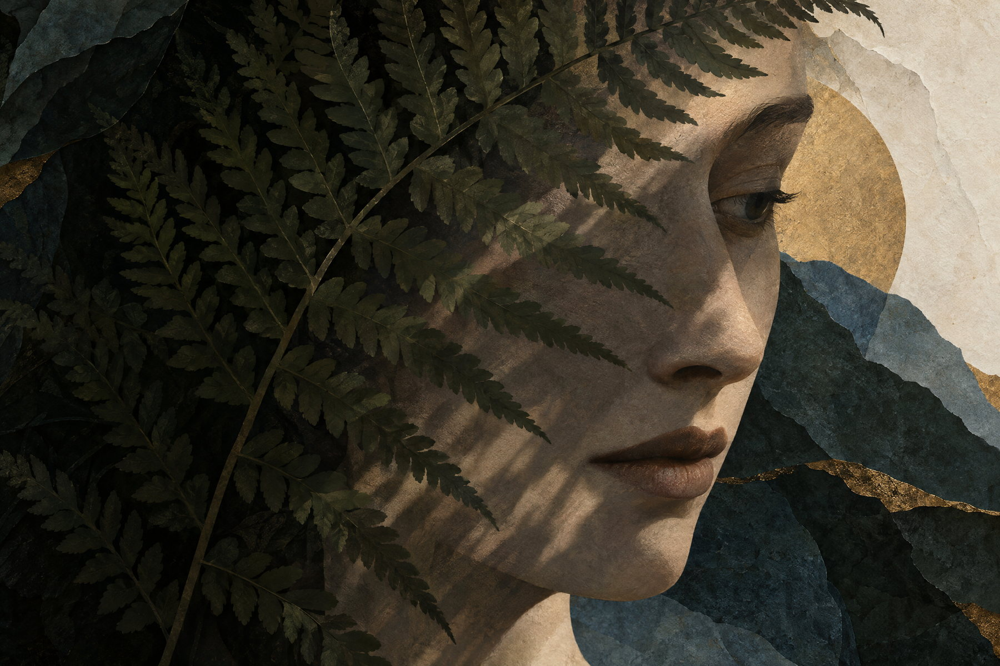

# За заслонкой

## Лицо и ракурс: что сохраняется, когда меняется изображение человека

**Иллюстрированное исследовательское издание · 31 октября 2026 · v1.0**

### Главный вывод

Мы узнаём человека не по одной неизменной фотографии. Опыт помогает связать разные изображения с одной личностью, но не делает лицо полностью независимым от ракурса, света, выражения или закрытой части. Для незнакомых лиц смена изображения обычно труднее; для знакомых она чаще переносится лучше — но даже знакомый профиль, маска или плохой снимок могут привести к ошибке. Это не один универсальный эффект: результат зависит от того, кого показывают, как устроено задание и что считают «узнаванием».[3] [4] [5] [8] [13]

## Не всякое «узнал» означает одно и то же

В исследованиях встречаются разные задачи. При **matching** человек решает, принадлежат ли два снимка одной личности. При **распознавании из памяти** он должен узнать ранее увиденное лицо. Иногда участник только оценивает, кажется ли лицо знакомым, а иногда называет человека. Эти ответы связаны, но не совпадают: знакомость может ощущаться без точной идентификации.[10]

Измерение тоже меняет вывод. Доля правильных ответов показывает общую точность в конкретном наборе проб. Чувствительность *d′* помогает отделить различение совпадений от склонности чаще отвечать «да». Время реакции измеряет скорость; уверенность — субъективную оценку ответа. Нейронная адаптация и зрительный aftereffect дают косвенные показатели обработки, а не прямую проверку того, верно ли человек назван.[10] [13] [16]

Это важно практически: результаты разных типов задач нельзя собрать в один процент «насколько хорошо люди узнают лица».

## Когда меняется ракурс

Для незнакомых лиц перенос между видами часто ухудшается с увеличением различия между тренировочным и тестовым ракурсом. В контролируемой задаче с синтетическими трёхмерными лицами участники точнее сопоставляли фронтальный вид, чем изображения с поворотом головы на 45 градусов. Но результат зависел и от вертикального поворота, и от освещения.[1] В более ранних экспериментах перенос также зависел от того, с какого исходного вида начиналось обучение; изучение нескольких видов помогало распознавать новые виды лучше, чем опора на один вид.[2]

**Один измеренный пример.** В эксперименте Favelle и коллег с 67 студентами и синтетическими лицами средняя точность в задаче выбора из двух вариантов была *M = 0,89* для фронтального изображения и *M = 0,79–0,80* для двух поворотов на ±45°. Полоса на графике показывает именно опубликованный диапазон двух условий. Это результат одной лабораторной задачи; он не равен «точности распознавания людей в жизни».[1]

Нельзя свести все ошибки к величине угла. Имеют значение особенности конкретного лица, его форма, освещение и задача. В экспериментах с новыми видами важной была двусторонняя симметрия, но асимметричное освещение ухудшало matching даже тогда, когда структура лица сохраняла симметрию.[15] Это помогает понять, почему две фотографии с одинаковым поворотом могут быть неодинаково трудными.

Знакомство не гарантирует полной ракурсной инвариантности. Troje и Kersten сравнивали профили со фронтальными изображениями собственного лица и лиц хорошо знакомых коллег. Собственный профиль распознавали хуже; для коллег не нашли различия во времени реакции между фронтом и профилем. Это небольшой эксперимент о конкретных людях и конкретной мере, а не доказательство, что все знакомые лица всегда узнаются одинаково хорошо.[3]

## Почему знакомые лица переносятся лучше

Когда человек часто видит одну личность в разных обстоятельствах, он получает не только одну «идеальную» фотографию. Он учится связывать вариации позы, света, выражения и качества с одним и тем же человеком. В эксперименте с естественными фотографиями незнакомые наблюдатели нередко раскладывали снимки одного человека по разным группам; знакомые наблюдатели чаще объединяли их правильно.[4]

Лабораторное обучение на разнообразных снимках тоже помогает переносу. Если новые личности показывают в нескольких естественно разных условиях, участники лучше справляются с новыми фотографиями, чем после обучения на похожих кадрах из одного события.[6] Более поздняя работа показала, что несколько почти однотипных изображений из одной встречи сами по себе могут не обеспечить такой перенос; вариативность между днями дала более сильное обобщение.[7]

Но знакомство не стирает различия между изображениями. В длинном тесте на обнаружение повторов известные лица распознавались лучше незнакомых, однако смена фотографии ухудшала обнаружение и для знакомых лиц.[5] Поэтому точнее сказать: опыт часто создаёт более устойчивое представление, но оно не делает любой новый вид или снимок автоматически прозрачным.

## Что меняет частичное закрытие лица

Маска убирает часть визуальных признаков, но не только «нижнюю половину». Меняются контуры, тени и соотношение видимых частей. В исследованиях маски ухудшали matching и идентификацию; эффект наблюдался для знакомых и незнакомых лиц, хотя его размер зависел от задания и материала.[8] Отдельная задача показала, что человек может почувствовать знакомость лица за маской и всё же не назвать его правильно.[10]

В эксперименте с недавно выученными незнакомыми лицами цифровая маска ухудшала распознавание, если присутствовала при обучении, тестировании или в обеих фазах.[9] Это не доказывает, что реальная тканевая маска, очки и любой иной предмет дадут одинаковый эффект: физическая форма и тени могут сами давать подсказки.

Нельзя считать видимую верхнюю часть лица универсальным заменителем. В исследовании с верхней и нижней половинами недавно выученных лиц преимущество верхней половины зависело от пола моделей и эксперимента; для части условий находили небольшое преимущество нижней половины.[11] Краткое обучение искать диагностические признаки, например уши и отметины, улучшило matching маскированных незнакомых лиц примерно на 5% в одной лабораторной задаче, но не доказывает долговременное улучшение узнавания знакомых людей.[12]

## Что говорят модели представления лица

Один подход ищет устойчивые признаки личности, другой подчёркивает, что мозг сохраняет отдельные зрительные виды, а новые виды сопоставляются с уже знакомыми. Поведенческие данные совместимы с сочетанием этих процессов: несколько ракурсов помогают, отдельные признаки могут быть особенно информативны, но конкретное изображение всё равно влияет на ответ.[2] [14]

Нейровизуализационное исследование нашло адаптацию в области FFA при повторе той же фотографии, но не показало значимой адаптации к другой фотографии того же человека. Это говорит о зависимости данного нейронного показателя от изображения; оно не доказывает, что человек не способен узнать знакомое лицо на новом снимке.[13]

Так же осторожно нужно трактовать aftereffect. Если адаптация к одному ракурсу меняет восприятие последующего, это свидетельствует о чувствительности обработки к ракурсу. Но aftereffect не равен ответу в задаче на идентификацию человека.[17]

## Что подтверждено, а что пока открыто

Хорошо поддерживается вывод, что незнакомым лицам сложнее переноситься между изображениями. Знакомство обычно помогает объединять вариативные фотографии, но не гарантирует полной независимости от ракурса.[3] [4] [5]

Хорошо поддерживается и то, что маски и другие частичные окклюзии мешают идентификации. Знакомство может оставить преимущество, но не возвращает всю потерянную информацию.[8] [9] [10]

Менее определённо, какие именно элементы опыта дают выигрыш: личные встречи, многократные фотографии, видео, знание имени или всё вместе. Остаётся открытым, как ракурс взаимодействует с освещением, выражением, возрастом, причёской и качеством кадра, когда эти факторы разделены экспериментально. Не решено и то, насколько контролируемые фотографии предсказывают узнавание движущегося человека в реальном времени.

Наконец, разные метрики отвечают на разные вопросы. Когда несовпадения редки, участники могут реже замечать их и менять критерий ответа. Поэтому высокая доля правильных ответов в одном тесте не обязательно означает низкий риск ошибок в другой ситуации.[16]

## Гипотезы проекта — не результаты

Следующие идеи предназначены для будущей проверки. Тесты по этим гипотезам не запускались, участники не набирались и данные не собирались.

**Гипотеза 1.** При одинаковом повороте знакомые лица будут давать меньшую потерю точности, чем незнакомые. Это преимущество может уменьшиться при одновременной сильной смене света и выражения.

**Гипотеза 2.** Обучение на снимках, покрывающих разные дни и условия, даст лучший перенос к новым ракурсам и окклюзии, чем такое же число похожих кадров из одной встречи.

**Гипотеза 3.** Плавная смена ракурса в видео может улучшить перенос по сравнению с двумя раздельными фотографиями тех же конечных видов. В доступных исследованиях недостаточно прямого сравнения, чтобы считать это установленным фактом.

### Как выглядела бы строгая проверка

Нужен заранее описанный эксперимент, где отдельно варьируются знакомство, угол, освещение и тип закрытия. Обучающие и тестовые изображения должны быть разными, чтобы проверить перенос, а не запоминание кадров. Результаты следует показывать несколькими способами: чувствительность, ложные совпадения и пропуски, уверенность и время реакции. Частоту совпадений надо задать заранее, потому что она влияет на критерий ответа.[16]

Такой план — предложение для будущей работы, а не проведённое исследование. Здесь не использовались фотографии пользователя и не оценивалась личность изображённого на пользовательских материалах.

## Карточки первичных исследований

### 1. Поворот и освещение

**Favelle, Hill & Claes (2017).** Два эксперимента по matching незнакомых синтетических 3D-лиц, контролируемый поворот и освещение. Для фронтального yaw средняя точность была выше, чем при ±45°; другие условия показали влияние pitch и взаимодействия с освещением. Граница: 67 студентов и синтетические модели не представляют все повседневные лица.[1]

### 2. Сколько ракурсов нужно увидеть

**Hill, Schyns & Akamatsu (1997).** В психофизических опытах с трёхмерными лицами перенос зависел от вида, на котором проходило обучение. Несколько видов улучшали распознавание новых ракурсов; форма и текстура давали разные подсказки. Граница: лабораторные, недавно увиденные лица.[2]

### 3. Собственное лицо и знакомые коллеги

**Troje & Kersten (1999).** Сравнили фронтальные и профильные изображения собственного лица и хорошо знакомых коллег. Собственный профиль распознавался хуже, а у коллег различие времени реакции не нашли. Граница: отсутствие различия во времени реакции не доказывает равную точность во всех условиях.[3]

### 4. Разброс реальных фотографий

**Jenkins et al. (2011).** Наблюдатели сортировали естественные фотографии по людям. Незнакомые наблюдатели часто разделяли фотографии одной личности; знакомство помогало объединить их. Граница: изображения были взяты из естественного интернет-разнообразия, а знакомство не назначалось случайно.[4]

### 5. Повторение разных изображений

**Chapman, Hawkins-Elder & Susilo (2018).** В потоке из 1 131 изображения участники обнаруживали повтор знакомой знаменитости чаще, чем повтор незнакомого лица. Однако смена фотографии ухудшала обнаружение и для знакомых лиц. Граница: длинная задача с известными знаменитостями, не повседневный разговор с лично знакомым человеком.[5]

### 6. Обучение вариативным снимкам

**Ritchie & Burton (2017).** Новые лица изучали по разнообразным фотографиям или кадрам из одного события. Разнообразное обучение помогало проверять имя на новых фотографиях и сопоставлять новые изображения. Граница: краткое обучение незнакомым лицам.[6]

### 7. Снимки из разных дней

**Matthews et al. (2024).** В двух экспериментах с новыми лицами изображения, собранные в разные дни, способствовали обобщению лучше, чем несколько похожих кадров одного события. В matching-эксперименте было 71 участника, в задаче распознавания — 73. Граница: лабораторное обучение, а не естественное многолетнее знакомство.[7]

### 8. Маски и очки

**Noyes et al. (2021).** В трёх экспериментах проверяли matching знакомых и незнакомых лиц и распознавание выражений. Маски и очки снижали точность; ухудшение было заметно и у высокоточных распознавателей. Граница: разные задачи и стимулы не дают единого процента потери.[8]

### 9. Обучение и тест с маской

**Guerra et al. (2022).** 139 участников изучали 48 незнакомых лиц в цифровых масках или без них. Чувствительность распознавания была выше в немаскированном условии и снижалась при маске на этапе обучения или теста. Граница: цифровая накладка и недавно выученные лица.[9]

### 10. Чувство знакомости за маской

**Carlaw et al. (2022).** Эксперименты разделяли субъективное ощущение знакомости и правильную идентификацию известных лиц. Маска мешала назвать человека, хотя лицо могло всё ещё казаться знакомым. Граница: известные изображения и лабораторная задача не равны личному знакомству.[10]

### 11. Верхняя и нижняя половины

**Yeung et al. (2023).** В двух экспериментах с недавно изученными лицами преимущество верхней половины зависело от пола моделей; результаты для динамических лиц не подтверждали универсальную роль одной половины. Граница: не прямое исследование реальной маски и не давно знакомые лица.[11]

### 12. Диагностические признаки

**Carragher et al. (2022).** Короткая инструкция обращать внимание на дополнительные признаки улучшила matching незнакомых лиц в масках примерно на пять процентов в конкретной задаче. Граница: это не доказательство такого же эффекта для знакомых лиц или вне лаборатории.[12]

### 13. Нейронная адаптация

**Davies-Thompson, Gouws & Andrews (2009).** fMRI-эксперимент с 19 взрослыми обнаружил реакцию адаптации к повтору той же фотографии в FFA, но не значимую инвариантную адаптацию для другой фотографии того же человека. Граница: нейронная адаптация — косвенный индекс, не поведенческий тест узнавания.[13]

### 14. Диагностические черты и конкретная личность

**O’Toole, Edelman & Bülthoff (1998).** Эксперименты на распознавании при переходе между фронтальным, трёхчетвертным и профильным видами показали, что нельзя объяснить результат только углом между фотографиями; конкретные свойства лица имеют значение. Граница: контролируемые изображения.[14]

### 15. Редкие несовпадения

**Papesh & Goldinger (2014).** В четырёх экспериментах участники чаще пропускали несовпадения, если mismatch-пробы составляли 10%, а не половину теста. Граница: это эффект базовой частоты в конкретном лабораторном формате, не универсальная оценка наблюдателя.[16]

## Источники

### Полные библиографические записи

1. Favelle, G. W. P., Hill, H., & Claes, P. (2017). About Face: Matching Unfamiliar Faces Across Rotations of View and Lighting. *i-Perception, 8*(6). [DOI](https://doi.org/10.1177/2041669517744221).
2. Hill, H., Schyns, P. G., & Akamatsu, S. (1997). Information and viewpoint dependence in face recognition. *Cognition, 62*(2), 201–222. [DOI](https://doi.org/10.1016/S0010-0277(96)00785-8).
3. Troje, N. F., & Kersten, D. (1999). Viewpoint-dependent recognition of familiar faces. *Perception, 28*(4), 483–487. [DOI](https://doi.org/10.1068/p2901).
4. Jenkins, R., White, D., Van Montfort, X., & Burton, A. M. (2011). Variability in photos of the same face. *Cognition, 121*(3), 313–323. [DOI](https://doi.org/10.1016/j.cognition.2011.08.009).
5. Chapman, C. S., Hawkins-Elder, H., & Susilo, T. (2018). How robust is familiar face recognition? A repeat detection study of more than 1000 faces. *Royal Society Open Science, 5*, 170634. [DOI](https://doi.org/10.1098/rsos.170634).
6. Ritchie, K. L., & Burton, A. M. (2017). Learning faces from variability. *Quarterly Journal of Experimental Psychology, 70*(5), 897–905. [DOI](https://doi.org/10.1080/17470218.2015.1136656).
7. Matthews, C., Ritchie, K. L., Laurence, P. G., & Mondloch, C. J. (2024). Multiple images captured from a single encounter do not promote generalization of face learning. *Quarterly Journal of Experimental Psychology*. [Полный текст, PubMed Central](https://pmc.ncbi.nlm.nih.gov/articles/PMC11088208/).
8. Noyes, E., Davis, J. P., Petrov, N., Gray, K. L. H., & Ritchie, K. L. (2021). The effect of face masks and sunglasses on identity and expression recognition with super-recognizers and typical observers. *Royal Society Open Science, 8*(3), 201169. [DOI](https://doi.org/10.1098/rsos.201169).
9. Guerra, M., Pinto, D., Mendes, A., Rodrigues, P. F. S., & Albuquerque, P. B. (2022). The impact of COVID-19 on memory: Recognition for masked and unmasked faces. *Frontiers in Psychology, 13*, 960941. [DOI](https://doi.org/10.3389/fpsyg.2022.960941).
10. Carlaw, K., et al. (2022). Detecting a familiar person behind the surgical mask: Recognition without identification among masked versus sunglasses-covered faces. *Cognitive Research: Principles and Implications, 7*, 90. [DOI](https://doi.org/10.1186/s41235-022-00440-3).
11. Yeung, J., Sidhu, D. M., Youn, T., Schaefer, A., Barton, J. J. S., & Corrow, S. L. (2023). The Role of the Upper and Lower Face in the Recognition of Facial Identity in Dynamic Stimuli. *Vision Research, 206*, 108194. [DOI](https://doi.org/10.1016/j.visres.2023.108194).
12. Carragher, D. J., et al. (2022). Masked face identification is improved by diagnostic feature training. *Cognitive Research: Principles and Implications, 7*, 30. [DOI](https://doi.org/10.1186/s41235-022-00381-x).
13. Davies-Thompson, J., Gouws, A., & Andrews, T. J. (2009). An image-dependent representation of familiar and unfamiliar faces in the human ventral stream. *Neuropsychologia, 47*(6), 1627–1635. [DOI](https://doi.org/10.1016/j.neuropsychologia.2009.01.017).
14. O’Toole, A. J., Edelman, S., & Bülthoff, H. H. (1998). Stimulus-specific effects in face recognition over changes in viewpoint. *Vision Research, 38*, 2351–2363. [DOI](https://doi.org/10.1016/S0042-6989(98)00042-X).
15. Troje, N. F., & Bülthoff, H. H. (1998). How is bilateral symmetry of human faces used for recognition of novel views? *Vision Research, 38*(1), 79–89. [DOI](https://doi.org/10.1016/S0042-6989(97)00165-X).
16. Papesh, M. H., & Goldinger, S. D. (2014). Infrequent identity mismatches are frequently undetected. *Attention, Perception, & Psychophysics, 76*(5), 1335–1349. [DOI](https://doi.org/10.3758/s13414-014-0630-6).
17. Ryu, J., & Chaudhuri, A. (2006). Representations of familiar and unfamiliar faces as revealed by viewpoint-aftereffects. *Vision Research, 46*, 4059–4063. [PubMed](https://pubmed.ncbi.nlm.nih.gov/16996559/).

[1]: https://doi.org/10.1177/2041669517744221 "Favelle, Hill & Claes (2017), About Face: Matching Unfamiliar Faces Across Rotations of View and Lighting"
[2]: https://doi.org/10.1016/S0010-0277(96)00785-8 "Hill, Schyns & Akamatsu (1997), Information and viewpoint dependence in face recognition"
[3]: https://pubmed.ncbi.nlm.nih.gov/10664788/ "Troje & Kersten (1999), Viewpoint-dependent recognition of familiar faces"
[4]: https://doi.org/10.1016/j.cognition.2011.08.009 "Jenkins, White, Van Montfort & Burton (2011), Variability in photos of the same face"
[5]: https://doi.org/10.1098/rsos.170634 "Chapman, Hawkins-Elder & Susilo (2018), How robust is familiar face recognition?"
[6]: https://doi.org/10.1080/17470218.2015.1136656 "Ritchie & Burton (2017), Learning faces from variability"
[7]: https://pmc.ncbi.nlm.nih.gov/articles/PMC11088208/ "Matthews et al. (2024), Multiple images captured from a single encounter do not promote generalization of face learning"
[8]: https://doi.org/10.1098/rsos.201169 "Noyes et al. (2021), The effect of face masks and sunglasses on identity and expression recognition"
[9]: https://doi.org/10.3389/fpsyg.2022.960941 "Guerra et al. (2022), The impact of COVID-19 on memory: Recognition for masked and unmasked faces"
[10]: https://doi.org/10.1186/s41235-022-00440-3 "Carlaw et al. (2022), Detecting a familiar person behind the surgical mask"
[11]: https://doi.org/10.1016/j.visres.2023.108194 "Yeung et al. (2023), The Role of the Upper and Lower Face in the Recognition of Facial Identity in Dynamic Stimuli"
[12]: https://doi.org/10.1186/s41235-022-00381-x "Carragher et al. (2022), Masked face identification is improved by diagnostic feature training"
[13]: https://doi.org/10.1016/j.neuropsychologia.2009.01.017 "Davies-Thompson, Gouws & Andrews (2009), An image-dependent representation of familiar and unfamiliar faces in the human ventral stream"
[14]: https://doi.org/10.1016/S0042-6989(98)00042-X "O’Toole, Edelman & Bülthoff (1998), Stimulus-specific effects in face recognition over changes in viewpoint"
[15]: https://doi.org/10.1016/S0042-6989(97)00165-X "Troje & Bülthoff (1998), How is bilateral symmetry of human faces used for recognition of novel views?"
[16]: https://doi.org/10.3758/s13414-014-0630-6 "Papesh & Goldinger (2014), Infrequent identity mismatches are frequently undetected"

[17]: https://pubmed.ncbi.nlm.nih.gov/16996559/ "Ryu & Chaudhuri (2006), Representations of familiar and unfamiliar faces as revealed by viewpoint-aftereffects"
