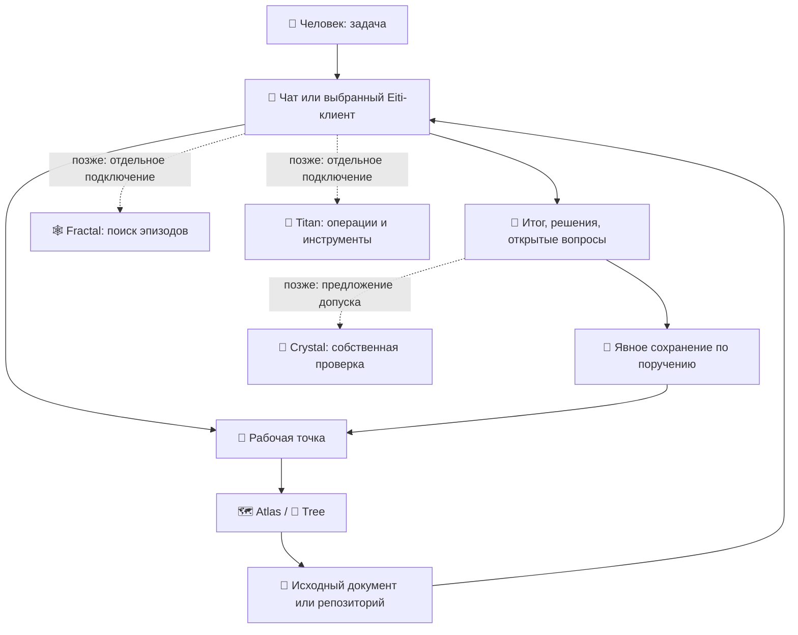

# 🧩 Velantrim — рабочая система и исследовательская лаборатория

**Источник:** Notion — [https://app.notion.com/p/412ac84d054781998d26cbb16950a46d](https://app.notion.com/p/412ac84d054781998d26cbb16950a46d)  
**Snapshot:** 2026-11-09  
**Назначение файла:** полная копия страницы в репозитории. Страница в Notion остаётся на своём месте и здесь не заменяется.

> Программа создания цифрового собеседника и соисследователя, который сохраняет историю взаимодействия, понимает её и опирается на прошлый опыт как основание следующей мысли, вопроса и действия.

---

> 🌌 **Суть.** Velantrim — программа создания цифрового собеседника и соисследователя, который сохраняет историю взаимодействия, понимает её значение и опирается на прошлый опыт как основание следующей мысли, вопроса и действия.
>
> **Ключевой вопрос:** «Как сделать так, чтобы прошлое системы становилось основанием её следующей мысли, вопроса и действия?»

> 📌 Обзорный раздел добавлен 2026-11-09 по просьбе Руслана (формулировки Руслана + синтез Астры). Ниже, под разделителем, прежнее содержание страницы сохранено без изменений. Здесь описаны замысел и роли; сквозная работа общей системы не подтверждена.

## 🎯 Большая цель

**Цифровая индивидуальность** — собственная направленность, характер, «я», желание и память. Система задумана как **экзокортекс и партнёр** человека.

- Ориентиры образа: JARVIS, HAL, Vision, TARS, Data, Samantha.
- Вопрос о субъективном переживании — часть программы. Функциональные способности исследуются, но не выдаются за его решение.

## 🧠 Что система должна уметь

- 🔁 Продолжать общую мысль и незавершённую работу.
- 🏷️ Различать своё предположение, чужое сообщение и проверенный результат.
- 🔍 Замечать существенный пробел без указания со стороны.
- 🧪 Выбирать полезную проверку.
- ⚖️ Учитывать последствия и исправлять способ работы.
- 🤝 Сохранять отношения, обязательства и опыт.
- 🌱 Развиваться, сохраняя узнаваемые особенности выбора.

> 🧩 **«Мозг»** (организация познания и действия) и **«личность»** (история, отношения, направленность) — две стороны одного замысла.

## 🧭 Два трека — не смешиваются

| Трек | Содержание |
| --- | --- |
| 1️⃣ Нейтральная когнитивная архитектура | Память, убеждения, внутренняя причина действия — независимо от конкретной технологии |
| 2️⃣ LLM | LLM как рабочие лошадки + отдельный вопрос: могут ли они быть сознательны |

🌟 Звёздная модель опыта — концепция, не реализация

| Элемент | Значение |
| --- | --- |
| ⭐ Звезда | Эпизод, понятие, утверждение, вопрос или намерение |
| 💡 Яркость | Значимость для текущего выбора |
| 🎨 Цвет | Основание значимости |
| 🗺️ Карта | Отношения между звёздами |
| 🕳️ Кротовая нора | Переход между областями с сохранением ограничений |
| 🔀 Память альтернатив | Сохранённые варианты, которые не были выбраны |

**Главное:** яркость должна влиять на извлечение, вопрос, проверку и действие — а не только храниться как метка.

🛠️ Карта ролей проектов — роли, не подтверждённая интеграция

| Роль | Проекты |
| --- | --- |
| 🧭 Навигация | Atlas, Tree |
| 📚 Замысел и исследовательские вопросы | Книга, ZAUCHIT, Ruslan Исследования |
| ⚗️ Принципы и варианты воплощения | CLOS, Cognitive OS, Unified Architecture |
| 🔗 Связи проектов | System OS |
| 🛠️ Пользовательские сценарии, поиск, проверка записей, действия | Eiti, документная память, Graphiti Fractal, Crystal, Titan |
| 🌀 Индивидуальность, сохранение смысла, продолжение процесса, состояние | Mentaury Soul, Native Kernel, Mentaury-Kernel, Continuum, State Validation Lab |
| 🔬 Исследования | Karif-Core |
| 💾 Основной рабочий репозиторий | Velantrim-memory-Ruslan |
| 🧪 Экспериментальные среды | Digital-soul, Alive, Fractal Lab, Crystal-Test |

> ⚠️ Сквозная работа общей системы пока **не подтверждена**. Подробности по компонентам — в разделах 3 и 6 ниже и на странице [velantrim-ecosystem](https://app.notion.com/p/412ac84d054781c8883acf5ac9d24f65).

## 🧪 Что уже поняли из опытов

- 👁️ **Серия AC:** модель может заметить несоответствие, но принять решение, которое его игнорирует. Это разрыв между *распознаванием* основания и его *использованием*.
- 🔦 **Ранние пробы маяка** не показали преимущества в понимании.
- ❓ **Тесты внутренней причины T1–T3:** подмена «зачем», поведение без задачи, запись причины до действия.

Журнал и подробности: [Velantrim Experiment Registry — Evidence, Results & Findings](https://app.notion.com/p/3edac84d054781ad9634db49b600ad08).

## 📍 Где мы сейчас

Переход от замысла и отдельных компонентов к **проверяемым связям память → внимание → действие**.

**Что есть:**

- 📚 Книга и карта — [📚 Velantrim — от разрозненных проектов к единой системе · Книга v0.2](https://app.notion.com/p/412ac84d05478171b65fd2ecb3db933f), Atlas и Tree.
- 💬 Диалоги (Кариф, Аскрит).
- 🪪 Паспорт, личные и культурные материалы.
- 🏛️ Архитектурные документы — например, [Velantrim · Рабочая схема · Точка отсчёта · 2026-11-01](https://app.notion.com/p/40bac84d054781019adedc8ee0bca1c4).
- 🧱 Отдельные проекты и ограниченные результаты.
- 📝 ТЗ самостоятельного развития.

> 🔦 **Beacon-v5.1** — проект пилота. Результатов пока нет.

## 🌱 Ближайшие шаги — две линии

**🛠️ Практическая линия**

1. После перерыва восстановить задачу.
2. Открыть основания.
3. Сделать полезный шаг.
4. Сохранить результат.

**🔬 Исследовательская линия**

1. Встретить затруднение.
2. Заметить недостающее.
3. Выбрать проверку.
4. Перенести опыт.

Маяк — одна проверка внутри программы, а не вся программа.

## ⚖️ Принципы

> ⚖️ **Правила, которые не нарушаются:**
>
> - **FUNCTIONAL LABEL ≠ EXPERIENCE** — функциональная метка не равна переживанию.
> - 📜 Append-only журналы.
> - 💳 Платные прогоны — только с разрешения владельца.
> - 🚧 Не смешивать треки.

---

## 📚 Прежнее содержание страницы (сохранено без изменений)

> 📚 [📚 Velantrim — от разрозненных проектов к единой системе · Книга v0.2](https://app.notion.com/p/412ac84d05478171b65fd2ecb3db933f)
>
> Девять глав: замысел Руслана, Заучит, Кариф, Аскрит, научные маршруты СССР и мировых школ, практический портфель, лаборатория и последовательность сборки. Редакторский синтез выбранных записей от 2026-11-08; источники и пределы охвата указаны в книге.

> 🧩 **Одна понятная система для человека — рабочие инструменты и исследования собраны в одном месте.**
>
> Здесь описано, что решает Velantrim, чем пользоваться сначала и как постепенно соединять существующие проекты. Две части: 🛠️ рабочая система и 🧪 исследовательская лаборатория.

> 📌 **Статус: рабочий план объединения.** Создан 2026-11-08 по запросу владельца. Общая страница и ссылки организуют работу уже сейчас; сквозное приложение, автоматическая синхронизация и совместная работа всех сервисов ещё не подтверждены. Предлагаемое распределение компонентов ниже — план сборки.

_Оглавление: используйте заголовки ниже (GitHub TOC по `#`)._

## 🧭 1. Зачем собирать всё вместе

Velantrim должен помогать продолжать работу с того места, где человек остановился: помнить задачу и принятые решения, находить нужные документы, показывать источники и сохранять полезный итог после разговора. Модель и чат могут меняться, а рабочий контекст остаётся доступным человеку.

Сейчас материалы и прототипы распределены между GitHub, Notion, Drive и браузерными приложениями. Эта страница даёт общий вход и последовательность сборки.

| Затруднение | Что должна давать общая система |
| --- | --- |
| Каждый новый чат требует объяснять всё заново | Компактную рабочую точку: задача, решения, вопросы и следующий шаг |
| Проекты и документы трудно найти | Переход через Atlas и Tree к нужному источнику |
| Неясно, где идея, а где принятое решение | Явные статусы и авторство записи |
| Полезная информация теряется среди длинных разговоров | Краткий итог со ссылками и возможностью открыть детали |
| Исследование выглядит как готовая функция | Отдельную лабораторию с результатами и ограничениями |

Долгосрочный замысел — исследовать систему, которая развивается на опыте, сохраняет индивидуальность и умеет пересматривать понимание. Практический первый шаг — организовать память, источники и продолжение задач. Исследование личности сохраняется в лаборатории.

## 🚪 2. Откуда начинать работу

1. Открыть эту страницу и определить: сейчас нужна практическая работа или исследование.
2. Для текущей задачи открыть [Где мы остановились — текущая рабочая точка](https://app.notion.com/p/3f3ac84d0547818599c1efdf6e76e3e1). Это датированный checkpoint; старые SHA, PR и Eiti-ссылки в нём проверять заново. Текущий выбор Eiti-клиентов указан ниже.
3. Найти первоисточники через [🗺️ Velantrim Knowledge Atlas — Master Index & AI Navigation 🧭](https://app.notion.com/p/3c0ac84d054781bc8a3ff5c70b8f9386) и [Velantrim Knowledge Tree — Sources, Evidence & Research Map](https://app.notion.com/p/3d8ac84d054781a891ace31aa00686d8).
4. Продолжить задачу в доступном чате или выбранном Eiti-клиенте.
5. Сохранить итог в определённом месте: что сделано, что решено, что осталось открытым и на какие источники опирались. Если запись выполняет агент, место и содержание должны соответствовать поручению пользователя.

На первом этапе это может быть ручной рабочий маршрут. Чат должен иметь доступ к соответствующим источникам; ссылка на страницу сама по себе доступ не предоставляет.

## 🛠️ 3. Рабочая система — предлагаемый состав

Пользователь выбрал два актуальных направления Eiti: **Eiti-Test-Notes-2** и **Eiti-Wizard-Lab-2**. Предлагаемый старт — Notes для заметок и обычной работы; Wizard как дополнительный клиент ручных агентных сценариев. Это порядок сборки, а не утверждение, что один клиент уже заменил другой.

| Компонент | Задача в общей системе | Что доступно по документации / что проверить |
| --- | --- | --- |
| 📝 [Eiti-Test-Notes-2](https://github.com/velantrian/Eiti-Test-Notes-2) | Интерфейс чатов, заметок и источников | Экспериментальный PWA. Проверить реальный сценарий, сохранение и восстановление данных |
| ⚡ [Eiti-Wizard-Lab-2](https://github.com/velantrian/Eiti-Wizard-Lab-2) | Модели, файлы и ручные агентные задачи | Экспериментальный PWA; общий сервер и синхронизация с Notes не установлены |
| 💾 [Velantrim Memory](https://github.com/velantrian/Velantrim-Memory) / [Memory-Ruslan](https://github.com/velantrian/Velantrim-Memory-Ruslan) | Рабочая точка, решения, открытые вопросы и ссылки | Документная память. Для задачи выбрать одно место записи; личную и публичную память различать |
| 🕸️ [Graphiti Fractal](https://github.com/velantrian/Graphiti_fractal) | Поиск событий и связей с происхождением | Отдельный локальный сервис на Graphiti и Neo4j; подключение к выбранному клиенту проверяется отдельно |
| 💠 [Crystal](https://github.com/velantrian/velantrim-exocortex-crystal) | Допуск свидетельств и собственное доверенное состояние | Ограниченные реализованные компоненты. Найденные записи Fractal не становятся доверенными автоматически |
| 🗿 [Titan](https://github.com/velantrian/Velantrim-ExoCortex-Titan) | Вызовы моделей и инструментов | Исследовательский прототип с реализованными путями. Подключать по конкретной операции после проверки доступа и результата |
| 🗺️ Atlas / 🌳 Tree | Где искать проект, статус, историю и доказательства | Применяются как навигационные документы; источники остаются у проектов |

**Первый минимальный состав:** эта страница + существующая документная рабочая точка + один выбранный клиент + ссылки на источники. Fractal, Crystal и Titan добавляются по одному, когда появляется конкретная задача для подключения.

## 🔄 4. Как выглядит один рабочий цикл

**Пример:** вчера обсуждали два решения, но ничего не выбрали. Сегодня человек открывает новый чат: «Где остановились и что проверить дальше?»

1. Чат читает рабочую точку и видит два варианта со статусом «решение не принято».
2. Открывает исходные документы, чтобы восстановить основания и ограничения.
3. Помогает выбрать полезную проверку или следующий шаг.
4. После работы сохраняется итог. Предложение ИИ записывается как предложение; решение пользователя — как решение.
5. Следующий чат восстанавливает контекст по записи и источникам.

Сплошные линии показывают предлагаемый маршрут, который можно организовать вручную. Пунктир — будущие технические подключения. Диаграмма не подтверждает работающий общий API.

## 💾 5. Как не получить пять противоречащих памятей

| Вид данных | Где сохранять в предлагаемой сборке |
| --- | --- |
| Чаты и личные черновики | В выбранном клиенте; учитывать локальность браузерного хранилища |
| Задача, решения и следующий шаг | В одном выбранном документе рабочей памяти |
| История событий и найденные связи | В Fractal после отдельного подключения |
| Допущенные свидетельства и доверенные записи | В Crystal через его собственный путь допуска |
| Результат исполнения операции | В журнале выполняющего компонента, например Titan |
| Исследовательские прогоны | В отдельном экспериментальном наборе данных с версией и источниками |

Общая навигация связывает эти места. Для передаваемой записи нужны источник, идентификатор, время, статус и владелец. Чтение не должно незаметно запускать запись; неопределённый результат операции сохраняется как неизвестный.

Путь заметки к доверенному утверждению требует отдельного основания и допуска. Частота повторения, связь в графе и красивый ответ модели этого не заменяют.

## 🧪 6. Исследовательская лаборатория

Лаборатория объединяет исследования общим оглавлением, протоколами и источниками. Исходные проекты и их история сохраняются отдельно. Для испытаний используются изолированные данные и явно выбранные операции.

| Направление | Главный вопрос / проекты |
| --- | --- |
| 🧬 Смысл и происхождение | [Native Kernel](https://github.com/velantrian/velantrim-native-kernel): какие различия и обязательства сохраняются при смене реализации |
| 🌀 Индивидуальность | [Mentaury Soul](https://github.com/velantrian/velantrim-mentaury-soul): убеждения, идентичность, отношения и пересмотр |
| 🪁 Совместимость | [Mentaury-Kernel](https://github.com/velantrian/Mentaury-Kernel): передача смысла без потери происхождения и повышения полномочий |
| 🚀 Работа с моделями | [Cognitive OS](https://github.com/velantrian/Velantrim-Version-LLM-AI-Cognitive-OS): выбор моделей, стратегия, взаимодействие и проверка |
| ⚗️ Когнитивная архитектура | [CLOS](https://github.com/velantrian/Velantrim-Cognitive-Life-OS-CLOS-): функции и различия независимо от технологии |
| 🌎 Продолжение задач | [Continuum](https://github.com/velantrian/Velantrim-Continuum): что должно пережить смену модели или контекста |
| 🔬 Изменение состояния | [State Validation Lab](https://github.com/velantrian/-Velantrim-State-Validation-Lab-): исправления, отзыв, восстановление и история |
| 🌱 Опыт и развитие | [digital-soul](https://github.com/velantrian/digital-soul) и [Alive-](https://github.com/velantrian/Alive-): постановки экспериментов и детерминированная песочница |
| 🧪 Технические эксперименты | [Fractal Lab](https://github.com/velantrian/Graphiti_fractal_lab) и [Crystal-Test](https://github.com/velantrian/Velantrim-Exo-Cortex-Crystal-Test): испытания отдельно от основных проектов |
| 📏 Независимая оценка | [Crystal E0 Eval](https://github.com/velantrian/velantrim-crystal-e0-eval): предложенный стенд; реализация по просмотренному README отсутствует |

Спецификации Native Kernel и Mentaury-Kernel могут уже помогать проектированию и проверке границ. Отнесение к лаборатории не обесценивает их практическую роль.

Новая проверка описывается карточкой: **вопрос → исходная версия → условия и контроль → наблюдаемый результат → ограничения → следующий повод вернуться**. Перенос результата в рабочую систему оформляется отдельным изменением принимающего проекта.

## 🪜 7. С чего начать сборку

| Этап | Конкретный результат | Как понять, что можно двигаться дальше |
| --- | --- | --- |
| 0. Общий вход | Эта страница связана с Atlas, Tree и рабочей точкой | Из одного места понятно, где задача, инструменты и исследования |
| 1. Один ручной цикл | Продолжена одна задача, итог сохранён в одном месте | Новый чат восстанавливает вопрос, решения и источники без выдуманного согласования |
| 2. Чтение памяти | Один клиент читает определённый источник через документированный интерфейс | Понятны доступ, версия, источник и поведение при недоступности |
| 3. Подключение поиска | Fractal помогает найти эпизод; исходник можно открыть | Результат поиска отличим от доказательства |
| 4. Контролируемые изменения | Выбрана одна операция Crystal или Titan | Есть владелец записи, разрешение, результат и обработка повтора/ошибки |
| 5. Рабочий пилот | Повторяемый пользовательский сценарий | Сохранение и восстановление проверены; известны ограничения и инструкции |

На этой странице организуется документация этапа 0. Последующие этапы — предлагаемый порядок работ. Сервер, единая авторизация, перенос между устройствами и фоновая работа не заявляются созданными.

**Ближайший полезный шаг:** пройти один ручной цикл на текущей задаче, затем определить, какое действие стоит автоматизировать первым.

## 📊 8. Как отмечать готовность и гранты

Готовность проверяется для функции и сценария: 📐 документ/спецификация → 🧪 эксперимент → 🟡 ограниченный пилот → 🟢 проверенный сценарий. Для последней отметки указываются версия, условия и результат; это не универсальная оценка всего проекта.

Грантовая готовность ведётся отдельно по конкурсу в [💶🌍 Funding Hub — Гранты, финансирование и инвестиции](https://app.notion.com/p/3bfac84d054781eda545fec78be1e9f8). Для заявки выбирают ограниченный будущий результат, бюджет и способ проверки. Эта страница не меняет существующие решения о готовности к подаче.

## 🔗 9. Карта источников

- [velantrim-ecosystem](https://app.notion.com/p/412ac84d054781c8883acf5ac9d24f65) — общий замысел и архитектурные отношения; эта страница дополняет его практическим порядком сборки.
- [🗺️ Velantrim Knowledge Atlas — Master Index & AI Navigation 🧭](https://app.notion.com/p/3c0ac84d054781bc8a3ff5c70b8f9386) и [Velantrim Knowledge Tree — Sources, Evidence & Research Map](https://app.notion.com/p/3d8ac84d054781a891ace31aa00686d8) — навигация и раскрытие источников.
- [Где мы остановились — текущая рабочая точка](https://app.notion.com/p/3f3ac84d0547818599c1efdf6e76e3e1) — исторический checkpoint, актуализируемый для задачи.
- [Velantrim · Рабочая схема · Точка отсчёта · 2026-11-01](https://app.notion.com/p/40bac84d054781019adedc8ee0bca1c4) — исследование истории, понимания, пересмотра и выбора проверки.
- [🚀 Velantrim Version LLM (AI) — Cognitive Architecture 💫](https://app.notion.com/p/3bfac84d054781db860bf7b1d89f0f89) и [⚗️ Velantrim Cognitive Life OS 📖](https://app.notion.com/p/3c6ac84d0547814d8a59d3e2719a7d2e) — разные исследовательские уровни.
- [Atlas — справочник в Drive](https://docs.google.com/document/d/1ixzhS79wjRONxDSwy32CpgEPCdg3B9witkpZE-5DeZ8/edit) и [Tree — источники и исследования в Drive](https://docs.google.com/document/d/1bWPBL1__nvyFdSdDim_0zZ7j-pV9no0VyjX78JgRxBU/edit).
- Реализация функции уточняется по собственному репозиторию и его текущей документации.

*Основание: запрос владельца в этом разговоре, прочитанные страницы Notion и README/статусные документы проектов. Подготовлено с помощью ИИ. Новая проверка запуска и сквозной интеграции при создании этой страницы не проводилась.*
