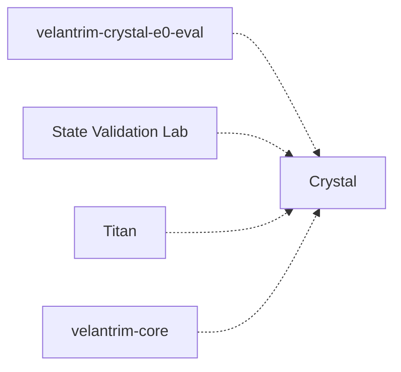

# Справочник проектов Velantrim

> **Velantrim Ecosystem** — общая карта назначения и связей проектов Velantrim. Это обычный файл с ручным текстом; только участки между маркерами `ECOSYSTEM:BEGIN … ECOSYSTEM:END` (маршруты, таблицы проектов, схема связей, источники) формируются из реестра [`ecosystem.json`](ecosystem.json) командой `python3 tools/ecosystem/ecosystem.py render` и вручную не правятся. Всё остальное, включая пояснения ниже, — текст человека. Подробные карточки: [`ecosystem-catalog.md`](ecosystem-catalog.md) (формируются целиком).

## Каталог кратко

Одна строка на проект: тип, зачем нужен и чему служит. Подробности, подтверждённое и задуманное — в [карточках](ecosystem-catalog.md); связи — в [отдельном файле](ecosystem-relations.md).

<!-- ECOSYSTEM:BEGIN overview -->
| Проект | Тип | Для чего (коротко) | Чему служит |
|---|---|---|---|
| [Velantrim-Memory-Ruslan](https://github.com/velantrian/Velantrim-Memory-Ruslan/blob/main/README.md) ([карточка](ecosystem-catalog.md#p-memory-ruslan)) | Документация | Публичная память владельца на Markdown и Git: рабочая точка, цели, решения, открытые вопросы и источники, чтобы разные ИИ и чаты продолжали работу без… | экзокортекс, «я», опыт, понимание, книга, познание мира |
| [Velantrim Ecosystem — velantrim](https://github.com/velantrian/velantrim/blob/main/README.md) ([карточка](ecosystem-catalog.md#p-velantrim)) | Документация | Зонтичная документация и исследовательская карта экосистемы: помогает понять роли проектов и связи между ними. | экзокортекс, напарник и друг, познание мира |
| [Atlas](https://github.com/velantrian/Velantrim-Atlas-App/blob/main/README.md) ([карточка](ecosystem-catalog.md#p-atlas)) | Навигация | Навигатор по экосистеме: помогает выбрать, какой источник открыть дальше. | экзокортекс |
| [Knowledge Tree](https://github.com/velantrian/Velantrim-Knowledge-Tree/blob/main/README.md) ([карточка](ecosystem-catalog.md#p-knowledge-tree)) | Навигация | Машиночитаемый навигационный граф источников: от известного проекта, документа или понятия помогает найти связанные материалы. | экзокортекс |
| [Crystal](https://github.com/velantrian/velantrim-exocortex-crystal/blob/main/README.md) ([карточка](ecosystem-catalog.md#p-crystal)) | Компонент | Проверяемая память и работа с доказательствами: разделяет поиск, происхождение сведений и допуск в доверенное состояние. | экзокортекс |
| [Titan](https://github.com/velantrian/Velantrim-ExoCortex-Titan/blob/main/README.md) ([карточка](ecosystem-catalog.md#p-titan)) | Приложение | Локальная память и оркестрация для ИИ: связывает поиск, контролируемую запись, происхождение сведений, модели, провайдеров и инструменты. | экзокортекс |
| [Graphiti_fractal](https://github.com/velantrian/Graphiti_fractal/blob/main/README.md) ([карточка](ecosystem-catalog.md#p-graphiti-fractal)) | Компонент | Слой памяти для ИИ на Graphiti и Neo4j: события во времени, связи людей и идей, возврат к источникам и опыту. | экзокортекс |
| [Mentaury Soul](https://github.com/velantrian/velantrim-mentaury-soul/blob/main/README.md) ([карточка](ecosystem-catalog.md#p-mentaury-soul)) | Исследование | Исследовательская архитектура устойчивой цифровой индивидуальности: память, идентичность, характер и управляемое саморазвитие. | Mentaury, «я», опыт, понимание |
| [Mentaury-Kernel](https://github.com/velantrian/Mentaury-Kernel/blob/main/README.md) ([карточка](ecosystem-catalog.md#p-mentaury-kernel)) | Исследование | Спецификация безопасной смысловой совместимости Native Kernel и Mentaury Soul. | Mentaury |
| [Native Kernel](https://github.com/velantrian/velantrim-native-kernel/blob/main/README.md) ([карточка](ecosystem-catalog.md#p-native-kernel)) | Исследование | Технологически независимая исследовательская архитектура знаний, памяти и объяснимого пересмотра. | экзокортекс |
| [Continuum](https://github.com/velantrian/Velantrim-Continuum/blob/main/README.md) ([карточка](ecosystem-catalog.md#p-continuum)) | Исследование | Исследование непрерывности долгоживущего ИИ-процесса при замене модели. | экзокортекс |
| [State Validation Lab](https://github.com/velantrian/-Velantrim-State-Validation-Lab-/blob/main/README.md) ([карточка](ecosystem-catalog.md#p-state-validation-lab)) | Лаборатория | Исследовательская архитектура изменения, конфликтов, устаревания, удаления и восстановления состояния. | экзокортекс |
| [CLOS](https://github.com/velantrian/Velantrim-Cognitive-Life-OS-CLOS-/blob/main/README.md) ([карточка](ecosystem-catalog.md#p-clos)) | Исследование | Технологически нейтральная исследовательская программа когнитивной архитектуры. | «я», опыт, понимание, экзокортекс |
| [Cognitive OS](https://github.com/velantrian/Velantrim-Version-LLM-AI-Cognitive-OS/blob/main/README.md) ([карточка](ecosystem-catalog.md#p-cognitive-os)) | Исследование | Исследовательская модульная архитектура взаимодействия с человеком, рассуждения, моделей, инструментов, проверки и памяти. | напарник и друг, экзокортекс |
| [velantrim-eiti](https://github.com/velantrian/velantrim-eiti/blob/main/README.md) ([карточка](ecosystem-catalog.md#p-eiti)) | Приложение | Персональный ИИ-ассистент в виде клиентского PWA с локальной памятью и поиском. | экзокортекс |
| [Eiti-Wizard-Lab](https://github.com/velantrian/Eiti-Wizard-Lab/blob/main/README.md) ([карточка](ecosystem-catalog.md#p-eiti-wizard-lab)) | Лаборатория | Экспериментальная лаборатория Eiti для непрерывности контекста, снимков состояния, чистого возобновления и контролируемых опытов с памятью. | экзокортекс |
| [Eiti-Wizard-Lab-2](https://github.com/velantrian/Eiti-Wizard-Lab-2/blob/main/README.md) — приватный ([карточка](ecosystem-catalog.md#p-eiti-wizard-lab-2)) | Лаборатория | Лаборатория Eiti Wizard с Gate B2: для записи в Working Memory нужны точная цитата владельца и явный запрос сохранить в последнем действии пользовател… | экзокортекс |
| [Eiti-Test-Notes](https://github.com/velantrian/Eiti-Test-Notes/blob/main/README.md) ([карточка](ecosystem-catalog.md#p-eiti-test-notes)) | Лаборатория | Тестовая копия клиентского PWA velantrim-eiti. | экзокортекс, познание мира |
| [Graphiti_fractal_lab](https://github.com/velantrian/Graphiti_fractal_lab/blob/main/README.md) ([карточка](ecosystem-catalog.md#p-graphiti-fractal-lab)) | Лаборатория | Отдельная исследовательская копия Graphiti_fractal для экспериментов с памятью и альтернативными хранилищами. | экзокортекс |
| [Crystal-Test](https://github.com/velantrian/Velantrim-Exo-Cortex-Crystal-Test/blob/main/README.md) ([карточка](ecosystem-catalog.md#p-crystal-test)) | Лаборатория | Изолированная экспериментальная копия Crystal, подготовленная для контролируемого тестирования в Forge (FORGE_LAB_PROVENANCE.md). | — |
| [velantrim-crystal-e0-eval](https://github.com/velantrian/velantrim-crystal-e0-eval/blob/main/README.md) ([карточка](ecosystem-catalog.md#p-crystal-e0-eval)) | Исследование | Задуманный внешний набор слепых A/B-испытаний обычной памяти/RAG и системы с Crystal: должен проверять происхождение, доверие, неподтверждённые утверж… | — |
| [science-core](https://github.com/velantrian/science-core/blob/main/README.md) ([карточка](ecosystem-catalog.md#p-science-core)) | Документация | Машинная база базовых научных знаний Velantrim (Core KB): короткие факты в JSON по схеме v3.2 — физика, математика, химия, биология, логика, практика,… | познание мира |
| [science-core-english](https://github.com/velantrian/science-core-english/blob/main/README.md) ([карточка](ecosystem-catalog.md#p-science-core-english)) | Документация | Оболочка английской редакции Science Core: политика источников, лицензия CC BY 4.0, зеркало схемы факта v3.2 и пустые каталоги для будущих записей. | — |
| [velantrim-culture](https://github.com/velantrian/velantrim-culture/blob/main/README.md) ([карточка](ecosystem-catalog.md#p-velantrim-culture)) | Документация | Авторский текст о культуре и наследии Velantrim: «Экософский Манифест Возрождения» с расширенной интерпретацией — философия регенерации, круговая экон… | — |
| [velantrim-ai-skills](https://github.com/velantrian/velantrim-ai-skills/blob/main/README.md) ([карточка](ecosystem-catalog.md#p-ai-skills)) | Документация | Набор переиспользуемых ролей и методик для аудита, разработки, проверки доказательств и воспроизводимости. | — |
| [velantrim-core](https://github.com/velantrian/velantrim-core/blob/main/README.md) ([карточка](ecosystem-catalog.md#p-velantrim-core)) | Исследование | Архитектурный документ Core 2.1 Crystal с рабочей и долговременной памятью, маршрутизацией, выбором действий, остановкой и восстановлением. | экзокортекс |
| [Karif-Core](https://github.com/velantrian/Velantrim-Karif-Core/blob/main/README.md) — приватный ([карточка](ecosystem-catalog.md#p-karif-core)) | Компонент | Замысел малого ядра-загрузчика: запуск большого ядра, откат к проверенному нормальному состоянию и заводской сброс как последний рубеж. | — |
| [Velantrim-Memory](https://github.com/velantrian/Velantrim-Memory/blob/main/README.md) — приватный ([карточка](ecosystem-catalog.md#p-velantrim-memory)) | Документация | Исходная переносимая Markdown-память для рабочей точки, решений, вопросов и источников между чатами и агентами. | экзокортекс |
| «От памяти к пониманию» — приватный ([карточка](ecosystem-catalog.md#p-book)) | Документация | — | — |
<!-- ECOSYSTEM:END overview -->

## Как найти нужное

Маршруты составлены по прочитанным документам проектов: проект указан там, где его собственные материалы действительно отвечают на вопрос. Более общую маршрутизацию по областям ведёт Atlas ([AGENT_MAP.md](https://github.com/velantrian/Velantrim-Atlas-App/blob/main/docs/atlas/AGENT_MAP.md), `atlas/routes.json`); здесь она не копируется.

<!-- ECOSYSTEM:BEGIN routes -->
| Вопрос | Куда идти | Маршрут Atlas |
|---|---|---|
| Где искать историю исследования и прежние решения? | [Velantrim-Memory-Ruslan · WORKBOARD.md](https://github.com/velantrian/Velantrim-Memory-Ruslan/blob/main/WORKBOARD.md) — цели, открытые вопросы и итоги обсуждений с пометкой, что решение владельца, а что мнение модели; [Velantrim-Memory-Ruslan · CURRENT.md](https://github.com/velantrian/Velantrim-Memory-Ruslan/blob/main/CURRENT.md) — последняя рабочая точка и датированные контрольные точки; [Velantrim-Memory-Ruslan · README-tracks.md](https://github.com/velantrian/Velantrim-Memory-Ruslan/blob/main/projects/README-tracks.md) — два трека исследования и указатели на заметки; [Eiti-Wizard-Lab](https://github.com/velantrian/Eiti-Wizard-Lab/blob/main/docs/research/EXPERIMENT_EVIDENCE_INDEX.md) — индекс экспериментов лаборатории (сам отмечает устаревшие места) | memory-understanding-scientific-donors |
| Откуда взято утверждение и можно ли ему доверять: память, происхождение, доказательства? | [Crystal](https://github.com/velantrian/velantrim-exocortex-crystal/blob/main/README.md) — допуск в доверенное состояние: поиск, происхождение и доказательства разделены; [Native Kernel](https://github.com/velantrian/velantrim-native-kernel/blob/main/README.md) — семантические контракты происхождения, времени, пересмотра и явной потери; [Mentaury Soul](https://github.com/velantrian/velantrim-mentaury-soul/blob/main/README.md) — убеждения и доказательства в области когниции и идентичности, за которую отвечает Soul | trusted-memory-evidence, semantic-invariants, soul-owner-domain |
| Где оркестрация, модели, провайдеры и инструменты? | [Titan](https://github.com/velantrian/Velantrim-ExoCortex-Titan/blob/main/README.md) — локальная память и оркестрация с шлюзом MCP (исследовательский прототип); [Cognitive OS](https://github.com/velantrian/Velantrim-Version-LLM-AI-Cognitive-OS/blob/main/README.md) — исследование ролей моделей и маршрутизации (не реализация); [velantrim-ai-skills](https://github.com/velantrian/velantrim-ai-skills/blob/main/README.md) — роли и методики для ИИ-аудитов и проверок | orchestration-execution, model-reasoning-routing |
| Где исследуются понимание, опыт и индивидуальность («я»)? | [Mentaury Soul](https://github.com/velantrian/velantrim-mentaury-soul/blob/main/README.md) — история становления, убеждения и их пересмотр с явным происхождением; [CLOS](https://github.com/velantrian/Velantrim-Cognitive-Life-OS-CLOS-/blob/main/README.md) — какие различия и переходы должны сохраняться при смене технологий; [Velantrim-Memory-Ruslan](https://github.com/velantrian/Velantrim-Memory-Ruslan/blob/main/projects/track-1-neutral-cognitive-architecture.md) — трек 1: нейтральная когнитивная архитектура (указатели на заметки) | substrate-neutral-cognition, soul-owner-domain |
| Как не потерять нить при смене чата или модели? | [Continuum](https://github.com/velantrian/Velantrim-Continuum/blob/main/README.md) — исследование минимального состояния, достаточного для продолжения процесса; [Eiti-Wizard-Lab](https://github.com/velantrian/Eiti-Wizard-Lab/blob/main/README.md) — снимки состояния, чистое возобновление и read-only мост непрерывности; [Velantrim-Memory-Ruslan](https://github.com/velantrian/Velantrim-Memory-Ruslan/blob/main/START_HERE.md) — порядок восстановления рабочего состояния для любого ИИ | process-continuity |
| Где пользовательский интерфейс и приложение? | [velantrim-eiti](https://github.com/velantrian/velantrim-eiti/blob/main/README.md) — основное клиентское приложение (CURRENT_PRIMARY по реестру актуальности Eiti); [Eiti-Test-Notes](https://github.com/velantrian/Eiti-Test-Notes/blob/main/README.md) — тестовая копия, по версии ушедшая вперёд основного; [Atlas](https://github.com/velantrian/Velantrim-Atlas-App/blob/main/README.md) — навигатор по экосистеме (веб-приложение и контракт маршрутов) | — |
| Где результаты конкретного эксперимента? | [Graphiti_fractal_lab](https://github.com/velantrian/Graphiti_fractal_lab/blob/experiment/falkordblite-deterministic-memory/RESEARCH_STATUS.md) — серия FM по релевантности поиска (основные результаты на отдельной ветке, не в main); [Continuum](https://github.com/velantrian/Velantrim-Continuum/blob/main/README.md) — Experiment 0: захват и перенос состояния; [State Validation Lab](https://github.com/velantrian/-Velantrim-State-Validation-Lab-/blob/main/README.md) — проверки обновления, отзыва и стирания состояния; [Eiti-Wizard-Lab](https://github.com/velantrian/Eiti-Wizard-Lab/blob/main/docs/research/EXPERIMENT_EVIDENCE_INDEX.md) — E0-A и E0-B: управление записью в память | graphiti-retrieval-relevance-research |
| Где справочные знания и культурные принципы? | [science-core](https://github.com/velantrian/science-core/blob/main/README.md) — справочный корпус научных фактов; [science-core-english](https://github.com/velantrian/science-core-english/blob/main/README.md) — английская версия; [velantrim-culture](https://github.com/velantrian/velantrim-culture/blob/main/README.md) — текст о культурных принципах | — |
| Какой проект владеет моим вопросом и с чего начать читать? | [Atlas](https://github.com/velantrian/Velantrim-Atlas-App/blob/main/docs/atlas/AGENT_MAP.md) — карта «проект — владелец — маршрут — границы полномочий»; [Knowledge Tree](https://github.com/velantrian/Velantrim-Knowledge-Tree/blob/main/README.md) — навигационный граф источников; [Velantrim Ecosystem — velantrim](https://github.com/velantrian/velantrim/blob/main/docs/architecture/VELANTRIM_ECOSYSTEM_MASTER_MAP.md) — карта ответственности и допустимых композиций (не доказательство интеграции) | ecosystem-system-orientation |
| Как безопасно сохранить новое сведение в общую память? | [Velantrim-Memory-Ruslan](https://github.com/velantrian/Velantrim-Memory-Ruslan/blob/main/START_HERE.md) — процедура Safe Memory Update: читать, минимальный diff, показать владельцу, Draft PR, read-back | — |
<!-- ECOSYSTEM:END routes -->

## Зачем это нужно

Руслан (Velan) исследует разум, память, понимание, опыт и индивидуальность и хочет создать долгоживущего цифрового напарника — экзокортекс: помощника, который помнит историю работы, не начинает с нуля при смене чата, задачи или модели, помогает исследовать и способен на содержательное несогласие. Так цели описаны в [WORKBOARD.md](../WORKBOARD.md); здесь они сжаты ассистентом по поручению владельца от 2026-10-21 и не являются его дословной цитатой.

Для такой цели нужны разные части с разными ролями: память и происхождение сведений (откуда известно и можно ли этому доверять), оркестрация моделей и инструментов, непрерывность работы при замене модели, исследование идентичности и понимания, пользовательские приложения и навигация по всему этому. Поэтому проектов несколько: каждый отвечает на свой вопрос и не заменяет остальных. Колонка «Чему служит» показывает, какую цель владельца обслуживает проект; это редакционное сопоставление по описанию проекта, а не решение владельца.

Коротко: что это за проекты и для чего они нужны. Ссылки в названиях ведут к README соответствующих репозиториев; для Atlas и Ecosystem дополнительно указаны их карты. Приватные проекты помечены явно: ссылка не предоставляет доступ, а в справочник включены только название и краткое назначение; у книги — только название. Это справочник назначения, а не список текущих задач, готовности к эксплуатации или доказанных возможностей.

Целей две, и критерии успеха у них разные: практическая (долговременный напарник и Exo-Cortex) и фундаментальная (познание, индивидуальность, самость, возможный субъективный опыт). Практический успех не доказывает сознание, а открытый вопрос сознания не делает напарника бесполезным; два технологических трека исследования не тождественны этим двум целям. См. [рабочий синтез от 2026-10-26](velantrim-research-baseline-2026-10-26.md) (WORKING SYNTHESIS · NOT CANON).

## Проекты по назначению

Таблицы сформированы из реестра. Назначение — формулировки прежнего справочника; места, где проверка по первоисточнику потребовала правки, перечислены в описании изменения. Подтверждённые возможности (раздельно: документ, код, тест, запись запуска), задуманное, ограничения и источники — в [карточках](ecosystem-catalog.md).

<!-- ECOSYSTEM:BEGIN projects -->
### Навигация, документация и память хаба

Где искать проект, документ или прежнее решение.

| Проект | Тип | Что это и для чего нужен | Чему служит | Документы |
|---|---|---|---|---|
| [Velantrim-Memory-Ruslan](https://github.com/velantrian/Velantrim-Memory-Ruslan/blob/main/README.md) | Документация | Публичная память владельца на Markdown и Git: рабочая точка, цели, решения, открытые вопросы и источники, чтобы разные ИИ и чаты продолжали работу без пересказа с нуля. Рядом лежат исследовательские записи, доски, книги и материалы «Заучит». Это ориентир, а не работающий ИИ и не автоматически проверенная истина. | экзокортекс, «я», опыт, понимание, книга, познание мира | [START_HERE.md](https://github.com/velantrian/Velantrim-Memory-Ruslan/blob/main/START_HERE.md) · [карточка](ecosystem-catalog.md#p-memory-ruslan) |
| [Velantrim Ecosystem — velantrim](https://github.com/velantrian/velantrim/blob/main/README.md) | Документация | Зонтичная документация и исследовательская карта экосистемы: помогает понять роли проектов и связи между ними. [Карта на GitHub](https://github.com/velantrian/velantrim/blob/main/docs/architecture/VELANTRIM_ECOSYSTEM_MASTER_MAP.md) и [Ecosystem Map в Notion](https://app.notion.com/p/3c8ac84d054781babe65dc72da7ac606) описывают композицию, но не доказывают работающую интеграцию; точная Google Docs копия — `NOT_VERIFIED`. | экзокортекс, напарник и друг, познание мира | [README.md](https://github.com/velantrian/velantrim/blob/main/README.md) · [карточка](ecosystem-catalog.md#p-velantrim) |
| [Atlas](https://github.com/velantrian/Velantrim-Atlas-App/blob/main/README.md) | Навигация | Навигатор по экосистеме: помогает выбрать, какой источник открыть дальше. [AGENT_MAP.md](https://github.com/velantrian/Velantrim-Atlas-App/blob/main/docs/atlas/AGENT_MAP.md) содержит маршруты, но не заменяет документы самих проектов. | экзокортекс | [README.md](https://github.com/velantrian/Velantrim-Atlas-App/blob/main/README.md) · [карточка](ecosystem-catalog.md#p-atlas) |
| [Knowledge Tree](https://github.com/velantrian/Velantrim-Knowledge-Tree/blob/main/README.md) | Навигация | Машиночитаемый навигационный граф источников: от известного проекта, документа или понятия помогает найти связанные материалы. Это карта маршрутов, не база истины и не память работающего ИИ. | экзокортекс | [README.md](https://github.com/velantrian/Velantrim-Knowledge-Tree/blob/main/README.md) · [карточка](ecosystem-catalog.md#p-knowledge-tree) |

### Память, доказательства и оркестрация

Компоненты и проекты, где исполняемый код отвечает за память, происхождение сведений и инструменты.

| Проект | Тип | Что это и для чего нужен | Чему служит | Документы |
|---|---|---|---|---|
| [Crystal](https://github.com/velantrian/velantrim-exocortex-crystal/blob/main/README.md) | Компонент | Проверяемая память и работа с доказательствами: разделяет поиск, происхождение сведений и допуск в доверенное состояние. Нужен, чтобы найденное или убедительно сформулированное не становилось истиной автоматически. | экзокортекс | [README.md](https://github.com/velantrian/velantrim-exocortex-crystal/blob/main/README.md) · [карточка](ecosystem-catalog.md#p-crystal) |
| [Titan](https://github.com/velantrian/Velantrim-ExoCortex-Titan/blob/main/README.md) | Приложение | Локальная память и оркестрация для ИИ: связывает поиск, контролируемую запись, происхождение сведений, модели, провайдеров и инструменты. Исследовательский прототип, а не обещание безошибочной или готовой к эксплуатации системы. | экзокортекс | [README.md](https://github.com/velantrian/Velantrim-ExoCortex-Titan/blob/main/README.md) · [карточка](ecosystem-catalog.md#p-titan) |
| [Graphiti_fractal](https://github.com/velantrian/Graphiti_fractal/blob/main/README.md) | Компонент | Слой памяти для ИИ на Graphiti и Neo4j: события во времени, связи людей и идей, возврат к источникам и опыту. Найденное или повторённое не получает статус истины автоматически. | экзокортекс | [README.md](https://github.com/velantrian/Graphiti_fractal/blob/main/README.md) · [карточка](ecosystem-catalog.md#p-graphiti-fractal) |

### Идентичность и композиция

Убеждения, самость и правила передачи сведений между системами.

| Проект | Тип | Что это и для чего нужен | Чему служит | Документы |
|---|---|---|---|---|
| [Mentaury Soul](https://github.com/velantrian/velantrim-mentaury-soul/blob/main/README.md) | Исследование | Исследовательская архитектура устойчивой цифровой индивидуальности: память, идентичность, характер и управляемое саморазвитие. Различает собственную историю и заимствованный материал, уверенность и доказательство. | Mentaury, «я», опыт, понимание | [README.md](https://github.com/velantrian/velantrim-mentaury-soul/blob/main/README.md) · [карточка](ecosystem-catalog.md#p-mentaury-soul) |
| [Mentaury-Kernel](https://github.com/velantrian/Mentaury-Kernel/blob/main/README.md) | Исследование | Спецификация безопасной смысловой совместимости Native Kernel и Mentaury Soul. Нужна для сохранения происхождения, неопределённости и границ полномочий при передаче сведений; не является готовой объединённой системой. | Mentaury | [README.md](https://github.com/velantrian/Mentaury-Kernel/blob/main/README.md) · [карточка](ecosystem-catalog.md#p-mentaury-kernel) |

### Исследовательские программы и спецификации

Архитектуры и проверки без готового общего рантайма.

| Проект | Тип | Что это и для чего нужен | Чему служит | Документы |
|---|---|---|---|---|
| [Native Kernel](https://github.com/velantrian/velantrim-native-kernel/blob/main/README.md) | Исследование | Технологически независимая исследовательская архитектура знаний, памяти и объяснимого пересмотра. Изучает, как сохранять смысл и происхождение при замене базы данных, языка или модели; это не ядро операционной системы. | экзокортекс | [README.md](https://github.com/velantrian/velantrim-native-kernel/blob/main/README.md) · [карточка](ecosystem-catalog.md#p-native-kernel) |
| [Continuum](https://github.com/velantrian/Velantrim-Continuum/blob/main/README.md) | Исследование | Исследование непрерывности долгоживущего ИИ-процесса при замене модели. Ищет минимальное сохраняемое состояние, достаточное для надёжного продолжения работы; это исследование, не готовая интеграция. | экзокортекс | [README.md](https://github.com/velantrian/Velantrim-Continuum/blob/main/README.md) · [карточка](ecosystem-catalog.md#p-continuum) |
| [State Validation Lab](https://github.com/velantrian/-Velantrim-State-Validation-Lab-/blob/main/README.md) | Лаборатория | Исследовательская архитектура изменения, конфликтов, устаревания, удаления и восстановления состояния. Нужна для проверки сохранения происхождения, применимости и объяснимой истории изменений. | экзокортекс | [README.md](https://github.com/velantrian/-Velantrim-State-Validation-Lab-/blob/main/README.md) · [карточка](ecosystem-catalog.md#p-state-validation-lab) |
| [CLOS](https://github.com/velantrian/Velantrim-Cognitive-Life-OS-CLOS-/blob/main/README.md) | Исследование | Технологически нейтральная исследовательская программа когнитивной архитектуры. Изучает, какие различия, состояния и переходы должны сохраняться при смене технологий; не является утверждённой реализацией. | «я», опыт, понимание, экзокортекс | [README.md](https://github.com/velantrian/Velantrim-Cognitive-Life-OS-CLOS-/blob/main/README.md) · [карточка](ecosystem-catalog.md#p-clos) |
| [Cognitive OS](https://github.com/velantrian/Velantrim-Version-LLM-AI-Cognitive-OS/blob/main/README.md) | Исследование | Исследовательская модульная архитектура взаимодействия с человеком, рассуждения, моделей, инструментов, проверки и памяти. Отличается от CLOS и не заявляет завершённую работающую систему. | напарник и друг, экзокортекс | [README.md](https://github.com/velantrian/Velantrim-Version-LLM-AI-Cognitive-OS/blob/main/README.md) · [карточка](ecosystem-catalog.md#p-cognitive-os) |

### Приложение и лаборатории Eiti

Пользовательский интерфейс и экспериментальные ветви.

| Проект | Тип | Что это и для чего нужен | Чему служит | Документы |
|---|---|---|---|---|
| [velantrim-eiti](https://github.com/velantrian/velantrim-eiti/blob/main/README.md) | Приложение | Персональный ИИ-ассистент в виде клиентского PWA с локальной памятью и поиском. Нужен для работы через браузер с офлайн-основой без собственного backend. | экзокортекс | [README.md](https://github.com/velantrian/velantrim-eiti/blob/main/README.md) · [карточка](ecosystem-catalog.md#p-eiti) |
| [Eiti-Wizard-Lab](https://github.com/velantrian/Eiti-Wizard-Lab/blob/main/README.md) | Лаборатория | Экспериментальная лаборатория Eiti для непрерывности контекста, снимков состояния, чистого возобновления и контролируемых опытов с памятью. Основана на браузерной ИИ-среде с чатами, агентами, файлами и локальными или внешними моделями. | экзокортекс | [README.md](https://github.com/velantrian/Eiti-Wizard-Lab/blob/main/README.md) · [карточка](ecosystem-catalog.md#p-eiti-wizard-lab) |
| [Eiti-Wizard-Lab-2](https://github.com/velantrian/Eiti-Wizard-Lab-2/blob/main/README.md) — приватный | Лаборатория | Лаборатория Eiti Wizard с Gate B2: для записи в Working Memory нужны точная цитата владельца и явный запрос сохранить в последнем действии пользователя. Вызов агента лишь готовит preview с цитатой и текущим запросом; запись разрешает отдельный Confirm. [PR #2](https://github.com/velantrian/Eiti-Wizard-Lab-2/pull/2) слит 2026-10-18; это само по себе не подтверждает приёмку на телефоне или готовность к эксплуатации. | экзокортекс | [карточка](ecosystem-catalog.md#p-eiti-wizard-lab-2) |
| [Eiti-Test-Notes](https://github.com/velantrian/Eiti-Test-Notes/blob/main/README.md) | Лаборатория | Тестовая копия клиентского PWA velantrim-eiti. Заведена 2026-10-14 из ветки с Notes Ask AI (v13.7.16), затем выросла до v14.13.0: офлайн-ответы без сети и ключа, библиотека знаний (~31 тыс. статей), голосовые ассистенты, дневник, синхронизация с Google Drive и корпус фольклора. Сам репозиторий называет себя тестовой копией, не основным продуктом. | экзокортекс, познание мира | [README.md](https://github.com/velantrian/Eiti-Test-Notes/blob/main/README.md) · [карточка](ecosystem-catalog.md#p-eiti-test-notes) |

### Лаборатории, стенды и запасные копии

Экспериментальные площадки; не оригиналы и не готовые проекты.

| Проект | Тип | Что это и для чего нужен | Чему служит | Документы |
|---|---|---|---|---|
| [Graphiti_fractal_lab](https://github.com/velantrian/Graphiti_fractal_lab/blob/main/README.md) | Лаборатория | Отдельная исследовательская копия Graphiti_fractal для экспериментов с памятью и альтернативными хранилищами. Нужна для лабораторных изменений без подмены основного репозитория; не заявлена готовой к эксплуатации системой. | экзокортекс | [README.md](https://github.com/velantrian/Graphiti_fractal_lab/blob/main/README.md) · [карточка](ecosystem-catalog.md#p-graphiti-fractal-lab) |
| [Crystal-Test](https://github.com/velantrian/Velantrim-Exo-Cortex-Crystal-Test/blob/main/README.md) | Лаборатория | Изолированная экспериментальная копия Crystal, подготовленная для контролируемого тестирования в Forge ([FORGE_LAB_PROVENANCE.md](https://github.com/velantrian/Velantrim-Exo-Cortex-Crystal-Test/blob/main/FORGE_LAB_PROVENANCE.md)). Этот файл до сих пор пишет, что копию в Forge не отправляли, но по истории git Forge уже добавил в неё тесты (PR #2, слит 2026-10-18): запись в файле устарела. Репозиторий остаётся запасным экспериментальным стендом, а не оригиналом Crystal. | — | [FORGE_LAB_PROVENANCE.md](https://github.com/velantrian/Velantrim-Exo-Cortex-Crystal-Test/blob/main/FORGE_LAB_PROVENANCE.md) · [карточка](ecosystem-catalog.md#p-crystal-test) |
| [velantrim-crystal-e0-eval](https://github.com/velantrian/velantrim-crystal-e0-eval/blob/main/README.md) | Исследование | Задуманный внешний набор слепых A/B-испытаний обычной памяти/RAG и системы с Crystal: должен проверять происхождение, доверие, неподтверждённые утверждения, противоречия и устаревшие сведения. Сейчас это только замысел: в main лежат README и LICENSE, а заготовка стенда — на неслитой ветке; наличие стенда не доказывало бы преимущество Crystal. | — | [README.md](https://github.com/velantrian/velantrim-crystal-e0-eval/blob/main/README.md) · [карточка](ecosystem-catalog.md#p-crystal-e0-eval) |

### Проекты знаний

Справочные корпуса и тексты.

| Проект | Тип | Что это и для чего нужен | Чему служит | Документы |
|---|---|---|---|---|
| [science-core](https://github.com/velantrian/science-core/blob/main/README.md) | Документация | Машинная база базовых научных знаний Velantrim (Core KB): короткие факты в JSON по схеме v3.2 — физика, математика, химия, биология, логика, практика, открытые проблемы — с уровнем уверенности и условиями применимости. Задумана как структура и законы наук, а не каталог всего; тексты фактов на русском. | познание мира | [README.md](https://github.com/velantrian/science-core/blob/main/README.md) · [карточка](ecosystem-catalog.md#p-science-core) |
| [science-core-english](https://github.com/velantrian/science-core-english/blob/main/README.md) | Документация | Оболочка английской редакции Science Core: политика источников, лицензия CC BY 4.0, зеркало схемы факта v3.2 и пустые каталоги для будущих записей. По собственному статусу — «Stage 1: структура, проверенных данных нет». Это не перевод science-core и не рантайм Crystal. | — | [README.md](https://github.com/velantrian/science-core-english/blob/main/README.md) · [карточка](ecosystem-catalog.md#p-science-core-english) |
| [velantrim-culture](https://github.com/velantrian/velantrim-culture/blob/main/README.md) | Документация | Авторский текст о культуре и наследии Velantrim: «Экософский Манифест Возрождения» с расширенной интерпретацией — философия регенерации, круговая экономика, биомимикрия, образование и сообщества. Это ценности и смыслы, а не техническая документация и не доказательство. В репозитории один README.md. | — | [README.md](https://github.com/velantrian/velantrim-culture/blob/main/README.md) · [карточка](ecosystem-catalog.md#p-velantrim-culture) |

### Инструменты и ранние наброски

Методики для ИИ и ранние прототипы.

| Проект | Тип | Что это и для чего нужен | Чему служит | Документы |
|---|---|---|---|---|
| [velantrim-ai-skills](https://github.com/velantrian/velantrim-ai-skills/blob/main/README.md) | Документация | Набор переиспользуемых ролей и методик для аудита, разработки, проверки доказательств и воспроизводимости. По умолчанию предназначен для чтения и не получает власть над правилами и решениями целевого проекта. | — | [README.md](https://github.com/velantrian/velantrim-ai-skills/blob/main/README.md) · [карточка](ecosystem-catalog.md#p-ai-skills) |
| [velantrim-core](https://github.com/velantrian/velantrim-core/blob/main/README.md) | Исследование | Архитектурный документ Core 2.1 Crystal с рабочей и долговременной памятью, маршрутизацией, выбором действий, остановкой и восстановлением. Формула «Graph = truth» — цитата этого README, не общее правило современной экосистемы. | экзокортекс | [README.md](https://github.com/velantrian/velantrim-core/blob/main/README.md) · [карточка](ecosystem-catalog.md#p-velantrim-core) |
| [Karif-Core](https://github.com/velantrian/Velantrim-Karif-Core/blob/main/README.md) — приватный | Компонент | Замысел малого ядра-загрузчика: запуск большого ядра, откат к проверенному нормальному состоянию и заводской сброс как последний рубеж. Ранний эскиз без рабочей реализации; ссылка требует доступа к приватному репозиторию. | — | [карточка](ecosystem-catalog.md#p-karif-core) |

### Личная память и книга (приватные)

Названия и краткое назначение — только то, что уже опубликовано в хабе.

| Проект | Тип | Что это и для чего нужен | Чему служит | Документы |
|---|---|---|---|---|
| [Velantrim-Memory](https://github.com/velantrian/Velantrim-Memory/blob/main/README.md) — приватный | Документация | Исходная переносимая Markdown-память для рабочей точки, решений, вопросов и источников между чатами и агентами. В [CURRENT.md](https://github.com/velantrian/Velantrim-Memory-Ruslan/blob/b79f20838fd5adec73e9e50188f79e47b58fdc43/CURRENT.md) Velantrim-Memory-Ruslan описан как целевая копия; [коммит от 2026-10-09](https://github.com/velantrian/Velantrim-Memory-Ruslan/commit/faa91a93c6e5b2c1b7d8a329a2c5f08abe3cf782) подтверждает адаптацию под Руслана уже к этой дате, но не устанавливает точную дату создания копии или отсутствие синхронизации. | экзокортекс | [CURRENT.md](https://github.com/velantrian/Velantrim-Memory-Ruslan/blob/main/CURRENT.md) · [карточка](ecosystem-catalog.md#p-velantrim-memory) |
| «От памяти к пониманию» — приватный | Документация | — | — | [карточка](ecosystem-catalog.md#p-book) |
<!-- ECOSYSTEM:END projects -->

## Связи между проектами

На схеме — только связи, у которых есть план, реализованный интерфейс или записанный совместный запуск. Идея и границы ответственности без плана и интерфейса названы концептуальной связью: они перечислены в карточках, но не в таблице и не на схеме, и не выдаются за рабочую интеграцию. Все связи, включая концептуальные, собраны в отдельном файле [ecosystem-relations.md](ecosystem-relations.md): там уровни разделены, и концептуальную связь нельзя спутать с планом или реализацией. Нулевые значения означают «не подтверждены в рамках этой проверки», а не доказанное отсутствие связей во всей экосистеме.

<!-- ECOSYSTEM:BEGIN relations -->

Толстая линия — проверенное совместное выполнение (не подтверждены в рамках этой проверки); сплошная — реализованный интерфейс (не подтверждены в рамках этой проверки); пунктир — запланированная интеграция (в реестре: 4). Это не доказательство отсутствия таких связей во всей экосистеме. Концептуальные связи на схеме не показаны: они в отдельном файле [ecosystem-relations.md](ecosystem-relations.md) и в карточках.

Уровни связи:

- **Проверенное совместное выполнение** — есть записанный запуск, где обе стороны действительно работали вместе, с результатом и источником.
- **Реализованный интерфейс** — в коде, схеме или манифесте есть контракт или адаптер для обмена, но совместный запуск не записан.
- **Запланированная интеграция** — в плане, ADR или дорожной карте названа интеграция, реализации ещё нет.
- **Концептуальная связь** — документы описывают общую идею, границу ответственности или возможную композицию; плана и интерфейса нет.

| От | К | Уровень | Основание |
|---|---|---|---|
| velantrim-crystal-e0-eval | Crystal | Запланированная интеграция | README: задумано сравнить систему с Crystal и без него; на неслитой ветке есть закрепление версии Crystal в requirements.txt, но адаптера, плана этапов и записи запусков нет. ([источник](https://github.com/velantrian/velantrim-crystal-e0-eval/blob/main/README.md)) |
| State Validation Lab | Crystal | Запланированная интеграция | В предрегистрации PP009-R1 Crystal назван источником для сравнения (comparator); эксперимент не реализован и не разрешён, Crystal он не меняет. ([источник](https://github.com/velantrian/-Velantrim-State-Validation-Lab-/blob/main/docs/PP009_R1_REDERIVATION_LAUNDERING_PREREGISTRATION.md)) |
| Titan | Crystal | Запланированная интеграция | План v1.0 (PROPOSED): последний этап PR-SYN-09 «Crystal Admission Adapter» — только кандидаты в Pending/Observation; реализации нет, адаптера в коде нет. ([источник](https://github.com/velantrian/Velantrim-ExoCortex-Titan/blob/main/docs/SYNAPTIC_EXO_CORTEX_IMPLEMENTATION_PLAN.md)) |
| velantrim-core | Crystal | Запланированная интеграция | INTEGRATION_GUIDE.md и адаптер в memory/memory_engine_interface.py планируют подключить HybridBiologicalMemory из Crystal, но get_status вызывает get_full_status, которого там нет (есть get_full_stats), импорт требует ручного пути, а Crystal держит модуль как RETAINED RESEARCH вне основного конвейера; совместного запуска не записано. ([источник](https://github.com/velantrian/velantrim-core/blob/main/INTEGRATION_GUIDE.md)) |

Концептуальных связей (границы ответственности и общие идеи без плана и интерфейса): 141. Они вынесены в отдельный файл [ecosystem-relations.md](ecosystem-relations.md), где отделены от планов и реализации, и перечислены в карточках.
<!-- ECOSYSTEM:END relations -->

## Что обновляется автоматически, а что требует рассмотрения

**Правило обновления:** обновлять описание следует только при существенной смене замысла или роли проекта, изменении названия или ссылки либо исправлении ошибки. Незначительные изменения кода сами по себе не требуют обновления справочника. README и документация проекта остаются первичными источниками; оперативные статусы проверяются отдельно при работе над конкретной задачей.

*Уточнение 2026-10-21 по поручению владельца:* прежняя формулировка «автоматическая синхронизация не нужна» заменена проверкой источников, которая **ничего не записывает**. Проверка (`python3 tools/ecosystem/ecosystem.py check`, workflow `.github/workflows/ecosystem-check.yml`) показывает, какой источник изменился, отделяет техническое от смыслового и предлагает diff; роли, связи и уровни меняет только человек после чтения первоисточника. Сейчас доступен только ручной запуск, расписание подготовлено и выключено. Подробности — в [`tools/ecosystem/README.md`](../tools/ecosystem/README.md).

- Автоматически отслеживаются только: переименование, архивирование, видимость и доступность репозитория, описание на GitHub, документы о назначении и явно опубликованный статус или интерфейс. Технические коммиты справочник не обновляют.
- Новое описание само по себе не повышает статус реализации: это повод проверить карточку, а не доказательство.
- Если значимых изменений нет, результат — NO CHANGE, и никакого PR не создаётся.
- Приватные репозитории автоматически не проверяются (отмечаются «не проверено»). Публичное упоминание ранее не раскрытых приватных проектов остаётся решением владельца.
- Изменения справочника идут по процедуре Safe Memory Update из [`START_HERE.md`](../START_HERE.md): показать diff владельцу, создать Draft PR, merge — отдельным разрешением, затем read-back.

## Заимствования и лицензии

Исключение стороннего репозитория из активной карты не удаляет сведения об авторстве. Происхождение заимствованного кода и известные сведения о лицензиях сохранены ниже; где лицензия не установлена, так и сказано.

<!-- ECOSYSTEM:BEGIN credits -->
| Проект | Источник заимствования | Что известно о лицензии и происхождении | Где записано |
|---|---|---|---|
| Graphiti_fractal | [Sergeyskeef/Graphiti_fractal](https://github.com/Sergeyskeef/Graphiti_fractal) — родитель форка на GitHub | Форк: в истории есть коммиты апстрима и коммиты владельца; LICENSE в форке нет, лицензия родителя в этой проверке не установлена. Авторство и ссылка на апстрим сохраняются в карте. | [карточка](ecosystem-catalog.md#p-graphiti-fractal) |
| Graphiti_fractal_lab | [Graphiti_fractal](https://github.com/velantrian/Graphiti_fractal) (зеркало на main) | Код на main — зеркало Graphiti_fractal на закреплённом коммите; происхождение — апстрим выше. Собственного LICENSE нет. | [RESEARCH_STATUS.md](https://github.com/velantrian/Graphiti_fractal_lab/blob/main/RESEARCH_STATUS.md) |
| Titan | [Crystal](https://github.com/velantrian/velantrim-exocortex-crystal) (core/crypto.py, core/pii.py, core/compliance.py) | Файлы помечены как перенесённые из открытого ядра Crystal и уже разошлись с ним. Лицензии по LICENSE: Crystal — GNU AGPL v3, Titan — MIT; совместимость при переносе в этой проверке не оценивалась. | [core/crypto.py](https://github.com/velantrian/Velantrim-ExoCortex-Titan/blob/main/core/crypto.py) |
| Crystal-Test | [Crystal](https://github.com/velantrian/velantrim-exocortex-crystal) (снимок коммита 692e05e без истории) | Копия дерева файлов Crystal для испытаний; лицензия оригинала — GNU AGPL v3. | [FORGE_LAB_PROVENANCE.md](https://github.com/velantrian/Velantrim-Exo-Cortex-Crystal-Test/blob/main/FORGE_LAB_PROVENANCE.md) |
| Eiti-Wizard-Lab | [velantrim-eiti](https://github.com/velantrian/velantrim-eiti) (лексический поиск, Kanban, поиск заметок) | По сообщениям слитых коммитов код переносился из velantrim-eiti; в самой лаборатории вложена сборка sql.js (sql-wasm.js и .wasm) без указания источника и лицензии (не установлено). LICENSE в репозитории нет. | [коммит переноса](https://github.com/velantrian/Eiti-Wizard-Lab/commit/b8a51932b26269086b128db8c4545dd656937bc0) |
| Eiti-Test-Notes | [velantrim-eiti](https://github.com/velantrian/velantrim-eiti) (тестовая копия) | Тестовая копия основного приложения; собственного LICENSE нет. | [README.md](https://github.com/velantrian/Eiti-Test-Notes/blob/main/README.md) |
| Atlas | сторонние навыки в .grok/skills (например generate2dsprite) | Рядом с навыками лежат LICENSE и SOURCE.md с указанием источника; корневой AGENTS.md — шаблон стороннего сервиса. Эти файлы сохраняются как есть. | [SOURCE.md](https://github.com/velantrian/Velantrim-Atlas-App/blob/main/.grok/skills/generate2dsprite/SOURCE.md) |
| science-core-english | собственный корпус | Лицензия CC BY 4.0 (LICENSE и NOTICE.md в репозитории). | [NOTICE.md](https://github.com/velantrian/science-core-english/blob/main/NOTICE.md) |

Сторонние репозитории, исключённые из активной карты и мониторинга (не удалены; сведения об авторстве остаются в самих репозиториях):

- [wandr](https://github.com/velantrian/wandr) — форк стороннего проекта; исключён из активной карты и мониторинга, не удалён
- [agents-remember](https://github.com/velantrian/agents-remember) — форк стороннего проекта; исключён из активной карты и мониторинга, не удалён
- [ladybug](https://github.com/velantrian/ladybug) — форк стороннего проекта; исключён из активной карты и мониторинга, не удалён
- [ExaConstit](https://github.com/velantrian/ExaConstit) — форк стороннего проекта; исключён из активной карты и мониторинга, не удалён
- [continue](https://github.com/velantrian/continue) — форк стороннего проекта; исключён из активной карты и мониторинга, не удалён
- [transformers.js](https://github.com/velantrian/transformers.js) — форк стороннего проекта; исключён из активной карты и мониторинга, не удалён
<!-- ECOSYSTEM:END credits -->

## Источники истории исследования

История исследования и прежние решения хранятся на рабочих досках владельца и в заметках этой папки; справочник только ссылается на них. Доступ к внешним страницам может требовать входа.

<!-- ECOSYSTEM:BEGIN sources -->
- [WORKBOARD.md](https://github.com/velantrian/Velantrim-Memory-Ruslan/blob/main/WORKBOARD.md) — цели владельца, установки и итоги обсуждений
- [CURRENT.md](https://github.com/velantrian/Velantrim-Memory-Ruslan/blob/main/CURRENT.md) — рабочая точка и датированные контрольные точки
- [Уточнение исходного замысла 2026-10-23](https://github.com/velantrian/Velantrim-Memory-Ruslan/blob/main/docs/velantrim-cognitive-system-research-program-human-machine-orientation.md) — ближняя цель — личный напарник и Exo-Cortex; дальняя — исследование целостной cognition (исследовательский синтез, не Canon)
- [Рабочий исследовательский синтез 2026-10-26](https://github.com/velantrian/Velantrim-Memory-Ruslan/blob/main/projects/velantrim-research-baseline-2026-10-26.md) — две цели программы (напарник и фундаментальное исследование), запреты на повышение статуса и требование помечать SPEC / CODE / TEST / RUNTIME / UNKNOWN отдельно (WORKING SYNTHESIS · NOT CANON)
- [Два трека исследования](https://github.com/velantrian/Velantrim-Memory-Ruslan/blob/main/projects/README-tracks.md) — трек 1 — нейтральная когнитивная архитектура, трек 2 — LLM с эмбеддингами
- [Velantrim Experiment Registry (Notion)](https://app.notion.com/p/3edac84d054781ad9634db49b600ad08) — журнал экспериментов: что проверяли, что получилось, чего это не доказывает (доступ может требовать входа)
- [Velantrim Ecosystem Map (Notion)](https://app.notion.com/p/3c8ac84d054781babe65dc72da7ac606) — карта ответственности проектов и допустимых композиций; не доказательство интеграции (доступ может требовать входа)
- [Velantrim Knowledge Atlas (Notion)](https://app.notion.com/p/3c0ac84d054781bc8a3ff5c70b8f9386) — оглавление Notion и маршрутизатор «вопрос → страница» (доступ может требовать входа)
- [Unified Cognitive System Architecture — рабочий мастер (Google Docs)](https://docs.google.com/document/d/1XCWURAahIB0pqZ7pZEw0l46pSD_6zfoFaSSjQfE2hHU/edit) — текущий источник по замыслу целостной когнитивной системы (по Atlas) (доступ может требовать входа)
<!-- ECOSYSTEM:END sources -->

## Границы

**Открытый источник:** точный адрес Google Docs копии Ecosystem Map — `NOT_VERIFIED`: Google Drive в доступной браузерной сессии требует входа. Ссылки Atlas и Knowledge Tree не подставлены вместо неё. Notion Ecosystem Map прочитана; равенство версий GitHub и Notion не утверждается.

Виды оснований в карточках («документ», «код», «тест», «запись запуска») соответствуют словарю SPEC / CODE / TEST / RUNTIME / UNKNOWN из [рабочего синтеза от 2026-10-26](velantrim-research-baseline-2026-10-26.md); одно основание не заменяет другое, а то, что не установлено, помечено как не установленное.

Существующие тематические заметки в этой папке сохраняют свою роль и не дублируются отдельными карточками справочника.
