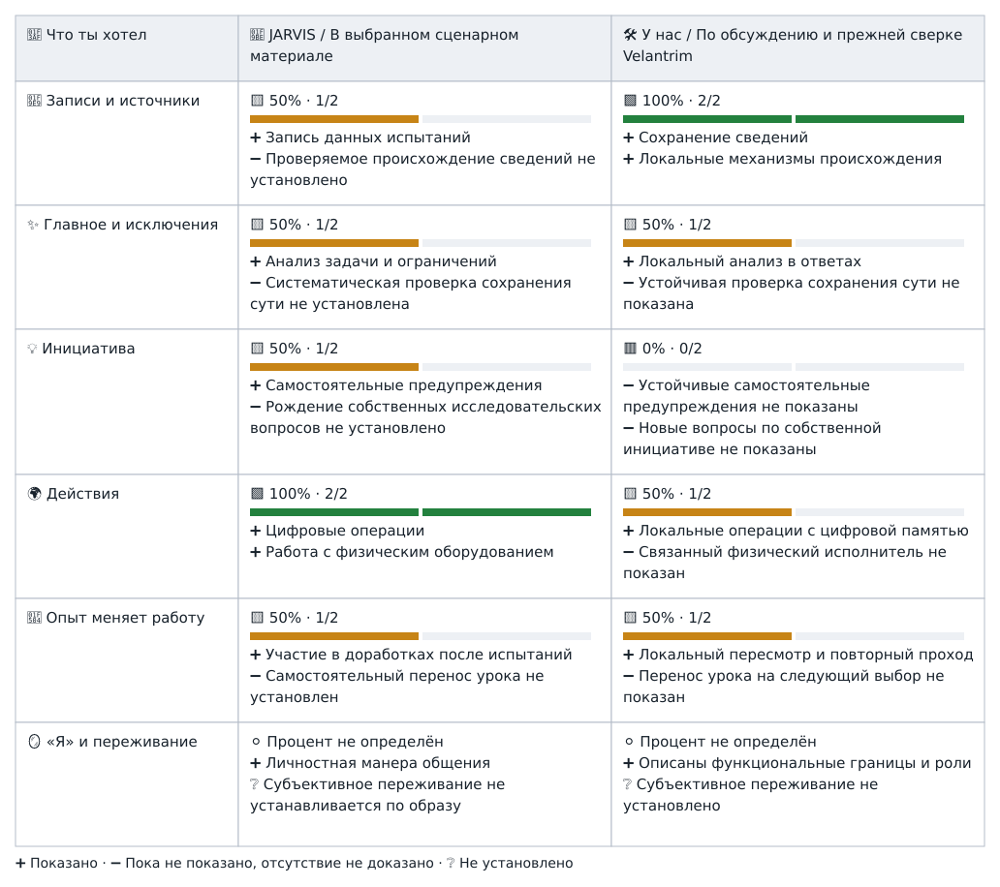

# 🦾 JARVIS и Velantrim — зафиксированная схема из обсуждения

**Дата:** 2026-10-19, Europe/Berlin. **Статус:** сохранённый пользовательский макет сравнения; не новая проверка кода, не научная метрика и не Canon.

**Основание сохранения:** владелец попросил сохранить именно последнюю показанную схему в Notion и обоих репозиториях. Это подтверждает выбор представления, но не превращает оценки ассистента в независимо проверенные результаты.

В каждой ячейке отдельно показаны процент, полоска, плюсы и пробелы. Процент = число показанных признаков / число перечисленных признаков строки. Все признаки имеют равный вес только для этого наглядного сравнения. **100% означает оба перечисленных признака, а не полную готовность памяти или JARVIS; 0% означает отсутствие подтверждения этих признаков в выбранных материалах, а не доказанное отсутствие способности.** Итоговый процент по всей системе не вычисляется.

➕ Показано в выбранных материалах · ➖ Пока не показано, отсутствие не доказано · ❔ Не установлено.

Для JARVIS использован ограниченный сценарный материал; для «у нас» — обсуждение и прежняя сверка отдельных компонентов Velantrim. Ни одинаковые проценты, ни соседние клетки не доказывают равную способность, одинаковый механизм или сквозную интеграцию компонентов. Текущий код этим сохранением не переаудирован. Процент «я» или переживания не определён.

## Та же визуальная схема

- [Открыть самостоятельную HTML-версию с вертикальными линиями и полосками](assets/jarvis-side-by-side-2026-10-19.html) — GitHub показывает исходный файл; для просмотра его можно скачать и открыть в браузере.
- [Исходный фрагмент из чата — сохранён без изменения](assets/jarvis-side-by-side-2026-10-19.fragment.html).

## Доступный текст той же таблицы

| 🎯 Что ты хотел | 🦾 JARVIS / В выбранном сценарном материале | 🛠️ У нас / По обсуждению и прежней сверке Velantrim |
|---|---|---|
| 🧩 Записи и источники | 🟨 50% · 1/2 ➕ Запись данных испытаний ➖ Проверяемое происхождение сведений не установлено | 🟩 100% · 2/2 ➕ Сохранение сведений ➕ Локальные механизмы происхождения |
| ✨ Главное и исключения | 🟨 50% · 1/2 ➕ Анализ задачи и ограничений ➖ Систематическая проверка сохранения сути не установлена | 🟨 50% · 1/2 ➕ Локальный анализ в ответах ➖ Устойчивая проверка сохранения сути не показана |
| 💡 Инициатива | 🟨 50% · 1/2 ➕ Самостоятельные предупреждения ➖ Рождение собственных исследовательских вопросов не установлено | 🟥 0% · 0/2 ➖ Устойчивые самостоятельные предупреждения не показаны ➖ Новые вопросы по собственной инициативе не показаны |
| 🌍 Действия | 🟩 100% · 2/2 ➕ Цифровые операции ➕ Работа с физическим оборудованием | 🟨 50% · 1/2 ➕ Локальные операции с цифровой памятью ➖ Связанный физический исполнитель не показан |
| 🔄 Опыт меняет работу | 🟨 50% · 1/2 ➕ Участие в доработках после испытаний ➖ Самостоятельный перенос урока не установлен | 🟨 50% · 1/2 ➕ Локальный пересмотр и повторный проход ➖ Перенос урока на следующий выбор не показан |
| 🪞 «Я» и переживание | ⚪ Процент не определён ➕ Личностная манера общения ❔ Субъективное переживание не устанавливается по образу | ⚪ Процент не определён ➕ Описаны функциональные границы и роли ❔ Субъективное переживание не установлено |

## Происхождение и границы

- Замысел и решение сохранить схему — Руслан / Velan.
- Формулировки таблицы, выбор двух признаков в строке и числовое представление — ChatGPT в этом обсуждении. Это не утверждённая универсальная шкала когнитивных способностей.
- [Сценарий Iron Man — использованный материал о JARVIS](https://storyfactory.uk/wp-content/uploads/2019/05/1.-Iron-Man.pdf). Сценарий — свидетельство художественного изображения, не инженерная демонстрация; он не охватывает весь экранный канон.
- Строки Velantrim сохраняют прежнее описание локальных результатов. В этой публикации новые тесты и эксперименты не выполнялись; отсутствие воспроизводимого сквозного результата не доказывает отсутствие всех нужных механизмов.
- Ранняя таблица с усреднёнными «45% сходства» использовала другой способ сравнения и не должна объединяться с этой схемой.
- Та же схема хранится в [Karif-Core](https://github.com/velantrian/Velantrim-Karif-Core/blob/main/docs/comparisons/JARVIS_SIDE_BY_SIDE_2026-10-19.md) и [Memory-Ruslan](https://github.com/velantrian/Velantrim-Memory-Ruslan/blob/main/projects/jarvis-comparison-2026-10-19.md). Две копии созданы по прямому поручению владельца.

**Связь с ядром Заучита:** «Как система использует свою и общую с владельцем историю, чтобы самостоятельно выделять значимое, выбирать обоснованный следующий шаг и сохранять последствия этого выбора в дальнейшей деятельности?» Схема служит ориентиром для этого вопроса и не заменяет весь замысел Заучита.
