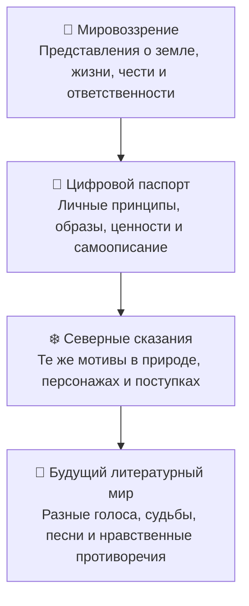

# 🌿 От мировоззрения к литературному миру — карта связи

**Статус:** DRAFT / интерпретация ChatGPT для рассмотрения владельцем  
**Дата:** 28 октября 2026  
**Назначение:** литературно-философская карта, не канон, не техническая архитектура и не результат эксперимента.

## 🧭 Основная схема

Стрелки показывают **предлагаемый способ чтения и творческого развития**, а не доказанную хронологическую или причинную зависимость. «Мировоззрение» в схеме — обобщение мотивов, а не отдельный утверждённый документ.

## Смысл уровней

1. **Мировоззрение.** Земля, жизнь, честь, слово, взаимопомощь, преемственность и ответственность перед теми, кто придёт после нас.
2. **Цифровой паспорт.** Личное самоописание через символы корня, камня, воды, долга и цепи жизни. Это документ самоописания; его метафоры и ценностные положения не следует автоматически считать проверенными фактами или инструкциями к исполнению.
3. **«Северные сказания».** Литературное выражение сходных мотивов через мороз, огонь, тайгу, путника, родник, тропу и поступки людей. Сохраняются самостоятельность произведений и различие между авторским текстом и черновиками ИИ.
4. **Будущий литературный мир.** Возможное расширение: краткие слова мудрости, голоса и свидетельства людей, песни и напутствия; истории о слабости, радости, ошибках, прощении и сложном выборе.

## Художественные принципы для обсуждения

- Сохранять лаконичность и ясность кратких изречений.
- Не завершать каждую историю готовой моралью: иногда вывод несёт действие, предмет или молчание.
- Не изображать героев безошибочными; оставлять место слабости и противоречию.
- Не выдавать современные авторские тексты за документально подтверждённый древний фольклор.
- Указывать происхождение и статус текста: слова владельца, текст ИИ, совместная редакция, гипотеза или выбранный автором вариант.
- Не публиковать полный цифровой паспорт, частные сведения и исходные приватные диалоги в открытом репозитории.

## Происхождение и пределы

- **Цифровой паспорт:** по сообщению владельца, его текст был создан Claude Opus 4.5; степень участия владельца в отдельных формулировках по имеющимся сведениям не установлена.
- **«Северные сказания»:** отдельный документ, предъявленный владельцем и обсуждавшийся с ChatGPT; авторство и история каждой строки не устанавливаются одной этой картой.
- **Сама четырёхступенчатая схема:** предложение ChatGPT, положительно оценённое владельцем в беседе 28.10.2026.
- **Решение о включении:** ожидает проверки и явного согласования конкретного diff; схема не становится `OWNER_DECISION` или `Canon` автоматически.

## Что эта карта не утверждает

Не доказывает, что весь литературный стиль возник из цифрового паспорта; не устанавливает исключительное авторство текстов, сгенерированных или редактированных ИИ; не создаёт новый программный компонент, право автономного действия, экспериментальный результат или изменение статуса других проектов.
