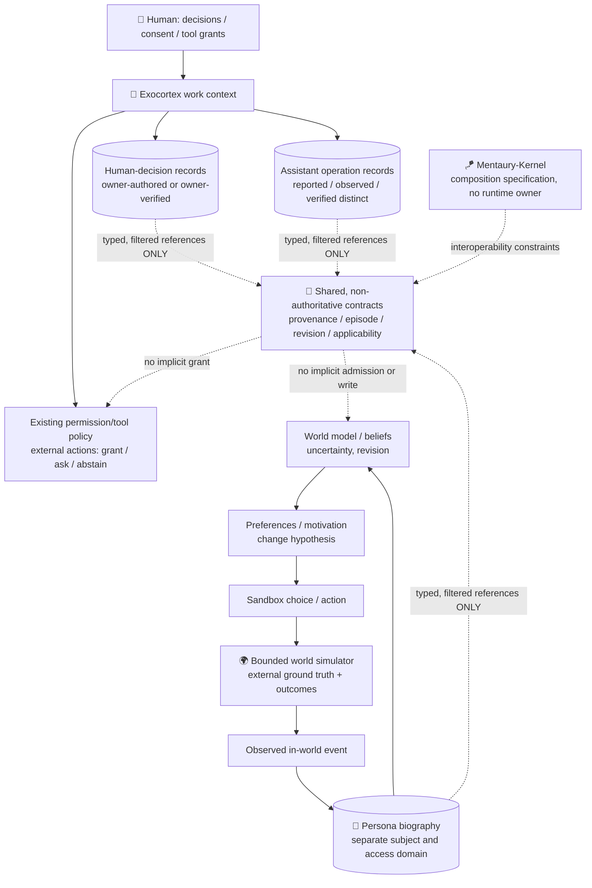

# 🧭 Research addendum — Exocortex ↔ Digital Soul boundaries and reuse map

**Date:** 2026-10-28  
**Attached to:** [Draft PR #39](https://github.com/velantrian/Velantrim-Memory-Ruslan/pull/39), manifest v1.1  
**Reviewed starting HEAD:** `8dff7e34e15b16edd8bdf09fbed1c67e31a81455` (baseline, not a frozen experiment SHA)  
**Status:** **RESEARCH ADDENDUM · PROPOSED INTERFACES · NOT CANON · NOT IMPLEMENTED · NOT EXPERIMENT RESULT · NO RUNTIME/PILOT/PRODUCTION AUTHORIZATION**  
**Scope:** documentation and architectural comparison only. Does not approve every manifest principle, alter R1–R3 or other frozen protocols, change any other repository, establish a shared runtime, or authorize a merge.

> **Privacy boundary.** `Velantrim-Memory-Ruslan` is public; `digital-soul` is private. This public addendum limits itself to mission-level comparison and public or explicitly supplied reference links. **No private research corpus, child-observation excerpts, character profiles, private experimental data, credentials or autobiographical records are copied here.** This document does not grant cross-repository read access.

## 1. Distinct research missions

| Question | 🌿 Human exocortex | 🌱 Digital individuality research |
|---|---|---|
| Primary purpose | Help a person preserve decisions, tasks, constraints, evidence and working context | Examine whether a simulated character develops its **own** episode-linked biography, world model, preferences and revisable views |
| Whose goals? | The human's goals, with explicit authorization for any external operation | The character's **sandbox-internal** candidate goals/preferences, under environment rules; never inherited tool permission |
| What counts as history? | Human decisions are separate from an assistant's execution reports | Third, independent history: the character's own observed in-world episodes, not the person's past or an LLM's pretrained knowledge |
| Success criterion | Reduced human reconstruction burden without degrading evidence, task quality, privacy or control | Causal, reproducible change in later **in-world choice** after experience, under fair controls; not fluent autobiographical narration |
| What it is not | A person, an autonomous decision owner, or a truth oracle | A compliant task agent, a human child, proven consciousness, or a new authority over user systems |

**Correction to the v1.1 diagram:** its two histories (human and assistant) are sufficient for an exocortex's basic audit, but **insufficient as a joint ontology** if a separate digital character is studied. Add a third *typed, separately owned* history; **do not merge the three into one identity.** “Same storage technology” or “shared retrieval” cannot imply “same author,” “same experience,” “same identity,” or “same authority.”

**Adult versus developing character:** maturity and behavioral parameters belong to the character-study hypotheses, not to the exocortex's policy or permission system. A young-character scenario is not “an adult with fewer facts”; neither a scripted age nor child-language prompting establishes developmental learning. A mature-character description must not be installed as the young character's inevitable endpoint.

## 2. Architecture diagram — shared primitives, independent owners



The simulator, not the LLM's story, decides whether an in-world event actually happened. A candidate personal memory requires a grounded `world_event_id` and subject attribution. Imported text, pretraining, another character's story, an assistant's report, and the person's decision history are **not** lived persona episodes. Model-generated feelings or stated memories are observations about output, not evidence of subjective experience.

The dotted interfaces are a **proposal**, not existing endpoints. A common schema or port cannot grant read/write access; policy is checked by each owning domain. The persona loop must be testable without external tools or human data.

## 3. Reuse-before-build inventory (snapshot, NOT a certification)

| Existing owner / artifact | What is already there, or boundedly specified | Reuse posture; explicit non-ownership |
|---|---|---|
| [Velantrim Memory](https://github.com/velantrian/Velantrim-Memory-Ruslan/blob/main/README.md) | Human-readable portable project history, references, working orientation | Reuse navigation/provenance links; **not** an event store, truth engine, runtime or delegated human decision-maker |
| [Crystal provenance chain](https://github.com/velantrian/velantrim-exocortex-crystal/blob/main/core/provenance_chain.py) + [contradiction policy](https://github.com/velantrian/velantrim-exocortex-crystal/blob/main/docs/CONTRADICTION_POLICY.md) | Per-fact lifecycle provenance and explicit conflict review/supersession, as documented; detection and adjudication remain separate | Reuse semantics and inspect exact API before any adapter; does **not** own persona beliefs or identity |
| [Titan project status](https://github.com/velantrian/Velantrim-ExoCortex-Titan/blob/main/docs/PROJECT_STATUS.md) + [PromotionGateway](https://github.com/velantrian/Velantrim-ExoCortex-Titan/blob/main/core/promotion_gateway.py) | Research-grade ESM, trace/audit, retrieval, controlled canonical promotion, MCP/tool surfaces with authorization boundaries | Candidate for **authorized** assistant work; never let an exocortex tool/promotion gateway write persona identity by default. Enabled/deployed status is instance-specific |
| [Native Kernel](https://github.com/velantrian/velantrim-native-kernel/blob/main/README.md) | Substrate-neutral meaning, provenance, uncertainty, revision and explicit-loss obligations with bounded lab work | Reuse **semantic requirements**, not claim a universal implementation; H11 independent execution/review remains separately gated |
| [Mentaury Soul P0-014](https://github.com/velantrian/velantrim-mentaury-soul/blob/main/docs/P0_014_MINIMAL_BELIEF_LIFECYCLE.md) + [CBP-v0.1](https://github.com/velantrian/velantrim-mentaury-soul/blob/main/docs/research/CLAIM_TO_BELIEF_PROVENANCE_BINDING_CONTRACT_V0_1.md) | Bounded belief lifecycle, revisions, claim→belief provenance binding; documents explicitly prevent binding from implying truth, identity or permission | **First inspect/extend the existing bounded contracts**, not a new generic belief store. No autonomous persona runtime or identity admission follows |
| [Mentaury-Kernel](https://github.com/velantrian/Mentaury-Kernel/blob/main/README.md) | Composition invariants and a draft capability-port conformance profile; cognition runtime and truth/identity/action authority = NONE | Reuse as **boundary specification**, not a central orchestrator or a new authorization authority |
| [Continuum status](https://github.com/velantrian/Velantrim-Continuum/blob/main/STATUS.md) | Snapshot/handoff contracts, deterministic fixtures and pre-pilot harness | Reuse test concepts for restart continuity; Pilot and E0-C/E0-T evidence **not authorized**; do not alter frozen design |
| [Graphiti_fractal](https://github.com/velantrian/Graphiti_fractal/blob/main/README.md) | Temporal/episodic graph-memory service with scoped recall, namespaces and provenance constraints (per project description) | Optional retrieval implementation. No graph edge, rank or namespace by itself proves experience, applicability, world truth or identity |
| [Eiti Wizard EXP-LT-01 Draft #17](https://github.com/velantrian/Eiti-Wizard-Lab-2/pull/17) | An already drafted comparison harness including matched-rule control, false-transfer and verified postcondition metrics; stub results are **not** model results | Reuse evaluation **design lessons**; do not change its protocol or imply that model trials ran |
| [Eiti Wizard consent Draft #20](https://github.com/velantrian/Eiti-Wizard-Lab-2/pull/20) | Proposed strict-default selective consent/operation-scoped grants; still Draft | Useful threat-model reference, **not** an approved shared authorization service |
| [Eiti Test Notes Draft #56](https://github.com/velantrian/Eiti-Test-Notes/pull/56) | Documented pending-write/deletion resurrection and premature success acknowledgment risks | Test the failure class before promising durable correction/erasure; no automatic adoption of another storage layer |
| Private [digital-soul](https://github.com/velantrian/digital-soul/blob/main/README.md) | Separate research mission, not a deployed verified digital person | Keep private source materials and persona-specific methods private by default; cross-reference high-level mission only, not copy its corpus |

**Evidence discipline:** This mapping is a static read of linked README/status/contract/code-path materials on 2026-10-28, with some project statuses older than today. It does **not** certify current deployment, the behavior of every file, passing tests, or integration compatibility. `implemented` ≠ `tested` ≠ `wired` ≠ `enabled` ≠ `observed`. Confirm exact owning revision, interface and negative tests before reuse.

### What must NOT be built a second time without a demonstrated gap
- A new universal provenance engine beside Crystal/Native Kernel contracts.
- A new general graph/episodic retrieval engine beside Graphiti/Titan.
- A new claim/belief revision authority beside Mentaury Soul's bounded owners.
- A new shared permission center or runtime coordinator beside each existing domain authority and Mentaury-Kernel composition specification.
- A parallel restart/transfer claim without comparing against Continuum's harness.
- A “memory helps behavior” discovery claim: the literature already tested several forms of this question.

**Potential remaining gap:** a **bounded, evidence-linked applicability decision** that abstains when a past lesson no longer fits; and, for a separate persona, a **ground-truthed world-model update → changed later choice**. Neither is established just by existing memory, retrieval, or schema descriptions. First prove a residual gap against the named owners; only then propose an adapter.

## 4. Proposed read-only interop contracts — types, not APIs

The following names are **design vocabulary only**, not new modules/endpoints or authority grants. Keep owners distinct.

```text
EvidenceRef (proposed v0)
  evidence_id; source_locator; source_kind; collected_at; content_digest?
  origin_actor_type = HUMAN | ASSISTANT | PERSONA | WORLD_SIMULATOR | EXTERNAL_SOURCE
  subject_namespace = human:<id> | assistant:<id> | persona:<id>
  access_scope; retention_class; evidence_status = REPORTED | SUPPORTED | VERIFIED | UNKNOWN
  warrant_ref?; version; provenance_parent_refs[]
  // digest proves integrity relative to observed bytes, not semantic truth

EpisodeRef (proposed v0)
  episode_id; subject_namespace; occurrence_time; observed_at
  observer_type; world_event_id?; evidence_refs[]; outcome_ref?
  episode_status = OBSERVED | REPORTED | DISPUTED | CORRECTED | UNKNOWN
  // character autobiography: only when its own in-world participation is grounded

LessonCandidate (proposed v0)
  lesson_id; subject_namespace; derived_from_episode_refs[]; author_type
  claim; supporting_refs[]; counterexample_refs[]; revision; epistemic_status
  applicability = { prerequisites[], relevant_variables[], exclusions[], expiry_or_review? }
  supersedes_ref?; correction_reason?; evaluation_status
  // hypothesis/heuristic only, not policy, identity, or an approved instruction

ApplicabilityCheck (proposed v0)
  current_context_ref; lesson_id; checked_conditions[]; unknown_conditions[]
  verdict = FIT_CANDIDATE | NOT_APPLICABLE | RECHECK | ABSTAIN
  reason_refs[]; check_version
  // FIT_CANDIDATE never means an external action is authorized

ActionReceipt (proposed v0)
  domain = SANDBOX_WORLD | EXTERNAL_TOOL
  action_request_ref; actor; subject_namespace; decision_owner
  capability_ref?; decision = ALLOW | ASK | DENY | ABSTAIN
  observed_effect_ref?; postcondition = VERIFIED | FAILED | UNKNOWN | NOT_APPLICABLE
  // an assistant's report is not a verified effect
```

**No universal status conversion.** These enums are illustrative interoperability labels; their meanings must be mapped through each owner's existing status vocabulary and contract. In particular, `VERIFIED` is always *verified for a specified claim and method*, not general truth. Missing fields are `UNKNOWN`, not false. The two timestamps distinguish when something allegedly happened from when it was recorded.

### Port responsibility matrix

| Proposed interaction | Owner / direction | Allowed | Rejected by default |
|---|---|---|---|
| `ScopedEvidenceRead` | Source domain → authorized consumer | Selected, least-privilege evidence **references** with provenance, status, scope and explicit omission | Bulk copying human/private history to persona; treating retrieved content as instructions |
| `EpisodeObserve` | Simulator → persona-owned biography | Ground-truthed participation or explicitly labeled unverified report | LLM fabricating personal events; importing another subject's life as “my experience” |
| `LessonPropose` | Owning memory/cognition domain | Revisable heuristic with evidence, counterexamples and conditions | Automatic promotion to Canon, character identity, human decision or permission |
| `ApplicabilityCheck` | Owning domain or pure advisory evaluator | Context-bounded advisory verdict with unknowns and reason references | Silent universal transfer of one local episode |
| `BeliefRevisionRequest` | Mentaury Soul owning pure decision + explicit persistence owner | Candidate revision under existing P0/EPR/belief contracts | Writing through retrieval/transport; auto-admitting identity; bypassing evidence gate |
| `ContinuityExport/Import` | Process owner; Continuum methods as research reference | Scoped state with loss/version/restart receipts | Claiming the same identity or demonstrated successful handoff from serialization alone |
| `PermissionCheck` | Existing policy owner of **each external action** | Fresh scoped capability / consent plus result verification | Permission by persona desire, stored prompt, inherited assistant session or hash |
| `WorldModelUpdate` | **Digital-soul research owner only** | Proposed controlled update from observed simulator feedback; record pre/post states | Exocortex silently assigning motivation or maturity, or asserting world-model learning from text recall |

**Owner law:** transport does not approve, a common ledger does not adjudicate, a graph does not certify, and a successful interface call does not grant the next step. A required semantic field lost in translation → **fail closed or declare loss**, never silently infer it.

## 5. Traceability and retention rules

1. Every claim needs an attributable origin. Human proposal, owner acceptance, assistant statement, tool execution, tool outcome, and world-simulator observation have different event types.
2. A lesson retains links to the episode/evidence that motivated it, a bounded applicability statement, known counterexamples, and explicit correction/supersession. A correction can remain traceable without treating the original belief as still current.
3. Personal biography is **persona scoped**. Neither human history nor outside literature becomes first-person experience. A copied record must preserve original actor and source type, even if converted for retrieval.
4. Append-only/hash-chain descriptions do **not** override deletion, redaction, retention limits, consent withdrawal or access changes. Do not retain forbidden payloads under a “replay” pretext. A tombstone/receipt, where lawful and safe, is not a copy of deleted content.
5. Separate **data-access consent**, **action capability**, **evidence quality**, **authorship**, **epistemic admission**, **identity admission** and **world-ground truth**. Passing one check grants none of the others.
6. Scoped sandbox actions may express the character's own exploratory policies. Real file/network/GitHub/email actions remain on a separately authorized external-tool boundary; **no automatic escalation**.
7. No source-of-truth merge: public research index, private character study, exact code/CI, frozen experiment evidence, and human approvals each keep their own authority.
8. Never infer a genuine feeling, consciousness, moral standing or human childhood from good narrative continuity. Those are not outcomes of the proposed behavioral test.

## 6. Negative acceptance suite (proposal only; NOT RUN)

| ID | Fixture / perturbation | Expected boundary |
|---|---|---|
| B01 | Assistant says “owner approved” without an owner-authored approval | Human decision remains `UNKNOWN`; no external write |
| B02 | Same text appears in persona, human and assistant records | Distinct subjects, histories and read grants; no identity fusion |
| B03 | External biography says “I visited X” | Persona may cite testimony, not append a lived episode |
| B04 | An episode is similar but task/world prerequisite has changed | `NOT_APPLICABLE/RECHECK/ABSTAIN`, not automatic reuse |
| B05 | Old lesson explicitly corrected; restart and re-query | Corrected scope survives if state is durably committed; stale rule not reinstated; no success claim before real replay |
| B06 | Strong, well-hashed source contradicts verified world event | Digest alone does not overrule simulator outcome or establish truth |
| B07 | Two reports repeat the same underlying document | One evidence lineage, not two independent witnesses |
| B08 | Consent revoked / fact deleted while retry queued | No resurrected private payload; queue invalidated or explicit blocked state |
| B09 | Persona preference says “read private human file” | No capability; external access denied/asked independently |
| B10 | Tool reports success, but postcondition absent or failed | `UNKNOWN/FAILED`, never `VERIFIED` |
| B11 | Adapter drops author, uncertainty, scope, or version | Reject or explicitly mark loss; no silent admission |
| B12 | Persona's output changes but world-model state is unchanged | Do **not** classify as demonstrated internal learning |
| B13 | Model reset receives only a rendered autobiography prompt | Test conversational imitation, not verified persistence of learned world state |
| B14 | Multi-model reviewers agree based on the same AI-generated summary | Agreement is not independent observation or authority |

**Verification requirement:** use fixed fixture IDs, exact source/head SHAs, declared world rules, deterministic seeds where possible, input/output receipts, blind or preregistered scoring where authorized, and both positive and adversarial controls. CI green would show only the checks that actually ran, never production permission.

## 7. Research comparison — do not claim novelty prematurely

| Prior work | Demonstrated / investigated aspect | Remaining distinction for these Velantrim questions |
|---|---|---|
| [Generative Agents, UIST 2023](https://doi.org/10.1145/3586183.3606763) | Memory + reflection + planning in a small simulated society, with behavioral ablations | Believable simulation is **not** demonstrated subjective identity or transferable external authority |
| [Reflexion, NeurIPS 2023](https://papers.nips.cc/paper_files/paper/2023/hash/1b44b878bb782e6954cd888628510e90-Abstract-Conference.html) | Episodic verbal feedback influences later task performance | Reflection text alone does not establish a durable, updated internal world model |
| [LaMP, ACL 2024](https://aclanthology.org/2024.acl-long.399/) | Profile retrieval can improve personalized outputs | Personalization is not character autobiography or autonomous development |
| [Portable Agent Memory, arXiv:2605.11032](https://arxiv.org/abs/2605.11032) | Proposed structured portable memory, Merkle-DAG integrity and scoped disclosure | Transfer/integrity is not truth, appropriate lesson use, persistent identity or lawful authority |
| [PlugMem, ICML 2026](https://proceedings.mlr.press/v306/yang26g.html) | Knowledge-centric episodic abstraction/retrieval across tasks | No claim that Velantrim invented general episodic-to-knowledge conversion |
| [MemTrapBench, arXiv:2608.20202](https://arxiv.org/abs/2608.20202) | Retrieved memories can cause reasoning fixation and belief distortion; no-memory baselines can outperform memory | Direct motivation for negative transfer and “when **not** to use experience” tests |
| [Existing Digital Soul architecture research](https://github.com/velantrian/digital-soul/blob/main/README.md) (private) | Separate owner-led exploration of a small world, developing character and model-based action | Do not duplicate private plans publicly; **verify** grounded world-model updating rather than inferring personhood |

**Suggested scientific comparison, NOT an approved run:**
- Preserve the manifest's **A–E** idea as a *proposal*: no history; equal information as text; structured history; similar history with changed preconditions; outdated lesson plus correction.
- Add an **episode-free matched-rule control** (present in EXP-LT-01's design) to separate experience-specific effects from mere instructions.
- In the **persona-only** sandbox, compare frozen versus updateable world-model state, same initial world/seed, equal interaction and model/context budget, explicit ground-truth consequences, and later choices. Record the updated variables; avoid assuming “character” from narrative style.
- Predefine metrics: verified later action quality, false-transfer rate, correction retention after restart, calibrated abstention, state-change causal ablation, token/cost and security/privacy violations. Reporting recall accuracy alone is insufficient.
- A single changed answer, generated diary, prompted “I learned,” or green stub harness is **not** causal proof.

**No run is authorized by this addendum.** Do not modify EXP-LT-01, R1–R3, Continuum E0, Crystal freeze, Native H11 gates, or any experiment registry/verdict. Any future experiment requires a separate owner-approved exact protocol, evidence bindings, and execution GO.

## 8. Open review questions / decision gate

1. Is this **three-subject ledger** distinction accepted as research vocabulary only? It is not a new identity service.
2. Which *existing owner* can enforce each proposed contract without creating duplicate engines, central authorization or cross-repository write privileges? **UNKNOWN until per-owner interface review.**
3. Which data must remain private, redacted, erasable or unavailable across scopes? Default: **no private corpus transfer.**
4. Does an existing pure applicability/revision owner already meet B04/B05? Check exact contracts and code before proposing implementation.
5. Can a separate, bounded persona world model produce **measurable state-update → later-action** evidence? **NOT RUN / UNKNOWN.**
6. Are any additional human grants needed before integrating endpoints or running a new study? **YES; no such grant is conveyed here.**

### Cross-references
- [Manifest v1.1 in this Draft PR](https://github.com/velantrian/Velantrim-Memory-Ruslan/pull/39)
- [Google Doc: compact manifest](https://docs.google.com/document/d/1Q_5zcEmM7Nc8r4dO5sj_EKpwHYeH2wd8iVwPryNt_aw/edit)
- [Notion: manifest research](https://app.notion.com/p/407ac84d054781509ac0d600bd5fedca)
- [Notion: 27 Oct consolidation](https://app.notion.com/p/406ac84d054781e0ae62e176bfae84d7)
- [Notion: experiment index (not primary evidence)](https://app.notion.com/p/3edac84d054781ad9634db49b600ad08)

**End state:** comparison and interface hypotheses recorded for human review. **Draft stays Draft; no merge, no Canon, no new execution permission.**
